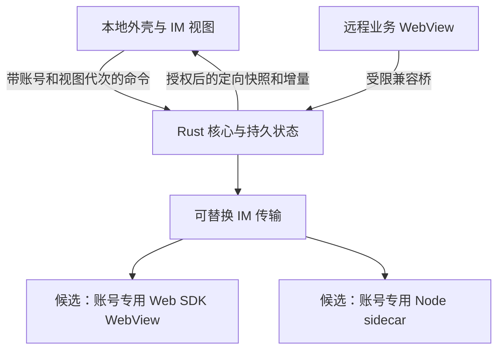

# 旅游商家客户端重构架构选型

2026-10-30 · 最终文档审查修订

## 决策：Tauri 2 + Rust 为首选，先验证 Windows 关键路径

选择 Tauri 2 + Rust 作为开发候选，Windows 先行、macOS 后续适配。目标是减少不必要的常驻页面、移除远程页面的宽泛本机权限，并把消息一致性和计时放在可恢复的核心服务中。**框架替换本身不保证内存减半、消除卡顿或兼容全部业务页。** 是否正式冻结该选型，取决于本文的 G0 可行性关口。

C# + WebView2 仍是 Windows 端备选；Swift 原生外壳也是 macOS 备选。双原生会增加界面与系统集成维护面，但并不必然需要两支团队或全部业务逻辑重写。当前优先 Tauri 是工程复用取舍，不是已通过性能对照的事实。

## 证据边界

| 输入 | 可得结论 | 不可外推 |
| --- | --- | --- |
| 上传的 Windows 1.2.12 包及后续源码核对 | 官方主入口、业务外壳、Node IM SDK、预加载桥与静态接口可分析 | 某接口当前必然可用、服务端幂等、全部账号角色相同 |
| 早期 macOS 包的框架与配置 | 该包为 x64 Electron 27.3.11 / Chromium 118；Swift 启动器与 companion 属于助手插件 | 所有官方发行渠道都只有 x64；Mac 业务逻辑与 Windows 完全一致 |
| [Windows 实机审查](reviews/2026-10-30-windows-adversarial-review.md) | 双账号、已安装助手的短时进程样本与源码指纹 | 纯官方性能基线、长期泄漏或具体性能瓶颈的因果关系 |
| [网页 IM 调查](research/2026-10-30-web-im-observation.md) | 官方网页登录与 XMPP over WSS 自然入站有实测 | Tauri 登录已通过、发送闭环已通过、隐藏 WebView 可替代后台进程 |

早期“缺少 app.asar、需补传才能分析”的判断仅描述当时输入，现已被 Windows 静态调查补齐；macOS 差异仍须按实际部署包与运行环境验收。旧在线稿 <https://claude.ai/artifact/QHSVMTyuYE4mE4ZyaEc3bT> 只作历史参考，不作为开发契约。

## 复用边界

| 组成 | 新方案 |
| --- | --- |
| 远程 vbooking 内容 | 尽量复用线上页面与业务接口；顶层子 WebView 承载，逐入口验证导航、登录、上传、下载与兼容桥，不承诺原样运行 |
| 本地业务外壳 | 重写账号导航与标签；8 个入口为 home、order、product、comment、bulletin、course、event、data（bi 别名） |
| 本地 IM 界面 | 重写；UI、业务 HTTP 与实时传输分别选型，不照搬旧页面 |
| 实时传输 | Web SDK 传输 WebView 与 Node sidecar 做同场景原型；Rust 原生 XMPP 为后续候选，见 [IM 决策](decisions/2026-10-30-im-transport.md) |
| Electron 主进程、preload、Node 特权 API | 由 Rust 核心和窄桥替代；不移植关闭 Web 安全、移除 CSP/X-Frame-Options 或关闭 TLS 验证的做法 |
| 助手的 Swift 启动器与 CDP 注入 | 相关产品功能内置；不保留生产调试端口。进程监督按最终传输路线决定 |

## 目标结构与取舍

| 维度 | Tauri 2 + Rust 方案 | 约束 |
| --- | --- | --- |
| 页面运行时 | Windows WebView2；macOS WKWebView | Chromium 同源不代表 Cookie、Profile、API、风控或嵌入场景等价；WKWebView另测 |
| 业务状态 | Rust 统一持有本地业务状态、持久化、提醒与恢复进度 | 上游状态仍以服务端为准；传输 SDK 有独立内部状态，须对账；UI 可保留临时展示状态 |
| 多账号 | 账号独立浏览器存储与数据库命名空间 | 同环境多 Profile 需适配验证；独立数据目录是可行性兜底，会增加进程组 |
| 包体与内存 | 不随包分发 Electron；控制页面和传输资源 | Node、WebView2 离线运行时、模型与平台组件另计；≤45 MB/≤30 MB 是目标而非保证 |
| 发布 | Windows NSIS 首选；macOS 签名与公证 | OCR 的包身份方案、更新链、深链与通知均须在正式安装产物上验证；Tauri 默认 Windows 打包是 NSIS/MSI，MSIX不是无成本默认项 |

## G0：冻结平台与接口前的可行性关口

| 关口 | 必需证据 | 失败后的处理 |
| --- | --- | --- |
| G1 登录与隔离 | 在目标 WebView2 完成官方登录；两账号 Cookie/Profile隔离；登出后旧请求不能复活凭据 | 评估登录接口路线或独立数据目录；不以 Ego 登录成功代替嵌入式验收 |
| G2 页面与系统集成 | 8 业务入口的兼容桥、microApp 回调、POST 新窗、下载、焦点/DPI；多子 WebView 与恢复 | 子视图失败转独立窗口；冻结所用 Tauri/wry 版本及补丁维护方案 |
| G3 消息正确性 | 测试会话收发/回执、稳定 localId、未知结果、补拉水位、多账号、锁屏/睡眠/断网恢复 | 保留 unknown；未证明幂等不得自动补发；原型后选择传输 |
| G4 安装能力 | 普通用户干净机验证 Runtime、OCR、通知激活、深链、监视器和卸载 | 改引擎或安装方式，不以开发机环境代替交付能力 |
| G5 数据与更新 | 账号隔离恢复、迁移重试保护新数据、可信更新策略、防回滚重放 | 阻断对应发布能力，不通过清库、覆盖安装或关闭验证兜底 |

当前授权仍为文档审查；这轮未实现这些原型。可以进入 G0 验证和不依赖未决项的基础开发，不能将所有关口写成已通过后并行铺开全部模块。实施契约见 [开发总纲](dev/00-architecture.md)，历史风险见 [Windows 审查](reviews/2026-10-30-windows-adversarial-review.md)。

## 平台支持口径

本项目主动不支持 Windows 7/8.1，最低候选 Windows 10 1809，实际发布支持矩阵须结合所选 Runtime/依赖与操作系统维护状态确定。不能写成“Tauri 2 本身不支持 Windows 7”：其官方安装文档仍记录兼容选项；这与采用过期 Runtime 是否可接受是两个问题。[Tauri Windows 安装](https://v2.tauri.app/distribute/windows-installer/)

性能以相同机器、账号数、页面和功能对照实测；正式签名提升发布可信度，但 EV 签名不保证免除 SmartScreen 提示。[Tauri Windows 签名](https://v2.tauri.app/distribute/sign/windows/) 多 WebView 和用户数据目录的进程成本按实际拓扑计入。[Microsoft 进程模型](https://learn.microsoft.com/en-us/microsoft-edge/webview2/concepts/process-model)
