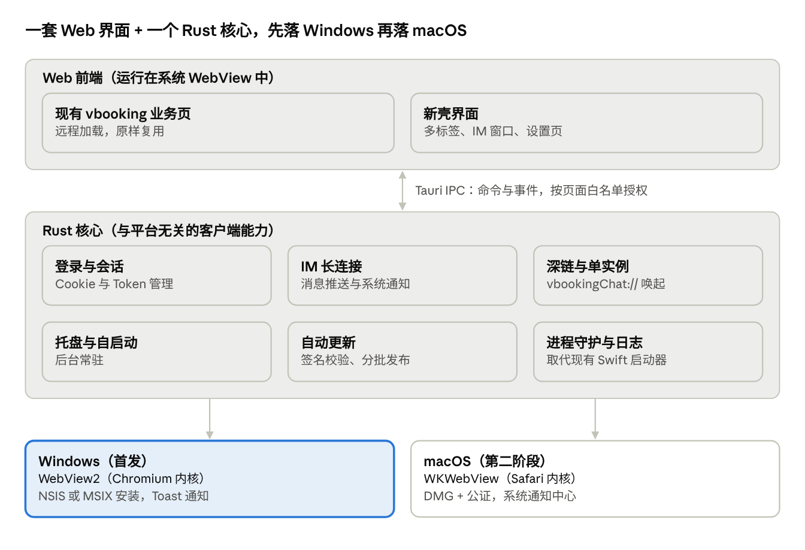
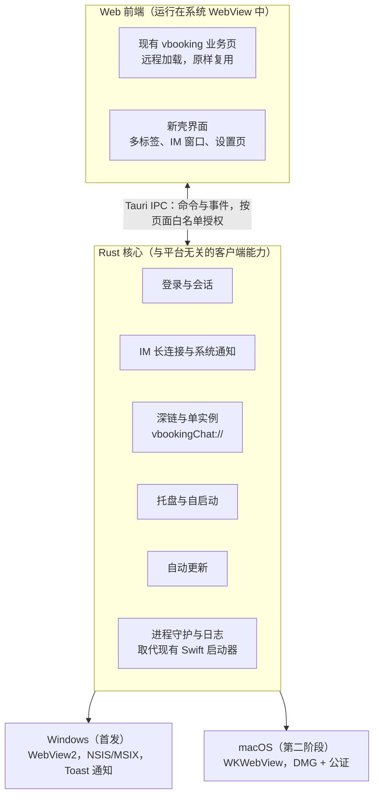

# 旅游商家客户端重构架构选型

2026-10-30 · 在线版本（含评论）：<https://claude.ai/artifact/QHSVMTyuYE4mE4ZyaEc3bT>

> **更正（2026-10-30）**：下文的 Swift 启动器、IM 伴随进程（companion）和 CDP 调试端口属于用户自己的插件「旅游商家助手」注入包，不是携程官方客户端的组成部分。官方客户端的实际缺陷与复用范围的修正见 [02 现有客户端缺陷分析](02-current-client-defects.md)。

## 结论：选 Tauri 2 + Rust，Windows 先行

推荐 Tauri 2 + Rust 作为统一架构，先做 Windows，macOS 第二阶段跟进。现有客户端是 Electron 壳，业务界面是 Web（vbooking 商家后台 + IM），Tauri 可以直接复用这些页面；Windows 上 Tauri 用的 WebView2 和现在的 Electron 同为 Chromium 内核，迁移风险最低。

C# + Swift 双原生意味着两支团队、每个功能做两遍，而业务页面大概率仍要嵌入 WebView2 / WKWebView，原生带来的收益抵不上翻倍的成本。

只有两种情况我会改推 C#（WinUI 3 或 WPF + WebView2）：决定放弃 macOS 只做 Windows，或决定把商家后台主要界面全部原生重写。

### 复用边界

- **复用**：业务页面（vbooking 后台、IM 界面等 Web 部分），原样在 WebView 中运行。
- **用 Rust 重写，不复用**：Electron 主进程、preload、ipcRenderer 与 Node API 调用、Swift 启动器、靠 CDP 控制页面的 IM 伴随进程。
- 边界的具体位置要看 app.asar：页面里调用 Electron/Node 的地方越多，需要改写的前端代码越多。

## 现有客户端拆包结果

上传的 macOS 包是 Electron 27 应用，并已装有插件注入包（Swift 启动器与 IM 伴随进程来自插件）。业务代码（app.asar）不在上传内容里，所以以下结论来自二进制和配置文件。

| 项目 | 发现 | 依据 |
| --- | --- | --- |
| 壳框架 | Electron 27.3.11，Chromium 118.0.5993.159 | Electron Framework 二进制内的版本串 |
| CPU 架构 | Electron 主程序与框架只有 x86_64，只有启动器是 arm64 | file 命令 |
| 启动器（插件） | TripVendorLauncher，Swift + AppKit 编写，由插件注入安装器替换为入口 | Info.plist 的 CFBundleExecutable |
| IM 伴随进程（插件） | 启动器拉起 companion（日志目录 trip_vendor_im_companion），崩溃后自动重启；并给 Electron 开启仅限 127.0.0.1 的 Chromium 远程调试端口 | 启动器字符串 |
| 自动更新 | Squirrel.Mac + electron-updater（generic 源，url 为空） | Frameworks、app-update.yml |
| 标识与版本 | com.ctrip.vbooking，1.2.12，最低 macOS 10.15 | Info.plist |
| 深链接 | vbookingChat:// URL Scheme，推测用于唤起 IM 会话 | Info.plist |
| 权限声明 | 摄像头、麦克风、蓝牙（文案是 Electron 默认模板） | Info.plist |
| 网络策略 | ATS 允许任意 HTTP 加载 | Info.plist |
| 缺失部分 | Resources/app.asar 和 Resources/companion/ | 目录列表 |

对重构有直接影响的三点：

- Chromium 118 是 2023 年的内核，Electron 27 已不再获得安全更新，客户端又允许任意 HTTP，安全面是重构的强理由。
- Electron 只有 x86_64 版本，在 Apple Silicon Mac 上靠 Rosetta 转译运行。
- 插件的 IM 伴随进程通过 Chromium 远程调试协议（CDP）注入页面；新客户端把这些功能做成内置功能，不再需要 CDP。

要梳理具体页面、功能清单和 Electron API 使用情况，需要补传 app.asar。

## 两种方案对比

在“Windows 优先、两端都要、业务是 Web”这三个前提下，Tauri 在成本、复用和 Windows 兼容性上都占优，双原生只在原生体验上更好。

| 维度 | Tauri 2 + Rust | C#（WinUI 3 / WPF）+ Swift |
| --- | --- | --- |
| 代码份数 | 一套 Web 界面 + 一个 Rust 核心，平台差异代码很少 | 两套完整客户端 |
| 团队 | 前端 + 少量 Rust 工程师 | .NET 团队 + Swift 团队 |
| 复用现有 Web 业务页 | 直接复用 | 仍需嵌 WebView，或原生重写 |
| Windows 内核 | WebView2（Chromium），与现 Electron 同源 | 原生 XAML；嵌网页同样用 WebView2 |
| macOS 内核 | WKWebView（Safari），需做兼容测试 | 原生 AppKit / SwiftUI；嵌网页同样是 WKWebView |
| 安装包与内存 | 包体通常只有几 MB 到十几 MB，内存明显低于 Electron | Swift 最小；WinUI 3 自包含发布通常数十 MB |
| 托盘、通知、深链、单实例、自启动 | 官方插件覆盖；特殊需求用 Rust 直调 Win32 / AppKit | 完全原生 |
| 自动更新 | tauri-plugin-updater，自带签名校验 | Windows 自研或 MSIX；macOS 用 Sparkle |
| 现有 IM 伴随进程（依赖 CDP） | Windows 可保留，macOS 须改为 IPC | 同左 |
| 新功能的长期成本 | 做一次 | 做两次，两端容易功能漂移 |
| 主要风险 | Rust 招人；WKWebView 兼容性 | 成本翻倍；macOS 端容易长期落后 |

Windows 单端看，两条路的首版工作量接近；差距出现在 macOS：Tauri 是适配，Swift 是从零再写一遍。

## 目标架构

现在的 Swift 启动器、Electron 主进程和 IM 伴随进程三件事，在新架构里都收进一个 Rust 核心；业务页只通过带白名单的 IPC 调用本地能力，不再暴露调试端口。

## 分阶段计划（本项目做到原型为止）

本项目只产出计划和原型，不落盘真实的前后端代码。

1. 补齐输入：补传 app.asar 和 Resources/companion/，梳理页面清单、Electron API 使用清单、IM 伴随进程的职责。关口：确认业务页是远程加载还是打包在本地。
2. Windows 技术验证方案：列出 Tauri 壳要验证的能力（登录态与 Cookie、vbookingChat:// 深链、系统通知、托盘、单实例、自动更新）和验收标准。关口：现有业务页在 WebView2 中无需改动即可用。
3. IM 与伴随进程方案：决定并入 Rust 核心，还是保留独立进程并改用 IPC。
4. 界面原型：用可点击的 HTML 原型展示新壳的导航、多标签和 IM 窗口，Windows 采用 Fluent 风格。
5. macOS 兼容性评估：在 WKWebView 下跑同一批页面，列出 Safari 兼容问题清单，决定前端是否需要适配。

## 风险与待确认问题

- 业务页是否依赖 Electron 专有能力（Node 集成、ipcRenderer、remote）。如果依赖多，需要一层兼容桥；要看 app.asar 才能判断。
- WKWebView 与 Chromium 的差异：文件下载、打印、剪贴板、音视频、第三方 Cookie 策略。
- WebView2 Runtime：Windows 10/11 基本预装，安装包仍应带引导程序兜底；Tauri 2 不支持 Windows 7，现有 Electron 27 同样不支持，不算新增损失。
- 伴随进程的 CDP 方案在 macOS 不可行，需要重新设计。
- 团队里是否有人能写 Rust。如果只有 .NET 背景且短期只做 Windows，WinUI 3 + WebView2 是可靠的备选。
- 这是携程内部立项还是第三方重做？这决定能否使用其接口、商标和更新通道。
