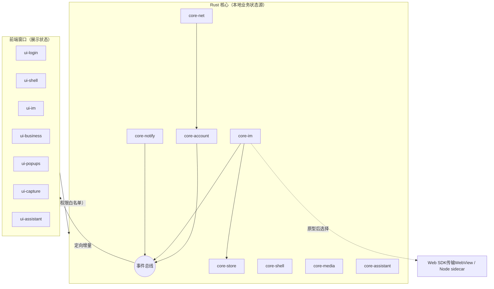

# 组件盘点、模块划分与联动设计

2026-10-30

> **最终审查修订（2026-10-30）**：早期错误已直接回写。本文是模块地图；跨模块安全、恢复与事件契约以 [开发总纲](dev/00-architecture.md) 为准，IM实现按 [选型决策](decisions/2026-10-30-im-transport.md) 在原型后冻结。

## 结论

Windows分发包的静态盘点列出25个页面入口、65个主进程IPC接口、IM utilityProcess实现和7个原生Node模块；入口/接口数量不等于同时活跃窗口或运行进程数。重构时把它们收拢为 **10 个 Rust 核心模块 + 8 组前端界面模块**，其中各有一个模块承接从插件迁入的「商家助手」功能。

模块之间只通过两类前端通道联动：

- 前端调用核心的**命令**；
- 核心经授权检查向来源视图定向下发的**事件 / Channel**。

本地业务状态由Rust核心持有，服务端事实由对账确认，UI可持有临时展示状态。核心仍可能过载，因此必须限制队列、窗口数量与阻塞任务；actor或Rust语言本身不提供性能保证。

有两项需要单独立项：

| 项目 | 原因 |
| --- | --- |
| 登录 | 涉及SOA登录接口、短信/扫码/滑块、Cookie与免密凭据；网页入口已在Ego验证，Tauri内尚未验收 |
| IM 协议层 | Node SDK与Web SDK均有静态证据；须比较鉴权、发送确认、补拉与后台恢复，不能凭接口同名选择 |

## 盘点来源与范围

- **Windows**：`vbk-electron/resources/app.asar`（1.2.12，含插件注入）与 `app.asar.unpacked/dist`。
- **macOS**：`.app` 包只上传了框架和启动器，没有 `app.asar`。Mac业务逻辑同源仅为待验证假设；现有平台差异依据Windows包的darwin分支与Mac包Info.plist，不能视为实际Mac调用链已完全确认。
- 凡是标着"推断"的内容，都是根据文件名、接口名推出来的，没有读到具体实现。

## 一、现有组件盘点

### 1. 窗口与页面（`dist/src/pages`，25 个）

| 分组 | 页面 | 现状 |
| --- | --- | --- |
| 启动与登录 | launch、login | 本地 React 页面。登录支持账号密码（pwLogin）、短信验证码（smLogin）、扫码（codeLogin）、免密自动登录（autoLogin）、滑块验证、记住密码，登录成功后拿到 bticket |
| 主框架 | main | 主窗口外壳；按账号持久分区创建本地业务BrowserView，部分再嵌远程iframe |
| IM | imPlus（打包产物名为 imWindow） | 本地页面，使用 tiptap 富文本输入框和 react-virtual 虚拟列表；长任务问题主要集中在这里 |
| 业务模块 | home、order、product、comment、bulletin、course、event、bi、data | 8个入口（data与bi同一入口）；本地菜单/外壳+远程iframe；具体见开发文档04 |
| 提醒类副窗口 | alarm、notifier、toolTip | 见 [03 副窗口](03-multi-window.md)；notice是主窗口内通知中心，不是副窗口 |
| 工具 | screenshots、screenshotsOverlay、image、video、web | 截图、图片预览、视频播放、通用网页 |
| 其他 | ai、setting、update、archGuide | AI 助手、设置、更新、架构引导下载 |

### 2. 主进程服务（按 IPC 接口归类）

| 服务 | 代表接口 | 说明 |
| --- | --- | --- |
| 账号与登录 | loginSuccess、logout、addAccount、changeAccount、getAccountList、sortAccountList、getLoginCookie、getAllLoginCookies、removeCachePassword | 支持多账号；账号列表和记住的密码保存在 electron-store。后续源码已确认无加密键，`pwd_account_list.password`明文落盘；新版本默认不存/不迁移密码 |
| IM | getIMChannelPort、newMessage、unreadMessageCount、jumpToConversation、replyTimeout | IM SDK 运行在独立的 utilityProcess（`imsdk.js`），通过 MessagePort 与各窗口通信；replyTimeout 对应回复倒计时 |
| 本地数据库 | executeDB | 渲染进程把 SQL 发给主进程执行（better-sqlite3 + drizzle）。现有 10 张表：conversationInfo、messageInfo、groupMember、userInfo、customEmoji、IQConversationInfo、IQMessageContent、venAgentInfo、workingSchedule、sharkInfo |
| 窗口管理 | openWindow、openExtraWindow、closeExtraWindow、mainViewChanged、flashMainWindow、popContextMenu | 包括托盘、菜单、commonWebOption编辑操作；常驻截图/唤起快捷键，Esc/Enter仅截图期间临时注册 |
| 网络 | netFetch、changeEnv | 主进程代发请求、切换环境，支持系统代理 |
| 媒体工具 | openScreenShotPanel、recognizeImage、recognizeImageBuffer、cancelRecognition、spellCheck、imageOption、downloadFile、videoPlayerFallback | OCR 用 paddleocr + onnxruntime；拼写检查在 worker 里跑；截图依赖 node-screenshots |
| 更新 | checkNewVersion、downloadNewVersion、installNewVersion、updateNewVersion、requestArchGuide | electron-updater，外加 `@ctrip/node-electron-hotfix` 热更新 |
| 偏好与多语言 | getUserPreferences、changeUserPreferences、getSharkInfo、changeSharkLocale、setLocalVoice | Shark 多语言；提示音设置 |
| 统计与诊断 | getLaunchCount、getStayDuration、crashreport、UBT | 埋点、崩溃上报 |
| 其他 | toggleBaolei、openAiWindow、sendBroadcastEvent、setCacheData / getCacheData | toggleBaolei是热更新堡垒灰度通道，新方案不保留该未签名热更路线 |

### 3. 依赖与原生模块

- **原生模块（Windows x64）**：better-sqlite3、sqlite3（两套 SQLite 并存）、heapdump、`node-vampire-cache`、`node-vampire-locker`、snappy、nice。
- **携程 SDK**：账号（bbz-accounts-*）、IM（s-node-imclient-core、im-web-file-uploader）、多语言（shark-*）、埋点（ubt-*）、配置与 AB 实验（ares-agent、trip-abtest），以及 nfes 组件库。
- **冗余**：静态清单含48个`node-vampire-*`包（redis、qmq、soa-server等）；未证明运行路径完全不使用。新应用不照搬整套依赖，Node sidecar若入选需按真实依赖闭包裁剪并验收。

### 4. 平台差异（来自 `darwin` / `win32` 分支）

| 能力 | Windows | macOS |
| --- | --- | --- |
| 未读提示 | 任务栏叠加图标 | Dock 角标、托盘标题 |
| 截图 | 直接截取 | 先检查屏幕录制权限 |
| 窗口外观 | 自绘标题栏 | 隐藏红绿灯按钮 |
| 硬件加速 | Win7 或 NUL 设备检测失败时关闭 | 不涉及 |
| 深链接 | 启动时setAsDefaultProtocolClient注册 | `vbookingChat://`（Info.plist） |
| 架构 | x64 | 已观察包为x64；代码有ArchGuide，不能据此否定其他发行架构 |
| 更新 | electron-updater | Squirrel.Mac |

### 5. 插件已有、需要并入的功能

来自 trip_vendor_im_companion：
- 出站翻译与草稿替换；
- 客户语言识别；
- TSim 登录；
- 订单查询（页面内 iframe）；
- 套餐速览；
- 会话自动滚到底部；
- 启动时窗口最大化；
- 运行日志。

## 二、模块划分

处理方式说明：**重写**指重新设计实现；**复用**指沿用现有远程页面或服务端接口；**替换**指用系统能力或成熟库代替；**删除**指不再需要。

### Rust 核心模块

| 模块 | 职责 | 来源 | 处理 |
| --- | --- | --- | --- |
| core-shell | 窗口注册表与预热、托盘、菜单、单实例、深链接、开机自启、快捷键 | 窗口管理服务 | 重写 |
| core-account | 多账号、登录态、每账号 Cookie 与 bticket、凭据保存（Windows 凭据管理器 / macOS 钥匙串） | 账号服务 | 重写；不再明文存密码 |
| core-im | IM 长连接、消息收发、回执、输入状态、未读数、回复倒计时 | imsdk.js + IM IPC | 分两期，见第四节 |
| core-store | 本地数据库（rusqlite），迁移现有 10 张表；只对外提供业务接口，不接受前端传入的 SQL | executeDB + drizzle | 重写 |
| core-notify | 横幅、倒计时提醒、提示音、系统通知、任务栏闪烁、Dock 角标 | notifier / alarm / tray | 重写 |
| core-net | 统一 HTTP 客户端、代理、环境切换、携程域名 Cookie 同步 | netFetch、changeEnv | 重写 |
| core-media | 截图（多屏）、文件下载与上传、OCR、拼写检查 | 媒体工具服务 | OCR引擎按安装身份原型决定；中文纠错为规则+可选ONNX，系统英文拼写不能替代中文 |
| core-update | 签名更新、双架构安装包 | updater、hotfix、ArchGuide | 替换为 Tauri updater；ArchGuide 删除 |
| core-telemetry | 日志、崩溃上报、埋点、偏好、多语言 | electron-log、crashreport、UBT、shark | 重写；多语言按实测复用；遥测接收端与授权待确认，默认无可用上报不影响本地诊断 |
| core-assistant | 翻译、TSim 会话、订单查询、套餐速览 | 插件 | 并入，作为可开关的功能 |

### 前端界面模块（Web，运行在系统 WebView）

| 模块 | 包含页面 | 处理 |
| --- | --- | --- |
| ui-login | launch、login | 重写，见第三节 |
| ui-shell | main、notice通知中心、setting、update | 重写外壳；账号切换、导航、多标签 |
| ui-im | imPlus | 重写，最高优先级：虚拟列表、输入框与列表解耦，按键响应低于 100 ms |
| ui-business | home、order、product、comment、bulletin、course、event、bi、data | 外壳重写，远程内容复用 |
| ui-popups | alarm、notifier、toolTip | 重写，常驻复用 |
| ui-capture | screenshots、screenshotsOverlay | 重写 |
| ui-viewer | image、video、web | 重写，体量小 |
| ui-assistant | 翻译面板、套餐速览卡、订单查询 | 从插件迁入，改走 IPC，不再需要 CDP 注入 |

ai是IM总结侧窗，归core-im相关业务；是否保留独立窗口在G0冻结。个人服务端设置、客服状态归core-im，桌面偏好归telemetry/prefs，不混为同一类设置。

## 三、登录模块

现状是一个本地登录页，登录后的流程如下：
1. 本地登录页直接调用SOA接口（pwdLogin、verifyCodeLogin、getQrCode等），不调用打包的账号SDK；
2. 处理密码、短信验证码、滑块验证；
3. 拿到 bticket 和 Cookie 后交给主进程；
4. 主进程为该账号创建一个 BrowserView 分区。

重构有两种做法：

| 做法 | 说明 | 适用 |
| --- | --- | --- |
| A：内嵌官方网页登录 | 在 WebView 中打开 vbooking 网页登录页，core-account 捕获登录完成后的 Cookie 与 bticket | 不依赖账号 SDK，滑块、风控由网页自己处理；推荐作为首选 |
| B：自研登录界面 + 调用账号接口 | 复刻现有本地登录页 | 需要确认接口使用范围、风控与变更维护；不能把包中存在SDK当成实际依赖 |

两种做法共同的要求：
- 默认不保存、迁移或自动填充密码；
- 免密凭据进系统凭据库，状态须在线验证，不能仅因有ticket就跳过校验；
- 多账号各自使用独立的 Cookie 存储。

## 四、IM 传输原型后选型

`@ctrip/s-node-imclient-core` 与网页Web SDK都使用XMPP over WSS，但appId、认证、HTTP兜底和重试行为存在差异。优先做Web SDK独立传输WebView原型，与Node sidecar同场景对照；未通过前保留sidecar候选基线。UI和core-im接口不绑定某一运行时。

Rust原生协议实现是后续候选，不能把“源码可读”当作协议完整性、接口授权或正确性已经解决。稳定localId、持久outbox、unknown状态、历史完整同步水位必须由core-im统一持有；两条路线都不得靠盲目重发掩盖确认丢失。参见[IM决策](decisions/2026-10-30-im-transport.md)。

## 五、组合与联动

约定：
- **命令**：前端到核心，一问一答，例如 `im.send`、`account.switch`。每个WebView只开放需要的命令；核心验证AccountContext和ViewContext，不能信任前端自报账号。
- **事件**：核心到窗口，按主题订阅，例如 `im.message.new`、`account.changed`。按总纲先订阅缓冲再取原子快照；事件按账号/流/epoch/seq恢复，禁止客户数据全局广播。
- 命令与事件的类型定义放在单独的契约包里，Rust 和前端共用，防止两端字段漂移。

### 关键联动场景

| 场景 | 流程 |
| --- | --- |
| 启动与登录 | core-shell 启动 → core-account 读取保存的 ticket → 在线验证有效才恢复会话，否则打开 ui-login → 登录成功后发出 `account.ready` → core-im 建立连接，ui-shell 加载业务页 |
| 新消息 | core-im 收到消息 → 写入 core-store → 发出 `im.message.new` → ui-im 刷新列表；core-notify 更新未读数、托盘闪烁，窗口不在前台时弹横幅 |
| 回复倒计时 | core-im按服务端会话事实与ClockService锚点维护本地首条未回复T1期限（非已验证的携程SLA） → 到期发出 `im.reply.timeout` → core-notify 打开 alarm 窗口并闪烁任务栏 → 用户点击后执行 `im.jump` 定位会话 |
| 新客户端深链接（暂定`tsim-vbk://`） | 系统唤起 → 单实例转发 → 核心解析/校验目标账号与会话 → `im.jump`；未登录有界排队且不在后来另一账号执行，不默认接管官方scheme |
| 截图发送 | ui-im 发出 `media.capture` → core-media 为每块屏幕打开遮罩 → 截图完成发出 `media.captured` → ui-im 插入图片 |
| 切换账号 | ui-shell 发出 `account.switch` → 核心切换视图绑定而非覆盖全局Cookie → 定向快照/增量；旧异步操作仍绑定原账号/代次；后台传输独立，业务页按保活/LRU策略处理 |
| 翻译 | ui-im 输入框停笔约 500 ms → `assistant.translate` → core-assistant按账号策略调官方翻译或可选TSim来源，绑定会话与草稿版本 → 返回译文预览，失败按错误类型提示 |
| 更新 | core-update 发现新版本 → 发出 `update.available` → ui-shell 提示 → 用户确认后下载、校验签名、重启 |

## 六、开发顺序

1. G0：登录/Profile、子WebView/bridge、IM闭环、OCR安装身份、更新与数据恢复原型；之后冻结契约包与命令/事件。
2. core-shell + core-account + ui-login：能登录、能切换账号。
3. core-im（G0选定传输）+ core-store + ui-im：先交付 IM，验证卡顿是否解决。
4. core-notify + ui-popups：横幅、倒计时、托盘。
5. ui-business 外壳，接入远程业务页。
6. core-media + ui-capture + ui-viewer。
7. core-assistant + ui-assistant：迁入插件功能。
8. 完成core-update/core-telemetry发布验收与macOS适配；诊断、账号隔离与可信更新契约从G0开始，不延后到最后设计。

## 待确认

- G0冻结登录、IM传输、多子WebView与Profile路线；已有静态/网页观测不能代替目标WebView2原型。
- 个人状态/设置已有[静态调用链](research/2026-10-30-agent-status-and-settings.md)，服务端分配与自动回复规则未经业务成功验证，不按名称推定。
- Mac专有行为按实际部署版本验证；安装包、签名、遥测端点与发行范围在发布前冻结。
