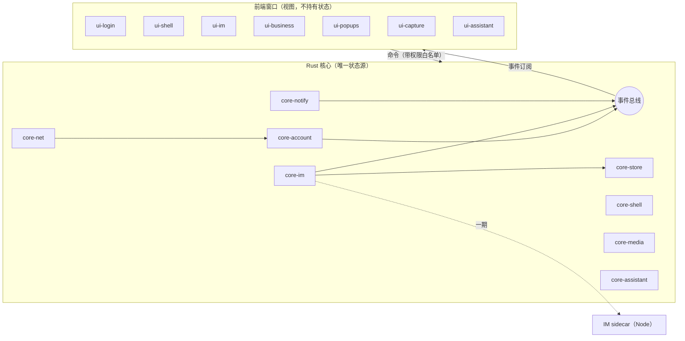

# 组件盘点、模块划分与联动设计

2026-10-30

> **更正（2026-10-30）**：编写各模块开发文档时核对源码，发现本文有几处说法需要更正（登录不调账号 SDK、密码明文已证实、深链与快捷键、业务模块承载方式、notice 窗口性质等），以 [开发总纲第十二节](dev/00-architecture.md#十二编写各模块文档时的新发现) 为准。

## 结论

现有客户端共有 25 个窗口页面、65 个主进程 IPC 接口、1 个 IM 子进程和 7 个原生 Node 模块。重构时把它们收拢为 **10 个 Rust 核心模块 + 8 组前端界面模块**，其中各有一个模块承接从插件迁入的「商家助手」功能。

模块之间只通过两条通道联动：
- 前端调用核心的**命令**；
- 核心向窗口广播的**事件**。

状态只由 Rust 核心持有，每个窗口都只是视图。这样副窗口再多，也不会出现现在这种"主进程转发一切"的瓶颈。

有两项需要单独立项：

| 项目 | 原因 |
| --- | --- |
| 登录 | 涉及携程账号 SDK、短信验证码、滑块验证、免密自动登录 |
| IM 协议层 | 现用携程私有的 Node SDK `@ctrip/s-node-imclient-core`，Rust 端没有现成实现 |

## 盘点来源与范围

- **Windows**：`vbk-electron/resources/app.asar`（1.2.12，含插件注入）与 `app.asar.unpacked/dist`。
- **macOS**：`.app` 包只上传了框架和启动器，没有 `app.asar`。Mac 的界面与业务代码按与 Windows 同源处理，平台差异根据 Windows 包中 `darwin` 分支和 Mac 包的 `Info.plist` 整理。
- 凡是标着"推断"的内容，都是根据文件名、接口名推出来的，没有读到具体实现。

## 一、现有组件盘点

### 1. 窗口与页面（`dist/src/pages`，25 个）

| 分组 | 页面 | 现状 |
| --- | --- | --- |
| 启动与登录 | launch、login | 本地 React 页面。登录支持账号密码（pwLogin）、短信验证码（smLogin / codeLogin）、免密自动登录（autoLogin）、滑块验证、记住密码，登录成功后拿到 bticket |
| 主框架 | main | 主窗口外壳；每个账号一个 BrowserView，加载远程 vbooking 页面（`persist:账号` 分区） |
| IM | imPlus（打包产物名为 imWindow） | 本地页面，使用 tiptap 富文本输入框和 react-virtual 虚拟列表；长任务问题主要集中在这里 |
| 业务模块 | home、order、product、comment、bulletin、course、event、bi、data | 本地窗口外壳（各有独立 bundle），内容大量来自远程接口或页面（推断） |
| 提醒类副窗口 | alarm、notifier、notice、toolTip | 见 [03 副窗口](03-multi-window.md) |
| 工具 | screenshots、screenshotsOverlay、image、video、web | 截图、图片预览、视频播放、通用网页 |
| 其他 | ai、setting、update、archGuide | AI 助手、设置、更新、架构引导下载 |

### 2. 主进程服务（按 IPC 接口归类）

| 服务 | 代表接口 | 说明 |
| --- | --- | --- |
| 账号与登录 | loginSuccess、logout、addAccount、changeAccount、getAccountList、sortAccountList、getLoginCookie、getAllLoginCookies、removeCachePassword | 支持多账号；账号列表和记住的密码保存在 electron-store。代码中没有看到 safeStorage 或加密密钥，**密码疑似以明文落盘**，需要复核 |
| IM | getIMChannelPort、newMessage、unreadMessageCount、jumpToConversation、replyTimeout | IM SDK 运行在独立的 utilityProcess（`imsdk.js`），通过 MessagePort 与各窗口通信；replyTimeout 对应回复倒计时 |
| 本地数据库 | executeDB | 渲染进程把 SQL 发给主进程执行（better-sqlite3 + drizzle）。现有 10 张表：conversationInfo、messageInfo、groupMember、userInfo、customEmoji、IQConversationInfo、IQMessageContent、venAgentInfo、workingSchedule、sharkInfo |
| 窗口管理 | openWindow、openExtraWindow、closeExtraWindow、mainViewChanged、flashMainWindow、popContextMenu | 包括托盘、菜单，以及 Esc / Enter 两个全局快捷键 |
| 网络 | netFetch、changeEnv、commonWebOption | 主进程代发请求、切换环境，支持系统代理 |
| 媒体工具 | openScreenShotPanel、recognizeImage、recognizeImageBuffer、cancelRecognition、spellCheck、imageOption、downloadFile、videoPlayerFallback | OCR 用 paddleocr + onnxruntime；拼写检查在 worker 里跑；截图依赖 node-screenshots |
| 更新 | checkNewVersion、downloadNewVersion、installNewVersion、updateNewVersion、requestArchGuide | electron-updater，外加 `@ctrip/node-electron-hotfix` 热更新 |
| 偏好与多语言 | getUserPreferences、changeUserPreferences、getSharkInfo、changeSharkLocale、setLocalVoice | Shark 多语言；提示音设置 |
| 统计与诊断 | getLaunchCount、getStayDuration、crashreport、UBT | 埋点、崩溃上报 |
| 其他 | toggleBaolei、openAiWindow、sendBroadcastEvent、setCacheData / getCacheData | toggleBaolei 用途不明，需要向业务方确认 |

### 3. 依赖与原生模块

- **原生模块（Windows x64）**：better-sqlite3、sqlite3（两套 SQLite 并存）、heapdump、`node-vampire-cache`、`node-vampire-locker`、snappy、nice。
- **携程 SDK**：账号（bbz-accounts-*）、IM（s-node-imclient-core、im-web-file-uploader）、多语言（shark-*）、埋点（ubt-*）、配置与 AB 实验（ares-agent、trip-abtest），以及 nfes 组件库。
- **冗余**：48 个 `node-vampire-*` 服务端包（redis、qmq、soa-server、pm2、thrift 等）被打进了桌面客户端，桌面端用不到；moment、request、jimp + sharp 等功能重复。新客户端全部不带。

### 4. 平台差异（来自 `darwin` / `win32` 分支）

| 能力 | Windows | macOS |
| --- | --- | --- |
| 未读提示 | 任务栏叠加图标 | Dock 角标、托盘标题 |
| 截图 | 直接截取 | 先检查屏幕录制权限 |
| 窗口外观 | 自绘标题栏 | 隐藏红绿灯按钮 |
| 硬件加速 | Win7 或 NUL 设备检测失败时关闭 | 不涉及 |
| 深链接 | 未见注册代码（推断由安装器注册） | `vbookingChat://`（Info.plist） |
| 架构 | x64 | x64，需要用 ArchGuide 引导用户换装 arm64 包 |
| 更新 | electron-updater | Squirrel.Mac |

### 5. 插件已有、需要并入的功能

来自 trip_vendor_im_companion：
- 出站翻译与草稿替换；
- 客户语言识别；
- TSim 登录；
- 订单查询（页面内 iframe）；
- 套餐速览；
- 会话自动滚到底部；
- 启动时窗口最大化；
- 运行日志。

## 二、模块划分

处理方式说明：**重写**指重新设计实现；**复用**指沿用现有远程页面或服务端接口；**替换**指用系统能力或成熟库代替；**删除**指不再需要。

### Rust 核心模块

| 模块 | 职责 | 来源 | 处理 |
| --- | --- | --- | --- |
| core-shell | 窗口注册表与预热、托盘、菜单、单实例、深链接、开机自启、快捷键 | 窗口管理服务 | 重写 |
| core-account | 多账号、登录态、每账号 Cookie 与 bticket、凭据保存（Windows 凭据管理器 / macOS 钥匙串） | 账号服务 | 重写；不再明文存密码 |
| core-im | IM 长连接、消息收发、回执、输入状态、未读数、回复倒计时 | imsdk.js + IM IPC | 分两期，见第四节 |
| core-store | 本地数据库（rusqlite），迁移现有 10 张表；只对外提供业务接口，不接受前端传入的 SQL | executeDB + drizzle | 重写 |
| core-notify | 横幅、倒计时提醒、提示音、系统通知、任务栏闪烁、Dock 角标 | notifier / alarm / tray | 重写 |
| core-net | 统一 HTTP 客户端、代理、环境切换、携程域名 Cookie 同步 | netFetch、changeEnv | 重写 |
| core-media | 截图（多屏）、文件下载与上传、OCR、拼写检查 | 媒体工具服务 | OCR 换用系统能力（Windows.Media.Ocr / Vision），拼写检查用系统 API，去掉 paddleocr |
| core-update | 签名更新、双架构安装包 | updater、hotfix、ArchGuide | 替换为 Tauri updater；ArchGuide 删除 |
| core-telemetry | 日志、崩溃上报、埋点、偏好、多语言 | electron-log、crashreport、UBT、shark | 重写；埋点与多语言沿用携程服务端接口 |
| core-assistant | 翻译、TSim 会话、订单查询、套餐速览 | 插件 | 并入，作为可开关的功能 |

### 前端界面模块（Web，运行在系统 WebView）

| 模块 | 包含页面 | 处理 |
| --- | --- | --- |
| ui-login | launch、login | 重写，见第三节 |
| ui-shell | main、setting、update | 重写外壳；账号切换、导航、多标签 |
| ui-im | imPlus | 重写，最高优先级：虚拟列表、输入框与列表解耦，按键响应低于 100 ms |
| ui-business | home、order、product、comment、bulletin、course、event、bi、data | 外壳重写，远程内容复用 |
| ui-popups | alarm、notifier、notice、toolTip | 重写，常驻复用 |
| ui-capture | screenshots、screenshotsOverlay | 重写 |
| ui-viewer | image、video、web | 重写，体量小 |
| ui-assistant | 翻译面板、套餐速览卡、订单查询 | 从插件迁入，改走 IPC，不再需要 CDP 注入 |

ai 窗口暂并入 ui-business，等确认其功能后再决定是否拆出。

## 三、登录模块

现状是一个本地登录页，登录后的流程如下：
1. 调用携程账号 SDK（bbz-accounts-loginsdk）；
2. 处理密码、短信验证码、滑块验证；
3. 拿到 bticket 和 Cookie 后交给主进程；
4. 主进程为该账号创建一个 BrowserView 分区。

重构有两种做法：

| 做法 | 说明 | 适用 |
| --- | --- | --- |
| A：内嵌官方网页登录 | 在 WebView 中打开 vbooking 网页登录页，core-account 捕获登录完成后的 Cookie 与 bticket | 不依赖账号 SDK，滑块、风控由网页自己处理；推荐作为首选 |
| B：自研登录界面 + 调用账号接口 | 复刻现有本地登录页 | 需要携程账号 SDK 的授权和接口文档，否则做不了 |

两种做法共同的要求：
- 记住密码改为存进系统凭据库；
- 自动登录只保存 ticket，不保存密码；
- 多账号各自使用独立的 Cookie 存储。

## 四、IM 协议层分两期

`@ctrip/s-node-imclient-core` 是携程私有的 Node SDK，它的协议没有公开文档。

- **一期**：用 Tauri sidecar 带一个最小 Node 运行时，只跑 IM SDK。core-im 通过本地管道与它通信，对外接口保持不变。这样做可以先把卡顿最严重的界面换掉，不被协议移植卡住。
- **二期**：拿到协议说明后，在 Rust 里重写 IM 连接，再移除 sidecar。

一期的 sidecar 只承载 IM 连接。它不碰界面、数据库和窗口，所以不会把 Electron 时期主进程过载的问题带回来。

## 五、组合与联动

约定：
- **命令**：前端到核心，一问一答，例如 `im.send`、`account.switch`。每个窗口只开放它需要的命令。
- **事件**：核心到窗口，按主题订阅，例如 `im.message.new`、`account.changed`。窗口打开时订阅，关闭时取消。
- 命令与事件的类型定义放在单独的契约包里，Rust 和前端共用，防止两端字段漂移。

### 关键联动场景

| 场景 | 流程 |
| --- | --- |
| 启动与登录 | core-shell 启动 → core-account 读取保存的 ticket → 有效则跳过登录，否则打开 ui-login → 登录成功后发出 `account.ready` → core-im 建立连接，ui-shell 加载业务页 |
| 新消息 | core-im 收到消息 → 写入 core-store → 发出 `im.message.new` → ui-im 刷新列表；core-notify 更新未读数、托盘闪烁，窗口不在前台时弹横幅 |
| 回复倒计时 | core-im 按会话启动计时器 → 到期发出 `im.reply.timeout` → core-notify 打开 alarm 窗口并闪烁任务栏 → 用户点击后执行 `im.jump` 定位会话 |
| 深链接 `vbookingChat://` | 系统唤起 → core-shell 单实例转发 → core-account 选定账号 → `im.jump` 打开对应会话 |
| 截图发送 | ui-im 发出 `media.capture` → core-media 为每块屏幕打开遮罩 → 截图完成发出 `media.captured` → ui-im 插入图片 |
| 切换账号 | ui-shell 发出 `account.switch` → core-account 切换 Cookie 存储 → 发出 `account.changed` → 所有窗口刷新；后台账号只保留 IM 连接，不保留页面 |
| 翻译 | ui-im 输入框停笔约 500 ms → `assistant.translate` → core-assistant 调 TSim 接口 → 返回译文预览，失败按错误类型提示 |
| 更新 | core-update 发现新版本 → 发出 `update.available` → ui-shell 提示 → 用户确认后下载、校验签名、重启 |

## 六、开发顺序

1. 契约包：先定命令和事件清单。
2. core-shell + core-account + ui-login：能登录、能切换账号。
3. core-im（一期 sidecar）+ core-store + ui-im：先交付 IM，验证卡顿是否解决。
4. core-notify + ui-popups：横幅、倒计时、托盘。
5. ui-business 外壳，接入远程业务页。
6. core-media + ui-capture + ui-viewer。
7. core-assistant + ui-assistant：迁入插件功能。
8. core-update、core-telemetry，macOS 适配。

## 待确认

- 登录走做法 A 还是做法 B，以及能否拿到携程账号 SDK 和 IM 协议文档。这决定了第三、四节的最终方案。
- `toggleBaolei` 的用途，以及 ai、data 窗口的具体功能。
- 业务模块窗口中，本地页面与远程页面各占多少，需要逐个打开页面确认。
- Mac 版 `app.asar` 尚未上传，Mac 专有逻辑目前只能从 Windows 包的 `darwin` 分支推断。
