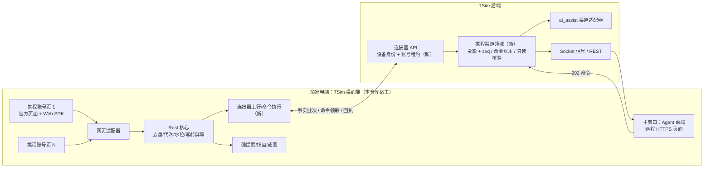

# 05 并入 TSim_CS 客服前端的架构研究与合并方案

2026-11-01。状态：研究报告与方案建议，**未实施**。本文没有修改 TSim_CS，没有新增路由、表、迁移或前端组件，也没有发起任何真实请求。

基线：

- 本仓库 `main` = `a34a007`（Tauri 2 宿主、std-only Rust 核心、无依赖 TS 适配器与界面；Windows 候选包已实机运行，G1–G5 未整体验收，见 [PROGRESS](../PROGRESS.md)、[BLOCKED](../BLOCKED.md)）。
- TSim_CS `main` = `e489b64`。下文 TSim 路径都以该仓库根为准，符号比行号稳定，落地前须重新核对。
- 前置材料：[TSim_CS 携程渠道迁移准备](integration/tsim-cs.md)（身份映射、入站/出站/unknown 边界、9 步迁移）与 [TSim 商家助手接口](api/external-tsim.md)。本文不重复其中的字段级契约，而是回答“整体以什么架构并进去、两边各要改什么、按什么顺序”。

---

## 0. 结论摘要

1. **KKday 工作台的并入方式是“服务器原生重实现”**：放弃浏览器插件（`kkday-cs-dialog-modernizer`），在 TSim 后端新建 `consumer_workspace` 领域模块，由服务器持有每名客服的加密凭据和上游 Session、直接 HTTP 访问 KKday、做单 owner 采集与权威投影；Agent 前端新增 `/consumer-workspace/*` 路由，只和 TSim 后端说话，浏览器不接触任何 KKday Cookie。
2. **携程不能原样照搬这条路**。KKday 是“服务器可直连的 HTTP 轮询型上游”；携程网页 IM 是“绑定官方页面的浏览器登录 + 官方 Web SDK 维持的 XMPP/WSS 长连接 + 页面内动态风控头（`x-ctx-wclient-req`、`w-payload-source`/`c_sign`）”。本仓库已决定登录复用官方网页、实时消息依赖页面内 SDK，且尚未证明 SDK 能脱离原站运行（见[IM 路线决定](decisions/2026-10-30-im-transport.md)、[鉴权](api/authentication.md)）。把这些搬到服务器，要么逆向协议与风控，要么在服务器跑一群无头浏览器，两者都有合规与稳定性风险，且 KKday 自己就是从“Redis 里的 Playwright 状态”迁回纯 HTTP 的。
3. **推荐方案：B+D——“边缘连接器 + TSim 服务器权威投影”，桌面宿主演进为“TSim 桌面端”。**
   - 携程登录、账号 Profile、官方页面与 SDK **继续留在商家电脑上的 Tauri 宿主**里，宿主变成该携程账号唯一的“上游执行者（connector）”。
   - 宿主把规范化后的入站事实、回执和读回结果**上行**到 TSim 后端；TSim 后端按 KKday 的协议纪律（单 owner、投影 + seq、202 命令、no-replay、只读核验）建一个新的携程渠道领域模块。
   - 客服界面迁到 **Agent 前端的新工作台路由**，与对话工作台、C 端工作台、聚合工作台并列；宿主主窗口直接承载 Agent 前端，而不是再维护一套独立 IM 界面。
   - 强提醒窗口、托盘、截图/OCR 等原生能力保留在宿主；TSim 后端拿到的消息事实让这些能力和团队视图、AI 辅助、统计、业务关联共用同一事实源。
4. **不走前端直连，避开 KKday 的 CORS 返工**：KKday 在 08-19 试过“浏览器直连 + 扩展桥”绕 CORS，一天发了 5 个扩展版本，次日删除 3,657 行回到服务器原生。本方案里 Agent 前端永远不请求携程；携程请求只在宿主内的官方页面同源发出，宿主与 TSim 之间走 Rust 原生 HTTP 或 Tauri IPC，**不需要新增任何 CORS 来源**（§6.9）。
5. **最大的两项架构调整**：TSim 需要第一次引入“非人类的长期在线客户端身份（设备/连接器）”和“服务器向边缘下发客户可见写命令”的通道；本仓库需要把“本地是权威”改为“本地是边缘缓冲 + 写前屏障，服务器是投影权威”，并把主界面让给 Agent 前端。
6. **分 7 个阶段（M0–M6）推进**，先做零风险的身份与嵌入收敛，再做只读影子上行，最后才开放经 TSim 的出站。每阶段都可回退到“官方页面 + 本地客户端人工操作”。第 10 节列出需要你拍板的 6 个问题。

---

## 1. 研究范围与证据层级

| 层级 | 本文用法 |
| --- | --- |
| 源码事实 | 两个仓库当前 `main` 的实际文件与符号，附路径 |
| 设计文档事实 | TSim `consumer_workspace/docs/`、`docs/specs/`、ADR；本仓库 `docs/` |
| 运行事实 | 只引用已有文档里记录的实测（例如 TSim 外部插件设计里的 10-28 正式服采样），本轮没有新测量 |
| 推断与建议 | 明确标注“建议/推断”，不是已验证结论 |

本轮没有运行 TSim、没有登录任何系统、没有访问携程或 KKday 上游。

---

## 2. 参考模式：KKday 工作台是怎么并入 TSim 的

### 2.1 演进时间线

| 时间 | 事件 | 证据 |
| --- | --- | --- |
| 2026-08 上旬 | 先做浏览器插件直连整条链路，5 个插件版本，一天建成即废弃 | 全链路设计附录 B：FP-1、BP-15 |
| 2026-08-13 | 在 TSim 内**原生重实现**：不加载插件产物、不用 iframe、不依赖扩展 bridge；凭据加密入库；HTTP 直连 | `central-backend/consumer_workspace/docs/kkday-consumer-workbench-implementation.md` |
| 08-13 ~ 08-31 | 42 个坑（前端 21、后端 21），集中在串客、last-good 被清空、限流、发送确认 | 同上附录 B |
| 2026-09-01 | 全链路重建设计：A′ = 服务器权威投影 + 前端副本/Outbox + 调度引擎同级支柱；38 条不变式 | `consumer_workspace/docs/specs/2026-09-01-consumer-workspace-full-chain-redesign.md` |
| 09-04 ~ 09-11 | 实时变更事件、Session 自动续期、图片、通知意图等专项 | `consumer_workspace/docs/specs/` |
| 10 月 | AI 预备回复、业务关联、案件记忆、订单面板、统计并入同一领域 | `consumer_workspace/api/routers/kkday_{prepared_reply,business_links,case_memory,orders,statistics}.py` |
| 2026-10-24 | 规划自建 IM 与 KKday 全量迁移到 Go（P0–P7），尚未实施 | `docs/specs/2026-10-24-kkday-b2b-im-go-migration-plan.md` |

结论：KKday 的“合并”不是把一个外部产品嵌进来，而是**把渠道能力收编成 TSim 后端的一个领域，加上 Agent 前端的一个工作台**。外部插件只充当了交互原型。

### 2.2 架构切面

| 切面 | KKday 在 TSim 中的做法 | 位置 |
| --- | --- | --- |
| 模块边界 | 后端领域目录 `central-backend/consumer_workspace/`（routers、services 约 60 个、models、独立 Alembic 版本目录、tests 约 120 个）；不是独立服务，由 `main.py` 注册路由与后台任务，鉴权、权限、配置、Redis、数据库、翻译复用共享后端 | `consumer_workspace/README.md`、`central-backend/main.py`（`include_router`、后台任务表） |
| 前端入口 | `agent-frontend/src/features/consumer-workspace/` 独立功能目录；路由 `/consumer-workspace/*`，默认 `/consumer-workspace/pending`，含 待处理/全部/订单 | `agent-frontend/src/modules/AuthenticatedApp.tsx`、`src/layouts/shellNavigation.ts`（`MESSAGE_ROUTE_KEYS` 与对话工作台、聚合工作台并列） |
| 权限 | 新增 `consumer_workspace`（工作台）与 `settings_personal_third_party_accounts`（个人第三方账号设置），以及业务关联确认/撤销等细分权限；默认不授予，管理员显式分配 | `central-backend/auth/permissions.py` |
| 凭据与上游会话 | `agent_third_party_credentials` 按 `(agent_id, provider)` 唯一；账号/密码/loginDevice/Cookie 用 `SECRET_KEY` 派生的 Fernet 加密；OTP 只在单次请求内存；前端只看到“是否已配置/登录状态” | `consumer_workspace/models.py::AgentThirdPartyCredential`、`services/agent_third_party_credential_service.py` |
| 上游传输 | 服务器直接请求 KKday SCM；现行实现是 `curl_cffi` 的 Chrome 指纹会话，私有 Cookie jar、有界并发与响应上限 | `services/kkday_session_service.py`、`kkday_http_transport.py`（Go 迁移方案 §3.3 已更正旧文档“httpx”的说法） |
| 采集与调度 | 集群内单 owner（Redis leader lease）的 pending/daily-all/new-order 采集器；统一准入、按账号预算、429 精确冷却；后台共享只读 lane（HRW 哈希分配） | `kkday_runtime_adapter.py`、`kkday_capacity_governor.py`、`kkday_lane_assigner.py`、`kkday_session_pool.py` |
| 投影与契约 | 服务器权威投影（列表、线程、外呼），每个 scope 带 `seq` 与新鲜度字段（`authority`/`stale_since`/`catch_up_deadline`）；快照读 + 增量读 + 202 命令写 + 资源通道 + 信号通道五类接口 | 全链路设计 §3 |
| 出站 | `KkdayOutboundAttempt` 唯一键 `(agent_id, client_message_id)`；`accepted → dispatching → verification_pending → verified / manual_reconcile_required`；`fenced_message_write_start_in_tx` 在外写前持久化不可重放边界；reconciler 只读、代码路径不含写端点 | `kkday_outbound_dispatcher.py`、`kkday_confirmation_reconciler.py` |
| 写身份 | 人工写只用当前客服本人的账号；共享池只做读，禁止跨客服代写 | 不变式 A1 |
| 实时 | Socket 只推 `{scope, seq, event_id}` 信号，不推正文/图片/凭据；信号丢失由轮询兜底 | 不变式 A34 |
| 前端形态 | 契约层 → 副本（IndexedDB）→ Outbox（Web Locks 跨标签互斥）→ 状态机 → 视图；last-good 不被瞬时失败清空；IME 四重判定 | 全链路设计 §4 |
| AI 与业务能力 | 渠道适配器接入 `ai_assist`：`grant_scope`（KKday = `supplier:<ctx>`）、`prepare`、`lock_lane`、`bind_attempt`、`verify`；预备回复、业务关联（候选只来自服务器快照）、案件记忆、统计都建立在服务器快照之上 | `services/ai_assist/live/delivery_adapters.py`、`kkday_business_links.py`、`kkday_case_memory.py` |
| 数据迁移 | 领域 Alembic 目录，共享配置同时扫描；Redis 中旧 Playwright storage state 一次性转为数据库会话后删除 | 实现说明“数据库迁移”节 |
| 发布 | 随 TSim 统一产品版本与组件身份（Agent PWA、后端等）发布；没有新增客户端组件 | `docs/adr/0007-unified-solution-version-with-component-identities.md` |

### 2.3 TSim 与“旅游商家助手”已经存在的接点

这些是携程方向今天已经在用的 TSim 能力，合并时要收编而不是另起：

| 接点 | 现状 | 位置 |
| --- | --- | --- |
| `/embed/operator` 桌面伴生嵌入 | 助手在 file:// 页面里 iframe 嵌入 TSim 套餐面板，通过 postMessage 把已验证的 Agent token 交给 iframe（`source=travel-merchant-companion&session=handoff`，有预热 host 模式），避免二次登录 | `agent-frontend/src/pages/operatorEmbedSession.ts`、`OperatorEmbedPage.tsx`、`stores/authStore.ts::adoptEmbeddedSession`、ADR 0005 |
| 出站/入站翻译 | `POST /agent/translate[/batch]`，`client_source` 允许 `travel_merchant_companion`，用量统计里单独标为“旅游商家助手” | `central-backend/api/routers/agent.py::TranslateRequest`、`agent-frontend/src/components/admin/SystemSettings/aiUsageModel.ts` |
| 套餐速览 | `/agent/package-query/{perform,dataplan-list,detail,live-detail,cdr-more}`；本仓库宿主已用随机句柄在本地实现，没有复用 iframe token handoff | [external-tsim](api/external-tsim.md) |
| 会话保活成本 | 10-28 正式服 `GET /agent/profile` 来自助手 63,360 次，占全站请求 11.5%，因为 Windows 每 4 秒校验一次且最小化也不停 | `docs/specs/2026-10-28-external-plugin-translation-cache-design.md` §1 |

### 2.4 可以直接继承的纪律

KKday 用 140 多个提交换来的不变式里，以下几条与携程渠道直接相关，合并方案必须保留：

- **单 owner**：同一上游账号只能有一个上游执行者，浏览器标签页或客户端数量不能改变上游调用量（A25）。
- **未知不重发**：未知写结果只读回确认，核验路径不含写端点（A3）。
- **写前持久化边界**：外写前先落 `write_started`，之后崩溃一律按 unknown 处理（Go 方案 §3.2）。
- **代次栅栏**：读取上下文绑定 `account + generation`，代次变化后旧结果不得覆盖新状态（A14）。
- **last-good 优先**：瞬时失败不清空列表、消息、选中、草稿（A19）。
- **403 不登出**：第三方会话失效映射为领域错误，不退出 TSim（A22，AGENTS.md 规则 1）。
- **信号与数据分离**：Socket 只推信号（A34）。
- **秘密不外泄**：Cookie/Token/密码/客户正文不进日志、Redis key、Socket payload（A32）。
- **分层报告**：源码、测试、构建、真实页面、部署、上线分别报告（A38）。

本仓库已经独立实现了其中多条的本地版本：`AccountContext{account_id, session_generation}`、`stream/epoch/seq` 去重、`confirmed/rejected/unknown` 三分、FileStore 发送账本 `write_started` fsync（`vbk/src-tauri/src/outbound_journal.rs`）、周边动作账本（`peripheral_journal.rs`）。这为合并提供了一个好的起点：**语义已经对齐，差的是“权威放在哪里”**。

---

## 3. 需要被合并的对象：本客户端当前形态

| 部分 | 当前职责 | 代码 |
| --- | --- | --- |
| 宿主 | 窗口（main/alarm/setting/update/login/package-detail）、托盘、每账号隐藏 WebView 与独立 Profile、按窗口 capability、1 Hz 调度、偏好、钥匙串、服务器校时锚点 | `vbk/src-tauri/src/{windows,views,profiles,tray,scheduler,keychain,clock_anchor}.rs` |
| 网页适配器 | 在官方页面内对接 Web IM SDK：有界事实事件、5 秒会话列表轮询、补偿、分页、发送意图、已读、上传签名、周边动作 | `vbk/ui/packages/web-adapter` |
| Rust 核心 | 身份/代次、去重与同步水位、SendIntent/outbox、等待轮次、L0–L4 提醒、TSim 客户端 | `vbk/crates/{contracts,core-account,core-store,core-net,core-im,core-notify,core-assistant}` |
| 本地持久层 | 提醒 round、发送意图、同步水位；发送账本与周边账本是写前屏障 | `core-store`、`outbound_journal.rs`、`peripheral_journal.rs`、`media_outbound.rs` |
| 主界面 | 自绘的会话列表、消息流、输入框、订单入口、商家助手面板 | `vbk/ui/apps/main` |
| 原生辅助窗口 | 独立回复超时强提醒（alarm）、套餐详情窗、设置、更新 | `vbk/ui/apps/{alarm,package-detail,setting,update}` |
| TSim 接入 | TSim 账号登录/会话导入、出站翻译、订单自动套餐速览与详情 | `vbk/src-tauri/src/assistant*`、`core-assistant` |

规模：Rust 约 4.7 万行，UI TS 约 2.6 万行（含测试）。主界面与网页适配器之间的契约在 `vbk/ui/packages/ipc`。

---

## 4. 为什么不能照搬 KKday：差异矩阵

| 维度 | KKday | 携程 vbooking IM | 对合并的影响 |
| --- | --- | --- | --- |
| 登录 | 账号密码 + 邮件 OTP，服务器可代登录 | 官方网页登录（验证码、风险校验由页面处理）；本项目决定不重写 `pwdLogin`、不读密码 | 服务器无法合法、稳定地代登录；登录必须发生在有人值守的浏览器里 |
| 会话凭据 | Cookie/Token，服务器 HTTP 可复用 | `bticket`/`vbkticket` 等 Cookie，受浏览器域、Origin、`Sec-*` 控制；页面外重放未证明 | 凭据宜留在宿主，不上传服务器 |
| 请求签名 | 无页面内签名（指纹由 curl_cffi 模拟） | `x-ctx-wclient-req`（含 GUID/UBT_VID/DUID 的 MD5）、`w-payload-source`/`c_sign`，`c_sign` 实现未追清 | 服务器重实现要逆向风控，持续跟版本 |
| 实时消息 | 无推送，服务器轮询列表/详情 | XMPP over WSS（SASL + bind + 心跳），由官方 SDK 维持；另有约 5 秒会话列表轮询和补偿 | 服务器要为每个账号常驻一条长连接，或改成纯轮询（丢实时性） |
| 限流模型 | 已测每账号 60/分钟窗口，服务器统一准入 | 未测；风控可能按设备/IP/行为判断 | 服务器出口 IP 与商家常用地点不同，风险未知 |
| 上游事实源 | KKday 上游 | 携程上游 | 两者都需要“本地投影 + 未知写只读核验”，这部分可复用 |
| 账号与客服 | 一名 TSim 客服对应一个 KKday 账号；后台共享读池 | 本客户端一台桌面可登录多个商家账号；携程侧还有 agentUid、转接、邀请客服 | 需要新的“TSim 客服 ↔ 携程账号”映射模型（第 10 节决策 1） |
| 原生能力 | 无 | 置顶强提醒窗、托盘未读、截图遮罩、隐藏页后台调度 | PWA 做不了，必须有桌面宿主 |
| 运行位置 | 服务器 | 商家电脑 | 电脑关机/休眠即“上游离线”，投影必须表达降级 |

一句话：**KKday 的难点在“服务器怎么省着调上游”，携程的难点在“上游只能在商家电脑的浏览器里被调用”。** 所以投影、命令、核验的纪律可以继承，上游执行者的位置必须改。

---

## 5. 合并方案选项

### 方案 A：服务器原生（与 KKday 同构）

- **A1 协议重实现**：TSim 后端（或 Go 服务）自己实现 SOA 请求、风控头、XMPP/WSS 客户端，服务器保存携程 Cookie。
- **A2 服务器托管浏览器**：在服务器为每个携程账号跑无头 Chromium，加载官方页面和 SDK，服务器控制页面。

优点：与 KKday 架构完全同构；商家电脑不再需要常开；团队调度、AI 自动化最容易。

缺点：登录仍要人参与（验证码），需要“远程登录流程”；A1 需逆向 `c_sign` 与 SDK 协议，任何一次官方发版都可能打断；A2 资源重（每账号一个浏览器进程，KKday 已经从 Playwright 方案迁走），且服务器 IP 与商家地点不同可能触发风控；两者都涉及平台条款与账号安全，需要业务方书面确认。本仓库此前也已放弃“桌面 SDK sidecar/原生协议重写”。

### 方案 B：边缘连接器 + TSim 服务器权威投影（推荐的数据面）

宿主保留登录、Profile、官方页面与 SDK，作为该携程账号**唯一的上游执行者**；向 TSim 上行规范化事实，从 TSim 领取命令并执行；TSim 后端建携程渠道领域（投影、命令账本、核验、AI 适配器、统计）；客服在 Agent 前端操作。

优点：沿用已验证的网页登录与 SDK 路线，不需要逆向；TSim 获得完整的消息事实，团队视图、AI、业务关联、统计都能复用 KKday 已有设计；凭据不离开商家电脑。

缺点：TSim 第一次需要“长期在线的设备身份”和“向设备下发客户可见写”的通道；商家电脑离线时渠道不可写；端到端链路更长（Agent 前端 → 后端 → 宿主 → SDK → 回执 → 宿主 → 后端），未知结果的窗口变多，需要两段式写屏障（§6.4）。

### 方案 C：只做界面层嵌入（现状的延长线）

宿主继续自有 IM 界面和本地状态，只把 TSim 页面（套餐、客诉、AI 建议等）嵌进来，类似现在的 `/embed/operator`。

优点：最快、零服务器改动。缺点：TSim 看不到消息事实，做不了团队协作、AI 辅助、统计；两套界面长期并存，体验割裂。适合作为过渡（M1），不适合作为终态。

### 方案 D：宿主承载 TSim（Tauri 成为“TSim 桌面端”，推荐的界面面）

宿主主窗口直接加载 Agent 前端（远程 HTTPS 源），携程账号页继续是隐藏 WebView，强提醒/托盘/截图等原生窗口保留。它本身不决定数据走向，因此与 B 组合：**B 决定数据权威在服务器，D 决定客服在哪个窗口里工作。**

### 对比

| 维度 | A1 | A2 | B（+D） | C |
| --- | --- | --- | --- | --- |
| 与已有决定一致（网页登录、页面内 SDK） | 否 | 部分 | 是 | 是 |
| 逆向/风控风险 | 高 | 中高 | 低 | 低 |
| TSim 获得消息事实 | 是 | 是 | 是 | 否 |
| 团队/AI/统计复用 | 完整 | 完整 | 完整（受边缘在线约束） | 无 |
| 商家电脑必须在线 | 否 | 否 | 是 | 是 |
| 服务器资源 | 中 | 高 | 低 | 无 |
| TSim 新增基础能力 | 携程协议栈 | 浏览器农场 | 设备身份 + 命令下发 | 无 |
| 本仓库已完成工作复用率 | 低 | 低 | 高 | 高 |
| 回退到官方客户端 | 易 | 易 | 易 | 易 |

**推荐：终态 B+D，M1 先用 C 收敛身份与嵌入。** A 不作为当前路线；若将来业务方确认条款允许、且需要“无人值守 24h 渠道”，再以 A2 做一个受控 PoC，并要求它满足与 B 相同的服务器侧契约（这样服务器领域代码不必重写）。

---

## 6. 推荐的目标架构



### 6.1 三种身份，严格分开

| 身份 | 谁持有 | 用途 | 来源 |
| --- | --- | --- | --- |
| TSim 客服 | 人；Agent 前端 Bearer JWT + `session_ref` | 看、发、权限判断 | 现有 `/agent/login`、`/agent/auth/refresh` |
| 连接器设备（新） | 宿主安装实例；服务器签发、可吊销、绑定“客服 + 安装 ID” | 上行事实、领取命令、续租账号 | TSim 需新增；不得复用 Agent JWT，不得用 localStorage 传递 |
| 携程商家账号 | 只在宿主，存于账号 Profile 与系统凭据库 | 上游调用 | 官方网页登录，不上传服务器 |

现在 `/embed/operator` 的 postMessage token 交接只适合“同一个人、同一个窗口”的短期复用。连接器是长期后台主体，必须有自己的凭据、作用域（只能调用连接器 API）、到期与吊销，并且吊销 TSim 客服会话时连带失效（参考 Go 方案 §5.3“撤权必须 fail closed”）。

### 6.2 单 owner：账号租约

- 服务器为每个“携程账号指纹”维护**唯一活动租约** `(account, connector_id, lease_epoch, expires_at)`。只有持租约的连接器可以上行该账号的事实、领取该账号的命令。
- 同一账号在两台电脑登录时，后一台默认只读（不上行、不执行命令），需显式“接管”。接管递增 `lease_epoch`，旧连接器迟到的上行与回执按 epoch 拒绝。这对应 KKday 的 A25 与本仓库的 `session_generation`。
- 官方桌面端或官方网页同时在线不受我们控制。它们发出的消息会被 SDK 作为“本人其他端消息”收到，必须作为普通入站事实（方向=商家）进入投影，并用于结束未知写的核验，但不能当作本系统命令的回执。

### 6.3 入站链路

1. 官方 SDK 事件 → 网页适配器（有界结构化事实）→ Rust 核心按 `stream/epoch/seq` 与上游消息 ID 去重（现有逻辑）。
2. 核心把已去重事实写入本地**上行队列**（持久，复用 `core-store`），按批次上行：`{connector, account, lease_epoch, session_generation, batch_seq, facts[]}`。
3. 服务器事务：校验租约与代次 → 按 `(tenant, platform, account, room, upstream_message_id)` upsert（键设计沿用 [tsim-cs.md](integration/tsim-cs.md#身份与隔离契约待实现的迁移目标)）→ 分配 scope `seq` → 提交后发 Socket 信号 `{scope, seq, event_id}`。服务器回 ACK 后宿主才删除本地批次；ACK 丢失重传由服务器幂等吸收。
4. 历史、补偿与分页是“读命令”：服务器发起 `read_history(room, cursor)`，连接器执行后上行页面，服务器负责“整页持久化后才推进检查点”。历史导入不计为新入站、不触发未读和提醒。
5. 已读回执分开建模：加载历史不清未读；“向客户公开已读”是写命令，走 §6.4。

### 6.4 出站链路与两段式写屏障

```text
Agent 前端 POST 命令（client_message_id）→ 202
  → 服务器 attempt: accepted（唯一键 tenant/platform/account/actor/client_message_id + payload hash）
  → 选取持租约连接器，下发 → attempt: dispatched_to_edge（带 lease_epoch、deadline）
  → 宿主收到命令：本地账本按同一 client_message_id 写 write_started 并 fsync（现有 outbound_journal）
  → 宿主回报 edge_write_started（服务器据此进入不可重放区）
  → SDK 提交一次 → 回执分类 confirmed / rejected / unknown（现有 classifyAck）
  → 宿主上行结果 → 服务器 verified / rejected / verification_pending
  → unknown：服务器发“只读核验”命令，连接器用无副作用查询（现有 im_outbound_lookup 边界）读回
```

关键规则：

- **服务器视角的不可重放点是 `dispatched_to_edge`，不是 `edge_write_started`**。命令一旦交给连接器，服务器就不能再交给另一个连接器；连接器失联只能等它回来或人工核对。只有连接器明确回报“未写入就拒绝执行”（例如租约过期、身份不符、`not_submitted`）才可以安全结束为未开始。
- 宿主端的 `write_started` 仍是最后一道屏障：宿主重启后先上行所有 `write_started/unknown`，再接新命令。
- 命令有硬截止时间。商家电脑离线时，客户可见写不长期排队，超时转为“未开始/已过期”，由客服决定是否重新起草（新意图、新 ID）。
- 同一 room/服务会话内命令 FIFO；有未解决 unknown 时阻塞同 lane 的后续同类命令（KKday `_has_unresolved_prior` 与本仓库周边账本的做法一致）。
- 附件分为上传与发送两步，资产在宿主冻结字节与摘要（现有 `media_outbound.rs`），服务器只保存资产元数据和阶段；`upload unknown` 不能被消息核验的“未找到”清除。

### 6.5 服务器侧领域模块（建议）

建议仿照 `consumer_workspace/` 新建独立领域目录（名称待定，以下用“携程渠道领域”指代），**不复用 KKday 表、不往 respond.io 字段里塞携程 ID**（理由见 [tsim-cs.md](integration/tsim-cs.md#已核对的真实实现)）：

| 组件 | 职责 | KKday 对应物 |
| --- | --- | --- |
| 连接器 API | 设备注册/吊销、账号租约、事实批次上行、命令领取（长连接或长轮询）、结果回报 | 无（新） |
| 身份映射 | 平台账号、客户、room、服务会话、订单、消息的映射与唯一键 | `KkdayConversationMessageSnapshot` 等的隔离键 |
| 投影 | 列表/线程/外呼投影，scope `seq`，`authority/stale_since` 新鲜度；连接器离线即 `authority=degraded` | `kkday_pending_projection_service.py`、`kkday_all_union_projection_service.py` |
| 命令账本 | attempt 阶段机、租约、CAS、no-replay、截止时间 | `KkdayOutboundAttempt`、`kkday_outbound_dispatcher.py` |
| 只读核验 | 通过连接器只读查询结束 unknown；有上限、退避、deadline，超限转人工 | `kkday_confirmation_reconciler.py` |
| 业务能力 | AI 渠道适配器（`grant_scope` = 平台账号作用域）、业务关联（订单 ↔ 套餐）、案件记忆、统计 | `delivery_adapters.py`、`kkday_business_links.py`、`kkday_case_memory.py`、`kkday_statistics_service.py` |
| HTTP 契约 | `/agent/<渠道>/…` 快照读、增量读、202 命令、资源、信号 | `/agent/consumer-workspace` |

与 KKday 的最大不同是**没有服务器采集器和上游预算准入**：上游调用量由连接器控制，服务器只控制“向连接器发多少读命令”。服务器仍需要一个准入器，防止 Agent 前端多标签页或 AI 把读命令放大到连接器（A25 的边缘版）。

### 6.6 前端：Agent 前端的新工作台

- 新功能目录与 `features/consumer-workspace/` 平级；路由加入 `MESSAGE_ROUTE_KEYS`，与对话工作台、C 端工作台、聚合工作台并列；新权限与个人账号设置项由管理员显式授予（与 KKday 的两项权限同构）。具体名称需按 AGENTS.md“不编造产品名称”规则，由你确定后写入 `permissions.py` 与 i18n。
- 前端形态直接沿用 KKday v2 的分层（契约层、副本、Outbox、状态机、视图），以及 IME、发送锁、last-good 规则。
- 新增一个 KKday 没有的状态：**连接器状态**（在线/离线/接管中/账号需要重新登录），由服务器投影给出，前端只渲染，不推断。
- “携程账号需要重新登录”时，Agent 前端不能自己打开携程登录页；它通过宿主桥（§6.7）请求宿主打开对应账号的官方登录窗口。普通浏览器里打开 Agent 前端时，该按钮显示“请在桌面端处理”。

### 6.7 宿主承载 Agent 前端的安全边界

宿主主窗口加载远程 Agent 前端，等于让一个远程源进入有本机权限的进程，这是本方案最需要设计的安全点：

- 远程源默认**没有任何 Tauri IPC**。只开放一个极小的、白名单化的桥：`打开账号登录窗口(account_ref)`、`聚焦强提醒`、`截图并作为附件草稿`、`读取连接器状态`。每个调用带当前 TSim 会话与账号作用域，由宿主再校验（沿用 `src-tauri/capabilities` 与 `views.rs` 的按窗口 ACL）。
- 不开放 shell、文件系统、任意网络代理、携程 Cookie 或 SDK 句柄（与总纲 §2“不得注入通用 shell、SQL 或任意网络代理能力”一致）。
- 只允许固定的 TSim 生产/测试 origin，导航到其他源时在系统浏览器打开。
- Agent 前端在普通浏览器和 PWA 中必须照常可用（只看、只发、不执行上游），宿主桥只是增强。

### 6.8 本地状态与辅助窗口的去留

| 能力 | 合并后 | 理由 |
| --- | --- | --- |
| 携程登录、账号 Profile、SDK 页面 | 留在宿主 | 第 4 节 |
| 去重、代次、写前屏障、上行队列 | 留在宿主，角色改为边缘缓冲 | 崩溃窗口发生在宿主 |
| 会话列表、消息流、输入框 | 迁到 Agent 前端；宿主旧主界面在 M5 之前保留为离线/回退界面 | 一个界面、一个事实源 |
| 强提醒 alarm | 保留原生窗口；M3 前用本地事实计算，M5 起改为服务器投影的等待轮次，本地只做显示和兜底 | 原生置顶不抢焦点 PWA 做不了；团队视图需要服务器事实 |
| 托盘未读 | 来自服务器投影；连接器离线时用本地计数并标注 | 与 TSim 计数一致 |
| 截图/OCR/中文纠错 | 留在宿主，结果作为 Agent 前端草稿或附件 | 原生能力 |
| 出站翻译、套餐速览、订单详情 | 改由 Agent 前端直接调用 TSim 现有接口；宿主侧的 TSim 客户端在 M5 退役 | 去掉重复实现和 `/agent/profile` 高频轮询 |
| `/embed/operator` iframe 交接 | M1 起由宿主主窗口的正式登录取代，助手的 handoff 协议进入退役 | 少一种 token 传递路径 |

### 6.9 请求路由：吸取 KKday 浏览器直连与 CORS 返工的教训

#### KKday 当时发生了什么（TSim git 历史）

| 时间 | 提交 | 事件 |
| --- | --- | --- |
| 08-19 | `6d4d0eea` 归档的可行性报告 | 真实浏览器从 TSim origin（`http://localhost:3000`）以 `credentials=include` 请求 KKday `get_msg_list`：`TypeError fetch_failed`；KKday 响应没有 `Access-Control-Allow-Origin/Credentials`；`mode=no-cors` 只得到 `opaque/status 0`，正文不可读。结论：普通 React 页面不能直接读取上游 JSON。 |
| 08-19 16:28 | `5b931ae7` | 为绕过 CORS，新增“浏览器会话 + 扩展分发”契约：后端 session JSON 导出给 MV3 扩展，扩展在 KKday 官方标签页 MAIN world 里做同源 fetch，再经 bridge 回传 TSim 页面。随之需要 `cookies` 权限、完整 Cookie 属性（sameSite、host-only 等，当时库里没存）、TSim origin 白名单、扩展 ID/版本/bridge 协议握手、ZIP 分发与发布清单。 |
| 08-19 16:31 ~ 08-20 00:28 | `04fe1c8c`、`9381baeb` | 工作台切到浏览器直连并补体验；扩展一天内发了 `kkday-tsim-bridge` 1.1.0 → 1.1.4 五个版本。 |
| 08-20 00:47 | `c5fd246c` | 整条链路移除：删除 3,657 行，包括扩展源码、5 个 ZIP、浏览器会话服务、多端点探针、env 契约条目、927 行方案和 331 行报告。之后转为服务器原生（附录 B 的 FP-1、BP-15）。 |

TSim 自己的 CORS 也有过返工，与此相关：

- 早期为公网 IP 部署把后端改成 `allow_origins=["*"]`（旧版 `CORS_FORMDATA_FIX.md`），09-04 `19fc4d66` 改写为按 profile 的显式 `CORS_ORIGINS`，生产拒绝 `*`；Socket.IO 复用同一集合（`central-backend/core/config.py`、`main.py`、`core/socket_manager.py`）。
- 09-04 `dd4af107` 新增请求超时中间件，并让它被 CORS 层包裹：超时返回带 CORS 头的 `504`，否则浏览器只会报“CORS 错误”，把超时误诊为跨域问题。`main.py` 另有 fallback 中间件，给异常响应也补齐允许来源的头。
- FormData 不能手写 `Content-Type: multipart/form-data`（缺 boundary）；10-28 插件缓存设计需要把 `ETag` 加入 `expose_headers`。

#### 从中得到的规则

1. **第三方上游不会给我们的 origin 开 CORS，浏览器直连在设计上就不成立**。携程比 KKday 更严格：观测到的请求依赖 `cookieOrigin: https://vbooking.ctrip.com`、浏览器管理的 `Origin/Cookie/Sec-*`、页面内生成的 `x-ctx-wclient-req` 与 `c_sign`（[鉴权](api/authentication.md)），这些都不能用页面 `fetch` 伪造。
2. **绕 CORS 的“桥”本身就是返工源**。KKday 的扩展桥引入了权限、Cookie jar 保真、版本握手、分发五个新问题，最后整体删除。本方案不新增任何“让 TSim 页面间接发携程请求”的桥。
3. **浏览器里看到的 CORS 报错常常不是 CORS 问题**：超时、5xx、预检缺自定义头、代理吞掉响应头都会表现成同一个错误。新接口必须让错误路径也带 CORS 头，并在验收里分开记录 OPTIONS 与实际请求。
4. **允许来源只加明确的、按环境的 origin**，不加 `*`，也不为桌面端加 `tauri://localhost`、`http://tauri.localhost` 之类的本地源。

#### 本方案的请求路由矩阵

| 调用方 → 目标 | 路由 | 是否涉及 CORS |
| --- | --- | --- |
| Agent 前端（浏览器、PWA、宿主主窗口）→ 携程 | **禁止**。一律发 TSim 命令，由服务器交给持租约的连接器执行 | 不涉及（不发请求） |
| Agent 前端 → TSim 后端 | 与今天相同。宿主主窗口必须加载远程 `https://csagent.tsim.tech`（测试为 `test-agent`），不打包成本地 `tauri://` 页面，这样 Origin 就是已在白名单里的那个 | 沿用现有白名单，无新增来源 |
| 宿主内携程账号页（官方页面 + 适配器）→ 携程 | 在官方页面上下文内同源调用，与现状一致 | 不涉及 |
| 宿主连接器（Rust）→ TSim 连接器 API | Rust 原生 HTTP，不经任何 WebView `fetch` | 不涉及；只由服务器鉴权把关 |
| 宿主本地窗口（alarm、设置、套餐详情，`tauri://` 源）→ TSim | 走 Tauri IPC 到 Rust，再由 Rust 请求 TSim（现有 `assistant` 模块即是这样） | 不涉及；不把本地源加入 CORS |
| Agent 前端 ↔ 宿主能力（打开携程登录、截图） | §6.7 的白名单 IPC 桥 | 不涉及 |

这样整个合并方案里**没有任何一跳需要新增 CORS 来源**；唯一的跨源浏览器请求仍是 Agent 前端调用 TSim 后端，沿用已经治理好的契约。若 Agent 前端要读新的响应头（例如 `ETag`、`Retry-After`），必须同步改 `expose_headers`、`config/env-contract.json`、profile 示例和预检测试，按 `CORS_FORMDATA_FIX.md` 的方式在真实域名验收。

### 6.10 与 TSim Go 迁移方案的关系

TSim 已规划把自建 IM、实时网关和 KKday 全部迁到 Go（P0–P7，未实施）。携程渠道领域如果先用 Python 写，将来又要按同一方案再迁一次。建议：

- 服务器侧契约（连接器 API、投影 seq、命令阶段、错误三元组）**按语言无关的 JSON fixture 先冻结**，这与 KKday 全链路设计“契约夹具是单一事实源”的做法一致。
- 实现语言由 Go 迁移的实际进度决定（第 10 节决策 4）：若 Go 消息工程在 M2 开工前已具备鉴权、PG 访问和事件出口，就直接用 Go 写连接器 API 与携程领域；否则先用 Python 写在独立领域目录，并在 Go 方案的“过渡端口退出契约”里登记。
- Socket 信号走现有网关；Go 网关切换（P5）时一并迁移，不另起连接栈。

---

## 7. 两边需要的重大架构调整

### 7.1 TSim_CS 侧

| # | 调整 | 说明 | 规模 |
| --- | --- | --- | --- |
| T1 | 连接器设备身份 | 注册、签发、作用域、到期、吊销，并与客服会话撤销联动；审计 | 中 |
| T2 | 服务器 → 边缘命令通道 | 可靠领取与回报（建议 HTTP 长轮询或专用 Socket namespace + 持久账本，不依赖 Socket 送达）；断线重领；按租约 epoch 拒绝旧连接器 | 中 |
| T3 | 携程渠道领域模块 | 映射、投影、命令账本、只读核验、新鲜度；独立迁移目录 | 大 |
| T4 | 账号映射与权限 | 携程账号属于谁（个人/团队），谁可读、谁可写；写必须用账号绑定的连接器，权限在服务器逐动作校验 | 中 |
| T5 | ai_assist 第三个渠道适配器 | `grant_scope`、`prepare`、`bind_attempt`、`verify`；AI 自动发送按 KKday 当前做法默认不开放 | 中 |
| T6 | Agent 前端工作台 | 新功能目录与路由，沿用 KKday v2 分层；连接器状态 UI；宿主桥特性检测 | 大 |
| T7 | 数据留存与 PII | 正文、附件、审计、备份的期限与删除责任（respond.io 的 30 天只是 webhook 审计现状） | 小（决策）+ 中（实现） |
| T8 | 发布治理 | 桌面端成为新的组件身份，进入统一产品版本与 release manifest（ADR 0007、0012）；契约版本独立（ADR 0008） | 小 |
| T9 | 外部插件流量收口 | 助手 `/agent/profile` 每 4 秒的轮询在 M1 停止；`client_source` 保留为统计维度 | 小 |

不建议在 M2 前就把 KKday 表“抽象成通用渠道表”。AGENTS.md 要求不为单次使用新增抽象；等携程领域落地后，再看两套实现中哪些是真正共享的（租约、no-replay、seq 投影），按 Go 方案“共用有界执行、事件、幂等工具”的思路抽取。

### 7.2 本仓库侧

| # | 调整 | 说明 | 规模 |
| --- | --- | --- | --- |
| C1 | 应用主身份改为 TSim 客服 | 启动先登录 TSim（或导入已有会话，已实现），再挂携程账号；携程账号绑定到当前客服 | 小 |
| C2 | 新增连接器模块 | 上行队列、批次 ACK、命令领取、租约续期、接管、离线与重连 | 大 |
| C3 | 本地状态降级为边缘缓冲 | `core-store` 的水位与 outbox 改为“未上行/未确认”的缓冲；权威计数与未读改读服务器 | 中 |
| C4 | 两段式写屏障 | `outbound_journal`、`peripheral_journal`、`media_outbound` 以服务器 `client_message_id` 为键，并上报 `edge_write_started`；重启先上报未决再接命令 | 中 |
| C5 | 主窗口承载 Agent 前端 | 远程源无 IPC + 最小白名单桥；导航白名单；旧主界面保留到 M5 作回退 | 中 |
| C6 | 强提醒数据源切换 | alarm 的输入从本地 rounds 改为服务器投影，保留本地兜底 | 小 |
| C7 | 去掉重复的 TSim 客户端 | 翻译、套餐速览、订单详情改由 Agent 前端完成；`core-assistant` 与对应 IPC 退役 | 小 |
| C8 | 更新与版本 | 更新通道与 TSim 发布节奏对齐，桌面端版本进入 TSim 组件身份；连接器协议版本协商 | 小 |

不变的部分：网页登录、Profile 隔离、页面内 SDK、适配器契约、去重与代次规则、强提醒的计时语义（[03-strong-alert](dev/03-strong-alert.md)）。这些是本仓库最有价值、也最难重做的部分，合并后继续由本仓库维护。

---

## 8. 风险与对策

| 风险 | 后果 | 对策 |
| --- | --- | --- |
| 连接器离线（电脑休眠、关机、断网） | 渠道不可写、TSim 数据滞后 | 投影显式 `degraded` 与最后同步时间；命令硬截止；alarm 本地兜底；允许团队内另一台电脑接管租约 |
| 双端执行（两台电脑或新旧客户端同时执行同一账号） | 重复发送、乱序 | 单租约 + epoch；接管显式化；旧客户端（M5 前的本地界面）发出的消息按“本人其他端”入站处理，不进命令账本 |
| 未知结果增多（链路更长） | 客服不知道是否已发 | 两段式屏障；`dispatched_to_edge` 后不改派；只读核验有 deadline；界面文案由服务器阶段驱动 |
| 有人提议“前端直接调携程更快” | 重演 KKday 浏览器直连 + 扩展桥的返工 | §6.9 路由矩阵作为评审硬门禁：任何让浏览器页面发携程请求、或为桌面端新增 CORS 来源的方案直接退回 |
| 把超时或 5xx 误诊为 CORS | 排错方向错误、反复试错 | 新接口错误路径保留 CORS 头；验收分别记录 OPTIONS 与实际请求、状态码和响应头 |
| 远程页面进入有权限的宿主 | 远程源被利用调用本机能力 | 默认无 IPC、白名单桥、origin 白名单、宿主二次校验作用域 |
| 携程页面或 SDK 改版 | 适配器失效 | 与现在一样由本仓库适配器承担；服务器契约与上游格式解耦，改版只影响宿主 |
| 平台条款与风控 | 账号受限 | B 方案上游调用仍在商家电脑、官方页面内，行为与人工使用接近；A 方案需业务方书面确认后才 PoC |
| 跨账号串数据 | 隐私事故 | 所有键带 tenant/platform/account；上行批次校验租约与代次；AI、业务关联的候选只来自服务器快照 |
| Go 迁移期间的返工 | 实现两遍 | 先冻结语言无关契约，按决策 4 选实现语言 |
| 高频保活与上行流量 | 服务器负担 | 批量上行、ETag/条件请求、信号+增量；吸取 `/agent/profile` 每 4 秒轮询的教训 |
| 本地 WebView 内存（主窗口 + N 个账号页） | 低配机卡顿 | 主窗口加载 Agent 前端后，旧自绘主界面可以退役；账号页数量上限与后台调度策略保持现状并实测 |

---

## 9. 分阶段迁移计划

每个阶段的“退出门禁”都要分别报告：源码、测试、构建、真实页面、部署、上线（A38）。任一阶段失败都可以回到“官方页面 + 本地客户端人工操作”。

| 阶段 | 内容 | 退出门禁 | 回退 |
| --- | --- | --- | --- |
| **M0 决策与契约冻结** | 拍板第 10 节问题；写连接器 API、事实批次、命令阶段、错误三元组的 JSON fixture；映射表与唯一键评审；更新 [tsim-cs.md](integration/tsim-cs.md) | fixture 被两边测试共同消费；隔离模型评审通过 | 无改动 |
| **M1 身份与嵌入收敛（方案 C）** | 桌面端以 TSim 客服为主身份；主窗口或侧栏承载 Agent 前端的现有页面（套餐、客诉）；停掉助手式每 4 秒 profile 轮询；宿主桥最小集 | 真实登录、刷新、吊销、403 不登出在桌面端验证；主窗口请求的 Origin 是已登记的 `csagent`/`test-agent` 域名，CORS 白名单未新增来源；`/agent/profile` 调用量下降可在统计中读回 | 关闭嵌入，回到当前宿主内 TSim 客户端 |
| **M2 只读影子上行** | 连接器设备身份、账号租约、事实批次上行；服务器建投影但**不展示、不触发 AI/通知/未读** | 白名单账号连续运行：实时+补偿+历史重复、重启重读、乱序、同时间戳、撤回；服务器投影与本地和官方页面逐条对账；0 串账号 | 停止上行，删除影子数据（未对外展示） |
| **M3 TSim 只读工作台** | Agent 前端新工作台只读开放；连接器状态 UI；本地主界面仍可发消息（作为“本人其他端”入站） | 真实页面验收：列表、线程、分页、切会话、降级状态；多标签页不放大连接器读命令 | 隐藏路由/撤销权限 |
| **M4 经 TSim 出站** | 文本命令 → 引用/撤回 → 图片/文件/视频 → 周边动作（转接、邀请、结束），逐项 feature flag；两段式屏障；只读核验 | 离线故障注入：下发前后、宿主 SDK 调用前后崩溃，回执丢失/晚到/错 localid，租约过期，双连接器，unknown deadline；断言每意图最多一次客户可见调用；之后**另获授权**在限定账号做小规模真实发送 | 关闭 flag；未决 attempt 保留只读核验 |
| **M5 业务能力与界面收敛** | AI 预备回复、业务关联（订单 ↔ 套餐）、案件记忆、统计；alarm 改读服务器轮次；本地主界面与宿主 TSim 客户端退役；`/embed/operator` handoff 退役 | 各能力按 KKday 已有契约验收；退役前确认无用户依赖旧界面 | 恢复旧界面构建（保留到 M6） |
| **M6 发布与语言收口** | 桌面端进入 TSim 组件身份与发布记录；按决策 4 与 Go 方案对齐（若先用 Python，进入其迁移清单） | 发布记录分别列出桌面包、后端、迁移、前端；回滚演练 | 版本回滚 |

粗略规模（相对量，不是工期承诺）：M2 与 M4 最大，各自相当于 KKday 08-13 到 09-01 那一段的工作量级；M1、M3、M6 较小；M5 主要是复用。

---

## 10. 需要你拍板的问题

1. **账号归属模型**：一个携程商家账号是“某名客服的个人账号”（KKday 模式，写只能本人发），还是“团队共享账号”（多名客服在 TSim 里处理，由持租约的那台电脑代为执行）？推荐：先按个人账号做（与 KKday 一致、权限最清楚），团队共享作为后续扩展，并明确“代执行”的审计与授权。
2. **是否允许探索服务器原生（方案 A）**：需要业务方确认平台条款与风控后果。推荐：当前不做，只在需要“电脑关机也能收发”时以 A2 做受控 PoC。
3. **旧本地界面保留多久**：推荐保留到 M5，作为连接器或 TSim 故障时的回退；M5 后只保留登录与账号管理窗口。
4. **服务器侧实现语言**：先 Python（落在独立领域目录，进入 Go 方案的过渡清单）还是直接 Go？推荐：M0 时按 Go 消息工程的实际进度决定，契约先冻结。
5. **产品命名与权限名**：新工作台、权限项、桌面端的正式名称（AGENTS.md 要求不编造），以及是否继续沿用“旅游商家助手”的 `client_source`。
6. **数据留存**：携程会话正文、附件与审计在 TSim 中保留多久、谁负责删除。

---

## 附录：证据索引

TSim_CS（`e489b64`）：

- `central-backend/consumer_workspace/README.md`、`docs/README.md`、`docs/kkday-consumer-workbench-implementation.md`
- `central-backend/consumer_workspace/docs/specs/2026-09-01-consumer-workspace-full-chain-redesign.md`（38 条不变式、42 坑）
- `docs/specs/2026-10-24-kkday-b2b-im-go-migration-plan.md`（Go 全量迁移 P0–P7）
- `docs/specs/2026-10-28-external-plugin-translation-cache-design.md`（助手流量实测）
- `central-backend/main.py`（领域路由注册、后台任务）、`central-backend/auth/permissions.py`
- `central-backend/services/ai_assist/live/delivery_adapters.py`（渠道适配器）
- `agent-frontend/src/modules/AuthenticatedApp.tsx`、`src/layouts/shellNavigation.ts`、`src/features/consumer-workspace/`
- `agent-frontend/src/pages/operatorEmbedSession.ts`、`OperatorEmbedPage.tsx`、`src/stores/authStore.ts`
- `docs/adr/0005-operator-embed-viewport-clipping.md`、`0007-unified-solution-version-with-component-identities.md`
- `CORS_FORMDATA_FIX.md`、`central-backend/core/config.py`、`central-backend/main.py`（CORS 契约、超时与 fallback 中间件次序）
- 提交 `5b931ae7`、`04fe1c8c`、`9381baeb`、`6d4d0eea`（归档的 `docs/specs/2026-08-19-kkday-browser-json-session-feasibility-report.md` 与直连方案）、`c5fd246c`、`19fc4d66`、`dd4af107`

本仓库（`a34a007`）：

- [开发总纲](dev/00-architecture.md)、[IM 路线决定](decisions/2026-10-30-im-transport.md)、[范围决定](decisions/2026-10-30-web-only-scope.md)
- [鉴权](api/authentication.md)、[传输](api/transports.md)、[后台账号调度](api/background-account-scheduling.md)、[宿主发送屏障](api/outbound-journal.md)
- [TSim_CS 携程渠道迁移准备](integration/tsim-cs.md)、[TSim 商家助手接口](api/external-tsim.md)
- `vbk/README.md`、`vbk/src-tauri/src/`、`vbk/crates/`、`vbk/ui/`
