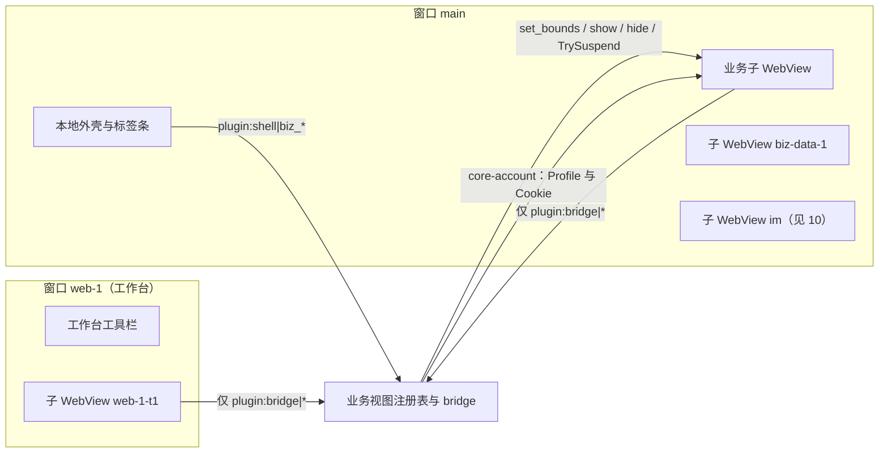

> 历史归档：本篇为范围收敛前的设计快照，全部旧任务、工期和验收要求已停止生效。当前依据为[范围决定](../../../decisions/2026-10-30-web-only-scope.md)与[总计划](../../../plan/00-master-development-plan.md)。

# 04 业务页承载：ui-business 与 bridge 插件

> **范围已变更（2026-10-30）**：以[网页版范围决定](../../../decisions/2026-10-30-web-only-scope.md)为准。只做目标网页已有的消息、通知和订单联系入口；网页没有的功能不做。本文超出该范围的桌面对齐、扩展功能与验收要求均作为历史参考，不再执行。

2026-10-30

本文是 [开发总纲](00-architecture.md) 下的模块文档，负责 home、order、product、comment、bulletin、course、event、bi（data）、ai、web 这些窗口，以及远程 vbooking 页面在 Tauri 2 里的承载方式和 bridge 插件。上游依据见 [04 模块划分与联动](../04-modules-and-integration.md)、[03 副窗口](../03-multi-window.md)、[02 现有客户端缺陷](../../../02-current-client-defects.md)。

文中“出处”指本地解包的官方 1.2.12 源码：主进程 `dist-electron/main/index.js`（下称 main）、常量 `constant-2w9sXoOv.js`（下称 constant）、预加载 `preload/*.js`、渲染产物 `renderer-dist/js/*Window-*.js`。标“推断”的是没有读到直接实现的结论。

## 1. 结论与定位

- **官方的业务模块不是“直接加载远程 URL”，而是“本地 React 外壳 + 跨域 iframe”**。home、order、product、comment、bulletin、course、event、data(bi) 这 8 个入口都是本地页面，作为 BrowserView 挂在主窗口里；除 home 的本地菜单分支外，页面内用 `<iframe class="full-iframe">` 嵌入 `vbooking.ctrip.com`、`zuchebao.ctrip.com`、`m.ctrip.com` 的页面，URL 参数按入口各自保留，不能给 home 等入口无条件追加 `micro=1`。只有 web（工作台）窗口和 extra 小窗是“BrowserView 直接 loadURL 远程页”。
- 静态代码包含三类放宽浏览器安全边界的做法（未证明每个页面都依赖全部开关）：`webSecurity:false`（本地页跨域带 Cookie 调接口、读 iframe 的 `contentWindow`）、`disable-site-isolation-trials`、在会话上**删除远程响应的 `X-Frame-Options` 与 `Content-Security-Policy` 头**（main，`IFRAME_WHITE_DOMAINS`）。WebView2 可通过 `WebResourceRequested` 自定义响应；不采用原方案的原因是它依赖宽松跨域与响应头剥除，不能把这种行为作为新客户端的安全基础，而非平台绝对做不到。[Microsoft 网络请求管理](https://learn.microsoft.com/en-us/microsoft-edge/webview2/how-to/webresourcerequested)
- **新方案：远程页一律作为顶层 WebView 承载**，不再嵌 iframe。主外壳是本地 WebView（导航、账号、二级标签），每个远程业务页是主窗口里的一个子 WebView（Tauri 2 multiwebview，`Window::add_child`，属 `unstable` 特性，必须先做原型）。原型不过时退回“每个业务页一个独立窗口”。
- **已识别 10 个 `postMessage` 事件，但“远程页无需改代码”尚未成立**。`preload/web.js` 没有通过 `contextBridge` 暴露对象，只能说明该预加载入口的行为；data 外壳还向远程页注入 `microApp`，并提供业务线与用户回调。顶层承载、`window.parent`、SSO 与 `microApp` 兼容需逐入口验收；不能用 IM 网页可打开推定所有业务页通过。
- **bridge 候选范围为 10 个已识别事件的命令**，逐项通过来源与兼容验收后，由 `remote-bridge.json` 按具体 WebView 和精确来源授权；未查证的 `downloadFile/download` 仅预留、默认无权限；导航、新窗口、下载、右键菜单、查找、崩溃恢复都在 Rust 侧用 WebView 回调处理，不需要远程页参与。
- ai 不是业务页，而是 IM 的“总结消息”侧窗；data 与 bi 是同一个入口；toggleBaolei 是热更新的“堡垒”灰度通道开关。三者的归属见第 11 节。

## 2. 承接范围

### 2.1 逐窗口现状

| 入口（pageType） | 官方页面 / bundle | 承载 | 远程内容（PROD；FAT/UAT 换成 `*.qa.nt.ctripcorp.com` 同路径） | 出处 |
| --- | --- | --- | --- | --- |
| home | `pages/home` / `homeWindow-*.js` | 主窗口 BrowserView，本地页 | 本地渲染业务线选择器与菜单墙（接口 `getCurrentUserInfo`、`getProviderBusinessLineList`、`queryDoorCommonTool`、`saveDoorCommonTool`）；点菜单项 `window.open` 到 web 窗口。商家账号（`partyType=merchant`）改为 iframe 嵌 `https://m.ctrip.com/webapp/vbooking/home?locale=zh_cn`，海外语言用 `us/hk/jp/kr/th.trip.com/m/vbooking/home` | homeWindow：`C_` 表、`window.open(f)` |
| order | `pages/order` | 本地外壳 + antd Tabs + 每个标签一个 iframe | 菜单 `href` 来自 `getCurrentUserInfo` 的 menuList，按 `businessMenu.properties` 里的 menuCode 过滤；相对路径拼 `https://vbooking.ctrip.com`（租车 `https://zuchebao.ctrip.com`），加 `micro=1` | orderWindow：`INIT_ORDER_MENU`、`searchParams.set("micro","1")` |
| product | `pages/product` | 同 order | 同上，menuCode 取 `product` 键 | productWindow |
| comment | `pages/comment` | 同 order | 同上，menuCode 取 `comment` 键 | commentWindow |
| bulletin | `pages/bulletin` | 本地外壳 + 单 iframe | 度假 `https://vbooking.ctrip.com/ivbk/notice/vendorAnnounceList?applicationCode=vbk_online_new&micro=1`；租车 `https://zuchebao.ctrip.com/webapp/zcb/pc/messageManagement/announcementList?micro=1` | bulletinWindow |
| course | `pages/course` | 本地外壳 + 单 iframe | 有未完成必修课时 `https://vbooking.ctrip.com/vendor/help/vbk/learningCenter?curcoursetype=compulsory&micro=1`，否则 `…/vendor/help/vbk/vendorServiceHomepage?micro=1`（先调 `queryProviderUncompletedDetail` 判断） | courseWindow |
| event | `pages/event` | 本地外壳 + 单 iframe | 度假 `https://vbooking.ctrip.com/tour/order_event_antd4/vbkEventList?applicationCode=vbk_online&micro=1`；租车 `https://zuchebao.ctrip.com/calabi-event/eventNotification/list?micro=1`；商家账号不显示 | eventWindow |
| data（即 bi） | `pages/bi` / `dataWindow-*.js` | 本地外壳 + 按业务线分标签的 iframe | `https://vbooking.ctrip.com` + 接口 `getVendorValidBusinesslineWithSort` 返回的 `urlSuffix` + `micro=1`；标签名取 Shark appId `100010917`。外壳每 16 ms 轮询 iframe，向其 `contentWindow` 注入 `microApp`，监听 `setGlobalCallback` 事件后回调 `onBusinessChanged(businessId)`、`onGetUserInfo({user})` | main：`Wo.data:"/pages/bi/index.html"`；dataWindow：`__vbkSetGlobalCallbackEvent` |
| ai | `pages/ai` | 独立窗口，宽 375，贴在主窗口右侧，本地页 | 不加载远程页。用 `fetch` 以 SSE 调 `https://m.ctrip.com/restapi/package/conversationsummary/streamSummary`（`credentials:"include"`），展示 IM 会话的“总结消息” | aiWindow；main：`openAiWindow`、`getCurrentMessages` |
| web（工作台） | `pages/web` / `webWindow-*.js` | 每账号一个窗口：本地标签栏 + 地址栏，下方每个标签是一个 **BrowserView 直接 loadURL** | 任意白名单内 URL；“+”默认打开 `https://vbooking.ctrip.com/micro/ivbk/accountV2/dashboard`（商家打开 m.ctrip.com 首页） | main：`createWebWindow`、`createWebView`；BaseController：`S_` |
| extra 小窗 | 无本地页 | 单个 BrowserWindow 直接 loadURL | 远程页通过 `openExtraUrl` 打开，窗口尺寸取 URL 参数 `width/height/top/left/fullscreen/isHideNavBar/navBarHeight/navBarStyle` | main：`openExtraWindow` |

补充：

- 主窗口的 BrowserView 按账号分组（`mainChilrenList[buid].viewList`），访问过的页面一直保留，直到账号登出；登录时预先创建 `im` 与 `notice` 两个视图（main：`openMainWindow`、`jumpToMainUrl`）。
- 各外壳页在 `visibilitychange` 时用 `getCurrentUserInfo` 探测登录态，错误码 `10007` 弹“账号下线提醒”（`useMenuList-*.js`），无菜单时自动切回 IM（`triggerMainViewChanged("im")`）。
- 本地外壳调接口用的是浏览器 `fetch(..., {credentials:"include"})`，不是 `netFetch`（BaseController：`async fetch(t,r,i){return i===!1?appBridge.netFetch(...):window.fetch(...)}`，业务页都传 `browser:true`）。

### 2.2 远程页可调用的客户端能力（`postMessage` 约定）

官方 `preload/web.js`、`preload/index.js`、`preload/main.js` 都监听 `window.message`，载荷为 `{eventName, detail}`。来源判定（`web.js`：函数 `I`、`H`、常量 `j`）：同源且 `source===window` 的消息全部放行；其他来源只要 origin 在 33 个携程系域名后缀白名单内（`.ctrip.com`、`.trip.com`、`.c-ctrip.com`、`.tripcdn.com`、`.ctripcorp.com`、`.tripqate.com`、`.qunar.com` 等），放行除 `login/logout/changeLocale/closeWindow/closeExtraWindow` 以外的事件。

| eventName | detail | 官方行为 | 新命令 |
| --- | --- | --- | --- |
| `login` | — | `add_account`，弹登录窗加账号 | `plugin:bridge\|add_account` |
| `logout` | — | `logout` 当前账号 | `plugin:bridge\|logout` |
| `changeLocale` | 语言串 | `change_shark_locale` | `plugin:bridge\|change_locale` |
| `openUrl` | URL | `window.open`，再由 `setWindowOpenHandler` 决定开新标签或系统浏览器 | `plugin:bridge\|open_url` |
| `openExtraUrl` | `{url}` | `open_extra_window`，只接受白名单域名 | `plugin:bridge\|open_extra` |
| `closeExtraWindow` | — | `close_extra_window` | `plugin:bridge\|close_extra` |
| `closeWindow` | — | 关闭当前标签（工作台里至少保留一个） | `plugin:bridge\|close_tab` |
| `openUrlByBrowser` | `{url}` | `open_with_system_browser` | `plugin:bridge\|open_external` |
| `recognizeImage` / `cancelRecognition` | `{imageData:ArrayBuffer}` 或 `{imagePath}` | 只在 `web.js` 里：调 OCR，结果用 `postMessage({eventName:"recognizeImageResult"})` 回传 | `plugin:bridge\|recognize_image`、`plugin:bridge\|cancel_recognition` |

`web.js` 还对远程页做了 4 件不需要页面配合的事：Ctrl+F 页内查找框（注入 DOM，`find_in_page`）、右键菜单（`pop_context_menu`，复制、链接、图片、剪切、粘贴、全选）、双击图片打开图片预览（`open_window "image"`）、主进程拦截 F12 / F5（`before-input-event`）。`web.js` 内部构造了 `appBridge` 对象但**没有暴露给页面**，`dbQuery`、`netFetch` 等对远程页不可达。

### 2.3 主进程中与远程页相关的策略

| 策略 | 官方实现 | 出处 |
| --- | --- | --- |
| 导航白名单 | `will-navigate`、`will-redirect`：非 http(s) 拦截；非白名单域名拦截并 `shell.openExternal`；IM 链接拦截 | main：`qe`、`Ot`、`nu`、`judgeIMJumpUrl` |
| IM 链接改走本地 IM | `vbooking.ctrip.com/ivbk/accountV2/vbkChat?imUrl=…`、`vbooking.ctrip.com/vbk/im/…`、`imvendor.ctrip.com/main` 转成跳本地 im / notice 视图 | main：`yp`、`_o`、`Lo`、`jumpToIMPage` |
| 新窗口 | `setWindowOpenHandler` 全部 deny 后自行处理：白名单内且 disposition 为 `foreground-tab`/`new-window` 时新建标签，否则当前标签 `loadURL`，**保留 POST 体与 Content-Type**；白名单外交系统浏览器 | main：`createWebView` |
| 下载 | 每个账号分区 `will-download` 弹保存对话框；若下载由空白新窗口触发，下载结束后关闭该窗口 | main：`Pp` |
| 账号 Cookie | 登录成功把默认会话的 Cookie 加上 `bticket`、`vbkticket`、`BDUID` 写进 `persist:<buid>` 分区 | main：`zt(m.cookies, …)` |
| 请求改写 | 本地页里协议相对地址被解析成 `file://webresource.c-ctrip.com/…`，用 `onBeforeRequest` 改回 https；`/restapi/soa2/` 按偏好切网关（`m.ctrip.com`、`online.ctrip.com`、`sec-m.ctrip.com`） | main：`onBeforeRequest`；constant：`GATEWAY_DOMAIN_LIST` |
| 安全开关 | 7 处 `webSecurity:false`，另有主窗口 BrowserView 只对 setting 页开启；`disable-site-isolation-trials`、`disable-http2`、`ignore-connections-limit`；非 PROD 忽略证书错误 | main |
| 崩溃与无响应 | BrowserView `crashed` 后 3 秒重载，最多 10 次；`unresponsive` 弹窗询问重载 | main：`createBrowserView` |
| 缩放 | 偏好 `scale` 应用到所有业务视图 | main：`onZoomChange` |

## 3. Tauri / Rust 分工表

| 放 Rust（core-shell 的业务视图子模块 + bridge 插件） | 放 WebView 前端（ui-business，运行在主外壳里） |
| --- | --- |
| 子 WebView 的创建、定位、显示隐藏、挂起、销毁、LRU 回收 | 左侧导航、二级标签条、加载态与错误态 |
| 每个入口的 URL 解析（环境、业务线、语言、`micro=1`）与菜单过滤 | 菜单墙、业务线选择器、常用工具编辑弹窗（home 本地部分） |
| 导航白名单、IM 链接改道、外链交系统浏览器 | 工作台窗口的地址栏、前进后退、标签拖拽排序 |
| 新窗口策略（含 POST 体）、下载接管、右键菜单、页内查找 | 无 |
| 兼容层脚本的注入与 bridge 命令校验（WebView 标签 + 当前 URL 来源） | 无（兼容层脚本由 Rust 下发，不属于前端工程） |
| 账号 Profile 绑定（调 core-account）、Cookie 写入时机 | 账号切换按钮（调 `plugin:account\|switch`） |
| 外壳页要调的携程接口（经 core-net，带账号 Cookie） | 展示接口结果 |
| 崩溃重载、无响应检测、内存档位 | 崩溃后的提示条 |

## 4. Rust 核心设计

### 4.1 承载方式



| 方案 | 做法 | 优点 | 风险 | 结论 |
| --- | --- | --- | --- | --- |
| A：主外壳内多子 WebView | `Window::add_child(WebviewBuilder, pos, size)`，外壳 WebView 占顶部和左侧，业务子 WebView 填内容区；切换时 `show/hide` | 接近官方 BrowserView 体验；同 Environment/Profile 方案可能共享浏览器进程，按账号目录兜底时不能承诺共享 | 需开 Tauri `unstable` 特性；焦点、DPI、窗口缩放时的闪烁、键盘快捷键路由要验证 | 首选，先做原型 P1 |
| B：每个业务页一个独立窗口 | `WebviewWindowBuilder` 加载远程 URL，标签 `biz-<模块>`，主外壳只做入口 | 只用稳定 API | 体验从“标签切换”变成“多窗口”，用户需适应 | A 不过关时退回 |
| C：本地外壳内 iframe（官方现状） | 不改结构 | 前端改动最小 | 原实现依赖剥除安全响应头、跨域 DOM 访问与第三方 Cookie，不符合本项目安全边界 | 不采用 |

外壳 WebView 只负责画标签条，它通过命令告诉 Rust 内容区的矩形（逻辑像素），Rust 负责 `set_bounds`。窗口 `resize` 与 DPI 变化由 Rust 直接重算，不经前端往返，避免拖动时子 WebView 跟不上。

### 4.2 WebView 标签

在总纲第七节的基础上细化（需总纲同步，见文末）：

| 标签 | 所在窗口 | 说明 |
| --- | --- | --- |
| `biz-<模块>-<序号>` | main | 业务子 WebView，模块取 home、order、product、comment、bulletin、course、event、data |
| `web-<n>` / `web-<n>-t<k>` | 工作台窗口 | `web-<n>` 是本地工具栏 WebView，`-t<k>` 是远程标签 |
| `web-extra` | extra 小窗 | 单例，只有一个远程 WebView |

### 4.3 状态

```rust
struct BizView {            // 一个远程子 WebView
    label: String,          // biz-order-0
    module: BizModule,      // Home | Order | ... | Web | Extra
    account: AccountContext, // account_id/environment/session_generation；由 core-account 解析
    view_generation: u64,  // 重建或导航使旧回调失效
    url: Url, title: String,
    state: ViewState,       // Live | Hidden{since} | Suspended | Discarded
    last_active: Instant,
    keep_alive: bool,       // 用户钉住或入口配置为常驻
}
struct BizRegistry { seq: u64, views: Vec<BizView>, active: HashMap<String, String> } // 窗口→当前标签
```

注册表由一个 actor 任务持有（总纲 4.5）。被回收（Discarded）的视图只保留 URL 和标题，再次激活时重建并加载。

### 4.4 命令

外壳侧（`shell.json` 只授予列出的具体命令）。每个账号相关请求显式携带 `AccountContext{account_id, environment, session_generation}` 与 `ViewContext{webview_label, view_generation}`，Rust 与注册表的来源绑定核对；不能在执行时重新读取“当前账号”。下表为业务参数，不重复公共上下文：

| 命令 | 参数 | 说明 |
| --- | --- | --- |
| `plugin:shell\|biz_entries_snapshot` | — | 请求绑定账号可见的入口与二级标签（已按菜单与 `businessMenu.properties` 过滤），带 `seq` |
| `plugin:shell\|biz_views_snapshot` | `window` | 该窗口的标签列表与状态 |
| `plugin:shell\|biz_open` | `module, sub_key?` | 打开或激活一个入口；不存在则创建子 WebView |
| `plugin:shell\|biz_set_viewport` | `window, rect` | 外壳上报内容区矩形 |
| `plugin:shell\|biz_tab_action` | `label, action` | `focus/close/close_others/back/forward/reload/home/jump{url}/pin` |
| `plugin:shell\|biz_reorder` | `window, labels[]` | 工作台标签拖拽排序 |
| `plugin:shell\|web_window_open` | `url?` | 打开请求绑定账号的工作台窗口 |
| `plugin:shell\|biz_api` | `api, body` | 仅固定只读 endpoint_id 及逐接口请求/响应 schema（菜单、业务线、常用工具、未读公告、课程），内部转 core-net；不接收 URL、任意头或原始透传体。`saveDoorCommonTool` 等写操作另设模块 typed command、校验账号权限且不得自动重试；旧 `netFetch` 参数只可映射已登记只读 endpoint_id，无法映射即拒绝 |

远程侧只授权第 2.2 节经验证的命令；`download` 未有静态事件证据，默认关闭。必须同时满足：

1. **能力以 WebView 精确分配**：本地工具栏与远程内容不用同一个 `windows` 通配授权；多个 capability 权限会合并，不可把 `shell.json` 的权限泄漏给同窗远程子 WebView。[Tauri capabilities](https://v2.tauri.app/security/capabilities/)
2. **来源由宿主取得**：检查实际调用 WebView、文档来源、导航代次与账号绑定；仅查当前顶层 URL 或标签前缀不足以证明某个 iframe 是调用者。JS 层 `event.source===window` 和精确 `event.origin` 是补充检查，不是可绕过的 Rust 权限替代。实际框架若无法可信区分 frame，远程侧禁用 `logout/change_locale/close_extra/close_tab` 等影响账号或窗口的命令，转本地外壳操作。
3. **载荷按事件 schema 校验**：拒绝未知字段、超长 URL、非 HTTPS（本地开发例外须独立构建）、凭据 URL、任意文件路径。OCR 只接受限额图片字节或核心发放且绑定账号的临时句柄，不接收页面提供的 `imagePath` 作为本地路径。
4. **权限不等于信任页面内容**：可信域名也可能有 XSS；远程 bridge 不授予文件系统、执行、任意网络、凭据读取、更新与偏好写入。加账号只打开本地登录入口，远程退出/全局语言修改须在本地壳确认；外链与下载应有用户操作且限流，不能信任页面自报的 `isUserInitiated`。
5. **导航竞态**：回调开始、异步完成、结果回送均核对 `view_generation` 与账号代次；结果只回到原来源文档，禁止 `postMessage(..., "*")` 携带用户资料或 OCR 内容。

### 4.5 事件

| 事件 | 载荷 | 订阅方 |
| --- | --- | --- |
| `shell://biz-entries-changed` | `{seq}` | 外壳（重新拉快照） |
| `shell://biz-views-changed` | `{seq, window}` | 外壳、工作台工具栏 |
| `shell://biz-view-crashed` | `{label, reason, retry}` | 外壳（显示提示条） |

事件采用总纲 `EventEnvelope{scope,stream,epoch,seq,payload}`，按账号绑定定向下发；先订阅并缓冲，再取原子快照后重放。表中 `{seq}` 是简写，不允许全局广播业务数据。

### 4.6 WebView 构建与回调（锁定版本后逐项编译、运行验收）

| 需求 | 实现 | 状态 |
| --- | --- | --- |
| 子 WebView | `Window::add_child`、`Webview::set_bounds`、`hide/show`、`close` | `unstable` 特性，需验证 |
| 兼容层注入 | `WebviewBuilder::initialization_script`，脚本显式检查顶层与精确 origin | 注入的 frame 范围随平台/版本核实；脚本检查不替代宿主 IPC 来源授权 |
| 导航白名单 | `WebviewBuilder::on_navigation`（返回 false 即拦截） | 稳定；是否覆盖服务端 302 跳转需验证，补充用 WebView2 `NavigationStarting` |
| 新窗口 | `WebviewBuilder::on_new_window`（2.6 起） | 需验证实际版本；WebView2 `NewWindowRequested` 可绑定同 Environment 的新 WebView，不能假定事件提供可重放 POST 体 |
| 下载 | `WebviewBuilder::on_download` 与平台下载事件 | 同步回调不能等待异步保存框；需平台 deferral 或预先取得路径，完成/取消语义列 P5 |
| 标题、URL 变化 | `on_page_load`、`on_document_title_changed` | 后者需验证版本 |
| 账号隔离 | `WebviewBuilder::data_directory`（每账号一个目录，兜底）或 WebView2 Profile（`ICoreWebView2ControllerOptions::ProfileName`，首选，需在 platform-win 补） | 需验证，与 02 共做 |
| 右键菜单 | WebView2 `ContextMenuRequested`（`ICoreWebView2_11`）：保留复制、粘贴、图片另存，去掉“检查”，加“刷新”“系统浏览器打开” | 经 `Webview::with_webview` 拿原生对象 |
| 页内查找 | WebView2 Find API（`ICoreWebView2Find`）；SDK 不满足时用兼容层脚本内的查找框 + `window.find` | 需验证 |
| 后台挂起 | `ICoreWebView2_3::TrySuspend/Resume`、`ICoreWebView2_19::MemoryUsageTargetLevel` | 稳定的 WebView2 接口 |
| 崩溃 | WebView2 `ProcessFailed` 事件 | 稳定 |
| 缩放 | `Webview::set_zoom` | 稳定 |

### 4.7 并发与平台差异

- 回调（`on_navigation`、`on_new_window`、`on_download`）在 WebView 线程上同步返回，只做白名单判断与快速决定，耗时动作（打开窗口、弹保存对话框、OCR）投递到注册表 actor 或 tokio 任务。
- macOS 第二阶段：WKWebView 没有 TrySuspend，后台标签只能靠回收；账号隔离用 `data_store_identifier`（macOS 14+）。所有 WebView2 专有调用放在 `core-shell/src/platform/win/biz.rs`。

## 5. 前端设计

| 页面 | 归属 | 结构 | 性能要求 |
| --- | --- | --- | --- |
| 导航与二级标签条 | ui-shell 主外壳内的 ui-business 组件 | 左侧入口列表（徽标：未读公告数）；顶部二级标签（order/product/comment/data 的子菜单）。只画标签，内容区留空给子 WebView | 切换入口到子 WebView 可见 ≤ 100 ms（已存活视图） |
| home 菜单墙 | ui-business，本地重写 | 业务线选择器、“我的常用”“最近使用”、菜单分组、添加常用工具弹窗；点菜单调 `biz_open` 或 `web_window_open` | 首屏 ≤ 300 ms（菜单数据来自 Rust 缓存） |
| 工作台工具栏 | 窗口 `web-<n>` 的本地 WebView | 标签栏（可拖拽、可改名、右键“关闭其他”）+ 地址栏（白名单外回车即交系统浏览器）+ 回主界面 | 单页包体 ≤ 150 KB |
| 加载与错误态 | 外壳 | 子 WebView 首次加载时外壳在内容区显示骨架；加载失败、崩溃时显示“刷新”按钮 | 无 |

原则：

- 外壳**不再访问远程页 DOM**。官方 iframe 上的“右键刷新”改为 Rust 原生右键菜单项。
- 外壳不直接 `fetch` 携程接口，全部经 `plugin:shell|biz_api`，由 core-net 使用已捕获并验证的请求账号 Cookie。
- “无菜单时自动切回 IM”改成 Rust 侧在快照里不下发该入口；“账号下线提醒”统一由 core-account 判定后发 `account://changed`，外壳不再各自轮询。
- 业务线选择写回 `userInfo.businessline`（官方直接在渲染进程用 drizzle 更新表），改为调用 account 命令。

## 6. 与其他模块的联动

| 模块 | 本模块需要它提供 | 它需要本模块提供 |
| --- | --- | --- |
| core-account（02） | 每账号的 WebView2 Profile 或数据目录；登录后把 `bticket`、`vbkticket`、`BDUID` 写入该 Profile 的 Cookie；`account://changed` | 远程页发起的 `add_account`、`logout`、`change_locale` 转交 |
| core-net（06） | 当前环境（FAT/UAT/PROD）与网关偏好；带账号 Cookie 的接口调用；SSE 流（供 ai 总结） | 无 |
| core-media（07） | 下载任务登记与完成通知、OCR（`recognize_image`）、图片预览窗口 | 下载事件转交 |
| core-im（10） | 跳会话命令（承接 `judgeIMJumpUrl`） | 导航回调里识别出 IM 链接后调用 |
| core-update / telemetry（08） | 缩放、语言偏好；埋点 `vbk_electron_webview_open` | 无 |
| core-assistant（09） | 无 | 若 ai 总结并入助手，复用本模块的流式接口约定 |

## 7. 关键流程

### 7.1 打开一个业务入口

1. 外壳调用 `biz_open(order, sub_key)`。
2. 注册表查请求绑定账号是否已有该视图：存活则 `show` 并隐藏原视图；挂起则 `Resume` 后 `show`；已回收或不存在则进入第 3 步。
3. 解析 URL：环境基址 + 菜单 `href` + `micro=1`（home 另加 `businessId`、`locale`）。
4. 向 core-account 取该账号的 Profile，确认登录 Cookie 已写入，然后 `add_child` 创建子 WebView，注入兼容层，挂上导航、新窗口、下载回调。
5. 发 `shell://biz-views-changed`，外壳更新标签条。

### 7.2 远程页点击链接或 `window.open`

| 目标 | 处理 |
| --- | --- |
| IM 链接（第 2.3 节三类） | 拦截，调 core-im 跳会话，焦点回主窗口 |
| 白名单内，新窗口意图 | 在来源账号的工作台新建、同 Profile 绑定目标 WebView，由浏览器完成原导航；优先保留 POST/opener/cookie 语义，不自行重放未知请求。能力不满足则明确阻断该操作，不能悄悄改 GET 或重复提交 |
| 白名单内，同标签 | 允许导航 |
| 白名单外的 http(s) | 拦截，系统浏览器打开（`tauri-plugin-opener`） |
| 其他协议 | 拦截；`vbookingChat://` 交 deep-link 流程，其余丢弃并记日志 |

### 7.3 下载

1. 来源 WebView 触发下载时捕获账号、认证代次、Profile、视图代次和 task_id，交 core-media 登记；不能使用全局当前账号。
2. core-media 校验建议文件名与目的地，采用平台下载 deferral 等待保存框，或使用事先确认的下载目录；同步回调不阻塞等待异步任务。不支持 deferral 的运行时须明确选择已验证回退，不能先允许后问路径。
3. **一次下载只有一个执行者**：网页导出（包括需浏览器上下文的 `blob:`）由 WebView 执行，core-media 管理状态；Rust 直链下载是另一任务类型，不额外重发网页请求。`blob:`/`data:` 的实际支持和大小上限由 P5 验证，不预先承诺。
4. 完成、失败、取消均回到原 task_id 与账号；临时文件/覆盖确认/不自动打开可执行文件遵循 07。只关闭由本任务创建且仍为空白的临时窗口。
5. 未观测到 `downloadFile` 事件契约前不注入伪兼容功能、不开放 `plugin:bridge|download`。

### 7.4 切换账号

1. core-account 发 `account://changed`。
2. 注册表把旧账号的业务视图全部隐藏；60 秒后仅将已确认可恢复且无未保存内容的旧账号视图列为回收候选。工作台窗口按账号分开，不受影响。
3. 外壳拉新的入口快照，打开新账号的默认入口。

## 8. 注意事项（Windows 优先）

- **去掉 `disable-site-isolation-trials` 与 `webSecurity:false` 的影响**：
  - 远程页改为顶层加载后，等价于用户在 Edge 里打开 vbooking 网页版。网页版本来就在标准浏览器安全模型下运行，**预期绝大多数页面不受影响**。
  - 真正会坏的是官方依赖这些开关的本地代码：外壳读 iframe `contentWindow`（右键刷新、data 页 `microApp` 握手）、本地页跨域带 Cookie 的 `fetch`（菜单、业务线、ai 的 SSE）、协议相对地址被解析成 `file://`。这些在新方案里分别改为原生右键菜单、兼容层注入、core-net 代理。
  - 待验证的风险是 `micro=1` 模式：页面可能假设自己在父页面的 iframe 里（读 `window.parent`、`window.microApp`），顶层加载时行为未知。兼容层需提供 `window.microApp` 桩，由原型 P2 确认。
  - 验证方法见第 9 节 P2：按入口清单逐个打开，用 DevTools 协议（`CallDevToolsProtocolMethod`，`Log.enable`、`Network.enable`）收集控制台错误与失败请求，重点看 CORS、`X-Frame-Options`、混合内容、第三方 Cookie、`SameSite` 警告，并与官方客户端截图对比。
- **`disable-http2`、`ignore-connections-limit` 不照搬**。如果原型发现某些接口在 HTTP/2 下异常，再用 `additional_browser_args` 只对受影响的情况打开，并记录原因。
- **证书验证不按环境关闭**。开发测试使用明确安装的测试 CA 与独立环境凭据；无受信证书时显示连接错误，不以 QA 域名为由放过任意证书。
- **白名单分两级**。导航白名单以已验收业务入口的精确 origin 为起点，33 个旧后缀仅作为调查线索；扩展必须经过版本化签名策略审核；IPC 白名单只放真正的入口主机：`vbooking.ctrip.com`、`zuchebao.ctrip.com`、`m.ctrip.com`、`us/hk/jp/kr/th.trip.com`、`imvendor.ctrip.com`，测试主机只进非 PROD 构建。`remote.urls` 与 Rust 校验都采用 URL 解析后的精确 scheme/host/port/path 规则，拒绝后缀伪装、userinfo、非预期端口及降级跳转；路径权限收窄不能代替同源 XSS 防护。
- **兼容层必须保守**：只监听 `message` 事件并转发既有 10 个事件名，不在页面里放 `window.appBridge` 等新全局对象，不改页面 DOM（查找框除外）。Tauri 会给远程页注入 `__TAURI_INTERNALS__`，所以 capability 只能授予 bridge，且 bridge 自己再校验来源。
- **后台节流**：隐藏的子 WebView 定时器会被 WebView2 节流，远程页的轮询会变慢，这与浏览器后台标签一致，可以接受。凡是计时敏感的逻辑都不在业务页里（总纲 2.1）。
- **焦点与快捷键**：子 WebView 获得焦点后，全局快捷键（如截图）要由 global-shortcut 插件或主窗口加速键处理；F5 刷新、Ctrl+F 查找、Ctrl+加减缩放由 Rust 用 WebView2 `AcceleratorKeyPressed` 统一拦截。正式构建禁用 F12。
- **内存**：所有 WebView 共用一个 WebView2 环境（同一用户数据目录）；如果账号隔离最终只能用独立数据目录，每个账号会多一套浏览器进程，需要更严的回收上限。
- **DPI**：`set_bounds` 统一用逻辑像素，跨屏拖动主窗口时监听 `ScaleFactorChanged` 重算一次。

### 8.1 页面保活与回收策略

| 档位 | 条件 | 动作 |
| --- | --- | --- |
| 前台 | 当前可见 | 正常 |
| 隐藏 | 切走后 | `hide`，`MemoryUsageTargetLevel=Low` |
| 挂起 | 隐藏超过 5 分钟 | `TrySuspend`（保留 DOM 与表单，停脚本） |
| 回收 | 存活视图超过 6 个或旧账号切走 60 秒后，仅在非豁免候选中按 LRU | 销毁 WebView，只留 URL 与标题；再次打开时重新加载 |
| 豁免 | 用户钉住、正在下载/上传/提交、未保存表单、无法判定是否有未保存内容的页面 | 不自动回收；`beforeunload` 不是完整的脏状态检测，默认未知即保留，需用户确认才关闭 |

数字是初值，以原型 P7 的实测内存为准，并做成设置项。

## 9. 原型验证项与验收标准

| 编号 | 验证项 | 验收标准 |
| --- | --- | --- |
| P1 | multiwebview：主窗口内 1 个外壳 + 8 个远程子 WebView | 切换 ≤ 100 ms；窗口缩放、最大化、跨 125%/150% 屏拖动无错位、无明显闪烁；键盘焦点在子 WebView 与外壳之间正确切换；IME 输入正常 |
| P2 | 默认安全设置下的远程页 | 第 2.1 节全部入口 URL（度假、租车、商家三类账号各一）可用：列表加载、搜索、详情新标签、导出下载、文件上传、打印；控制台无新增 CORS、XFO、第三方 Cookie 报错；与官方截图逐页对比 |
| P3 | 账号隔离 | 两个账号同时登录，核验 HttpOnly Cookie、localStorage/IndexedDB、service worker、接口实际身份及跨账号新窗口；仅检查 `document.cookie` 不算通过，切换不重启 |
| P4 | 新窗口与 POST | 远程页 `window.open`、`target=_blank`、表单 POST 到新窗口三种情况，都在工作台新标签打开且 POST 体完整 |
| P5 | 下载 | http、`blob:`、`data:` 三类下载均弹保存框并成功；需要登录态的导出文件可下 |
| P6 | data 页兼容层 | `microApp` 桩 + `setGlobalCallback` 握手后，各业务线标签数据与官方一致 |
| P7 | 内存 | 单账号打开 8 个入口后空闲内存 ≤ 官方同场景的 50%；挂起 10 个后台标签后 CPU 接近 0 |
| P8 | bridge 安全 | 跨域 iframe、同源 iframe、旧文档迟到回调、重定向后旧 URL、同窗口本地/远程 capability 合并均测试；远程无法调用其他插件或读任意路径；无法可信识别 frame 时高影响命令保持禁用 |
| P9 | 右键菜单与查找 | 复制、粘贴、图片另存、刷新可用；Ctrl+F 能查找并定位；双击图片打开预览 |

## 10. 开发步骤与工作量估计

| 步骤 | 内容 | 人日 |
| --- | --- | --- |
| 1 | 原型 P1、P2、P3（与 02 共做 P3），决定方案 A 或 B | 5 |
| 2 | 业务视图注册表、`biz_*` 命令与事件、视口同步 | 4 |
| 3 | 入口 URL 解析与菜单过滤（含环境表、`businessMenu.properties`、商家账号分支）、`biz_api` 白名单接口 | 3 |
| 4 | 导航、IM 改道、新窗口（含 POST）、下载接管 | 4 |
| 5 | 兼容层脚本 + 经验证 bridge 命令（最多 10 个）+ 来源校验 + capability | 3 |
| 6 | 右键菜单、查找、快捷键、缩放、崩溃重载 | 3 |
| 7 | 外壳前端：导航、二级标签、home 菜单墙重写 | 5 |
| 8 | 工作台窗口与 extra 小窗 | 3 |
| 9 | 保活与回收策略、内存实测调参（P7） | 3 |
| 10 | 全入口回归（P2、P4–P9）与问题修复 | 4 |
| 合计 | | 37 |

不含 ai 总结窗口（归属待定，约 2 人日）和 macOS 适配。

## 11. 待确认问题

| 问题 | 现状 | 需要谁确认 |
| --- | --- | --- |
| `micro=1` 页面顶层加载是否正常，是否依赖父页面 | 官方一直以 iframe 嵌入，未见顶层使用 | 携程业务方 + 原型 P2 |
| data 页 `setGlobalCallback` 需要的 `user` 字段范围 | 官方把整个 `userInfo` 传给 iframe；新方案只下发经逐字段验证的展示/业务字段，禁止票据、Cookie、密码、跨账号信息 | 携程 BI 页面负责人 |
| ai 窗口归属 | 本地页，功能是 IM 会话“总结消息”，与业务页无关；SSE 走 m.ctrip.com，需 core-net 提供流式通道 | 建议并入 ui-im 侧栏或 09 商家助手，由 10、09 负责人确认 |
| toggleBaolei | 设置页双击版本号切换“堡垒已打开/关闭”，写 `BAOLEI_TAG_KEY`；打开后热更新的 `packageVersion.json` 改从 `static.fws.qa.nt.ctripcorp.com` 取，即内部灰度通道 | 归 08 core-update；是否保留给内部测试人员需携程确认 |
| bi 与 data | 同一入口（`Wo.data` 指向 `pages/bi`），没有独立的 bi 窗口 | 已确认，文档 04 的两个名字合并 |
| 网关切换对远程页是否必要 | 官方对整个会话的 `/restapi/soa2/` 请求改写网关；新方案只能覆盖经 core-net 的请求 | 携程运维；若必要需评估 WebView2 `WebResourceRequested` 代理的性能 |
| WebView2 Profile 能否接入 Tauri 子 WebView | wry 目前未暴露 ProfileName | 与 02 共做原型，失败则用每账号数据目录 |
| 新窗口能否保留 POST、opener 和 Profile | 新实现不能假定回调提供 POST；优先 `NewWindowRequested.put_NewWindow` 绑定同 Environment 的未导航 WebView | 原型 P4；[Microsoft API](https://learn.microsoft.com/en-us/microsoft-edge/webview2/reference/win32/icorewebview2newwindowrequestedeventargs) |
| 菜单数据来源 `businessMenu.properties` | 外壳从缓存读，主窗口 3.5 秒超时后用内置默认值（mainWindow） | 确认线上配置地址，改由 Rust 拉取 |
