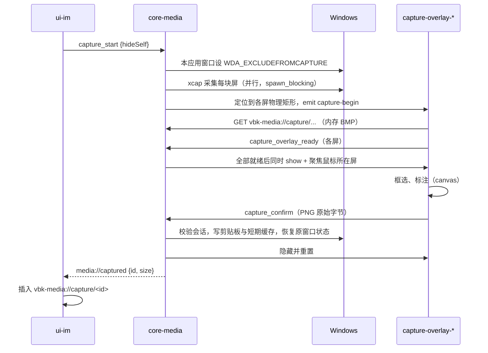

> 历史归档：本篇为范围收敛前的设计快照，全部旧任务、工期和验收要求已停止生效。当前依据为[范围决定](../../../decisions/2026-10-30-web-only-scope.md)与[总计划](../../../plan/00-master-development-plan.md)。

# 07 媒体工具：截图、OCR、拼写检查、下载、图片与视频预览

> **范围已变更（2026-10-30）**：以[网页版范围决定](../../../decisions/2026-10-30-web-only-scope.md)为准。只做目标网页已有的消息、通知和订单联系入口；网页没有的功能不做。本文超出该范围的桌面对齐、扩展功能与验收要求均作为历史参考，不再执行。

2026-10-30

本文覆盖 Rust 核心模块 core-media，以及前端模块 ui-capture（截图遮罩）与 ui-viewer（图片、视频预览）。跨模块约定以 [00 开发总纲](00-architecture.md) 为准，上游依据见 [04 模块划分与联动](../04-modules-and-integration.md)、[03 副窗口](../03-multi-window.md)。文中接口签名都是示意。

## 1. 结论与定位

- **截图采集放 Rust，框选与标注放前端 canvas。** 采集用 `xcap` crate。官方用的 `node-screenshots` 本身就是 xcap 的 Node 绑定，换成 xcap 等于去掉一层 N-API，行为最接近现状，而且第二阶段 macOS 可直接复用。DXGI Desktop Duplication 作为性能兜底，只在原型测出 xcap 达不到预算时启用。
- **每块屏幕一个预热的遮罩窗口**（`capture-overlay-<序号>`），按物理像素定位；截图帧通过自定义协议从内存直接给遮罩，结果以原始字节回传 Rust，不再走 base64。
- **隐藏自身是经验证后的能力，不能只按系统版本判定。** 优先验证 `SetWindowDisplayAffinity(WDA_EXCLUDEFROMCAPTURE)`（Windows 10 2004+）；调用失败或采集后端不兼容时安全恢复并回退隐藏窗口，用户看到结果前不得声称已排除。
- **OCR 选型暂不冻结为 Windows.Media.Ocr。** Microsoft 明确其桌面受支持使用需要 package identity；普通 NSIS 安装并不自动具有身份。必须在原型选择并通过“签名身份包 + 安装/更新/卸载全链”或“不依赖身份的本地 OCR 后端”其中一路，未完成前 OCR 为禁用的可选能力，不能仅用语言包降级掩盖此阻断。
- **中文纠错不等于系统拼写检查**：官方的 spellCheck 实际是“中文错别字纠错”（规则表 + BERT 类 ONNX 模型，跳过 ASCII 字符）。Windows ISpellChecker 和 WebView2 内置拼写检查都不支持中文，替代不了。新方案：中文错别字用 Rust 规则引擎（一期）+ 可选的 ONNX 纠错模型（`ort` crate，按需下载）；英文拼写直接用 WebView2 内置拼写检查。
- **下载统一登记和展示，不强制统一执行者。** WebView 发起的下载由来源 WebView 执行，保留 POST、Cookie、blob 上下文；明确可授权的直接 GET 下载才由 Rust 执行。两类共享任务生命周期、路径校验与完成提示，禁止重复发起请求。

## 2. 承接范围

### 2.1 官方窗口与 IPC

| 官方组件 | 现状（出处） | 新归属 |
| --- | --- | --- |
| screenshotsOverlay 页面 | `ScreenShotManagerV2` 启动时为每块屏幕预建 `title:"screenshots-v2"` 的透明窗口，`setAlwaysOnTop(true,"screen-saver")`、`setVisibleOnAllWorkspaces(...visibleOnFullScreen)`，且 `webSecurity:false`（index.js，`class Jh` 的 `_createWindow`） | ui-capture |
| screenshots 页面 | 旧版截图页，使用 `captureWindow`、`setLang`、`getWindowCapture`（renderer-dist `screenshotsWindow-*.js`）；主进程未见 `SCREENSHOTS:captureWindow` 的处理，推断 V2 之后已不再使用 | 不迁移 |
| image 页面 | 单例窗口，图片列表与当前序号放在 URL hash（`imgList`、`curIndex`），基于 viewerjs，支持缩放、旋转、翻转、切换、下载、右键菜单，切图时自动 OCR 并可“提取文字”（index.js `openImageWindow`；`imageWindow-*.js`） | ui-viewer |
| video 页面 | 每次打开新建一个黑底窗口（`openVideoWindow`），页面用 `<video>` 播放，记录 `video_player_log`，失败时发 `video_player_fallback`（`videoWindow-*.js`） | ui-viewer |
| `open_screen_shot_panel` | 触发截图，参数为是否隐藏本窗口（`openScreenShot(isHiddenThisWindows)`） | `plugin:media\|capture_start` |
| `paste_screen_shot`、`screen_shot_ready` | 截图确认后，主进程把 PNG 转成 base64 data URL 发给主窗口 BrowserView（`handleScreenshotResult`）；取消或完成后发 `screen_shot_ready` | 事件 `media://captured`、`media://capture-finished` |
| `SCREENSHOTS:*`（preload/screenshots.js） | `ready`、`reset`、`save`、`cancel`、`ok`、`captureWindow`、`selectionReady`、`imageLoaded`、`updateToolSettings`、`getAllSettings`，以及主进程下发的 `capture`、`windowInfo`、`enterPressed` | 见第 4 节命令表 |
| `recognize_image`、`recognize_image_buffer`、`cancel_recognition` | OCR 在 utilityProcess `ocr-worker.js` 中跑 PaddleOCR（PP-OCRv5 mobile det/rec 模型 + onnxruntime-web wasm），长边缩到 1280 px；返回 `{text, words:[{text,bbox}], imageSize}`，有 `detecting`/`recognizing` 进度 | `plugin:media\|ocr_*` |
| 远程页 OCR | preload/web.js 监听 `window.postMessage` 的 `recognizeImage`、`cancelRecognition`，结果回 `recognizeImageResult` | bridge 插件转发到 core-media |
| `spell_check` | utilityProcess `spell-check-worker.js`：约 60 条中文错别字规则 + `model_quantized.onnx`/`vocab.txt` 的 BERT 类纠错模型；ASCII 字符直接跳过；偏好 `enableSpellCheck` 默认开 | `plugin:media\|spell_check` |
| `image_option` | `copy`：data URL 用 `clipboard.writeImage`，否则 `copyImageAt(x,y)`；`save`：`downloadURL` | `plugin:media\|image_copy`、`download_start` |
| `download_file` | preload 只放行 http(s)、`blob:`、`data:`；主进程直接 `sender.downloadURL(url)`；会话的 `will-download` 由 `Pp()` 处理，每次弹 `showSaveDialogSync`，无进度、无续传、无完成提示 | 下载管理器 |
| `video_player_fallback` | 视频 `error` 或 `loadedmetadata` 后宽高为 0 时，用 `shell.openExternal` 交给系统浏览器并关闭视频窗口 | 见 5.3 |
| 截图快捷键 | 偏好 `screenShotKey` 默认 `CommandOrControl+Shift+X`，`globalShortcut` 注册（`PreferencesManager.initShortcut`） | global-shortcut 插件，归 core-shell 注册、core-media 响应 |

### 2.2 数据与文件

| 数据 | 官方位置 | 新位置 |
| --- | --- | --- |
| 标注工具设置 | `userData/screenshots/settings.json`，工具 Rectangle、Ellipse、Arrow、Text、Brush、Mosaic，默认 `size:3,color:#F53A45` | core-store 偏好 `media.capture.tools` |
| 截图临时文件 | 系统临时目录，截图结束 `cleanupTempFiles` | 不落盘（内存）；确认结果写账号隔离短期缓存；到期/登出删除 |
| OCR 模型 | 运行时从 `raw.githubusercontent.com` 下载，`rejectUnauthorized:false` | 取决于已通过安装验收的 OCR 后端；如需模型，只用项目可维护且已授权的来源 |
| 纠错模型 | 安装包 `resources/csc-models` 或从 `docs.c-ctrip.com/files/8/tour_vbkadminuser` 下载 gz，同样关闭证书校验 | `models/csc/`，按需下载并校验哈希 |
| 下载保存目录 | 偏好 `fileSavePath`（推断为默认目录），但 `will-download` 实际总是弹框 | 偏好 `media.download.dir` + “每次询问”开关 |

官方现状中的三个安全缺陷要在新实现中消除：遮罩窗口 `webSecurity:false`；模型下载关闭 TLS 证书校验；OCR worker 拉取图片 URL 时同样关闭证书校验（ocr-worker.js 中 `new https.Agent({rejectUnauthorized:false})`）。

## 3. Tauri / Rust 分工

| 能力 | Rust 核心（core-media） | WebView 前端 |
| --- | --- | --- |
| 截图 | 显示器枚举、采集、窗口列表（吸附用）、经 core-shell 申请遮罩窗口并调度定位/显示、排除自身窗口、结果编码、写剪贴板、通知调用方 | 框选、放大镜、窗口吸附高亮、标注工具、撤销、导出 PNG 字节 |
| OCR | 解码、缩放、调用已验收的 OCR 后端、坐标换算、取消、语言检测 | 文字层叠加、提取文字抽屉、复制 |
| 拼写检查 | 规则匹配、模型推理、开关 | 输入防抖、下划线标注、建议菜单 |
| 下载 | 拦截、任务队列、续传、文件落盘、MOTW 标记、完成通知、历史 | 下载列表 UI（设置页或 IM 内） |
| 上传支撑 | 可信选择器/拖放生成短效句柄、元数据、分片读取、MD5、图片压缩与缩略图 | 上传流程本身归 ui-im / core-im |
| 图片预览 | 远程图片带 Cookie 拉取与缓存、复制到剪贴板、保存 | 缩放、旋转、翻转、切换、键盘与滚轮 |
| 视频 | 打开、失败降级、日志转 telemetry | `<video>` 播放与控制条 |

## 4. Rust 核心设计

### 4.1 内部结构与并发

core-media 是一个内部插件，内部分 5 个 actor，各持有自己的状态，用 mpsc 接收消息：

| actor | 状态 | 阻塞工作放在哪里 |
| --- | --- | --- |
| CaptureActor | 会话（idle/capturing/selecting/finishing/cancelled）、session_id、AccountContext、ViewContext、每屏帧缓存 | 采集与 PNG 编码用 `spawn_blocking` |
| OcrActor | 当前任务、按后端/语言隔离的引擎缓存（Windows API 仅身份路线通过后启用） | WinRT 异步操作，在专用 STA/MTA 线程上 `get()` 或 `await`（需验证 windows crate 的 IAsyncOperation 与 tokio 配合方式） |
| SpellActor | 规则自动机、可选的 ONNX 会话 | 推理用 `spawn_blocking`，串行 |
| DownloadActor | 任务表、并发上限（默认 3）、`seq` | reqwest 流式写盘在 tokio 任务里 |
| ViewerActor | 当前图片列表、序号、视频地址 | 无 |

```rust
pub struct CaptureFrame {        // 每块屏幕一帧，只在内存中
    pub monitor_id: u32,
    pub phys: PhysRect,          // 物理像素：x, y, w, h（虚拟桌面坐标）
    pub scale: f64,              // 该屏缩放比例，125% => 1.25
    pub bgra: Arc<Vec<u8>>,      // 原始像素，不编码
}
pub struct CaptureResult {
    pub id: String,              // 截图 id，用于 vbk-media://capture/<id>
    pub size: (u32, u32),        // 物理像素
    pub media_handle: String,    // 对外不暴露真实文件路径；核心绑定账号/视图/有效期
}
```

### 4.2 命令

命令名按总纲 4.2 映射。“窗口”一列对应 capability 授权。

| 命令 | 参数 → 返回 | 调用窗口 | 说明 |
| --- | --- | --- | --- |
| `plugin:media\|capture_start` | `{context, hideSelf?}` → `{session_id}` | im、main 外壳 | 开始截图；已有会话返回 busy；绑定实际发起视图/账号，结果不得交给后来切换的会话 |
| `plugin:media\|capture_session_snapshot` | → `{seq, monitors, windows, tools}` | capture-overlay-* | 遮罩显示后拉取本屏信息与吸附窗口列表 |
| `plugin:media\|capture_overlay_ready` | `{session_id, monitor, view_generation}` → `()` | capture-overlay-* | 本屏帧已绘制，核心据此统一显示所有遮罩（对应官方 `imageLoaded`） |
| `plugin:media\|capture_confirm` | 原始字节体（PNG）+ 绑定 session/monitor 的元数据 → `CaptureResult` | capture-overlay-* | 确认；核心写剪贴板、落盘、发 `media://captured` |
| `plugin:media\|capture_save_as` | 同上 → `path?` | capture-overlay-* | 另存为，弹系统保存框 |
| `plugin:media\|capture_cancel` | `{session_id}` → `()` | capture-overlay-* | 取消 |
| `plugin:media\|capture_tool_update` | `{tool, size?, color?}` → `()` | capture-overlay-* | 标注工具设置，延迟写偏好 |
| `plugin:media\|ocr_recognize` | `{context, source: MediaHandle\|ApprovedUrl\|BoundedBytes, lang?}` → `OcrResult` | im、viewer-*、bridge | 结果结构与官方一致：`text`、`words[{text,bbox}]`、`imageSize`，另加 `lang` |
| `plugin:media\|ocr_cancel` | `{context, taskId}` → `()` | 同上 | 仅取消调用方所持任务，不取消其他账号/视图任务 |
| `plugin:media\|ocr_languages_snapshot` | → `{available, preferred, missing}` | setting、viewer-* | 用于降级提示 |
| `plugin:media\|spell_check` | `{text}` → `{text, errors[{offset,length,original,message,suggestions}]}` | im | 结构与官方一致 |
| `plugin:media\|download_start` | `{context, approved_url, filename?}` → `taskId` | im、viewer-* | 主动下载（官方 `download_file`、`image_option:save`） |
| `plugin:media\|download_snapshot` | → `{seq, tasks}` | setting、im | 下载列表 |
| `plugin:media\|download_control` | `{context, taskId, action: pause\|resume\|cancel\|retry\|open\|reveal}` → `()` | 同上 | |
| `plugin:media\|file_pick` | `{filters, multiple}` → `FileMeta[]` | im | 调 tauri-plugin-dialog，返回句柄而非让前端拿任意路径 |
| `plugin:media\|file_read_chunk` | `{handle, offset, len}` → 原始字节 | im | 分片上传用，单片上限 4 MB；核心校验 offset/len/句柄归属/有效期，禁止整数溢出或任意路径读取 |
| `plugin:media\|file_digest` | `{handle, algo: md5\|sha256}` → `hex` | im | 替代 spark-md5 |
| `plugin:media\|image_prepare` | `{handle, maxSide, quality}` → `handle` | im | 压缩、缩略图、去 EXIF 方向 |
| `plugin:media\|image_copy` | `{source}` → `()` | viewer-image、im | 解码后用 arboard 写剪贴板 |
| `plugin:media\|viewer_open` | `{context, kind: image\|video, media_handles, index}` → `()` | im、main 外壳 | 打开或复用预览窗口 |
| `plugin:media\|viewer_snapshot` | → `EventEnvelope<{kind, media_handles, index}>` | viewer-* | 预览窗口打开后拉取 |
| `plugin:media\|video_fallback` | `{context, media_handle, reason, user_action}` → `()` | viewer-video | 见 5.3 |

字节类命令使用 Tauri 2 的原始请求/响应体（`tauri::ipc::Request` 的 Raw body 与 `tauri::ipc::Response`），避免 JSON 数组或 base64 膨胀。

### 4.3 事件与 Channel

| 事件 / Channel | 载荷 | 接收方 |
| --- | --- | --- |
| `media://capture-begin` | `{sessionId, monitor}` | 对应遮罩窗口：清空上一次状态并加载新帧 |
| `media://captured` | `{context, requester_view, session_id, result: CaptureResult}` | 发起截图的窗口（`emit_to`），ui-im 据此插入图片 |
| `media://capture-finished` | `{context, session_id, reason: ok\|cancel\|error}` | 发起方；对应官方 `screen_shot_ready` |
| `media://ocr-progress` | `{taskId, stage: decoding\|recognizing}` | 发起方 |
| `media://download-changed` | `EventEnvelope<{task}>`（状态变化，低频） | 订阅下载列表的窗口 |
| 下载进度 Channel | `{taskId, received, total, speed}`，最多每 250 ms 一次 | 调用 `download_snapshot` 时传入 Channel 的窗口 |
| `media://viewer-changed` | `EventEnvelope<{kind, media_handles, index}>` | viewer-* |

### 4.4 截图采集方案对比

| 方案 | 原理 | 优点 | 问题 | 结论 |
| --- | --- | --- | --- | --- |
| xcap | Windows 上按显示器用 GDI BitBlt 采集，另可枚举窗口 | 官方 node-screenshots 的底层；API 简单；含窗口列表；支持 macOS | 4K 多屏时 BitBlt 耗时偏高（需实测）；HDR 屏颜色可能偏暗 | **首选** |
| DXGI Desktop Duplication（windows crate 自写） | 每个输出复制桌面纹理 | 可减少读回/采集开销，须与 xcap 同机实测；传统 DuplicateOutput 输出 BGRA8，HDR 需另验 DuplicateOutput1/格式和色调映射 | 需处理多显卡、首帧等待、`DXGI_ERROR_ACCESS_LOST`、受保护内容黑屏；代码量大 | 性能兜底 |
| windows-capture（Windows.Graphics.Capture） | WGC 捕获会话 | 现代 API，适合录屏 | 面向连续帧，单张截图启动成本高；Win10 上有黄色边框，去边框需 Win11 | 不采用 |

采集实现放在 `platform/win/capture.rs`，对外只暴露 `capture_all() -> Vec<CaptureFrame>` 与 `list_windows()`，切换实现不影响上层。

### 4.5 排除自身窗口

| 方式 | 适用 | 做法 |
| --- | --- | --- |
| 首选 | Windows 10 2004（19041）及以上 | 对 main、im、viewer-* 等本应用窗口调用 `SetWindowDisplayAffinity(hwnd, WDA_EXCLUDEFROMCAPTURE)`，采集前设置、采集后恢复原值；只接受本进程顶层窗口；检查返回值、保存原 affinity，等待合成边界；采集完成立即恢复原值，失败/取消同样恢复，不宣称是内容防泄漏安全边界 |
| 兜底 | 老系统、API 调用失败或后端验证不通过 | 通过 shell 保存并隐藏本应用窗口，等待合成后采集；所有退出路径恢复原可见/最小化/最大化状态，焦点恢复需用户触发且允许失败；不假设存在 Electron 的 setOpacity API |

偏好 `isHiddenThisWindows`（官方默认 false）保留语义：false 时自身窗口照常出现在截图里。遮罩窗口本身在采集完成之后才显示，不需要排除。

### 4.6 平台差异

| 项 | Windows（一期） | macOS（二期） |
| --- | --- | --- |
| 采集 | xcap（BitBlt），可选 DXGI | xcap（ScreenCaptureKit / CGWindow），需屏幕录制权限，沿用官方的引导文案 `key.screenshot.mediaAccess*` |
| 遮罩层级 | 置顶 + 覆盖整屏 | objc2 设 NSWindow level 为 screen-saver |
| OCR | 待安装身份关口后确定后端 | Vision `VNRecognizeTextRequest`（待 macOS 阶段验收） |
| 拼写 | 规则 + ONNX；英文用 WebView2 内置 | 规则 + ONNX；英文用 NSSpellChecker 或 WKWebView 内置 |
| 剪贴板 | arboard（CF_DIBV5 + PNG） | arboard |

## 5. 前端设计

### 5.1 ui-capture：截图遮罩

| 项 | 要求 |
| --- | --- |
| 窗口 | 每块屏幕一个，标签 `capture-overlay-<序号>`；`decorations:false`、`transparent:true`、`always_on_top:true`、`skip_taskbar:true`、`resizable:false`、`shadow:false`；主外壳可交互后的空闲期按预算预热并隐藏，不承诺固定 3 秒同时创建全部屏幕窗口 |
| 定位 | 一律用 `PhysicalPosition` / `PhysicalSize` 设为该屏的物理矩形；先在目标屏内移动再设尺寸，避免跨不同 DPI 屏时触发 `WM_DPICHANGED` 二次缩放 |
| 显示器变化 | 监听显示器增减与分辨率、缩放变化（WM_DISPLAYCHANGE / WM_DPICHANGED，经 core-shell 转发），重建遮罩；官方只在启动时预热一次，没有处理插拔屏 |
| 帧加载 | `/<monitor>.bmp">`，协议只向绑定当前 session/monitor 的本地遮罩提供帧，使用不可猜测会话令牌、禁止缓存/跨源访问；加载完再调版本化 ready |
| 坐标 | 画布尺寸 = 窗口 CSS 尺寸 × `devicePixelRatio`；选区以 CSS 像素记录，导出时乘缩放比例换成物理像素，保证 125%/150% 屏导出清晰 |
| 选区范围 | 与官方一致，每次只在一块屏内框选；其他屏显示遮罩，点击即切换到该屏 |
| 窗口吸附 | 用 `capture_session_snapshot` 返回的窗口矩形（物理坐标，已转为本屏相对坐标）做悬停高亮 |
| 标注 | 矩形、椭圆、箭头、文字、画笔、马赛克，撤销/重做；全部在 canvas 完成，不调用 Rust |
| 按键 | Esc 取消、Enter 确认、Ctrl+C 确认并复制，都在遮罩窗口内 `keydown` 处理。官方在截图期间把 Escape、Return 注册为全局快捷键（`globalShortcut.register("Return")`），会吞掉其他程序的回车，新实现不再这样做 |
| 包体 | 不引组件库，首屏脚本 ≤ 150 KB（gzip 前） |
| 性能 | 快捷键按下到遮罩可见 ≤ 300 ms（双 2K 屏）；拖动选区 60 fps；确认到 IM 输入框出现图片 ≤ 300 ms |

### 5.2 ui-viewer：图片预览（viewer-image）

| 项 | 要求 |
| --- | --- |
| 窗口 | 单例，常规窗口，自绘标题栏；关闭即隐藏复用，隐藏后释放图片资源 |
| 数据 | 打开时 `viewer_snapshot` 拿 `items`、`index`，不再把列表塞进 URL hash；`media://viewer-changed` 用于再次打开时替换列表 |
| 图片源 | 远程图片统一转成 `vbk-media://img/<hash>`，由 Rust 绑定消息来源 AccountContext 拉取（绝不查询“当前账号”），缓存键包含 environment/account/resource 身份；Cookie 逐跳按域/path/secure 匹配。LRU 总预算 300 MB、账号配额、登出撤销访问；本地截图使用短期授权 media_handle |
| 交互 | 滚轮缩放（以指针为中心）、双击 1:1/适应切换、拖动平移、左右旋转、水平/垂直翻转、←/→ 切换、Esc 关闭；可沿用 viewerjs（MIT）或自写，体量都小 |
| OCR | 切到某张图后延迟 300 ms 调 `ocr_recognize`，结果按图缓存；文字层可选中，“提取文字”抽屉可复制全部 |
| 右键菜单 | 复制图片（`image_copy`）、保存图片（`download_start`）、复制文字 |
| 性能 | 打开到首图可见 ≤ 200 ms（缓存命中）；切图 ≤ 100 ms；20 MP 图片缩放不掉帧（用 CSS transform，不重绘位图） |

### 5.3 ui-viewer：视频播放（viewer-video）

视频解码依赖 WebView2 Runtime、系统媒体组件、版本/发行版和驱动。H.264/AAC 作为验收主样本，VP9/AV1/HEVC/Windows N 版逐项实测；不能仅因“基于 Edge”承诺所有编码可播放。运行时结合 canPlayType、实际解码事件和播放错误分类。

官方 `videoPlayerFallback` 的含义：`<video>` 触发 `error`，或元数据加载后宽高为 0（典型是只有音轨能解、视频轨编码不支持，如 HEVC），就判定为“内置播放器放不了”，把地址交给系统浏览器并关闭视频窗口。

| 项 | 要求 |
| --- | --- |
| 窗口 | 总纲定为单例 `viewer-video`；官方每次新开一个窗口，新实现改为复用，再次打开替换地址 |
| 检测 | 保留官方两条判定（`error`、宽高为 0），5 秒无进展仅显示“加载较慢”，区分网络/鉴权/解码失败；不能据此自动另发下载或外开 |
| 降级 | 调 `video_fallback`：先显示错误与用户可选动作；只在用户点击后下载/用已校验本地媒体文件调用系统播放器。带鉴权/签名参数的原始 URL 不自动交浏览器；若外开需展示目标域并明确无法继承登录。禁止按远程扩展名自动运行任意程序/脚本 |
| 日志 | 官方 `video_player_log` 的事件（`page_init`、`loadedmetadata`、`error`、`snapshot_2s` 等）改为调用 telemetry 埋点，只记录 host、路径长度，不记录完整 URL |
| 节流 | 窗口隐藏时暂停播放 |

### 5.4 IM 与设置页中的媒体 UI

IM 输入框的拼写检查、截图按钮、图片/视频消息点击打开预览，都在 ui-im 里实现，只调用本模块命令。下载列表放在设置页“文件下载”一栏，同时在 IM 文件消息上显示进度。

## 6. 与其他模块的联动

| 对方模块 | 方向 | 内容 |
| --- | --- | --- |
| core-shell | shell → media | 注册全局快捷键 `screenShotKey`（global-shortcut 插件），触发后调用 media 的截图入口；转发显示器变化；提供窗口句柄用于排除截图 |
| core-shell（bridge） | bridge → media | 远程页的 `recognizeImage` postMessage 协议由 bridge 注入脚本保留，转到 `ocr_recognize`；远程页下载由 `on_download` 拦截，不需要额外命令 |
| core-account | media → account | 任务创建时绑定来源 AccountContext；执行及回传再次验证 session_generation，登出取消任务并撤销图片/文件句柄，账号切换不把任务改绑到新账号 |
| core-net | media → net | 下载与图片拉取复用 net 的 HTTP 客户端（代理、TLS 校验、网关改写） |
| core-store | media → store | 偏好（工具设置、保存目录、拼写开关）、下载历史表（新增，见第 11 节） |
| core-notify | media → notify | 下载完成、截图保存失败等提示；完成通知带“打开”“打开所在文件夹” |
| core-im / ui-im | 双向 | ui-im 发起截图、收 `media://captured` 插入图片；上传流程归 im，本模块只提供 `file_*`、`image_prepare` |
| core-telemetry | media → telemetry | 截图耗时（官方埋点 `vbk_electron_screen_capture_cost`）、OCR 耗时与语言、视频降级原因 |

## 7. 关键流程

### 7.1 截图



要点：统一 session_id 和每屏 ready 屏障；任一屏失败或 2 秒未就绪时默认取消整次截图并恢复窗口，不能留下不可操作屏或旧帧。若将来允许部分屏截图，必须明确标示失败屏且禁止选择。取消、错误、登出、发起视图销毁、显示器变化均进入同一 finally 清理，丢弃旧代次确认；剪贴板写入与成功事件最多一次。

### 7.2 OCR

0. 先通过 OCR 安装身份/替代引擎关口；以下 Windows.Media.Ocr 流程仅适用通过该路线的产物。
1. 收到 `ocr_recognize`，仅解析绑定账号/视图的 media_handle 或已批准 URL；通过 core-net 执行 TLS/逐跳域与 Cookie 策略。远程 bridge 不能提交任意本地路径或截图 ID；大图解码前校验字节数/尺寸/帧数/像素预算，任务有超时与取消。
2. 用 `image` crate 解码，长边超过 `OcrEngine::MaxImageDimension()` 时缩放，转成 BGRA8 `SoftwareBitmap`。
3. 选引擎：请求语言 → 用户配置语言（`TryCreateFromUserProfileLanguages`）→ `zh-Hans` → `en-US`，取第一个可用的。
4. `RecognizeAsync`；取消时调用异步操作的 `Cancel()`。
5. 后处理：Windows OCR 会在中文字符之间插入空格，需合并 CJK 字符之间的空格；按缩放比例把 `BoundingRect` 换回原图坐标；输出与官方相同的 `words[{text,bbox:{x0,y0,x1,y1}}]`。

语言包缺失时的降级：

| 情况 | 处理 |
| --- | --- |
| 有 zh-Hans OCR | 正常 |
| 没有中文、有英文 | 用英文识别，结果附 `lang:"en-US"` 与 `degraded:true`，预览窗口提示“未安装中文识别组件，中文可能无法识别” |
| 一种都没有 | 返回错误码 `media.ocr_unavailable`，前端隐藏“提取文字”按钮 |
| 引导安装 | 提示里给按钮打开 `ms-settings:regionlanguage`，说明在“中文（简体）→ 语言选项 → 光学字符识别”中安装。命令行 `Add-WindowsCapability -Name Language.OCR~~~zh-CN~0.0.1.0` 需要管理员权限，不在客户端内自动执行 |

### 7.3 下载

1. 与 04 统一登记 WebView 的 Requested/Finished 与可用进度事件，任务绑定来源 AccountContext、ViewContext 和唯一执行者。来源 WebView 下载继续由该 WebView 完成；Rust 不在拦截后盲目对同 URL 再发 GET，避免丢 POST body/重复业务请求。
2. Rust 只执行明确登记、已授权的直接 GET；协议、目标/重定向/凭据规则由 06 的独立媒体策略执行，非白名单不默认放行。blob/data 仅接受已授权来源和大小限制；未知协议拒绝。
3. 保存位置使用用户选择目录或安全默认下载目录。保存框异步等待使用平台 deferral 或预先选择路径，不能在同步 on_download 中阻塞 UI；接口能力在锁定的 Tauri/wry 版本验证。文件名净化分隔符、设备名、ADS、绝对路径和尾随点，并防止目录符号链接/重解析点逃逸，规范化后仍须位于授权目录；重名安全分配、不覆盖既有文件。
4. Rust 任务写独立 `.vbkpart`；续传绑定原始资源身份和校验器，校验 206 Content-Range 起点/总量，200 从头，416 重新核对而不误报完成。无可靠 ETag/Last-Modified 的资源不承诺续传；重启先重新授权账号并由用户继续。
5. 完成以原子改名发布；Windows 写 MOTW，确认宿主文件系统是否支持 ADS，HostUrl 不写携带 token 的完整 URL。MOTW 不是病毒检测，也不因写入成功就允许自动执行文件。
6. 通知点击默认打开下载列表；只有用户明确“打开”才调用经过类型/路径校验的系统 opener。可执行/脚本/快捷方式不自动运行；“打开所在文件夹”仅使用核心记录的路径。
7. 退出将未完任务暂停；登出使凭据/访问句柄失效并中止有鉴权任务。WebView 任务若不能可靠恢复标记不可续传并允许用户回原页重试，不声称等同 Rust 下载器。

## 8. 注意事项（Windows 优先）

- **DPI 感知**：Tauri 应用默认为 Per-Monitor V2。采集得到的是物理像素，遮罩与选区换算都基于物理像素；不要用逻辑坐标 × 主屏缩放比例去换算副屏。
- **负坐标屏**：副屏在主屏左侧或上方时坐标为负，窗口定位与 xcap 的显示器坐标需在同一个虚拟桌面坐标系下验证。
- **全屏应用之上**：置顶窗口能覆盖无边框全屏（大部分视频、浏览器、PPT 放映）；独占全屏的 D3D 游戏覆盖不了，这与官方一致，不作要求。
- **遮罩抢焦点**：截图时遮罩需要键盘焦点；结束后把焦点还给发起前的前台窗口（记录 `GetForegroundWindow`），否则用户回到 IM 时输入框失焦。
- **透明窗口闪烁**：WebView2 透明背景首帧可能闪白，遮罩窗口预热时就设好透明并加载页面，截图时只切换显示。
- **剪贴板**：按锁定版本核验 arboard 实际写入格式；验收所需格式为 CF_DIBV5 和 PNG；部分程序（如旧版 QQ、Office）只认其中一种，需实测粘贴到微信、QQ、企业微信、Word 的效果。剪贴板被其他程序占用时重试 3 次。
- **Windows OCR 精度**：对小字号中文、手写、竖排的识别率可能低于 PP-OCRv5，需要用真实商家图片做对比（见第 9 节）。差距过大时再评估“ONNX PaddleOCR 作为可选组件”的方案。
- **拼写检查不进系统 API**：ISpellChecker 支持的语言列表里没有中文；WebView2 内置拼写检查对中文同样无效。中文纠错必须自带规则与模型。
- **ONNX 运行时体积**：`ort` 依赖的 onnxruntime.dll 约 10 MB 以上，放进安装包会挤占 30 MB 预算，因此纠错模型与运行时都按需下载；仅使用项目有授权且可维护的制品源；不得假设可向携程 CDN 上传。哈希必须来自已签名/固定信任的模型清单（同源随附可篡改哈希无效），限制解压大小、路径与模型版本，必须校验 SHA-256，禁止关闭证书校验。
- **下载拦截覆盖面**：远程页可能用 `<a download>`、`window.open` 新窗口下载、表单 POST 下载。来源 WebView 请求继续由 WebView 下载，POST/body 不可盲目重放；是否可控路径/进度/取消/恢复按实际版本验证。
- **拖放文件**：Tauri 的拖放事件给的是本地路径；IM 窗口需要拖放上传时，由 core-media 把路径登记成句柄再交给前端，前端不直接持有任意路径。
- **视频与 Windows N 版**：检测到 Media Foundation 不可用时，直接走降级路径并提示安装“媒体功能包”。

## 9. 原型验证项与验收标准

| 编号 | 验证项 | 方法 | 验收标准 |
| --- | --- | --- | --- |
| P1 | xcap 采集耗时 | 1080p 单屏、2K+4K 双屏、三屏各 50 次 | 双屏全部采集完成 ≤ 120 ms（P95）；不达标则做 DXGI 对比 |
| P2 | 混合 DPI 遮罩 | 100% 主屏 + 150% 副屏、副屏在左侧（负坐标）、竖屏 | 遮罩完全覆盖，选区导出图与屏幕像素逐点一致 |
| P3 | 排除自身窗口 | Win10 1809 与 Win11 各一台 | 2004+ 上 main/im 不出现在截图中且不闪烁；1809 走兜底且恢复原状态；API 失败、取消与异常路径均恢复，不复用旧帧 |
| P4 | 全屏应用之上 | 浏览器 F11、PPT 放映、视频播放器全屏 | 遮罩可见可操作 |
| P5 | 截图端到端 | 快捷键到遮罩可见、确认到 IM 插图 | 分别 ≤ 300 ms；连续截图 20 次内存不增长超过 20 MB |
| P6 | OCR 后端/安装身份与精度 | 正式签名安装产物在干净普通用户机验证身份；使用 100 张经授权并脱敏的商家样本对比官方 PP-OCRv5 | 先证明所选后端无需未声明的身份/管理员环境；字符准确率差距 ≤ 5 个百分点；单张 ≤ 800 ms |
| P7 | 语言包缺失 | 英文版 Windows 未装中文 | 正确降级、提示、引导安装后无需重启应用即可用 |
| P8 | 拼写检查 | 官方规则表全部样例 + 200 条客服语句 | 规则命中与官方一致；开启模型时单句 ≤ 50 ms，IM 输入不卡顿 |
| P9 | 下载 | 300 MB 文件下载中断网、杀进程后续传；`blob:` 下载；POST 下载 | 续传成功且文件哈希一致；其余两类能保存到指定目录 |
| P10 | 剪贴板 | 截图与图片复制后粘贴到微信、QQ、企业微信、Word、画图 | 全部可粘贴，透明区域不变黑 |
| P11 | 视频 | H.264/AAC、HEVC、VP9、损坏文件；Windows N 版 | 前者正常播放；不支持的格式走降级且有明确提示 |

## 10. 开发步骤与工作量估计

| 步骤 | 内容 | 人日 |
| --- | --- | --- |
| 1 | 插件骨架、命令/事件契约、capability（capture.json、viewer.json）、`vbk-media://` 自定义协议 | 2 |
| 2 | 采集（xcap）、显示器枚举、窗口列表、排除自身窗口与兜底 | 3 |
| 3 | 遮罩窗口预热、多屏定位、显示器变化重建、焦点恢复 | 3 |
| 4 | ui-capture：框选、放大镜、吸附、6 种标注、撤销、导出 | 6 |
| 5 | 截图结果：剪贴板、落盘、`media://captured`、与 ui-im 联调 | 1.5 |
| 6 | OCR：已通过安装关口的 OCR 后端、后处理、取消、语言降级、bridge 转发（身份包/替代引擎额外工时另估） | 3 |
| 7 | 拼写检查：规则引擎（aho-corasick）+ ONNX 可选组件（`ort`，按需下载与校验） | 3.5 |
| 8 | 下载管理器：拦截、reqwest 续传、MOTW、通知、历史表、设置页列表 | 5 |
| 9 | 上传支撑：`file_pick`、分片读取、摘要、图片压缩 | 1.5 |
| 10 | ui-viewer 图片：缩放旋转切换、远程图片代理与缓存、OCR 文字层、复制保存 | 4 |
| 11 | ui-viewer 视频：播放、检测、降级、埋点 | 1.5 |
| 12 | 原型验证 P1–P11 与修正 | 4 |
| 合计 | | **38** |

可并行：步骤 2–5 与 6–7 可由两人同时进行；步骤 8 依赖 core-net 与 core-account 的 Cookie 接口。DXGI 兜底如需启用，另加 4 人日。

## 11. 待确认问题

1. 中文纠错一期采用规则引擎；ONNX 模型保持后续可选，模型授权、制品签名和体积预算通过后再启用。
2. OCR 后端先完成安装身份或替代本地引擎的原型决策；模型来源必须是项目可维护且已授权的服务，不假定可使用携程 CDN 托管。
3. core-store 需要新增 `downloads` 表（任务 id、url、保存路径、大小、状态、ETag、创建时间、账号），请 [05 本地存储](05-store.md) 纳入迁移。
4. 媒体下载使用 core-net 独立操作策略与制品清单；页面导航白名单不自动授予携带 Cookie 的媒体下载权限。
5. 截图是否需要“钉在屏幕上”“长截图”“直接识别文字”等官方没有的功能？本文按官方功能范围估算，未包含。
6. 视频窗口改为单例后，是否有同时观看两个视频的需求？如有则改为 `viewer-video-<序号>`，需同步总纲第七节。
7. 快捷键冲突按 01：设置页即时提示；启动注册失败通过 shell 事件作一次非打断提示，不重复抢注册。
8. 遮罩窗口的 capability 只授 `capture_*` 命令；viewer 是否需要 `download_start` 之外的下载控制权限，请 [01 壳与窗口管理](01-shell.md) 确认 capability 文件划分。

## 12. 本轮冻结约束与补充验收（2026-10-30）

- 所有任务/媒体句柄绑定总纲 AccountContext 与 ViewContext；结果回传前再次验证。viewer 单例换账号先撤销旧会话、清空像素/文字层；旧请求完成不能覆盖新账号内容。缓存按账号/环境隔离，下载 URL 与本地路径不进入普通日志。
- `vbk-media` 不是鉴权本身。协议处理器从核心映射校验本地调用源、短期不可猜测 token、账号/视图/session 与资源种类；远程 WebView/iframe 不可读取截图和本地文件，禁缓存与任意路径参数。视频 range 请求仍校验同一授权。CSP、CORS 和 Tauri capability 各守一层，不能互相替代。
- 媒体协议仅提供经过解码/重新编码的可信位图与已验证视频 MIME，设固定 Content-Type 和 nosniff；不把远程 SVG/HTML/脚本原样放在本地可信 origin 执行。
- 原始帧不落盘；取消立即释放。截图结果/文件句柄仅保留发送或预览所需时间；默认清理策略有硬上限并在登出撤销。像素、编码字节、并行采集屏数、解码帧数及单任务时限均需预算，避免多屏 4K/恶意图片挤爆内存。损坏文件不在 UI 线程解码。
- 新增必过：截图中切换 A→B、登出、拔屏、遮罩崩溃，旧图不插入 B；远程页面猜测媒体 URL 无法读取；同 URL 两账号缓存不串用；302 到另一域不带原 Cookie；POST 下载不产生第二次 GET；路径穿越/ADS 文件名被拒；206/200/416 中断恢复正确；下载失败不自动启动外部程序。

官方依据：[Windows.Media.Ocr 身份要求](https://learn.microsoft.com/en-us/uwp/api/windows.media.ocr?view=winrt-26100)、[外部位置身份包](https://learn.microsoft.com/en-us/windows/apps/desktop/modernize/grant-identity-to-nonpackaged-apps)、[SetWindowDisplayAffinity 的限制](https://learn.microsoft.com/en-us/windows/win32/api/winuser/nf-winuser-setwindowdisplayaffinity)、[DuplicateOutput](https://learn.microsoft.com/en-us/windows/win32/api/dxgi1_2/nf-dxgi1_2-idxgioutput1-duplicateoutput)。
