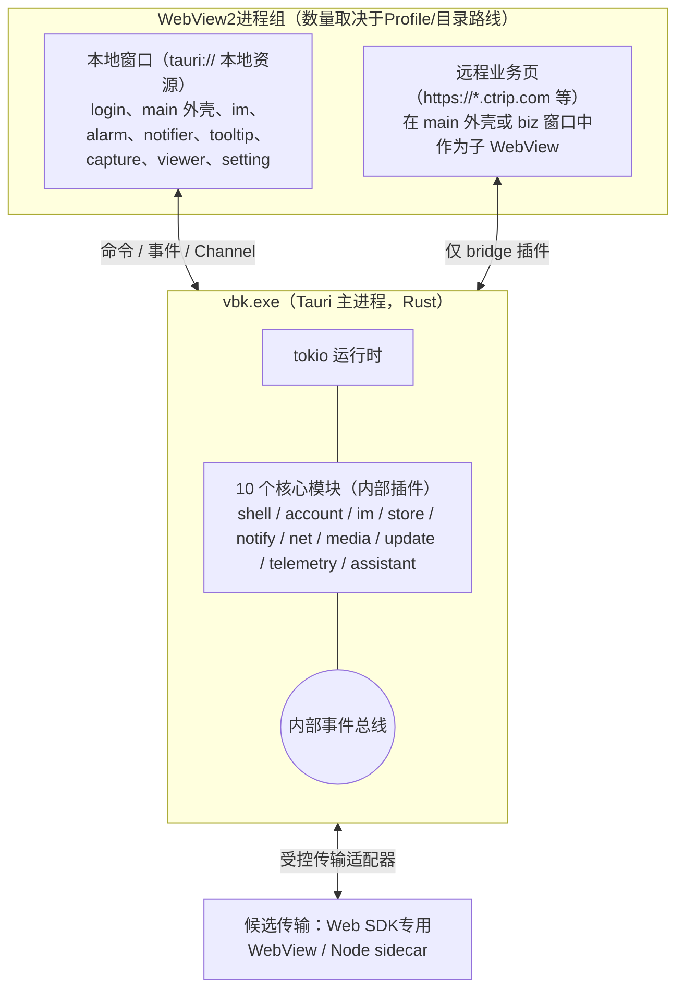

# 开发总纲：整体架构、Tauri / Rust 分工与公共约定

> **范围已变更（2026-10-30）**：以[网页版范围决定](../decisions/2026-10-30-web-only-scope.md)为准。只做目标网页已有的消息、通知和订单联系入口；网页没有的功能不做。本文超出该范围的桌面对齐、扩展功能与验收要求均作为历史参考，不再执行。

2026-10-30

本文是 `docs/dev/` 下各模块开发文档的总纲。各模块文档只写本模块的设计，凡是跨模块的约定（工程结构、命令与事件命名、权限、错误、日志、性能预算）都以本文为准。上游依据见 [04 模块划分与联动](../04-modules-and-integration.md)、[03 副窗口](../03-multi-window.md)、[02 现有客户端缺陷](../02-current-client-defects.md)。

本轮只审查并修订文档，未实现或验收Tauri原型。接口签名是设计契约示意；进入开发后先执行第十节G0，不能把“写进计划”视为已经验证。事实冲突以当前直接证据和对应决策记录处理，历史审查报告保留当时状态。

> **IM 选型补充（2026-10-30）**：以下 Node sidecar 拓扑是候选基线，网页传输方案正在比较，尚未锁定最终实现；见 [决策记录](../decisions/2026-10-30-im-transport.md)。此处为早期候选比较；功能范围及已取消模块以最新网页版范围决定为准。

## 结论

- **一个 Rust 核心进程 + 按账号隔离的传输与多个 WebView**。Rust持有本地业务状态；上游事实以服务端回读/对账为准，SDK内部状态和UI临时展示状态不冒充服务端真相。官方客户端里“主进程转发一切 + 渲染进程直接发 SQL”的结构不再保留。
- **划分规则只有一条**：系统资源、持久化、凭据、计时和跨窗口业务状态由Rust管理；传输实现可在受控sidecar或专用WebView运行，生命周期不依赖聊天窗口；前端负责渲染、交互和临时展示状态。
- **每个 Rust 核心模块做成一个内部 Tauri 插件**，命令以 `plugin:<模块>|<命令>` 暴露，权限按具体WebView用capability命令白名单授予，另由核心做账号与视图授权；capability不是事件载荷的数据隔离机制。
- **远程 vbooking 业务页默认没有任何 IPC 权限**，只通过一个窄的 `bridge` 插件拿到它真正需要的几个能力。
- **Windows 先行**：WebView2（Evergreen）、NSIS 安装包、代码签名。macOS 作为第二阶段，所有平台相关代码收在各模块的 `platform/` 子目录里。

## 一、进程与窗口模型



| 进程 | 内容 | 说明 |
| --- | --- | --- |
| vbk.exe | Tauri 应用 + 全部 Rust 核心模块 | 单实例；崩溃采集由telemetry与独立监视模式协作，主进程损坏后不依赖其继续写dump |
| WebView2浏览器进程组 | 本地外壳、远程业务页及可选Web SDK传输 | 同环境可共享browser，跨域可新增renderer；独立数据目录产生独立进程组，具体拓扑由G0决定 |
| IM sidecar（候选C） | Node运行时 + `@ctrip/s-node-imclient-core` | 按账号进程隔离SDK全局状态，Job Object随主进程退出；还含SDK自身HTTP鉴权/兜底路径，不能宣称只跑长连接或已统一经core-net；Web SDK候选B1通过后可替换 |

不保留Electron utilityProcess接口。OCR引擎与部署方式须通过G0：Windows.Media.Ocr要求受支持的包身份方案，普通NSIS尚不能视为已闭环；允许选择其他受支持引擎。官方的 spellCheck 实际是中文错别字纠错（规则 + BERT 类 ONNX 模型），改为 Rust 规则引擎，ONNX 模型作为按需下载的可选组件，英文拼写交给 WebView2 内置拼写检查。计算任务使用有界专用执行器/阻塞线程池，不阻塞核心actor；重计算的原生崩溃隔离需求另由原型决定，详见 [07 媒体工具](07-media.md)。

## 二、Tauri（WebView 前端）与 Rust 核心的分工

### 2.1 划分规则

| 放 Rust 核心 | 放 WebView 前端 |
| --- | --- |
| 窗口创建、定位、置顶、焦点、托盘、快捷键 | 窗口内部的布局、动画、交互 |
| 账号、Cookie、ticket、凭据库 | 登录页面的展示（网页登录本身在 WebView 里跑） |
| IM业务状态、持久outbox、同步水位、未读/回复计时；驱动可替换传输 | 会话/消息列表、输入与富文本；专用传输WebView若入选则另受生命周期管理 |
| 数据库读写与迁移 | 列表虚拟化、分页展示 |
| HTTP 请求（需要 Cookie、代理、签名的） | 纯展示用的静态资源加载 |
| 计时器与提醒升级策略（窗口隐藏时也必须准） | 倒计时数字的刷新显示 |
| 文件下载、上传、截图采集、OCR、中文纠错 | 截图框选、标注 UI，图片/视频播放 UI |
| 更新检查、下载、签名校验 | 更新提示 UI |
| 日志、崩溃、埋点上报、偏好、多语言词条 | 埋点触发点、语言切换后的重新渲染 |

两条硬规则：

1. **前端不持有持久业务真相**。草稿等要持久化；打开视图按4.3节先完成订阅并缓冲，再取原子快照并重放增量，禁止先快照后订阅留下丢失窗口。
2. **计时在Rust，但不假定系统睡眠时仍执行**。唯一ClockService归core-net，维护每环境服务器时间锚点、单调时间映射、误差与有效期；core-im以服务端会话事实维护本地首条未回复消息的T1期限并产生ReplyTimeout，core-notify负责后续重复与升级；这是本地辅助提醒规则，不是已验证的携程SLA期限。墙钟跳变、睡眠/网络恢复先校时和会话对账；锚点过期标stale，不沿用旧offset承诺准确。

### 2.2 模块总表

各模块文档的编号、负责范围与承接的官方组件如下。

| 文档 | Rust 核心模块 | 前端模块 | 承接的官方组件 |
| --- | --- | --- | --- |
| [01 壳与窗口管理](01-shell.md) | core-shell | ui-shell（main 外壳、setting） | main、setting（官方是主窗口内页面）；launch 删除；openWindow、openExtraWindow、mainViewChanged、commonWebOption（编辑菜单与页内查找）、托盘、菜单、单实例、深链、自启、快捷键 |
| [02 账号与登录](02-account-login.md) | core-account | ui-login | login 窗口；loginSuccess、logout、addAccount、changeAccount、getLoginCookie 等账号接口 |
| [03 强提醒](03-strong-alert.md) | core-notify | ui-popups（alarm、notifier、tooltip） | replyTimeout 的展示与升级（到期判定在 core-im）、flashMainWindow、未读数、提示音、横幅、托盘与任务栏闪烁 |
| [04 业务页承载](04-business-pages.md) | bridge 插件 + `plugin:shell\|biz_*`（归 core-shell 管理） | ui-business | home、order、product、comment、bulletin、course、event、bi（data 与 bi 是同一入口）、web、extra；preload/web.js；ai 实为 IM 的“总结消息”侧窗，建议并入 ui-im |
| [05 本地存储](05-store.md) | core-store | — | executeDB、drizzle 迁移、10 张表、electron-store |
| [06 网络](06-net.md) | core-net | — | netFetch、changeEnv、公共头、代理与 PAC、网络状态 |
| [07 媒体工具](07-media.md) | core-media | ui-capture、ui-viewer | screenshots、screenshotsOverlay、image、video；OCR、中文纠错、下载 |
| [08 更新、诊断与偏好](08-update-telemetry.md) | core-update、core-telemetry（注册 telemetry、prefs、i18n 三个插件） | update 窗口 | 整包更新、自研热更新（不保留）、toggleBaolei 灰度通道、ArchGuide（删除）、日志、崩溃、UBT、偏好、Shark 多语言 |
| [09 商家助手](09-assistant.md) | core-assistant | ui-assistant | 插件 trip_vendor_im_companion 的翻译、TSim、订单查询、套餐速览 |
| [10 IM](10-im.md) | core-im（+ G0选定传输） | ui-im | im / imPlus 窗口、imsdk.js、IM 相关 IPC |

## 三、工程结构（建议）

```
vbk/
├─ src-tauri/                 Tauri 应用（只做组装：注册插件、读取配置、创建初始窗口）
│  ├─ capabilities/           每类窗口一个权限文件（见第五节）
│  └─ tauri.conf.json
├─ crates/
│  ├─ contracts/              命令、事件、错误、DTO 的类型定义；生成前端 TS 类型
│  ├─ core-shell/  core-account/  core-im/  core-store/  core-notify/
│  ├─ core-net/    core-media/    core-update/  core-telemetry/  core-assistant/
│  └─ platform-win/           跨模块复用的 Win32 封装（窗口样式、任务栏、凭据库）
├─ sidecar/im-node/           候选C的IM sidecar（G0后决定是否交付）
└─ ui/                        Vite 多页面前端
   ├─ apps/                   每个本地窗口一个入口：login、shell、im、alarm、notifier、tooltip、capture、viewer、setting、update
   ├─ packages/ipc/           对生成类型的薄封装：invoke、listen、订阅缓冲+snapshot+重放
   ├─ packages/ui-kit/        共享组件与样式令牌
   └─ packages/i18n/          Shark 词条加载与格式化
```

- 前端技术栈：React 18 + TypeScript + Vite。官方客户端已是 React，团队迁移成本低。窗口内状态用轻量 store（如 Zustand），数据只来自命令返回和事件推送。
- 组件库：主窗口、设置、IM 可用 Fluent UI React v9（贴合 Windows 风格）。alarm、notifier、tooltip 这类小窗口不引组件库，单页包体控制在 100 KB 以内，保证弹出速度。
- Rust 与前端共享的类型由 `contracts` crate 通过 tauri-specta（或 ts-rs）生成，禁止前端手写接口类型。

## 四、命令、事件与数据通道

### 4.0 所有模块共同的上下文契约

| 类型 | 字段与规则 |
| --- | --- |
| `AccountContext` | `{account_id, environment, session_generation}`；`account_id`为本地不透明ID，核心验证后映射上游`buid/uid`，不能把前端传值直接当身份；`environment`参与凭据/Profile/数据库/备份/缓存命名空间 |
| `ConversationRef` | `{account: AccountContext, gid}`；gid或localId不单独作为跨账号对象标识 |
| `ViewContext` | `{webview_label, view_generation}`；由核心视图注册表确定，复用label/重建/重新绑定账号均递增代次，不信任JS自报来源 |
| `AggregateScope` | `{subscription_id, authorization_revision}`；核心创建并绑定获授权账号集合及来源视图，供账号列表/提醒队列/多账号未读汇总使用；不是全局广播权限 |
| `EventEnvelope` | `{scope, stream, epoch, seq, payload}`；scope为AccountContext、AggregateScope或明确无敏感数据的app全局域；epoch标识流实例，seq仅在同scope+stream+epoch内递增 |

所有发送、历史、已读、草稿、译文替换、状态/设置修改、截图插入、图片/下载、Toast跳转均绑定创建时的上下文；异步完成时再检查账号会话代次、视图代次以及必要的draft_version/message_version。全局“当前账号”只服务导航，不能用于在途任务寻址。会话失效先递增`session_generation`并阻断新请求，再撤销Jar/传输/句柄和清理资源；取消无法替代拒绝迟到结果。接口表省略上下文字段时只是排版省略，不构成例外。

凭据内部轮换可另用`credential_revision`抵御旧Set-Cookie覆盖新凭据，不能用它代替登录/登出代次。错误、日志、快照均不得包含完整密码/ticket/Cookie。

### 4.1 三种通道

| 通道 | 方向 | 用途 | Tauri 实现 |
| --- | --- | --- | --- |
| 命令 | 前端 → 核心，一问一答 | 读快照、触发动作 | 插件命令 `invoke("plugin:im\|send", …)` |
| 事件 | 核心 → 订阅窗口 | 状态变化通知（低频、小载荷） | 核心校验后`emit_to`指定WebView，禁止客户数据全局广播 |
| Channel | 核心 → 单个调用方，流式 | 大量或高频数据：消息同步、下载进度、截图帧 | `tauri::ipc::Channel` |

窗口之间不直接通信。窗口 A 要影响窗口 B，只能调用命令改变核心状态，再由核心发事件给 B。

### 4.2 命名

文档 04 里的点号写法（`im.send`、`im.message.new`）作为契约名保留，落到 Tauri 时按下表映射（Tauri 事件名不允许点号）。

| 契约名 | Tauri 命令 / 事件名 | 规则 |
| --- | --- | --- |
| `im.send` | `plugin:im\|send` | 命令：模块名即插件名，动作用 snake_case |
| `im.conversation.snapshot` | `plugin:im\|conversation_snapshot` | 快照命令统一以 `_snapshot` 结尾 |
| `im.message.new` | 事件 `im://message-new` | 事件：`<模块>://<主题>`，主题用 kebab-case |
| `account.changed` | 事件 `account://changed` | |

### 4.3 快照 + 增量

每个流按 `scope + stream + epoch` 定义序号；快照与增量来自同一actor提交序列，不能分别读取seq和data形成不一致快照。

1. 核心验证订阅者账号/视图权限；前端等待订阅建立完成，开始有界缓冲事件。
2. 调用该流`*_snapshot`，原子返回`{scope, stream, epoch, seq, data}`。
3. 只对当前请求代次应用快照；丢弃相同epoch中`seq <= snapshot.seq`的缓存，按连续序号重放其余事件。迟到快照不得覆盖已接受的新快照/新账号状态。
4. 跳号、epoch变化、缓冲溢出、连接重建或订阅取消后恢复，都停止应用增量并重新握手/取快照。重建流必须换epoch，不能把seq重置为0却维持旧epoch。
5. 账号切换/登出/窗口销毁撤销订阅与Channel；核心每次下发再次验证上下文。聚合流的账号集合/权限变更递增authorization_revision，使旧快照/增量失效并要求重订阅。存活Channel不是永久授权。

内部`tokio::broadcast`的`Lagged`必须触发重新取源状态；业务关键写入（入库、outbox、确认水位）使用显式请求/提交协议，不能把“已广播”视为“已持久执行”。UI事件只做状态通知，不能承载必须执行且不可重放的唯一业务动作。

### 4.4 错误

所有命令返回 `Result<T, AppError>`。`AppError` 是 contracts 里定义的统一结构：

| 字段 | 说明 |
| --- | --- |
| `code` | 稳定的字符串错误码，如 `account.ticket_expired`、`net.timeout` |
| `message` | 给开发者看的英文描述，不直接展示给用户 |
| `retryable` | 可再次尝试的提示，不能单独授权自动重试；安全读由core-net策略决定，写请求须有端点幂等证据/稳定操作ID，提交结果不明返回unknown供对账 |
| `detail` | 可选，结构化补充信息 |

用户可见的提示文案由前端按 `code` 查多语言词条，不直接显示 `message`。

错误码前缀与模块名一致（`account.*`、`net.*`、`im.*`、`assistant.*` 等）。跨模块约定的几个：`net.offline`、`net.timeout`、`net.payload_too_large`；`account.ticket_expired` 由 core-net 根据服务端的未登录响应（如 `AccountsMobileRequestFilterException`）映射后上报 core-account。

### 4.5 模块之间

- 核心模块通过有界actor请求与显式服务接口完成关键状态变更；tokio broadcast仅传可从快照恢复的通知，消费者必须处理Lagged。不允许互相持锁等待。
- 每个模块内部用“一个状态持有任务 + mpsc 消息”的 actor 写法，避免多把锁交叉造成死锁；只读快照用 `Arc` 共享或 `watch` 通道发布。
- 启动顺序如下，依赖方向见各模块文档的“联动”一节，禁止循环依赖：
  0. 进程入口先识别受约束的内部crash-monitor模式，验证启动上下文后分流；监视进程不进入Tauri/单实例/更新普通启动路径；
  1. 普通应用路径single-instance插件最先注册（第二个实例在这里就转发参数并退出）；
  2. telemetry 的日志与崩溃捕获（不依赖 store）；
  3. store；
  4. telemetry 的偏好、多语言、埋点队列（依赖 store）；
  5. net → account → shell → notify、media、update；
  6. im（账号在线验证就绪后按账号启动G0选定传输）；
  7. assistant 最后启动，失败只关闭助手功能，不影响 IM。

## 五、权限与安全

**命令权限与数据权限分开实现。** Tauri事件/Channel不提供按业务字段的细粒度capability控制；下表只是命令入口清单。客户消息、账号详情、订单、草稿、媒体和下载数据必须由核心按AccountContext和ViewContext授权后定向下发。远程WebView不授予通用事件收发能力；本地视图也不能通过自发Tauri事件修改核心业务状态。后端不得把JS事件名当可信内部事件。[Tauri事件与Channel](https://v2.tauri.app/develop/calling-frontend/)

同一窗口含本地外壳和远程子WebView时，不对父窗口label授予宽泛capability；应按`webviews`精确匹配，并检查多份capability合并后的有效权限。权限文件只列插件名还不够，必须落到单命令与scope。[Tauri capabilities](https://v2.tauri.app/security/capabilities/)

官方客户端有 7 处 `webSecurity:false`，并无条件关闭站点隔离（见文档 02）。新客户端全部不做，并按具体WebView最小授权；下表“窗口”仅为产品名称：

| capability 文件 | 适用窗口 | 命令授权范围（按模块矩阵展开） |
| --- | --- | --- |
| `shell.json` | main 外壳、setting | 按本地视图角色分别展开 shell/biz、账号管理、通知设置、update、telemetry、prefs、i18n、助手设置和存储维护命令；account 含 02 授予 shell 的 snapshot/start_login/switch/sort/quick_login/suspend/logout/forget；net 含 06 授予该角色的受限 fetch/status_snapshot/probe_gateways/设置，set_env 仅开发构建 |
| `login.json` | login 本地外壳 | account 的 account_snapshot/start_login/cancel_login/login_snapshot；net 的受限 fetch/status_snapshot/probe_gateways。B 路线认证命令仅启用 B 时注册；远程登录子 WebView 不授任何 capability，包括 bridge |
| `im.json` | im 本地 WebView | 按各模块矩阵展开 im、media、assistant、notify；account 仅 account_snapshot/switch/suspend/logout；net 仅受限 fetch/status_snapshot；不授通用 store，查询仅经有账号校验的 im 命令 |
| `popups.json` | alarm、notifier、tooltip | notify 的 queue_snapshot/ack/ack_all/jump/snooze/dismiss/report_layout；每条目和聚合 scope 再授权 |
| `capture.json` | capture-overlay-* | media（截图相关命令） |
| `viewer.json` | viewer-* | media（读取、保存） |
| `update.json` | update 本地 WebView | 仅 08 的 state_snapshot/download/install/defer；检查入口由 setting/原生菜单触发，不额外发明取消命令；不可继承 shell 的账号和业务操作权限 |
| `remote-bridge.json` | 远程 vbooking 子 WebView，以注册表明确区分远程业务WebView，避免`web-*`误授予本地工具栏；`remote.urls`限制精确HTTPS来源 | 静态发现的10个bridge事件对应命令；download仅预留且默认不授权，见 [04 业务页承载](04-business-pages.md) |
| （无文件） | `im-order-panel` 等第三方远程页面 | 不授予任何 IPC 权限，使用独立 WebView2 Profile |

所有本地窗口额外授予只读的 `prefs\|snapshot` 与 `i18n\|snapshot`，以便响应偏好和语言变化。

表内模块名是职责汇总，不是允许整个插件的通配权限。实现时将各模块“命令—可用窗口”矩阵展开为具体 WebView 的单命令清单，并校验每个 UI 调用有对应授权、每个授权有调用用途；不能因本表缩写而漏授正常命令，也不能为修复拒绝调用而给父窗口或远程页整组插件权限。

其他安全要求：

- 本地页面开启 CSP，禁止内联脚本与 `eval`。
- 白名单分两级：导航与IPC精确HTTPS origin。解析URL后校验scheme/host/port及重定向；域后缀匹配必须有边界，禁止字符串contains。非http(s)默认拒绝或走明确产品处理器；不能把任意未知协议交系统启动器。每次导航使文档代次失效并重验权限。
- 不再删除远程响应的 X-Frame-Options / CSP 头（官方 `IFRAME_WHITE_DOMAINS` 的做法）；业务页改为顶层子 WebView 承载，不再用跨域 iframe，见文档 04。
- 应用额外持久化的免密凭据只进系统凭据库，默认不存密码。WebView自身浏览器Profile会保存Cookie，这是网页登录的真实边界，不能声称磁盘绝无Cookie；Profile使用OS用户权限隔离，不导出到日志/普通业务库。
- 不开启远程调试端口；开发构建可开 DevTools，正式构建关闭。

## 六、多账号与 WebView 数据隔离

官方客户端每个账号一个 `persist:账号` 分区和一组 BrowserView（访问过的页面一直保留到登出）。新客户端的要求是：每个账号的 Cookie 互不可见，切换账号不重启应用。

| 方案 | 隔离 | 内存 | 结论 |
| --- | --- | --- | --- |
| 每账号独立WebView2用户数据目录 | 浏览器存储隔离（非OS用户/恶意本机进程安全边界） | 每个目录一套浏览器进程，账号多时内存明显上升 | 兜底方案 |
| 同一环境每账号独立Profile | Cookie/站点数据按Profile隔离，仍共享browser故障域 | 待测 | 优先优化原型；已核对Tauri 2.12.5 WebviewBuilder公开接口未见profile_name，须在G0锁定Tauri/wry版本后评估原生适配/补丁、维护者与退出条件，不能认定已可用 |
| 同一 Cookie 存储，切换时整体替换 Cookie | 不隔离，切换慢且易串号 | 最低 | 不采用 |

Profile在控制器创建时绑定；登录前先分配待定Profile，验证上游身份后建立`(environment, account_id) → profile_id`映射并保存经核验的buid关联，重复登录的Profile收敛见文档02。非携程的第三方页面（如助手的 `im-order-panel`）也用独立 Profile，不与任何账号共享 Cookie。

公开接口核对依据：[Tauri WebviewBuilder 2.12.5](https://docs.rs/tauri/latest/tauri/webview/struct.WebviewBuilder.html)。macOS持久化数据存储隔离能力及其最低版本在第二阶段验证；不得把Windows Profile方案直接视为跨平台已实现。细节见 [02 账号与登录](02-account-login.md) 与 [04 业务页承载](04-business-pages.md)。

## 七、窗口标签约定

窗口标签（label）是权限、事件定向和窗口复用的依据，全项目统一：

| 标签 | 窗口 | 生命周期 |
| --- | --- | --- |
| `main` | 主外壳 | 常驻；关闭按钮默认最小化到托盘 |
| `login` | 登录（本地外壳 + 远程登录子 WebView） | 按需 |
| ~~`launch`~~ | 官方启动页 | 删除：直接打开 `main` 或 `login`，`window_ready` 握手后再显示 |
| `im` | IM本地WebView | 官方嵌入main；新客户端嵌入或独立窗在G0冻结，关闭/隐藏不销毁后台传输，聊天视图可按内存策略恢复 |
| `im-order-panel` | IM 侧栏内的第三方订单查询子 WebView | 按需；无 IPC 权限 |
| `alarm`、`notifier`、`tooltip` | 强提醒小窗 | 主外壳可交互后按资源预算预创建并隐藏，复用内容 |
| `notice`（路由，不独立窗口） | ui-shell内系统通知中心 | 官方即为主窗口内页面，保留本地通知中心路由，不增加同名确认弹窗或额外capability |
| `capture-overlay-<显示器标识>` | 截图遮罩 | 使用显示器稳定标识+显示配置代次，按预算懒建/预热；热插拔后不复用旧序号/坐标 |
| `viewer-image`、`viewer-video` | 预览 | 单例复用（官方视频每次新开窗口；需要同时看多个时改为 `viewer-video-<序号>`） |
| `biz-<模块>-<序号>` | main 外壳内承载远程业务页的子 WebView | 按需创建，隐藏 5 分钟后挂起，超过 6 个按 LRU 回收（见文档 04） |
| `web-<n>`、`web-<n>-t<k>` | 通用网页工作台窗口及其内部标签的子 WebView | 每个账号最多一个工作台 |
| `web-extra` | `openExtraWindow` 打开的贴边小窗 | 单例 |
| `biz-ai` | AI 总结侧窗（暂定，建议并入 IM 侧栏） | 单例 |
| `setting`、`update` | 设置（官方是主窗口内页面，新客户端独立成窗）、更新 | 单例 |

## 八、性能预算（验收用）

以下是待验收目标，不是已实现收益。按同机、相同账号/页面/功能/预热条件，分别比较纯官方、官方+助手和新原型。计入Rust、全部WebView进程组、sidecar与可选计算组件；记录Runtime版本、Private Bytes、工作集共享页口径与CPU。启动分别记录壳可交互、账号验证、业务页就绪、IM连通；延迟报告P50/P95/P99及采样窗口。

| 指标 | 目标 |
| --- | --- |
| 冷启动到主外壳可交互 | ≤ 2 s（有效 ticket，不含远程页加载） |
| 空闲内存（主外壳 + IM，单账号） | ≤ 官方的 50% |
| IM 输入按键到字符上屏 | ≤ 50 ms（P95），文档 04 的 100 ms 是上限 |
| 新消息到横幅可见 | 从客户端传输收到事件到本机可见≤300 ms；在线正常负载且允许提醒时，不包含未知上游网络延迟 |
| 回复倒计时误差 | 有效ClockService锚点、系统在运行时≤1s；睡眠/断网恢复先对账，过期锚点标stale，禁止承诺系统暂停时实时弹窗 |
| 主线程长任务（> 50 ms） | IM 窗口连续使用 10 分钟内 ≤ 5 次 |
| 安装包 | 一期 ≤ 45 MB（含候选Node运行时，具体SEA/签名/依赖大小由原型测量）；二期移除 sidecar 后 ≤ 30 MB。另列WebView2离线运行时、OCR/纠错模型与更新下载总量，不用排除项掩盖真实安装占用 |

## 九、Windows 交付要点

- **WebView2 Runtime**：运行时可有可无，安装时检测；Evergreen Bootstrapper需网络，离线策略单独提供Evergreen离线安装器或固定版本并承担后续更新，明确实际安装体积。
- **安装与签名**：NSIS 安装包，每用户安装（不需管理员），选择受信代码签名与时间戳，但不保证免SmartScreen；EV不再自动获得即时信誉。见[Tauri签名文档](https://v2.tauri.app/distribute/sign/windows/)。
- **URL协议**：新客户端默认独立scheme，暂定`tsim-vbk://`与开发`tsim-vbk-dev://`，发布时冻结；不抢占官方`vbookingChat://`。兼容接管只能是用户显式选择并可恢复旧处理器，深链参数不携带凭据且不自动授予账号权限。官方setAsDefaultProtocolClient仅为历史实现证据。
- **系统通知**：冻结唯一AUMID/identifier与安装、快捷方式、激活注册契约；在正式NSIS产物验证显示、点击路由与冷启动，不能只凭开发机Toast弹出判定完成。
- **数据目录**：数据放 `app_local_data_dir`（Local，不用 Roaming），由 `identifier` 决定，定下后不要改。
- **全局快捷键**：常驻的只有截图 `screenShotKey`（Ctrl+Shift+X）与唤起主窗口 `openVbkKey`（官方 Ctrl+Shift+V，会抢走其他程序的“粘贴为纯文本”，建议默认改为 Ctrl+Alt+V）。官方截图期间临时把 Esc / Enter 注册为全局快捷键，会吞掉其他程序的回车，新客户端改在截图遮罩窗口内处理。
- **兼容**：本项目最低候选Windows 10 1809，不支持7/8.1；发布前核对OS/Runtime/依赖支持矩阵。这是产品策略，Tauri官方仍记录Win7兼容选项，不能混同。[Windows安装文档](https://v2.tauri.app/distribute/windows-installer/)
- **硬件加速**：不再照搬官方“NUL 设备检测失败就关硬件加速”的逻辑，交给 WebView2 自己处理；保留一个设置项供用户手动关闭。

## 十、开发顺序与里程碑

先执行G0，再冻结跨模块契约并进入对应实现。G0不是把全部开发延后，而是先消除会让界面/存储/发布设计返工的关键不确定性。已确认的公共契约和模拟传输基础可并行。

| 里程碑 | 内容 | 验收 |
| --- | --- | --- |
| G0 可行性与证据 | 登录/Profile隔离、子WebView/bridge、两种IM传输、OCR安装身份、可信更新/数据恢复 | 对应[架构选型G1–G5](../01-architecture-selection.md)逐项有通过证据或明确回退路线；未过的模块不冻结实现 |
| M0 契约 | contracts crate、ipc 前端包、capability 骨架、日志 | 类型生成一致；合法调用通过，远程/跨账号/旧代次调用拒绝，事件缺口/epoch重建可恢复 |
| M1 能登录 | shell + account + net + store + ui-login + main 外壳 | 网页登录成功后主外壳加载远程业务页，可切换两个账号 |
| M2 IM可用 | im（G0选定传输）+ ui-im | 收发/回执、unknown、完整同步水位、工作状态/个人设置边界、重连对账与隔离；满足适用IM指标 |
| M3 强提醒 | notify + ui-popups | 横幅、回复倒计时、托盘闪烁、提示音全部可用，满足计时误差指标 |
| M4 业务页齐 | ui-business + bridge | 8个业务入口可用（data/bi为同一入口），逐项验证兼容桥、microApp、导航/上传/下载，不承诺无需适配 |
| M5 工具 | media + ui-capture + ui-viewer | 双屏不同缩放截图正确，图片视频预览 |
| M6 助手 | assistant + ui-assistant | 插件功能全部内置，无 CDP |
| M7 发布 | update + telemetry + 安装包 | 签名更新可用，崩溃可上报 |

## 十一、各模块文档统一结构

每篇模块文档按以下顺序组织，方便横向对照：

1. 结论与定位
2. 承接范围：对应的官方窗口、IPC 接口、数据（带出处）
3. Tauri / Rust 分工表
4. Rust 核心设计：状态、命令、事件、并发模型、平台差异
5. 前端设计：窗口、页面结构、状态与性能要求
6. 与其他模块的联动
7. 关键流程
8. 注意事项（Windows 优先）
9. 原型验证项与验收标准
10. 开发步骤与工作量估计
11. 待确认问题

## 十二、编写各模块文档时的新发现

### 12.1 官方客户端的安全缺陷（新客户端必须消除）

这些是在写模块文档时从 `app.asar` 里新查到的，补充文档 02。

| 缺陷 | 出处 | 新客户端的做法 | 文档 |
| --- | --- | --- | --- |
| 记住的密码明文落盘（已证实，不再是“疑似”）：electron-store 无加密键，`pwd_account_list` 存明文 `password` 和 `bticket` | index.js `new Fl` 无参构造、无 safeStorage | 默认丢弃password，仅免密凭据进系统凭据库；不改写用户旧客户端数据文件 | 02、05 |
| 渲染进程可发任意 SQL，`run` 可无 WHERE 删表；`init()` 失败直接删库重建 | `execute_db`、`dbQuery` | 只暴露业务接口；坏库先隔离留证再恢复 | 05 |
| 热更新把 https 换成 http 下载 `dist.zip`，不校验哈希和签名，可被中间人执行代码 | `checkRenderUpdate`、`downloadBundleZip` | 不保留前端热更新，只用带 minisign 签名的整包更新 | 08 |
| OCR 模型、纠错模型、OCR 拉图都关闭 TLS 证书校验 | ocr-worker.js、spell-check-worker.js | 一律开启校验，走 core-net | 07、06 |
| 删除 `.ctrip.com` 等域名响应的 X-Frame-Options / CSP，配合 `webSecurity:false` 跨域 iframe | `IFRAME_WHITE_DOMAINS` | 改为顶层子 WebView 承载，不改响应头 | 04 |
| 截图期间全局注册 Esc / Enter | `ScreenShotManagerV2._doCapture` | 遮罩窗口内处理按键 | 01、07 |

### 12.2 历史更正记录（已回写上游正文）

| 原说法 | 更正 | 出处文档 |
| --- | --- | --- |
| 文档 04：登录调用携程账号 SDK（bbz-accounts-loginsdk），做法 B 需要 SDK 授权 | 1.2.12 登录页不调 SDK，直接调 SOA 接口（`/22160/pwdLogin`、`/22160/verifyCodeLogin`、`/24863/getQrCode` 等）；`codeLogin` 实为扫码登录；做法 B 需要的是接口授权 | 02 |
| 文档 04：Windows 未见深链注册代码 | 启动时 `setAsDefaultProtocolClient` 注册，开发构建用 `vbookingChatDev` | 01 |
| 文档 04：Esc / Enter 两个全局快捷键 | 只在截图期间临时注册；常驻的是 `screenShotKey` 与 `openVbkKey` | 01 |
| 文档 04：commonWebOption 属网络 | 是复制、粘贴、页内查找等编辑操作，归 core-shell | 06 |
| 文档 04：业务模块是远程页面 | 8 个入口都是“本地 React 外壳 + 跨域 iframe（`micro=1`）”，只有 web 工作台和 extra 小窗直接加载远程 URL；data 与 bi 是同一入口；ai 是 IM 总结侧窗；toggleBaolei 是热更新“堡垒”灰度通道 | 04 |
| 文档 04：翻译由 core-assistant 调 TSim | 官方客户端本身就有翻译（SOA `/11679/getMessageTranslate`、`batchTranslateByMsgIds`），默认用官方；TSim 翻译是插件的可选来源；订单查询与套餐速览的数据来自 TSim，不是携程 | 09 |
| 文档 03：notice 是无边框弹窗 | 官方 notice 是主窗口内预加载的系统通知中心页 | 03 |
| 文档 04：回复倒计时由 IM SDK 判定 | 官方由 IM 页每 5 秒轮询会话列表判定、alarm 页 1 秒 setInterval 计秒，两处都会被节流；新客户端由 core-im 判定到期、core-notify 展示与升级 | 03、10 |
| 本文初稿：拼写检查改用系统 API | 官方是中文错别字纠错，系统拼写检查不支持中文，改为 Rust 规则引擎 + 可选 ONNX 模型 | 07 |

### 12.3 需要产品或携程方拍板的事项

各模块文档第 11 节列了各自的待确认问题，下面是影响多个模块、需要优先决定的几项：

1. **IM 窗口形态（G0冻结）**：独立 `im` 窗口（本文默认）还是像官方一样嵌在 main 外壳里。影响 01、03、10 和 capability 划分。
2. **多账号 Profile**：是否接受给 wry 打 `profile_name` 补丁（PR 或 fork）；不接受则退回每账号独立数据目录，内存会上升。影响 02、04。
3. **多 WebView 子视图**：Tauri 2 的 `Window::add_child` 仍属 `unstable` 特性，原型不过关则业务页退回“每页一个独立窗口”。影响 01、02、04。
4. **IM传输与接口范围**：Node和Web SDK都存在XMPP over WSS，但appId/认证分支不同；不能用Node的UID+bticket模式外推网页。Web SDK可脱离原站运行、发送幂等与后台恢复均待验证；接口/SDK使用范围与发布条件需冻结。影响10。
5. **TSim 功能的发布范围**：若面向所有携程商家发布，TSim 相关功能应默认隐藏，只对灰度名单开放。影响 09。
6. **崩溃与埋点上报**：沿用 `sentrycollector.ctrip.com` 与 UBT 接口需确认是否接受非 Electron 客户端。影响 08。

### 12.4 工作量汇总

各模块文档第 10 节的估计（人日，单人，不含联调与测试缓冲）：

| 模块 | 人日 |
| --- | --- |
| 01 壳与窗口管理 | 约 30.5 |
| 02 账号与登录（做法 A） | 约 29 |
| 03 强提醒 | 约 22（macOS 另加 3） |
| 04 业务页承载 | 约 37 |
| 05 本地存储 | 约 22 |
| 06 网络 | 约 18 |
| 07 媒体工具 | 约 38 |
| 08 更新、诊断与偏好 | 约 30.5 |
| 09 商家助手 | 约 26.5 |
| 10 IM 一期 | 约 41（二期另加 15–25） |
| 合计（一期初估） | 表内相加约294.5人日（四舍五入295）；仅为旧sidecar方案模块估计，未含G0失败返工、联调测试与平台发布验证，不能据此承诺3–4人4–5个月交付 |

> 工期重估点：G0完成后按选定传输、Profile适配、OCR部署、业务兼容与发布路线重新排关键路径；macOS不是零成本附带项。架构图 `docs/images/target-architecture.png` 为早期历史图，已停止在当前架构正文引用，不能用作开发依据。
