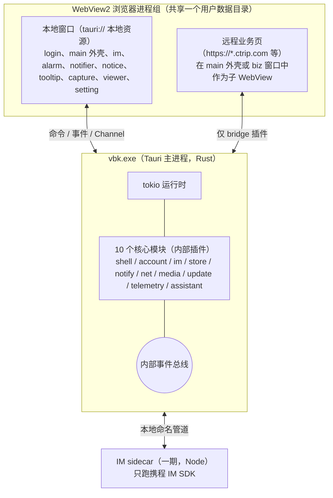

# 开发总纲：整体架构、Tauri / Rust 分工与公共约定

2026-10-30

本文是 `docs/dev/` 下各模块开发文档的总纲。各模块文档只写本模块的设计，凡是跨模块的约定（工程结构、命令与事件命名、权限、错误、日志、性能预算）都以本文为准。上游依据见 [04 模块划分与联动](../04-modules-and-integration.md)、[03 副窗口](../03-multi-window.md)、[02 现有客户端缺陷](../02-current-client-defects.md)。

本项目当前只产出计划与原型，各文档中的接口签名都是示意，不是要落盘的代码。

## 结论

- **一个 Rust 核心进程 + 多个 WebView 窗口**。Rust 核心是唯一的状态源，窗口只是视图。官方客户端里“主进程转发一切 + 渲染进程直接发 SQL”的结构不再保留。
- **划分规则只有一条**：凡是涉及系统资源、持久化、网络长连接、凭据、计时、跨窗口共享状态的逻辑，放 Rust；只负责渲染和交互的，放 WebView 前端。
- **每个 Rust 核心模块做成一个内部 Tauri 插件**，命令以 `plugin:<模块>|<命令>` 暴露，权限按窗口用 capability 白名单授予。
- **远程 vbooking 业务页默认没有任何 IPC 权限**，只通过一个窄的 `bridge` 插件拿到它真正需要的几个能力。
- **Windows 先行**：WebView2（Evergreen）、NSIS 安装包、代码签名。macOS 作为第二阶段，所有平台相关代码收在各模块的 `platform/` 子目录里。

## 一、进程与窗口模型



| 进程 | 内容 | 说明 |
| --- | --- | --- |
| vbk.exe | Tauri 应用 + 全部 Rust 核心模块 | 单实例；崩溃由 telemetry 模块写 minidump |
| WebView2 浏览器进程组 | 所有窗口的渲染进程、GPU 进程 | 由系统 WebView2 Runtime 提供，窗口共享同一环境以节省内存 |
| IM sidecar（一期） | 最小 Node 运行时 + `@ctrip/s-node-imclient-core` | 每个已登录账号一个进程（SDK 使用全局变量，一个进程只能跑一个账号，官方也是如此）；只负责 IM 长连接，不碰界面、数据库、窗口；放进 Job Object 随主进程退出；二期移除 |

不再有 Electron 的 utilityProcess、OCR worker、纠错 worker：OCR 改用 Windows.Media.Ocr；官方的 spellCheck 实际是中文错别字纠错（规则 + BERT 类 ONNX 模型），改为 Rust 规则引擎，ONNX 模型作为按需下载的可选组件，英文拼写交给 WebView2 内置拼写检查。这些都在 Rust 的阻塞线程池里执行，详见 [07 媒体工具](07-media.md)。

## 二、Tauri（WebView 前端）与 Rust 核心的分工

### 2.1 划分规则

| 放 Rust 核心 | 放 WebView 前端 |
| --- | --- |
| 窗口创建、定位、置顶、焦点、托盘、快捷键 | 窗口内部的布局、动画、交互 |
| 账号、Cookie、ticket、凭据库 | 登录页面的展示（网页登录本身在 WebView 里跑） |
| IM 长连接、收发、重连、未读数、回复计时 | 会话列表、消息列表、输入框、富文本 |
| 数据库读写与迁移 | 列表虚拟化、分页展示 |
| HTTP 请求（需要 Cookie、代理、签名的） | 纯展示用的静态资源加载 |
| 计时器与提醒升级策略（窗口隐藏时也必须准） | 倒计时数字的刷新显示 |
| 文件下载、上传、截图采集、OCR、中文纠错 | 截图框选、标注 UI，图片/视频播放 UI |
| 更新检查、下载、签名校验 | 更新提示 UI |
| 日志、崩溃、埋点上报、偏好、多语言词条 | 埋点触发点、语言切换后的重新渲染 |

两条硬规则：

1. **前端不持有业务真相**。窗口关闭、刷新、崩溃都不能丢状态；任何窗口打开时先调用 `*_snapshot` 命令拿全量，再订阅事件拿增量。
2. **计时在 Rust**。WebView2 会对隐藏或最小化窗口的 JS 定时器节流，回复倒计时、提醒重复等时间敏感逻辑必须由 Rust 的 tokio 定时器驱动，前端只显示 Rust 推送的剩余时间。

### 2.2 模块总表

各模块文档的编号、负责范围与承接的官方组件如下。

| 文档 | Rust 核心模块 | 前端模块 | 承接的官方组件 |
| --- | --- | --- | --- |
| [01 壳与窗口管理](01-shell.md) | core-shell | ui-shell（main 外壳、setting） | main、setting（官方是主窗口内页面）；launch 删除；openWindow、openExtraWindow、mainViewChanged、commonWebOption（编辑菜单与页内查找）、托盘、菜单、单实例、深链、自启、快捷键 |
| [02 账号与登录](02-account-login.md) | core-account | ui-login | login 窗口；loginSuccess、logout、addAccount、changeAccount、getLoginCookie 等账号接口 |
| [03 强提醒](03-strong-alert.md) | core-notify | ui-popups（alarm、notifier、notice、tooltip） | replyTimeout 的展示与升级（到期判定在 core-im）、flashMainWindow、未读数、提示音、横幅、托盘与任务栏闪烁 |
| [04 业务页承载](04-business-pages.md) | bridge 插件 + `plugin:shell\|biz_*`（归 core-shell 管理） | ui-business | home、order、product、comment、bulletin、course、event、bi（data 与 bi 是同一入口）、web、extra；preload/web.js；ai 实为 IM 的“总结消息”侧窗，建议并入 ui-im |
| [05 本地存储](05-store.md) | core-store | — | executeDB、drizzle 迁移、10 张表、electron-store |
| [06 网络](06-net.md) | core-net | — | netFetch、changeEnv、公共头、代理与 PAC、网络状态 |
| [07 媒体工具](07-media.md) | core-media | ui-capture、ui-viewer | screenshots、screenshotsOverlay、image、video；OCR、中文纠错、下载 |
| [08 更新、诊断与偏好](08-update-telemetry.md) | core-update、core-telemetry（注册 telemetry、prefs、i18n 三个插件） | update 窗口 | 整包更新、自研热更新（不保留）、toggleBaolei 灰度通道、ArchGuide（删除）、日志、崩溃、UBT、偏好、Shark 多语言 |
| [09 商家助手](09-assistant.md) | core-assistant | ui-assistant | 插件 trip_vendor_im_companion 的翻译、TSim、订单查询、套餐速览 |
| [10 IM](10-im.md) | core-im（+ 一期 sidecar） | ui-im | im / imPlus 窗口、imsdk.js、IM 相关 IPC |

## 三、工程结构（建议）

```
vbk/
├─ src-tauri/                 Tauri 应用（只做组装：注册插件、读取配置、创建初始窗口）
│  ├─ capabilities/           每类窗口一个权限文件（见第五节）
│  └─ tauri.conf.json
├─ crates/
│  ├─ contracts/              命令、事件、错误、DTO 的类型定义；生成前端 TS 类型
│  ├─ core-shell/  core-account/  core-im/  core-store/  core-notify/
│  ├─ core-net/    core-media/    core-update/  core-telemetry/  core-assistant/
│  └─ platform-win/           跨模块复用的 Win32 封装（窗口样式、任务栏、凭据库）
├─ sidecar/im-node/           一期 IM sidecar（Node 单文件打包）
└─ ui/                        Vite 多页面前端
   ├─ apps/                   每个本地窗口一个入口：login、shell、im、alarm、notifier、notice、tooltip、capture、viewer、setting、update
   ├─ packages/ipc/           对生成类型的薄封装：invoke、listen、snapshot+订阅
   ├─ packages/ui-kit/        共享组件与样式令牌
   └─ packages/i18n/          Shark 词条加载与格式化
```

- 前端技术栈：React 18 + TypeScript + Vite。官方客户端已是 React，团队迁移成本低。窗口内状态用轻量 store（如 Zustand），数据只来自命令返回和事件推送。
- 组件库：主窗口、设置、IM 可用 Fluent UI React v9（贴合 Windows 风格）。alarm、notifier、tooltip 这类小窗口不引组件库，单页包体控制在 100 KB 以内，保证弹出速度。
- Rust 与前端共享的类型由 `contracts` crate 通过 tauri-specta（或 ts-rs）生成，禁止前端手写接口类型。

## 四、命令、事件与数据通道

### 4.1 三种通道

| 通道 | 方向 | 用途 | Tauri 实现 |
| --- | --- | --- | --- |
| 命令 | 前端 → 核心，一问一答 | 读快照、触发动作 | 插件命令 `invoke("plugin:im\|send", …)` |
| 事件 | 核心 → 订阅窗口 | 状态变化通知（低频、小载荷） | `emit_to` 指定窗口，或按主题广播 |
| Channel | 核心 → 单个调用方，流式 | 大量或高频数据：消息同步、下载进度、截图帧 | `tauri::ipc::Channel` |

窗口之间不直接通信。窗口 A 要影响窗口 B，只能调用命令改变核心状态，再由核心发事件给 B。

### 4.2 命名

文档 04 里的点号写法（`im.send`、`im.message.new`）作为契约名保留，落到 Tauri 时按下表映射（Tauri 事件名不允许点号）。

| 契约名 | Tauri 命令 / 事件名 | 规则 |
| --- | --- | --- |
| `im.send` | `plugin:im\|send` | 命令：模块名即插件名，动作用 snake_case |
| `im.conversation.snapshot` | `plugin:im\|conversation_snapshot` | 快照命令统一以 `_snapshot` 结尾 |
| `im.message.new` | 事件 `im://message-new` | 事件：`<模块>://<主题>`，主题用 kebab-case |
| `account.changed` | 事件 `account://changed` | |

### 4.3 快照 + 增量

每个会被多个窗口展示的状态（账号列表、会话列表、未读数、提醒队列、更新状态）都遵循同一模式：

1. 状态在核心里带一个单调递增的版本号 `seq`。
2. 窗口打开时先 `listen` 事件，再调用 `*_snapshot` 拿到 `{seq, data}`。
3. 事件载荷带 `seq`；窗口丢弃 `seq` 小于等于快照的事件，发现跳号就重新拉快照。

这样窗口晚打开、WebView 刷新、事件丢失都能自愈。

### 4.4 错误

所有命令返回 `Result<T, AppError>`。`AppError` 是 contracts 里定义的统一结构：

| 字段 | 说明 |
| --- | --- |
| `code` | 稳定的字符串错误码，如 `account.ticket_expired`、`net.timeout` |
| `message` | 给开发者看的英文描述，不直接展示给用户 |
| `retryable` | 前端是否可以自动重试 |
| `detail` | 可选，结构化补充信息 |

用户可见的提示文案由前端按 `code` 查多语言词条，不直接显示 `message`。

错误码前缀与模块名一致（`account.*`、`net.*`、`im.*`、`assistant.*` 等）。跨模块约定的几个：`net.offline`、`net.timeout`、`net.payload_too_large`；`account.ticket_expired` 由 core-net 根据服务端的未登录响应（如 `AccountsMobileRequestFilterException`）映射后上报 core-account。

### 4.5 模块之间

- 核心模块之间通过内部事件总线（tokio broadcast）与少量显式的服务接口（trait）联动，不允许互相持有对方的锁。
- 每个模块内部用“一个状态持有任务 + mpsc 消息”的 actor 写法，避免多把锁交叉造成死锁；只读快照用 `Arc` 共享或 `watch` 通道发布。
- 启动顺序如下，依赖方向见各模块文档的“联动”一节，禁止循环依赖：
  1. single-instance 插件最先注册（第二个实例在这里就转发参数并退出）；
  2. telemetry 的日志与崩溃捕获（不依赖 store）；
  3. store；
  4. telemetry 的偏好、多语言、埋点队列（依赖 store）；
  5. net → account → shell → notify、media、update；
  6. im（账号就绪后按账号启动 sidecar）；
  7. assistant 最后启动，失败只关闭助手功能，不影响 IM。

## 五、权限与安全

官方客户端有 7 处 `webSecurity:false`，并无条件关闭站点隔离（见文档 02）。新客户端全部不做，并按窗口最小授权：

| capability 文件 | 适用窗口 | 授予的插件 |
| --- | --- | --- |
| `shell.json` | main 外壳、setting | shell（含 `biz_*` 业务视图管理）、account（只读与切换）、notify（设置）、update、telemetry、prefs、i18n、assistant（设置）、store（只限维护命令：用量、清理缓存、旧数据导入状态、打开数据目录） |
| `login.json` | login 本地外壳 | account（登录相关命令）；内嵌的远程登录子 WebView 不授予任何 capability，包括 bridge |
| `im.json` | im | im、store（只通过 im 暴露的命令）、media、assistant、notify |
| `popups.json` | alarm、notifier、notice、tooltip | notify（只限确认 ack、跳转 jump、稍后 snooze、关闭、上报布局 report_layout） |
| `capture.json` | capture-overlay-* | media（截图相关命令） |
| `viewer.json` | viewer-* | media（读取、保存） |
| `remote-bridge.json` | 远程 vbooking 子 WebView，用 `webviews` 匹配 `biz-*`、`web-*`，再按域名白名单 `remote.urls` 限制 | 只有 bridge 插件的 11 个命令，见 [04 业务页承载](04-business-pages.md) |
| （无文件） | `im-order-panel` 等第三方远程页面 | 不授予任何 IPC 权限，使用独立 WebView2 Profile |

所有本地窗口额外授予只读的 `prefs\|snapshot` 与 `i18n\|snapshot`，以便响应偏好和语言变化。

其他安全要求：

- 本地页面开启 CSP，禁止内联脚本与 `eval`。
- 白名单分两级：导航白名单（宽，允许哪些域名在应用内打开）与 IPC 白名单（窄，只到实际业务入口主机）。官方的 IPC 白名单是 33 个域名后缀，新客户端收窄。白名单外的链接交给系统浏览器打开。
- 不再删除远程响应的 X-Frame-Options / CSP 头（官方 `IFRAME_WHITE_DOMAINS` 的做法）；业务页改为顶层子 WebView 承载，不再用跨域 iframe，见文档 04。
- 凭据只进系统凭据库（Windows 凭据管理器 / macOS 钥匙串）；数据库与日志中不出现密码、完整 ticket、完整 Cookie。
- 不开启远程调试端口；开发构建可开 DevTools，正式构建关闭。

## 六、多账号与 WebView 数据隔离

官方客户端每个账号一个 `persist:账号` 分区和一组 BrowserView（访问过的页面一直保留到登出）。新客户端的要求是：每个账号的 Cookie 互不可见，切换账号不重启应用。

| 方案 | 隔离 | 内存 | 结论 |
| --- | --- | --- | --- |
| 每账号独立 WebView2 用户数据目录 | 完全隔离 | 每个目录一套浏览器进程，账号多时内存明显上升 | 兜底方案 |
| 同一环境下每账号一个 WebView2 Profile | 完全隔离，共享浏览器进程 | 低 | 首选；Tauri 2 目前只公开了 `data_directory`，wry 只把 ControllerOptions 用于 incognito，要给 wry 加 `profile_name`（提 PR 或 fork），列为原型验证项 |
| 同一 Cookie 存储，切换时整体替换 Cookie | 不隔离，切换慢且易串号 | 最低 | 不采用 |

Profile 只能在创建 WebView 时指定，而登录前还不知道账号 buid，所以每次登录先用一个随机命名的待定 Profile，登录成功后再建立 `buid → profile_id` 映射，见文档 02。非携程的第三方页面（如助手的 `im-order-panel`）也用独立 Profile，不与任何账号共享 Cookie。

macOS 对应能力是 WKWebsiteDataStore 的 `dataStoreIdentifier`（macOS 14+），第二阶段再评估。细节见 [02 账号与登录](02-account-login.md) 与 [04 业务页承载](04-business-pages.md)。

## 七、窗口标签约定

窗口标签（label）是权限、事件定向和窗口复用的依据，全项目统一：

| 标签 | 窗口 | 生命周期 |
| --- | --- | --- |
| `main` | 主外壳 | 常驻；关闭按钮默认最小化到托盘 |
| `login` | 登录（本地外壳 + 远程登录子 WebView） | 按需 |
| ~~`launch`~~ | 官方启动页 | 删除：直接打开 `main` 或 `login`，`window_ready` 握手后再显示 |
| `im` | IM | 首次打开后常驻，关闭即隐藏。官方 imPlus 是嵌在 main 里的 BrowserView，独立窗口还是嵌入待定（见第十二节） |
| `im-order-panel` | IM 侧栏内的第三方订单查询子 WebView | 按需；无 IPC 权限 |
| `alarm`、`notifier`、`notice`、`tooltip` | 强提醒小窗 | 主外壳可交互后空闲时预创建并隐藏，复用内容。官方 notice 是主窗口里的系统通知中心页，新客户端把通知中心放回主外壳，`notice` 改作“需确认的系统通知”弹窗（待确认） |
| `capture-overlay-<显示器序号>` | 截图遮罩 | 启动后预热，截图时显示 |
| `viewer-image`、`viewer-video` | 预览 | 单例复用（官方视频每次新开窗口；需要同时看多个时改为 `viewer-video-<序号>`） |
| `biz-<模块>-<序号>` | main 外壳内承载远程业务页的子 WebView | 按需创建，隐藏 5 分钟后挂起，超过 6 个按 LRU 回收（见文档 04） |
| `web-<n>`、`web-<n>-t<k>` | 通用网页工作台窗口及其内部标签的子 WebView | 每个账号最多一个工作台 |
| `web-extra` | `openExtraWindow` 打开的贴边小窗 | 单例 |
| `biz-ai` | AI 总结侧窗（暂定，建议并入 IM 侧栏） | 单例 |
| `setting`、`update` | 设置（官方是主窗口内页面，新客户端独立成窗）、更新 | 单例 |

## 八、性能预算（验收用）

以官方 1.2.12 在同一台 Windows 机器上的表现为对照。

| 指标 | 目标 |
| --- | --- |
| 冷启动到主外壳可交互 | ≤ 2 s（有效 ticket，不含远程页加载） |
| 空闲内存（主外壳 + IM，单账号） | ≤ 官方的 50% |
| IM 输入按键到字符上屏 | ≤ 50 ms（P95），文档 04 的 100 ms 是上限 |
| 新消息到横幅可见 | ≤ 300 ms |
| 回复倒计时误差 | 窗口隐藏、最小化、锁屏后恢复，误差 ≤ 1 s |
| 主线程长任务（> 50 ms） | IM 窗口连续使用 10 分钟内 ≤ 5 次 |
| 安装包 | 一期 ≤ 45 MB（node.exe 压缩后约 25 MB，先验证 small-icu 自编 Node 能否压低）；二期移除 sidecar 后 ≤ 30 MB。中文纠错的 ONNX 模型按需下载，不计入 |

## 九、Windows 交付要点

- **WebView2 Runtime**：Windows 10/11 一般已预装；安装包内置 Evergreen Bootstrapper 兜底，离线安装包可选带固定版本。
- **安装与签名**：NSIS 安装包，每用户安装（不需管理员），EV 代码签名，避免 SmartScreen 拦截。
- **URL 协议**：注册 `vbookingChat://`（开发构建为 `vbookingChatDev://`，官方用 `setAsDefaultProtocolClient(SCHEMA_MAP[nodeEnv])` 在启动时注册），由 deep-link 插件在运行时校验注册状态。
- **系统通知**：NSIS 必须创建带 AUMID 的开始菜单快捷方式，AUMID 与 `identifier` 一致，否则 Toast 发不出来。
- **数据目录**：数据放 `app_local_data_dir`（Local，不用 Roaming），由 `identifier` 决定，定下后不要改。
- **全局快捷键**：常驻的只有截图 `screenShotKey`（Ctrl+Shift+X）与唤起主窗口 `openVbkKey`（官方 Ctrl+Shift+V，会抢走其他程序的“粘贴为纯文本”，建议默认改为 Ctrl+Alt+V）。官方截图期间临时把 Esc / Enter 注册为全局快捷键，会吞掉其他程序的回车，新客户端改在截图遮罩窗口内处理。
- **兼容**：最低 Windows 10 1809；Tauri 2 不支持 Windows 7，现有 Electron 27 同样不支持。
- **硬件加速**：不再照搬官方“NUL 设备检测失败就关硬件加速”的逻辑，交给 WebView2 自己处理；保留一个设置项供用户手动关闭。

## 十、开发顺序与里程碑

沿用文档 04 第六节，细化为可验收的里程碑：

| 里程碑 | 内容 | 验收 |
| --- | --- | --- |
| M0 契约 | contracts crate、ipc 前端包、capability 骨架、日志 | 一个空窗口能调用命令、收事件，类型由生成而来 |
| M1 能登录 | shell + account + net + store + ui-login + main 外壳 | 网页登录成功后主外壳加载远程业务页，可切换两个账号 |
| M2 IM 可用 | im（sidecar）+ ui-im | 收发消息、历史、未读数；满足第八节 IM 指标 |
| M3 强提醒 | notify + ui-popups | 横幅、回复倒计时、托盘闪烁、提示音全部可用，满足计时误差指标 |
| M4 业务页齐 | ui-business + bridge | 9 个业务模块入口可用，远程页无需改动 |
| M5 工具 | media + ui-capture + ui-viewer | 双屏不同缩放截图正确，图片视频预览 |
| M6 助手 | assistant + ui-assistant | 插件功能全部内置，无 CDP |
| M7 发布 | update + telemetry + 安装包 | 签名更新可用，崩溃可上报 |

## 十一、各模块文档统一结构

每篇模块文档按以下顺序组织，方便横向对照：

1. 结论与定位
2. 承接范围：对应的官方窗口、IPC 接口、数据（带出处）
3. Tauri / Rust 分工表
4. Rust 核心设计：状态、命令、事件、并发模型、平台差异
5. 前端设计：窗口、页面结构、状态与性能要求
6. 与其他模块的联动
7. 关键流程
8. 注意事项（Windows 优先）
9. 原型验证项与验收标准
10. 开发步骤与工作量估计
11. 待确认问题

## 十二、编写各模块文档时的新发现

### 12.1 官方客户端的安全缺陷（新客户端必须消除）

这些是在写模块文档时从 `app.asar` 里新查到的，补充文档 02。

| 缺陷 | 出处 | 新客户端的做法 | 文档 |
| --- | --- | --- | --- |
| 记住的密码明文落盘（已证实，不再是“疑似”）：electron-store 无加密键，`pwd_account_list` 存明文 `password` 和 `bticket` | index.js `new Fl` 无参构造、无 safeStorage | 只存 ticket，进系统凭据库；导入旧数据后清理旧文件中的密码（待定） | 02、05 |
| 渲染进程可发任意 SQL，`run` 可无 WHERE 删表；`init()` 失败直接删库重建 | `execute_db`、`dbQuery` | 只暴露业务接口；坏库先隔离留证再恢复 | 05 |
| 热更新把 https 换成 http 下载 `dist.zip`，不校验哈希和签名，可被中间人执行代码 | `checkRenderUpdate`、`downloadBundleZip` | 不保留前端热更新，只用带 minisign 签名的整包更新 | 08 |
| OCR 模型、纠错模型、OCR 拉图都关闭 TLS 证书校验 | ocr-worker.js、spell-check-worker.js | 一律开启校验，走 core-net | 07、06 |
| 删除 `.ctrip.com` 等域名响应的 X-Frame-Options / CSP，配合 `webSecurity:false` 跨域 iframe | `IFRAME_WHITE_DOMAINS` | 改为顶层子 WebView 承载，不改响应头 | 04 |
| 截图期间全局注册 Esc / Enter | `ScreenShotManagerV2._doCapture` | 遮罩窗口内处理按键 | 01、07 |

### 12.2 对上游文档的更正

| 原说法 | 更正 | 出处文档 |
| --- | --- | --- |
| 文档 04：登录调用携程账号 SDK（bbz-accounts-loginsdk），做法 B 需要 SDK 授权 | 1.2.12 登录页不调 SDK，直接调 SOA 接口（`/22160/pwdLogin`、`/22160/verifyCodeLogin`、`/24863/getQrCode` 等）；`codeLogin` 实为扫码登录；做法 B 需要的是接口授权 | 02 |
| 文档 04：Windows 未见深链注册代码 | 启动时 `setAsDefaultProtocolClient` 注册，开发构建用 `vbookingChatDev` | 01 |
| 文档 04：Esc / Enter 两个全局快捷键 | 只在截图期间临时注册；常驻的是 `screenShotKey` 与 `openVbkKey` | 01 |
| 文档 04：commonWebOption 属网络 | 是复制、粘贴、页内查找等编辑操作，归 core-shell | 06 |
| 文档 04：业务模块是远程页面 | 8 个入口都是“本地 React 外壳 + 跨域 iframe（`micro=1`）”，只有 web 工作台和 extra 小窗直接加载远程 URL；data 与 bi 是同一入口；ai 是 IM 总结侧窗；toggleBaolei 是热更新“堡垒”灰度通道 | 04 |
| 文档 04：翻译由 core-assistant 调 TSim | 官方客户端本身就有翻译（SOA `/11679/getMessageTranslate`、`batchTranslateByMsgIds`），默认用官方；TSim 翻译是插件的可选来源；订单查询与套餐速览的数据来自 TSim，不是携程 | 09 |
| 文档 03：notice 是无边框弹窗 | 官方 notice 是主窗口内预加载的系统通知中心页 | 03 |
| 文档 04：回复倒计时由 IM SDK 判定 | 官方由 IM 页每 5 秒轮询会话列表判定、alarm 页 1 秒 setInterval 计秒，两处都会被节流；新客户端由 core-im 判定到期、core-notify 展示与升级 | 03、10 |
| 本文初稿：拼写检查改用系统 API | 官方是中文错别字纠错，系统拼写检查不支持中文，改为 Rust 规则引擎 + 可选 ONNX 模型 | 07 |

### 12.3 需要产品或携程方拍板的事项

各模块文档第 11 节列了各自的待确认问题，下面是影响多个模块、需要优先决定的几项：

1. **IM 窗口形态**：独立 `im` 窗口（本文默认）还是像官方一样嵌在 main 外壳里。影响 01、03、10 和 capability 划分。
2. **多账号 Profile**：是否接受给 wry 打 `profile_name` 补丁（PR 或 fork）；不接受则退回每账号独立数据目录，内存会上升。影响 02、04。
3. **多 WebView 子视图**：Tauri 2 的 `Window::add_child` 仍属 `unstable` 特性，原型不过关则业务页退回“每页一个独立窗口”。影响 01、02、04。
4. **IM 协议授权**：SDK 实为基于 WebSocket 的 XMPP（`wss://im3.ctrip.com/ws-xmpp/`，SASL 用 UID + bticket），源码未压缩，二期 Rust 重写技术上可行，但需要携程授权。影响 10。
5. **TSim 功能的发布范围**：若面向所有携程商家发布，TSim 相关功能应默认隐藏，只对灰度名单开放。影响 09。
6. **崩溃与埋点上报**：沿用 `sentrycollector.ctrip.com` 与 UBT 接口需确认是否接受非 Electron 客户端。影响 08。

### 12.4 工作量汇总

各模块文档第 10 节的估计（人日，单人，不含联调与测试缓冲）：

| 模块 | 人日 |
| --- | --- |
| 01 壳与窗口管理 | 约 30.5 |
| 02 账号与登录（做法 A） | 约 29 |
| 03 强提醒 | 约 22（macOS 另加 3） |
| 04 业务页承载 | 约 37 |
| 05 本地存储 | 约 22 |
| 06 网络 | 约 18 |
| 07 媒体工具 | 约 38 |
| 08 更新、诊断与偏好 | 约 30.5 |
| 09 商家助手 | 约 26.5 |
| 10 IM 一期 | 约 41（二期另加 15–25） |
| 合计（一期） | 约 295，约 14 人月；按 3–4 名工程师并行，M0–M7 粗估 4–5 个月 |
