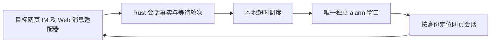

# 开发总纲：网页 IM 与独立强提醒

2026-10-30。当前范围以[范围决定](../decisions/2026-10-30-web-only-scope.md)为准。本文替换全面移植桌面客户端的旧总纲；旧正文保留在[历史归档](../archive/desktop-baseline/dev/00-architecture.md)。

## 1. 产品范围

- 网页已有的消息与会话交互、通知、对应客服设置。
- 订单联系入口：订单管理 → 操作栏“详情” → 联系人旁“IM 联系” → 正确的网页会话标签。完整订单管理不在范围内。
- 唯一扩展：一个独立、可持续显示的回复超时强提醒窗口。

其他桌面独有或自行扩展的功能不排期。网页共享代码中未启用的入口不算已有功能；登录、鉴权和资源释放属于必要基础，不能据此恢复旧产品范围。

## 2. 实现路线

保留 Tauri 2 + Rust 作为桌面宿主候选，先验证 Windows。业务契约以目标网页版为准，实时消息使用网页 Web IM SDK/传输；不再安排桌面 SDK sidecar 与原生协议重写的双路线竞赛。

先做“网页登录 + Web 消息接入 + 独立窗口”的小原型，验证网页身份和事件能否在宿主中可靠使用。实际网页与独立 Web SDK 承载方式需原型验证，不把脱离原站的 SDK 运行当作既成事实。网页路线失败时记录阻塞，不自动切回旧桌面路线。

网页 UI 是否直接承载或逐步本地重写，不改变网页能力基准。不得为了窗口扩展注入通用 shell、SQL 或任意网络代理能力。

## 3. 职责

| 部分 | 当前职责 |
| --- | --- |
| Web 适配器 | 网页登录态、消息/会话初始化与补偿、服务端回执、网页已有业务动作；输出有界结构化事件 |
| Rust 核心 | 校验来源、身份与代次；消息去重、等待轮次、超时调度、最小提醒状态、窗口生命周期 |
| 主界面 | 消息、通知、设置与订单联系入口；业务成功以网页契约读回 |
| alarm | 展示超时会话与等待时长，打开会话、暂时隐藏当前轮次；不发送客户消息、不改变客服状态 |

只保留 `main` 和 `alarm` 两种宿主窗口职责；网页登录与订单联系新标签按实际流程处理，不引入通用工作台或业务窗口池。

## 4. 共用约束

- `AccountContext={account_id,session_generation}`；`ConversationRef={account,gid}`；每个视图另有 `view_generation`。即便当前只服务一个登录身份，也必须拒绝注销前的迟到回调。
- 传输事件带 `stream/epoch/seq`；重复事件去重，跳号、断线和重启先补偿/取快照后继续。不要因两条连接都收到了同一条消息而提醒两次。
- 发送的 `confirmed/rejected/unknown` 分开；发送按钮、HTTP 200 或 Socket Connected 不等于客户消息已确认送达。结果未知不得盲目重发。
- 所有写动作保留网页字段大小写、鉴权和权限语义；收到无权限或登录失效不能伪装为无结果。
- 强提醒是本地辅助规则，不是平台考核时钟；计时、隐藏、恢复与停止条件详见[独立窗口](03-strong-alert.md)。
- 远程页面不持有任意本机权限；登录态不写入日志或提醒数据库；链接须校验 HTTPS、来源及目标身份。

## 5. 当前文档分工

[01 宿主](01-shell.md)、[02 登录](02-account-login.md)、[03 强提醒](03-strong-alert.md)、[04 订单入口](04-business-pages.md)、[05 最小状态](05-store.md)、[06 网页网络](06-net.md)、[07 网页附件](07-media.md)、[08 偏好与诊断](08-update-telemetry.md)、[09 外部助手取消说明](09-assistant.md)、[10 网页 IM](10-im.md)。

实际工程尚未创建；上述职责和标识是待实现设计，不是现有 API。当前计划见[总计划](../plan/00-master-development-plan.md)。
