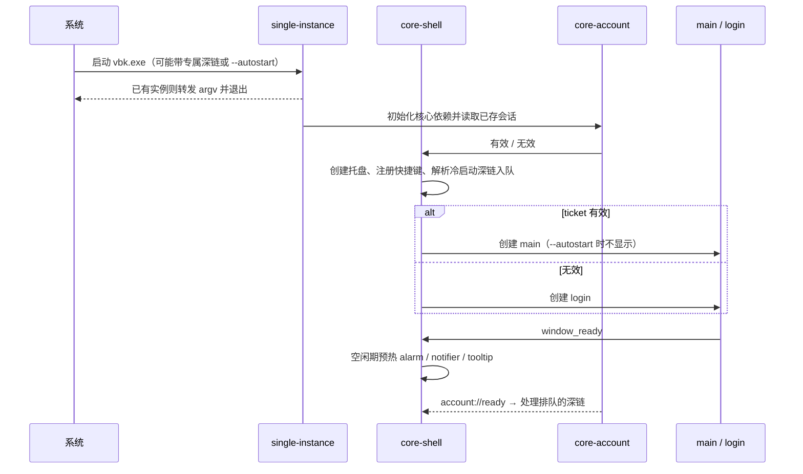

# 01 壳与窗口管理（core-shell + ui-shell）

> **范围已变更（2026-10-30）**：以[网页版范围决定](../decisions/2026-10-30-web-only-scope.md)为准。只做目标网页已有的消息、通知和订单联系入口；网页没有的功能不做。本文超出该范围的桌面对齐、扩展功能与验收要求均作为历史参考，不再执行。

2026-10-30

本文覆盖 Rust 核心模块 core-shell 与前端模块 ui-shell（main 主外壳、setting 设置窗口，以及官方 launch 启动页的去留）。跨模块约定以 [00 开发总纲](00-architecture.md) 为准；远程业务页在子 WebView 里怎么承载、bridge 暴露哪些能力，归 [04 业务页承载](04-business-pages.md)，本文只写宿主与标签管理。

## 一、结论与定位

- **core-shell 是唯一能创建、定位、显示、隐藏原生窗口和登记视图生命周期的模块**。其他模块只通过 shell 服务申请；04 提供远程 WebView 配置/bridge 策略，由 shell 执行创建和销毁，不自行建立未登记的窗口。官方客户端里每个 Manager 各自 `new BrowserWindow` 的做法不保留。
- **窗口注册表**按标签（00 第七节）登记每类窗口的规格与生命周期：常驻、预热、按需、单例。预热在主外壳可交互之后的空闲期进行，不挤占冷启动的 2 秒预算。
- **主外壳布局沿用官方**：顶部 40 px 账号标签栏、左侧 68 px 导航栏，其余区域是宿主区，放当前页面的子 WebView。导航切换对应官方 `mainViewChanged`。
- **托盘使用 Tauri core API；单实例、深链、开机自启、全局快捷键使用 Tauri 2 官方插件**，平台特有的部分（任务栏叠加图标、前台激活）收在 `core-shell/platform/`。
- **几处要更正的现状认知**（详见第二节）：官方的 Esc / Enter 只在截图期间临时注册为全局快捷键，常驻的全局快捷键是 `Ctrl+Shift+X`（截图）和 `Ctrl+Shift+V`（显示 / 隐藏主窗口）；官方运行时会调用 `setAsDefaultProtocolClient` 注册深链；setting 在官方是主外壳里的一个页面，不是独立窗口；官方没有窗口位置记忆。
- **关闭行为改为可选**：默认“关闭即最小化到托盘”，首次关闭时提示一次，设置里可改成“退出程序”，解决 02 文档“用户以为退出、进程仍占内存”的问题。

## 二、承接范围

### 2.1 官方窗口

| 官方窗口 | 证据（`dist-electron/main/index.js`） | 现状 | 新客户端 |
| --- | --- | --- | --- |
| main | `title:"Main window"`，1280×960，最小 990×700，`frame:!1`、`titleBarOverlay:{color:"rgba(10, 37, 76, 1)"}`，`webSecurity:!1` | 外壳页面 + 每账号一组 BrowserView，按 pageType 懒创建 | `main`，常驻；外壳页重写，子 WebView 由 04 承载 |
| launch | `title:"Launch window"`，`frame:!1,show:!1`；`autoLogin()` 每 200 ms 发 `beginToLogin`，渲染进程回应后打开 login 并关闭自身 | 只是等渲染进程就绪的过渡页 | **取消独立窗口**，见 7.1 |
| setting | 主进程无独立窗口；`Wo.setting="/pages/setting/index.html"` 作为 main 的 pageType，`createBrowserView` 中仅 setting 页 `webSecurity` 为真 | 主外壳里的一个页面（bundle `settingWindow-*.js` 约 123 KB） | 按总纲改为独立单例窗口 `setting` |
| web（多标签网页窗口） | `createWebWindow`：每账号一个窗口，`title` 为账号名，子 BrowserView 作为标签；`webViewChanged`、`getWebInfoList`、标签右键“关闭其他” | 远程页多标签容器 | `web-<序号>`，标签管理归本文，页面承载归 04 |
| extra（附加窗口） | `openExtraWindow(url)`：从 URL 查询参数读 `width/height/top/left/isHideNavBar/navBarStyle/fullscreen`，默认贴在主窗口右侧 8 px | 单个，`closeExtraWindow` 关闭 | `web-extra`，单例；每次打开绑定账号与视图代次 |
| ai | `nn.openWindow`，贴主窗口右侧，宽 375 | 单例 | 暂归 04（`biz-ai`），定位规则复用本文 7.6 |

### 2.2 IPC 接口（常量见 `preload/main.js` 与 `index.js` 中的 `y.*`）

| 官方 IPC | 通道名 | 官方行为 | 新契约 |
| --- | --- | --- | --- |
| `mainViewChanged` | `main_view_changed` | 渲染进程发 pageType，主进程 `jumpToMainUrl(pageType, buid)` 切换 BrowserView；`did-finish-load` 时反向通知 | `plugin:shell\|main_view_switch` + 事件 `shell://main-view-changed` |
| `openWindow` | `open_window` | 只处理 `image`、`video` 两种，转给预览窗口 | 移交 07（`plugin:media\|viewer_open`），shell 只提供开窗服务 |
| `openExtraWindow` / `closeExtraWindow` | `open_extra_window` / `close_extra_window` | URL 须通过 `qe()`、`Ot()` 白名单，否则交系统浏览器 | `plugin:shell\|extra_window_open` / `extra_window_close`；远程页经 bridge 转调 |
| `popContextMenu` | `pop_context_menu` | 主进程：`mediaType:"image"` 弹“复制图片 / 保存图片”；web 窗口：标签“关闭其他” | `plugin:shell\|context_menu_popup`，只接受预定义菜单种类 |
| `flashMainWindow` | `flash_main_window` | `win.flashFrame(e)` | 能力在 shell，策略在 03：`TaskbarService::flash` |
| `windowFullScreen`、`closeWindow`、`showWindow`、`windowLoaded`、`forceFocus` | 同名 snake_case | 外壳页控制自身窗口 | 可信本地页面仅获自身拖动/最小化/最大化权限，显示/关闭仍走 shell 以执行策略；`window_loaded` 改为 `plugin:shell\|window_ready` |
| `webViewChanged`、`getWebInfoList` | `web_view_changed`、`get_web_info_list` | web 窗口标签切换、列表 | `plugin:shell\|tab_*` 与 `tabs_snapshot` |

### 2.3 系统集成点

| 能力 | 官方证据 | 要点 |
| --- | --- | --- |
| 单实例 | `f.app.requestSingleInstanceLock()\|\|(f.app.quit(),process.exit(0))` | 第二实例的 argv 经 `second-instance` 交给 `B.onProtocolOpen(e.pop().slice(0,-1))` |
| 深链 | `setAsDefaultProtocolClient(W.SCHEMA_MAP[ne.nodeEnv])`；`SCHEMA_MAP={production:"vbookingChat",development:"vbookingChatDev"}`（`constant-2w9sXoOv.js`）；macOS `open-url` | 运行时注册；04 文档“Windows 未见注册代码”需更正 |
| 深链参数 | `onProtocolOpen`：`action=auth` 时带全部参数跳 im；否则读 `account`、`bu`（`tour`/`zcb`）、`initChat`（`3` 跳 notice，否则 im）；账号不存在则以模态打开 login | **冷启动时不解析 `process.argv`**（只在 `second-instance` 和 `open-url` 处理），推断应用未运行时点深链会丢失目标 |
| 托盘 | `$t` 类：Windows 用 `tray_icon.ico`；菜单“显示 / 退出”（开发环境多一项开发者工具）；`click` 聚焦 main 或 login 或 update；`mouse-move` 时有未读则显示 toolTip 窗；提示文字“旅游商家桌面版” | 闪烁用 500 ms `setInterval` 交替空图标 |
| 未读角标 | `rerenderTray()`：汇总各账号 `message + notice`，超过 99 显示 `99+`；macOS `tray.setTitle` + `dock.setBadge`，Windows `B.instance.setOverlay(t)` | Windows 叠加图标是在 main 的 webContents 里 `executeJavaScript` 用画布画出数字，再 `setOverlayIcon` |
| 开机自启 | `setLoginItemSettings({openAtLogin:!ke.dev&&isAutoLaunch,path:process.execPath})`，偏好默认 `isAutoLaunch:!0` | 另有 `isRunOnStart:!0` 字段，未见使用（推断为遗留） |
| 全局快捷键 | `initShortcut()`：`screenShotKey`（默认 `CommandOrControl+Shift+X`）打开截图，`openVbkKey`（默认 `CommandOrControl+Shift+V`）调 `toogleMainWin()`；注册失败只写日志 | 截图期间 `ScreenShotManagerV2._doCapture` 临时 `globalShortcut.register("Escape")`、`register("Return")`，`finishScreenShot` 时注销 |
| 关闭行为 | main `close` 事件：`ke.isQuiting\|\|(t.preventDefault(),win.hide())`；托盘“退出”走 `app.quit()`，`before-quit` 置 `isQuiting` 并清理 IM 进程、托盘等 | 无选项，永远隐藏 |
| 启动顺序 | `whenReady` → 代理 → `[_t.init, ie.initAccount]` → `[UBT, Shark]` → `[偏好, 托盘 ft, 截图 Ai, …]` → `[ln, toolTip Lt, …]` → `Oc()`（launch、启动时检查更新、autoLogin） | 启动次数计数 `z.set(Cr,i+1)` |
| 崩溃自愈 | main `crashed` 3 秒后 reload，最多 10 次；BrowserView `unresponsive` 弹框询问重新加载 | |
| 窗口位置 | 未见保存 bounds 的代码；extra、ai 窗口按主窗口位置贴右侧，越界判断只用 `getPrimaryDisplay().size`；web 窗口在 `isFullScreen` 偏好下取主屏 `workAreaSize` | 副屏上会判断错误 |
| 其他 | `setAppUserModelId(app.getName())`；`window-all-closed` 非 macOS 直接退出 | AUMID 影响通知与任务栏分组 |

### 2.4 主外壳页面（`renderer-dist/js/mainWindow-*.js`、`useMenuList-*.js`）

| 区域 | 官方实现 |
| --- | --- |
| 账号标签栏 | antd `editable-card` 标签：点击 `changeAccount`，“+” 调 `addAccount`（主进程以模态打开 login），关闭调 `logout`；账号数超过 15 隐藏“+”（即最多 16 个）；dnd-kit 拖拽排序后发 `sortAccountList`；标签内可直接改昵称（渲染进程用 drizzle 直接写 userInfo 表）；有未读时标签带“new”样式；自动登录中的账号按 `2s×(序号+1)` 依次触发 |
| 导航栏 | 上组：消息（im）、通知（notice）、事件、商服、产品、订单、数据（bi）、点评、工作台（home）等，按 `userMenuList` 与远程 `qconfigMenu`、`partyType`、`buType` 决定是否显示，部分带角标；下组：首页（`isolated:!0`，在 web 窗口打开远程首页）、设置 |
| 宿主区 | BrowserView `setBounds({x:68,y:40,width:w-68,height:h-40})`（`vr=68`、`yr=40`），最大化时按光标所在屏工作区裁剪 |

## 三、Tauri / Rust 分工

| 功能 | Rust 核心（core-shell） | WebView 前端（ui-shell） |
| --- | --- | --- |
| 窗口注册表、创建、预热、复用 | 全部 | 无 |
| 主外壳布局 | 子 WebView 的位置与大小、显示哪一个（宿主区矩形由前端上报） | 标签栏、导航栏、宿主区占位、骨架屏 |
| 当前账号 / 当前页面 | 持有 `MainViewState`（当前页面、各账号已创建的页面） | 只显示，切换调命令 |
| 导航菜单可见性 | 无（数据来自 account 快照） | 按账号菜单权限与远程配置计算 |
| 多标签（web 窗口） | 标签列表、激活、关闭、上限与回收 | 标签条渲染、拖拽、右键触发 |
| 托盘 | 图标、菜单、点击与悬停事件、闪烁计时 | 无 |
| 任务栏叠加图标、闪烁 | 绘制与设置（预渲染图标，不经 WebView） | 无 |
| 右键菜单 | 原生菜单弹出、执行复制 / 保存等动作 | 发起请求、带上下文（坐标、媒体地址） |
| 单实例、深链 | 接收、校验、解析、排队、分发 | 无 |
| 开机自启、全局快捷键 | 注册、冲突检测、持久化 | 设置页里的开关与录入框 |
| 关闭到托盘 | 拦截 `CloseRequested`、首次提示策略 | 首次提示对话框的展示 |
| 窗口位置记忆 | 保存、多显示器校验、恢复 | 无 |
| setting 窗口 | 单例开窗 | 页面重写；各分区内容由对应模块提供组件 |

## 四、Rust 核心设计

### 4.1 状态

shell 按 00 第 4.5 节用一个 actor 持有状态，只读部分用 `watch` 发布。

| 状态 | 内容 | 持久化 |
| --- | --- | --- |
| `WindowRegistry` | 标签 → 规格、生命周期（Absent / Creating / ReadyHidden / ReadyVisible / Failed / Destroying）、AccountContext、ViewContext、WebView 环境代次 | 否 |
| `MainViewState` | `seq`、当前账号、当前页面、各账号已创建的子 WebView 列表、宿主区矩形 | 否 |
| `TabState` | 每个 web 窗口的 `seq`、标签列表、激活标签 | 否（是否恢复标签见第十一节） |
| `TrayState` | 图标状态（正常 / 闪烁）、提示文字、菜单项 | 否 |
| `ShortcutState` | 动作 → 快捷键、注册结果 | 是，经 08 偏好服务 |
| `ShellPrefs` | 关闭行为、是否已提示过、开机自启、启动时隐藏 | 是，经 08 偏好服务 |
| 窗口几何 | 各标签的位置、大小、最大化、所在显示器 | 是，tauri-plugin-window-state 自己的文件 |

窗口规格示意（不是要落盘的代码）：

```rust
pub enum Lifecycle { Resident, Prewarm, OnDemand, Singleton }
pub struct WindowSpec {
    pub label_pattern: &'static str,   // "main"、"web-{n}"、"capture-overlay-{n}"
    pub entry: &'static str,           // ui/apps/<入口>/index.html
    pub lifecycle: Lifecycle,
    pub size: (f64, f64), pub min_size: Option<(f64, f64)>,
    pub decorations: bool, pub transparent: bool,
    pub always_on_top: bool, pub skip_taskbar: bool, pub focusable: bool,
    pub remember_geometry: bool,       // 是否交给 window-state 记忆
    pub close_policy: ClosePolicy,     // Hide / Destroy / AskThenHide
}
```

### 4.2 窗口注册表与复用策略

| 标签 | 生命周期 | 创建时机 | 关闭按钮 | 记忆位置 |
| --- | --- | --- | --- | --- |
| `main` | 常驻 | 本地启动策略就绪后创建；账号连接状态异步显示 | 按关闭行为偏好 | 是 |
| `login` | 按需 | 无有效 ticket 或“添加账号” | 销毁 | 否（居中，添加账号时以 main 为父窗口模态） |
| `im` | 首次打开后常驻 | 归 10 | 隐藏 | 是 |
| `alarm`、`notifier`、`tooltip` | 预热 | main 可交互后约 1.5 秒空闲期，归 03 定义规格 | 隐藏 | 否（由 03 按屏幕边缘定位） |
| `capture-overlay-<n>` | 预热 | 归 07；shell 在显示器增减时通知 07 重建 | 隐藏 | 否 |
| `viewer-image`、`viewer-video` | 单例 | 归 07 | 隐藏 | 是 |
| `web-<序号>` | 按需 | 打开第一个远程标签时；每账号最多一个 | 销毁（连同子 WebView） | 是（所有 web 窗口共用一条记录） |
| `web-extra` | 单例 | `extra_window_open` | 销毁 | 否（按 URL 参数或贴主窗口右侧） |
| `setting` | 单例 | 导航“设置” | 销毁 | 是 |
| `update` | 单例 | 归 08 | 隐藏 | 否 |

复用规则：

1. 单例与常驻窗口复用前核对环境、视图、账号代次；只有 Ready 状态可复用。通过定向快照/事件下发新参数；提醒窗只不激活显示，只有用户主动打开的交互窗口可请求焦点。
2. 预热窗口的创建排在一个低优先级队列里，逐个创建，每个之间让出事件循环，避免集中创建造成主外壳卡顿。
3. `window_ready` 绑定实际调用 WebView 与当前 `view_generation`；就绪前请求有界排队（同一对象合并、最长 5 秒），超时转 Failed，禁止无界等待。旧代次 ready/参数回调直接丢弃。
4. 账号登出先推进 `session_generation`，取消该账号排队操作，关闭账号窗口并释放业务 WebView；共享 im/viewer/弹窗清空该账号内容、撤销对应资源句柄，不能只关闭 web 窗口。
5. BrowserProcessExited 按 WebView 环境和恢复代次只处理一次：该环境全部控制器（含隐藏提醒、预览、截图）失效，销毁旧句柄；可见窗口按策略重建，隐藏窗口下次使用时重建并重新握手。失败预算按环境计数并带退避，超过预算显示恢复入口，不无限 reload。

### 4.3 主外壳宿主与页面切换

- 宿主区矩形由 ui-shell 在布局变化时上报（`host_rect_update`，逻辑像素），shell 负责在窗口 resize、最大化、DPI 变化时同步子 WebView 的位置。官方在主进程写死 68 / 40，新做法让布局可以调整而不改 Rust。
- 远程业务页按账号/页面对应子 WebView，本地 im 按总纲单例；每个远程页面对应一个子 WebView，由 04 提供配置、shell 用 `Window::add_child` 创建（Tauri 2 的多 WebView 需打开 `unstable` 特性，需验证稳定性）。shell 只记录“账号 × 页面 → 子 WebView 标签”，并决定显示哪一个。
- 子 WebView 数量上限与回收：当前账号的通知中心业务视图常驻；本地 im 不计入远程页面配额；其他页面按最近使用保留，单账号最多 4 个、全部账号合计最多 8 个，超出时回收最久未用的（数值需原型实测后定）。后台账号只保留 IM 连接，不保留页面，符合 04 文档“切换账号”场景。
- `scale` 偏好变化时，shell 对所有宿主中的子 WebView 调 `set_zoom`（对应官方 `onPrefrencesChanged` 里的 `setZoomFactor`）。
- 主窗口获得焦点时，把焦点交给当前子 WebView（官方 `focus` 监听里 `getBrowserView().webContents.focus()`）。

### 4.4 命令

| 命令 | 参数 → 返回 | 调用方 | 说明 |
| --- | --- | --- | --- |
| `plugin:shell\|window_ready` | `{view_generation}` → `()` | 所有本地窗口 | 就绪握手 |
| `plugin:shell\|window_open` | `{kind, params}` → `label` | main、setting | 只能开注册表里的种类 |
| `plugin:shell\|window_show` / `window_hide` / `window_close` | `{label}` → `()` | main | 本窗口的最小化、最大化、拖动直接用 Tauri core 窗口权限 |
| `plugin:shell\|main_view_snapshot` | `{}` → `{seq, account, page, created_pages}` | main | |
| `plugin:shell\|main_view_switch` | `{page, account?, hash?}` → `()` | main；深链内部调用 | 对应 `mainViewChanged` |
| `plugin:shell\|host_rect_update` | `{x, y, width, height}` → `()` | main | 逻辑像素 |
| `plugin:shell\|tabs_snapshot` | `{window}` → `{seq, tabs, active}` | web 窗口 | 对应 `getWebInfoList` |
| `plugin:shell\|tab_open` / `tab_activate` / `tab_close` / `tab_close_others` | `{window?, url \| tab_id}` → `tab_id` 或 `()` | web 窗口；04 bridge | URL 经 04 的 scheme/origin/redirect 分类；非可信地址仅经用户点击确认后交系统浏览器，不自动外开 |
| `plugin:shell\|extra_window_open` / `extra_window_close` | `{url}` → `()` | 04 bridge | 仅接受已知参数，尺寸/位置夹紧到目标屏工作区，禁止任意 fullscreen/置顶/隐藏导航扩权 |
| `plugin:shell\|context_menu_popup` | `{kind, x, y, payload}` → `Option<action_id>` | main、web、im | `kind` 限定为 `image`、`tab`、`text`、`link` |
| `plugin:shell\|shortcut_snapshot` | `{}` → `[{action, accelerator, registered}]` | setting | |
| `plugin:shell\|shortcut_update` | `{action, accelerator?}` → `{registered, conflict?}` | setting | 先试注册，成功后才落盘 |
| `plugin:shell\|autostart_get` / `autostart_set` | `{enabled}` | setting | |
| `plugin:shell\|close_behavior_set` | `{behavior: tray \| quit}` | setting、首次关闭提示框 | |
| `plugin:shell\|app_quit` / `app_relaunch` | `{}` | setting、托盘 | 真正退出，走有序关闭流程 |

### 4.5 事件

| 事件 | 载荷 | 接收方 |
| --- | --- | --- |
| `shell://main-view-changed` | `{seq, account, page}` | main |
| `shell://tabs-changed` | `{seq, window, tabs, active}` | 对应 web 窗口 |
| `shell://window-params` | `{label, params}` | 被复用的单例窗口（再次打开时的新参数） |
| `shell://close-prompt` | `{}` | main（首次点关闭时弹提示框） |
| `shell://shortcut-failed` | `{action, accelerator, reason}` | main、setting |

内部事件总线（不进 WebView）：`WindowFocusChanged{label, focused}`、`WindowVisibilityChanged`、`TrayPointer{Enter \| Move \| Leave, rect}`、`DeepLinkReceived(DeepLink)`、`ShortcutTriggered(action)`、`MonitorsChanged`、`AppQuitting`。

### 4.6 对其他模块提供的服务接口

```rust
pub trait WindowService {
    fn ensure(&self, kind: WindowKind, params: Value) -> Result<String, AppError>; // 返回 label
    fn show(&self, label: &str, activate: bool) -> Result<(), AppError>;
    fn hide(&self, label: &str) -> Result<(), AppError>;
    fn monitors(&self) -> Vec<MonitorInfo>;            // 工作区、缩放比
}
pub trait TrayService { fn set_flashing(&self, on: bool); fn set_tooltip(&self, text: &str); }
pub trait TaskbarService {
    fn set_unread(&self, count: u32);                  // Windows 叠加图标 / macOS Dock 角标
    fn flash(&self, kind: AttentionKind);              // request_user_attention
}
```

角标与闪烁的“何时开、何时关”由 03 决定（官方逻辑在 `rerenderTray`，按通知偏好过滤），shell 只执行。

### 4.7 使用的 Tauri 2 能力

| 能力 | 用法 |
| --- | --- |
| tauri-plugin-single-instance（开启 `deep-link` 特性） | 必须第一个注册；回调拿到第二实例的 argv |
| tauri-plugin-deep-link | 安装器注册新客户端专属 scheme（暂定 `tsim-vbk`，开发版 `tsim-vbk-dev`）；启动时读冷启动 URL，单实例处理后续 URL；仅修复本应用 scheme，不覆盖官方 `vbookingChat` |
| `tray-icon` 特性：`TrayIconBuilder`、`TrayIconEvent` | 左键单击、`Enter` / `Move` / `Leave`（代替官方 `mouse-move` 驱动 tooltip） |
| `tauri::menu` + `Window::popup_menu` | 托盘菜单与右键菜单 |
| tauri-plugin-global-shortcut | 截图、显示 / 隐藏主窗口两个动作 |
| tauri-plugin-autostart | Windows 写当前用户 Run 键，启动参数带 `--autostart` |
| tauri-plugin-window-state | 窗口几何记忆；关闭插件自动显示/恢复冲突路径，由 shell 先校验再恢复，非交互/敏感窗口不恢复可见状态 |
| `Window::set_overlay_icon`、`set_badge_count`、`request_user_attention` | 任务栏叠加图标、Dock 角标、任务栏闪烁（叠加图标 API 名称需验证） |
| windows crate | `AllowSetForegroundWindow`、`WM_QUERYENDSESSION` 处理等补充调用，收在 `platform/win.rs` |

## 五、前端设计

### 5.1 main 外壳（`ui/apps/shell`）

| 区域 | 内容 | 数据来源 |
| --- | --- | --- |
| 标题栏（40 px） | 账号标签、“+”、窗口按钮、拖动区 | `account_snapshot` + `account://changed`；未读点来自 03 的未读快照 |
| 导航栏（68 px） | 上组业务入口、下组首页与设置；角标 | 菜单权限来自 account 快照；消息、通知角标来自 03 / 10 快照 |
| 宿主区 | 空占位 + 骨架屏；尺寸变化上报 `host_rect_update` | 子 WebView 由 Rust 盖在其上 |
| 首次关闭提示框 | “最小化到托盘 / 退出程序”，可勾选“不再提示” | `shell://close-prompt` |

- 标签栏的拖拽排序、改昵称、关闭账号分别调 02 的 `account_sort`、`account_rename`、`account_logout`。官方在渲染进程里直接写数据库改昵称的做法取消。
- 自动登录的依次触发（官方每个标签一个 `2s×(序号+1)` 定时器）移到 core-account，外壳只显示“登录中”状态。
- 窗口按钮自绘（`decorations(false)` + `data-tauri-drag-region`），配色沿用官方 `rgba(10, 37, 76, 1)`。
- 事件、公告、商服三个入口的角标在官方由页面 `setInterval` 轮询远程接口获得；一期保留在前端（非时间敏感），是否下沉到 06 见第十一节。

### 5.2 setting 窗口（`ui/apps/setting`）

| 分区 | 内容 | 提供方 |
| --- | --- | --- |
| 通用 | 开机自启、关闭行为、启动时隐藏到托盘、语言、缩放 | shell + 08 |
| 快捷键 | 截图、显示 / 隐藏主窗口；冲突即时提示 | shell |
| 通知与提醒 | 新消息、系统通知、回复超时、提示音、横幅位置 | 03 |
| 网络 | 系统代理、网络优化 | 06 |
| 存储 | 聊天缓存天数、打开数据目录 | 05 |
| 关于与更新 | 版本、检查更新 | 08 |

各分区以独立组件包的形式由对应模块维护，setting 只做框架和导航。

### 5.3 性能要求

| 指标 | 目标 |
| --- | --- |
| main 外壳 JS 首包 | ≤ 250 KB（gzip 前，不含 Fluent UI 按需部分以外的依赖） |
| 冷启动到外壳可交互 | ≤ 2 s（00 第八节），外壳首屏不等待任何远程请求 |
| 导航切换到子 WebView 可见 | 已创建页面 ≤ 100 ms；未创建页面先显示骨架 |
| 账号切换到外壳刷新 | ≤ 200 ms（不含远程页加载） |
| 预热窗口 | 不得让外壳在预热期间出现 > 50 ms 长任务 |
| setting 首次打开 | ≤ 500 ms |

## 六、与其他模块的联动

| 模块 | shell 提供 | shell 使用 |
| --- | --- | --- |
| 02 account | 登录窗口开关、账号登出时关闭相关窗口 | `account://changed`、`account://ready`；深链里按账号名查 buid |
| 03 notify | `TrayService`、`TaskbarService`、`TrayPointer` 与 `WindowFocusChanged` 事件 | 未读数与闪烁指令；主窗口获得焦点时 03 停止闪烁（官方 `focus` 里 `flashFrame(!1)` + `stopFlash()`） |
| 04 业务页 | 宿主矩形、显示哪个子 WebView、标签管理、extra 窗口 | 子 WebView 的创建、回收、崩溃重载 |
| 07 media | `ShortcutTriggered(Screenshot)`、`MonitorsChanged`、截图时隐藏主窗口与恢复 | 截图遮罩窗口规格 |
| 08 偏好 / 更新 | `update` 窗口开关 | 偏好读写（关闭行为、自启、快捷键、缩放）、启动时检查更新结果 |
| 10 IM | `im` 窗口开关；深链目标的转发 | `plugin:im\|jump` 定位会话 |

## 七、关键流程

### 7.1 启动顺序与启动页



- **取消 launch 窗口**。官方 launch 的作用只是等渲染进程就绪（每 200 ms 发一次 `beginToLogin`），并在后台做启动时更新检查。新客户端里 main 或 login 页本身就是本地资源，首屏在几百毫秒内可见，再多一个过渡窗口只会多一个 WebView 控制器。main 窗口先以 `visible(false)` 创建，`window_ready` 后再显示，避免白屏。
- 启动遵守 08 的可信缓存版本门禁；已知被禁版本先进入更新/受限页。未知远端策略时允许本地壳可见，后台检查有截止时间；运行中发现有效强更后阻断新增业务写入并排空/记录在途操作。不得同时承诺“首屏不等网络”和“未知远端强更时绝不出现 main/login”。
- 进程入口先区分受约束的内部 crash-monitor 模式；仅普通应用路径把单实例插件作为第一个 Tauri 插件注册，监视器不进入此路径。

### 7.2 深链与官方客户端共存

新客户端默认不接管官方 `vbookingChat` / `vbookingChatDev`。专属 scheme 暂定 `tsim-vbk` / `tsim-vbk-dev`，冻结安装标识前确认唯一性；如将来显式提供接管开关，必须显示当前处理程序、说明影响并支持恢复，禁止启动时静默覆盖。远程业务页内识别官方深链可在本应用内部按已核验参数转换，不修改系统归属。

1. 入口有三个：冷启动 argv（`deep_link().get_current()`）、第二实例 argv（single-instance 回调）、macOS `open-url`（第二阶段）。
2. 校验：协议名不区分大小写地匹配当前环境的 scheme；整串长度 ≤ 2 KB；每种 action 独立参数 schema，拒绝重复键、未知 action、非法编码、路径穿越与多层嵌套 URL；日志只记拒绝类别，不记录原始 URL/凭据。深链是外部输入，不得直接拼进 URL 或命令。
3. 解析为类型化目标；账号须匹配 environment/account_id 的已登录身份，不按可重名昵称授权。只开放已核验的 IM/通知导航；`action=auth` 参数与认证闭环未证实，默认拒绝。按 URL 规范解析，禁止盲目 `.slice(0,-1)` 或删除可能属于参数值的尾斜杠。
4. 激活窗口：main 存在则恢复并聚焦，否则聚焦 login 或 update（同官方顺序）。
5. 未就绪目标有界排队并绑定目标身份、创建时间和用户动作 ID；30 秒后显示“请求已过期，可重新打开”，不静默丢失。登录可继续，但不得在后来登录的其他账号中执行旧目标；每次执行重新验证 AccountContext。
6. 执行：重新授权目标 → 切换已确认账号 → 调类型化 `jump(ConversationRef)` 或通知中心导航；不把外部参数直接拼入 hash。

### 7.3 关闭、最小化到托盘与退出

| 触发 | 行为 |
| --- | --- |
| 点 main 关闭按钮，首次 | 拦截 `CloseRequested`，保持 main 可见并发 `shell://close-prompt`；用户选定后再隐藏或退出 |
| 点 main 关闭按钮，已选“托盘” | 隐藏；子 WebView 保留，但 04 可在隐藏 10 分钟后回收非 IM 页面（需原型验证内存收益） |
| 点 main 关闭按钮，已选“退出” | 走有序退出 |
| 托盘“退出”、setting“退出” | 有序退出：发 `AppQuitting` → 10 断开 IM 与 sidecar、05 刷盘、08 写日志 → 销毁托盘 → `app.exit(0)`；退出前即持久化未决发送/下载状态；整体预算 3 秒，超时终止本应用子进程，不把在途发送误标失败；禁止粗暴结束共享 WebView2 进程 |
| 系统注销 / 关机 | 不弹提示、不阻止，直接走有序退出（需验证 Tauri 在 `WM_QUERYENDSESSION` 时的事件顺序） |
| 全局快捷键“显示 / 隐藏主窗口” | 同官方 `toogleMainWin`：未聚焦或不可见则恢复并聚焦，否则隐藏 |

### 7.4 托盘

- 菜单：显示主窗口、设置、退出（开发构建加“开发者工具”）。菜单文案随语言切换重建。
- 左键单击：聚焦 main 或 login 或 update，并让 03 隐藏 tooltip（官方 `Lt.instance.hide()`）。
- 指针进入 / 移动 / 离开：发 `TrayPointer` 事件给 03，由 03 决定是否显示 tooltip 窗及何时隐藏，代替官方 toolTip 窗每秒检查鼠标位置的轮询。
- 闪烁：03 调 `set_flashing(true)` 后，shell 用 tokio 500 ms 定时器在正常图标与透明图标之间切换；`false` 时恢复。

### 7.5 右键菜单（popContextMenu）

- 前端在 `contextmenu` 事件里调 `context_menu_popup`，带坐标与载荷；Rust 按 `kind` 构建固定菜单并用 `popup_menu` 弹出，返回用户选中的项。
- 能在 Rust 完成的动作直接执行：`image` 的“复制图片”（下载或解码后写剪贴板）、“保存图片”（交 07 下载）；`tab` 的“关闭其他”。只影响页面的动作（如“复制选中文本”）返回给前端执行。
- 远程页的右键默认用 WebView2 自带菜单，是否关闭并替换由 04 决定；shell 只提供接口。

### 7.6 多显示器窗口位置记忆

1. 保存：`main`、`im`、`setting`、`viewer-*`、`web-*` 在移动、缩放结束（防抖 500 ms）和退出时保存逻辑坐标、大小、最大化状态与所在显示器名称。
2. 恢复：读取记录后检查该矩形与当前任一显示器工作区的交集是否至少占窗口面积的 30%，且标题栏区域可见；不满足则在主窗口所在（没有则主显示器）显示器居中，大小按该屏工作区裁剪。
3. 显示器拔插（`MonitorsChanged`）：对可见窗口重复第 2 步的校验，把落在已消失屏幕上的窗口移回。
4. 相对定位窗口（`web-extra`、`biz-ai`）：贴在 main 右侧 8 px，越界判断使用 **main 所在显示器** 的工作区，修正官方只看主屏的问题；放不下时贴在 main 内侧右边缘。
5. 新开的 `web-<序号>` 相对当前焦点窗口偏移 40 px（同官方），并做同样的越界校验。

### 7.7 任务栏叠加图标

- 03 调 `set_unread(count)`；Windows 上 shell 从内嵌的预渲染图标集（1–99 与 `99+`，16×16 与 32×32 两档）中选一张设为叠加图标，0 时清除；描述文字用多语言词条“新消息通知”。官方每次都在 main 的 WebView 里执行画布脚本生成图片，新做法不依赖任何 WebView 是否存活。
- macOS（第二阶段）：`set_badge_count` + 托盘标题。

## 八、注意事项（Windows 优先）

| 主题 | 说明 |
| --- | --- |
| 全局快捷键冲突 | 默认的 `Ctrl+Shift+V` 在很多软件里是“粘贴为纯文本”，注册为全局热键后会在所有程序里被抢走。建议新默认改为 `Ctrl+Alt+V`（老用户迁移时保留原值，并在设置页提示）。注册失败必须通过 `shell://shortcut-failed` 告诉用户，不能像官方一样只写日志 |
| 不注册全局 Esc / Enter | 官方截图时把 Esc、Enter 注册为系统级热键，截图流程异常时会让全系统的 Esc、Enter 失效。新客户端由截图遮罩窗口自己获得焦点后处理按键，归 07 |
| 前台激活限制 | Windows 不允许后台进程随意抢前台。第二实例转发时先调用 `AllowSetForegroundWindow` 让主实例获得激活权；仍失败则 `show` + `request_user_attention`。是否能在 single-instance 插件的第二实例侧插入这一步需验证 |
| AUMID 与快捷方式 | 官方 `setAppUserModelId(app.getName())`。NSIS 生成的开始菜单快捷方式 AUMID 必须与运行时一致，否则 Toast 无法显示、任务栏分组错乱、叠加图标落到错误按钮上 |
| 叠加图标的显示条件 | 窗口必须在任务栏上有按钮（`skip_taskbar(false)`）；main 隐藏到托盘时没有任务栏按钮，此时只靠托盘闪烁提醒，这与官方一致 |
| 托盘图标被折叠 | Windows 11 默认把新托盘图标收进溢出区。首次运行可在提示框里引导用户固定。托盘图标身份与 exe 路径相关，安装目录变化会丢失“固定”状态（需验证 Tauri 是否支持指定 GUID） |
| 自绘标题栏 | `decorations(false)` 后 Windows 11 的贴靠布局（悬停最大化按钮弹出布局）默认不可用，需要额外处理或接受该限制；窗口阴影与圆角需验证 |
| DPI | 坐标一律用逻辑像素保存，换屏时由 Tauri 的 Per-Monitor V2 处理；宿主矩形在 `ScaleFactorChanged` 时要重新下发给子 WebView |
| 深链注册 | 仅注册本应用专属 scheme；便携版不静默写默认关联，开发版用独立 scheme；与官方客户端共存及卸载恢复必须验收 |
| 开机自启 | 写 `HKCU\...\Run`，不需要管理员。自启时带 `--autostart`，启动后不显示主窗口，只有托盘；开发构建不写自启（同官方 `!ke.dev`） |
| 关闭即隐藏的内存 | 隐藏不等于暂停/释放；回收规则由 04 执行。`MemoryUsageTargetLevel` 是需显式评估的版本相关能力，不能承诺隐藏自动降内存 |
| 崩溃自愈 | 按 4.2 环境代次统一恢复，应用层定义有限次数/时间窗与退避；ProcessFailed/BrowserProcessExited 接入及隐藏控制器重建须在原型验证 |

## 九、原型验证项与验收标准

| 编号 | 验证项 | 验收标准 |
| --- | --- | --- |
| P1 | 主外壳 + 子 WebView 宿主（`unstable` 多 WebView） | 两个账号各 3 个页面来回切换 100 次无白屏、无错位；resize、最大化、跨不同缩放比的显示器拖动后子 WebView 位置正确 |
| P2 | 冷启动 | 有效 ticket 下从双击到外壳可交互 ≤ 2 s；预热期间外壳无 > 50 ms 长任务 |
| P3 | 深链 | 应用未运行、已运行（主窗口隐藏、最小化、在后台）四种情况下点击深链，都能打开正确账号的正确会话；畸形 URL 不崩溃、不执行 |
| P4 | 前台激活 | 深链与快捷键唤起时主窗口能到前台；做不到时任务栏闪烁 |
| P5 | 关闭与退出 | 关闭到托盘后进程内存在 10 分钟内下降（记录数值）；“退出”后 3 秒内进程与 sidecar 全部退出；注销 / 关机不被阻止 |
| P6 | 托盘与叠加图标 | 未读 0、1、99、120 显示正确；托盘悬停在 300 ms 内出现 tooltip；闪烁开关无残留定时器 |
| P7 | 快捷键 | 被其他程序占用时设置页即时提示；修改后无需重启即生效 |
| P8 | 位置记忆 | 双屏下把 main 放在副屏后退出，拔掉副屏再启动，main 出现在主屏且完整可见 |
| P9 | 开机自启 | 开关写入 / 删除 Run 键；自启后只显示托盘 |

## 十、开发步骤与工作量估计

| 步骤 | 内容 | 人日 |
| --- | --- | --- |
| 1 | 窗口注册表、`WindowService`、就绪握手、预热队列 | 3 |
| 2 | 单实例、深链解析与排队、前台激活 | 2.5 |
| 3 | 托盘、菜单、闪烁、`TrayPointer` 事件 | 2 |
| 4 | 任务栏叠加图标（预渲染图标集）、`request_user_attention` | 1 |
| 5 | 关闭行为、首次提示、有序退出、注销处理 | 2 |
| 6 | 全局快捷键、开机自启、偏好对接 | 1.5 |
| 7 | 窗口位置记忆与多显示器校验 | 2 |
| 8 | 主外壳宿主：宿主矩形、页面切换、子 WebView 数量上限与回收（与 04 联调） | 4 |
| 9 | web 窗口多标签、extra 窗口、右键菜单 | 3 |
| 10 | ui-shell 外壳页：标题栏、账号标签、导航、骨架屏 | 4 |
| 11 | setting 窗口框架与“通用”“快捷键”分区 | 2.5 |
| 12 | 原型验证 P1–P9 与性能测量 | 3 |
| 合计 | | 约 30.5 |

步骤 1–7 属于 M1 前置，步骤 8–10 与 02、04 一起在 M1 交付，步骤 9、11 可推到 M4 前完成。

## 十一、待确认问题

1. 一期取消独立 launch 窗口；未来启动广告/品牌页属于新增需求。
2. 一期显示窗口新默认 `Ctrl+Alt+V`；旧用户保留已导入有效值，注册冲突不抢占并即时提示。
3. 一期默认最小化到托盘并首次提示；“退出”行为必须独立可达。
4. 一期不自动恢复带鉴权参数的远程标签；页面配额按 04 原型预算执行。
5. 事件、公告、商服的角标轮询是否下沉到 06 统一调度，还是保留在外壳前端。
6. 旧 `isRunOnStart` 未发现有效消费点，保留在只读迁移报告中，不擅自改变 `isAutoLaunch`。
7. Tauri 多 WebView（`unstable`）若在 P1 中不稳定，退路是“每页显式独立业务窗口”，不以贴附无边框子窗口伪装成功的多 WebView，需要 04 一起评估。
8. 深链 `action=auth` 在业务含义、可信来源与参数清单确认前禁用，不能原样转交 IM。

## 十二、本轮冻结约束与补充验收（2026-10-30）

所有异步窗口操作使用总纲 `AccountContext{account_id,environment,session_generation}` 与 `ViewContext{webview_label,view_generation}`；核心从调用方登记表验证，不信任前端指定 account/label。全局单例跨账号复用先取消旧任务并清空内容；事件使用总纲 EventEnvelope，禁止将账号参数广播。窗口服务实现线程负责 UI 调度，actor 不持锁同步等待 UI 回调。

新增必过：首次关闭提示可见；A 账号操作排队后切到 B 或登出，旧回调不得落入 B；隐藏预热窗口后结束测试 WebView2 环境，重新使用须重建；Explorer 重启后托盘恢复且主窗可唤回；官方客户端共存时专属深链/卸载互不劫持；未就绪窗口失败必须可恢复。上述均为尚未实施的验收，不是已通过的实机结果。

平台依据：[Tauri 深链](https://v2.tauri.app/plugin/deep-linking/)、[WebView2 进程事件](https://learn.microsoft.com/en-us/microsoft-edge/webview2/concepts/process-related-events)。
