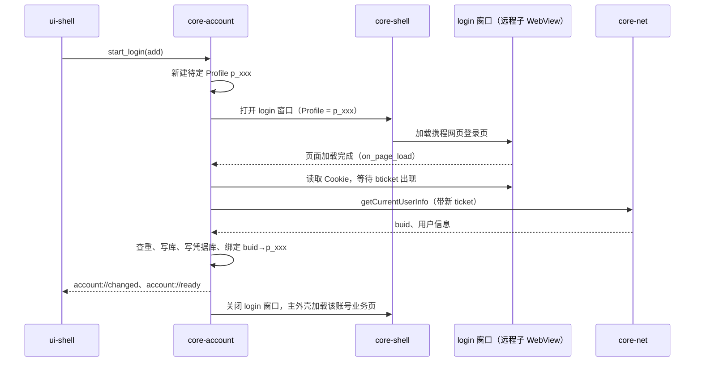

# 02 账号与登录：core-account + ui-login

2026-10-30

本文是 [开发总纲](00-architecture.md) 下的模块文档，负责 Rust 核心模块 core-account 与前端模块 ui-login。上游依据见 [04 模块划分与联动](../04-modules-and-integration.md) 第三节、[02 现有客户端缺陷](../02-current-client-defects.md)。文中接口都是示意。

官方源码引用的路径约定：`index.js` 指 `asar/dist-electron/main/index.js`，`loginWindow`、`launchWindow`、`mainWindow`、`BaseController` 指 `renderer-dist/js/` 下同名前缀的 bundle。

## 1. 结论与定位

- **登录推荐做法 A：内嵌官方网页登录**。登录窗口里放一个加载携程网页登录页的远程 WebView，滑块、短信、新设备验证都由网页自己处理；core-account 只在登录完成后从该 WebView 的 Cookie 存储里读出 `bticket`、`BDUID`，再调用户信息接口拿到 `buid`。做法 B（复刻本地登录页、直连账号接口）只作为备选。
- **每个账号一个独立的 Cookie 存储**。首选同一 WebView2 环境下的 Profile（每账号一个），兜底是每账号一个独立的用户数据目录。Tauri 2 目前公开的是 `data_directory`，Profile 需要在 wry 层补一个小补丁，必须先做原型验证。
- **只存 ticket，不存密码**。ticket 进 Windows 凭据管理器（`keyring` crate），数据库只存账号的展示信息和排序。
- **核实结论：官方 1.2.12 把“记住的密码”明文写在 electron-store 的 `config.json` 里**，见 2.4 节。迁移时只导入 ticket，丢弃密码。
- core-account 是登录态的唯一来源。core-net、core-im、业务页承载都通过一个内部服务接口拿 Cookie，不再像官方那样由渲染进程调用 `getLoginCookie` 取明文 ticket。

## 2. 承接范围

### 2.1 官方登录流程现状

官方登录页是本地 React 页面（`loginWindow`），启动页（`launchWindow`）负责免密自动登录。登录请求由 `BaseController.post` 直接调用携程 SOA 网关（`https://m.ctrip.com/restapi/soa2`），接口名都在 `BaseController` 的 API 表里。

| 登录方式 | loginType | 实际做法（出处） |
| --- | --- | --- |
| 账号密码 | `pwLogin` | 先过拼图滑块，再调 `/22160/pwdLogin`，参数含 `authenticateInfo:{password,loginName}`、`frontRiskInfo:{token,sliderVersion,rid}`（`loginWindow` 的 `handleLoginByPassword`） |
| 短信验证码 | `smLogin` | 滑块后调 `/24863/sendVerifyCodeByMobilePhone` 发码，再调 `/22160/verifyCodeLogin`（`MESSAGE_CODE_MAP.smLogin:"S220342"`） |
| 扫码登录 | `codeLogin` | `/24863/getQrCode` 取码，拼成 `m.ctrip.com/webapp/vbk-account/codeLogin?qrcode=…` 生成二维码，每秒轮询状态，确认后拿到 `bticket/bduid/buid`（`handleFetchCodeStatus`）。注意界面上名为 `codeLogin` 的标签页显示的是短信登录，loginType `codeLogin` 实际来自扫码 |
| 免密自动登录 | `autoLogin` | `launchWindow` 收到 `beginToLogin` 后调用 `getLoginCookie` 取缓存的 ticket，再用它调 `/12405/getCurrentUserInfo` 验证；验证失败发 `loginFailure`，主进程删除该账号缓存的 `bticket` |
| 新设备验证 | — | 登录返回需要验证时弹窗 `newEquipmentLogin`，调 `/24863/checkVerifyCode`（短信或邮箱） |
| 滑块 | — | `SlidItem` 组件，加载 `static.tripcdn.com/packages/infosec/jigsaw-captcha/`，`appId:100032497`，`businessSite` 区分密码登录与短信登录 |
| 记住密码 | — | 勾选框写偏好 `rememberPassword`（`setUserPrefrences`）；账号输入框用 `getCacheAccountList` 拉取带 `password` 的缓存记录做下拉补全 |

登录成功后的主进程处理（`index.js`，`ipcMain.handle(y.loginSuccess)`）：

1. 用户信息拼装后调用 `AccountManager.addAccount`：加入内存账号列表、为该账号 fork 一个 IM utilityProcess（`createIMProcess`，token 就是 `bticket`）、写入 `user` 表。
2. 按 `rememberPassword` 决定是否清掉 `password`，然后把整条记录合并写入 electron-store 的 `pwd_account_list`。
3. 把 `defaultSession` 的全部 Cookie 加上 `bticket`、`vbkticket`、`BDUID` 写进 `persist:<buid>` 分区（函数 `zt`：域为 `.ctrip.com` 与 `.trip.com`，`httpOnly:false`，`sameSite:no_restriction`，有效期固定一个月）。
4. 为该分区挂 `will-download` 和网关重定向，再 `openMainWindow`，关闭启动页和登录窗。

### 2.2 账号 IPC 接口（`constant-2w9sXoOv.js` 与 `index.js`）

| 官方 IPC | 行为 | 新客户端去向 |
| --- | --- | --- |
| `login_success` / `login_failure` | 见 2.1 | core-account 内部流程，不再由前端上报结果 |
| `begin_to_login` | 启动页触发自动登录 | 启动流程由 Rust 驱动 |
| `add_account` | 以模态打开登录窗 | `plugin:account\|start_login` |
| `change_account` | 切换当前账号：改写 `defaultSession` 的三个 Cookie、刷新主窗口 | `plugin:account\|switch` |
| `logout` | `removeAccount`：清内存、关该账号所有窗口、杀 IM 进程、清 `bticket` 缓存；最后一个账号退出时打开登录窗 | `plugin:account\|logout` |
| `get_account_list` / `get_current_user_info` | 返回 `userInfo` | `plugin:account\|account_snapshot` |
| `sort_account_list` | 按 buid 数组排序，同时写回 `pwd_account_list` | `plugin:account\|sort` |
| `get_login_cookie` | 返回 `pwd_account_list` 里第一条带 `bticket` 的完整记录（`getLoginTicket`），只允许 login、launch、main 页面调用（`Ri`） | 不对前端开放，改为内部服务接口 |
| `get_all_login_cookies` | 返回“有 ticket 但当前未登录”的完整缓存记录，主窗口用它显示快速登录列表（`mainWindow.initAutoLogin`） | `account_snapshot` 中的 `quick_login` 列表，不含任何凭据 |
| `get_cache_account_list` | 返回整个 `pwd_account_list` | 删除 |
| `remove_cache_password` | 把某账号记录的 `password` 置空 | 删除（新客户端不存密码） |
| `clear_user_store` | `electron-store` 整体 `clear()` 并清 `user` 表 | 由 05 本地存储承接 |

`preload/index.js`、`main.js`、`im.js`、`web.js` 都暴露了 `getLoginCookie`、`getAllLoginCookies`、`getCacheAccountList`，靠主进程按页面路径拦截。新客户端从源头上不给远程页任何账号命令。

### 2.3 持久化数据

| 位置 | 键 / 表 | 内容 |
| --- | --- | --- |
| electron-store `config.json` | `pwd_account_list` | 数组，元素含 `account`、`password`（可选）、`buid`、`bduid`、`bticket`、`loginType`、`userInfo` 等 |
| 同上 | `default_login_account` | 旧格式的单账号记录，`getLoginTicket` 读到后合并进 `pwd_account_list` 再删除 |
| 同上 | `ZUCHE_ACCOUNT_LIST` | 租车业务线账号名列表 |
| SQLite | `user` 表 | 用户展示信息，离线时 `getUserInfo` 从这里读（`BaseController`） |
| Chromium 分区 | `Partitions/<buid>` | 各账号的 Cookie、缓存 |

`config.json` 的位置推断为 `%APPDATA%\vbk-electron\config.json`（asar 内 `package.json` 的 `name` 为 `vbk-electron`，未见 `productName`，需在真机核实）。

### 2.4 核实结论：密码是明文落盘的

| 检查项 | 结果（`index.js`） |
| --- | --- |
| `electron-store` | 构造为 `z=new Fl`，**没有传任何参数**，即没有 `encryptionKey`，`config.json` 是明文 JSON |
| `safeStorage` | 出现 0 次 |
| `encryptionKey` | 出现 0 次 |
| `password` | `loginSuccess` 中仅当 `pwLogin` 且未勾选记住密码时才置 `e.password=void 0`；否则整条记录（含 `password`）写入 `pwd_account_list` |
| `removeCachePassword` | 只是把该字段置空后重新写回，没有任何加解密 |
| 读回路径 | `loginWindow` 的 `AccountItem` 调 `getCacheAccountList`，过滤出 `!!d.password` 的记录做下拉，选择后回填密码框 |

结论：勾选“记住密码”的账号，密码以明文保存在 `config.json`；未勾选的账号也会以明文保存 `bticket`。即便 `electron-store` 设置了 `encryptionKey`，它也只是混淆，不等于安全存储。另外 `getAllLoginCookies` 返回的是完整记录，主窗口渲染进程因此也能拿到密码字段。

### 2.5 账号 SDK 依赖

`asar/node_modules/@ctrip/` 下有 `bbz-accounts-loginsdk`（1.0.7）及 `-service`、`-service-adapter-web`、`-env`、`-log`、`-utils`、`-types`、`-adapter`，但它们不在 `package.json` 的直接依赖里，而是 `@ctrip/trip-user`（依赖 `bbz-accounts-loginsdk ^1.0.4`）与 `@ctrip/i18n.core`（依赖 `bbz-accounts-log`）的传递依赖。主进程和所有窗口 bundle 中都搜不到 `bbz-accounts` 字样。**结论：1.2.12 的登录页并不调用账号 SDK，而是直接调 SOA 接口**。文档 04 第三节“调用 bbz-accounts-loginsdk”的描述需要更正。

## 3. Tauri / Rust 分工表

| 放 Rust（core-account） | 放 WebView 前端（ui-login、ui-shell 的账号区） |
| --- | --- |
| 账号列表、当前账号、排序、状态机、`seq` | 登录窗外壳（标题栏、加载与错误提示、“返回”） |
| 为每个账号分配并管理 Profile（或数据目录） | 账号切换下拉、快速登录列表、排序拖拽的展示 |
| 监听登录 WebView 的导航与 Cookie，判断登录完成 | 官方网页登录页本身（远程内容，无 IPC） |
| ticket 读写凭据库、校验、过期判断、续期 | 过期提示条、重新登录按钮 |
| 登出清理：Cookie、凭据、窗口、IM 连接 | 登出确认框 |
| 旧版 electron-store 迁移 | 迁移结果提示 |
| 向 core-net、core-im、core-shell 提供 Cookie 与 Profile | — |

## 4. Rust 核心设计

### 4.1 做法 A 与做法 B

| 维度 | 做法 A：内嵌官方网页登录（推荐） | 做法 B：自研登录页 + 直连 SOA 接口 |
| --- | --- | --- |
| 依赖 | 一个可用的携程网页登录地址（需确认，源码中未出现 vbooking 网页登录 URL） | `/22160/pwdLogin` 等接口的授权与文档；拼图滑块 `appId:100032497` 的接入许可 |
| 滑块、风控、新设备验证 | 网页自己处理，携程改版对我们无影响 | 需自行接入 jigsaw-captcha、维护 `frontRiskInfo`、新设备验证弹窗、全部错误码 |
| 扫码、短信 | 网页若支持就有 | 自行实现 `getQrCode` 轮询与发码 |
| 记住密码 | 不提供（见 4.4） | 可提供，但密码只进凭据库 |
| 工作量 | 约 4 人日（登录部分） | 约 12–15 人日，且有持续维护成本 |
| 风险 | 网页登录页可能检测内嵌环境或要求跳转；登录完成判定依赖 Cookie 名 | 接口未公开，随时可能变更；使用未授权接口存在合规风险 |

**做法 A 的开发方式**：

1. 用户点击“添加账号”，core-account 新建一个待定的 Profile（名字随机，见 4.3），通知 core-shell 打开 `login` 窗口。窗口内含一个本地外壳和一个在该 Profile 中加载网页登录页的子 WebView（是否使用 Tauri 的多 WebView 能力，与 01、04 的选择保持一致）。
2. 子 WebView 不授予任何 capability，导航限制在携程登录相关域名白名单内。
3. 通过 `on_navigation` / `on_page_load` 观察 URL；每次页面加载完成后读取该 WebView 的 Cookie（Tauri 2 的 `Webview::cookies_for_url`，所需最低版本需验证），出现 `bticket` 即视为登录成功。
4. core-account 用新 ticket 通过 core-net 调 `/12405/getCurrentUserInfo`（官方 `BaseController.getUserInfo` 同款参数，失败码 `11000` 时改用 `x-tour-auth-from: merchants_online` 重试）拿到 `buid` 与展示信息。
5. 检查是否重复登录（官方提示“当前账号已经登录”），落库、写凭据库、绑定 Profile，发 `account://ready`，关闭登录窗。

**做法 B 的开发方式**：沿用 2.1 节的接口清单，在 Rust 中实现 `pw_login`、`sms_send_code`、`sms_login`、`qr_create`、`qr_poll` 命令；滑块在 ui-login 中按官方 `SlidItem` 的方式加载远程脚本，把 `{token, version, rid}` 交给 Rust。成功后从返回值直接拿到 `uid/duid/ticket`，再像官方 `zt` 那样把 `bticket`、`vbkticket`、`BDUID` 写入该账号的 Profile。只有在做法 A 被证实不可行时才启动。

### 4.2 账号模型与状态机

```rust
pub struct Account {
    pub buid: Buid,                 // 携程用户 id，主键
    pub account_name: String,       // 登录名，只用于展示
    pub profile_id: ProfileId,      // 随机生成，映射到 WebView2 Profile 或数据目录
    pub bu: BuType,                 // tour / zuche
    pub display: UserDisplay,       // 昵称、头像、供应商名
    pub order: u32,                 // 排序
    pub state: AccountState,        // 见下表
    pub last_validated_at: Option<i64>,
}
pub struct LoginCookie { pub buid: Buid, pub bduid: String, pub bticket: SecretString }
```

| 状态 | 含义 | 是否有业务页 WebView | 是否保持 IM |
| --- | --- | --- | --- |
| `Active` | 当前账号 | 有 | 是 |
| `Background` | 已登录但不在前台 | 默认无（最多保留上一个账号的 WebView 作为热备，上限由 04 决定） | 是 |
| `Expired` | ticket 失效 | 无 | 否，停止重连 |
| `Cached` | 用户登出但保留快速登录（对应官方 `getAllLoginCookies` 列表） | 无 | 否 |

账号元数据（不含 ticket）存 core-store 的 `account` 表；ticket 存凭据库；Profile 内的 Cookie 由 WebView2 自己加密保存（Chromium 在 Windows 上用 DPAPI 加密 Cookie 库）。

### 4.3 每账号 Cookie 隔离

官方做法是“每账号一个 `persist:` 分区 + 一个 BrowserView”，并且把当前账号的三个 Cookie 反复写入 `defaultSession`（`updateCurAccount`），本质上是半隔离。新客户端按总纲第六节：

| 方案 | Tauri 2 / wry 现状 | 结论 |
| --- | --- | --- |
| A1：同一环境下每账号一个 WebView2 Profile | WebView2 通过 `ICoreWebView2ControllerOptions::put_ProfileName` 在创建控制器时指定 Profile（Runtime 与 SDK 版本要求需验证）。wry 创建控制器时已经使用 ControllerOptions（用于 `incognito`），但没有公开 Profile 名参数；Tauri 的 `with_webview` 只能拿到已创建的控制器，此时 Profile 已无法更改 | 首选。需要给 wry 加一个 Windows 专用的 `profile_name` 选项（上游 PR 或临时 fork），放在 `platform-win` 维护 |
| A2：每账号一个独立用户数据目录 | Tauri 2 公开了 `WebviewWindowBuilder::data_directory` / `WebviewBuilder::data_directory`（底层是 wry 的 `WebContext`），可直接使用 | 兜底。每个目录一套浏览器进程，账号多时内存上升，需实测 |
| 整体替换 Cookie | 可行但会串号 | 不采用 |

设计要点：

- **Profile 在 WebView 创建时绑定，之后不能改**。所以“切换账号”等于让 core-shell 在另一个 Profile 中创建或唤醒业务页 WebView，而不是改写现有 WebView 的 Cookie。
- **登录前并不知道 buid**。因此 Profile 名不由 buid 派生，而是随机的 `p_<16 位十六进制>`，登录成功后在 `account` 表里建立 `buid → profile_id` 映射。重新登录同一账号也使用新 Profile，成功后替换映射并删除旧 Profile，避免“重新登录时登了另一个账号”导致旧 Profile 被污染。这个映射同样适用于兜底方案的目录名。
- Profile 名只用 ASCII，不含 buid 或手机号，避免个人信息出现在磁盘路径里。
- 所有 WebView 共用同一个环境（同一用户数据目录、同一组浏览器参数）。WebView2 要求同一用户数据目录下的环境参数一致，否则创建失败，额外浏览器参数统一由 core-shell 管理。
- macOS 第二阶段对应 Tauri 的 `data_store_identifier`（基于 WKWebsiteDataStore，macOS 14+，所需 Tauri 版本需验证）。

### 4.4 凭据存储

| 项 | 做法 |
| --- | --- |
| 库 | `keyring` crate（v3，Windows 启用 `windows-native`，macOS 启用 `apple-native`） |
| 条目 | service 为 `vbk`，user 为 `ticket:<buid>`；值为 `{bduid, bticket, saved_at}` 的 JSON |
| 大小 | Windows 凭据管理器单条 blob 上限 2560 字节，只存 ticket，不存整套 Cookie |
| 持久范围 | 希望只存本机（`CRED_PERSIST_LOCAL_MACHINE`），`keyring` 默认值需验证，必要时在 `platform-win` 用 `windows` crate 直接调 `CredWriteW` |
| 密码 | 做法 A 不存密码。WebView2 自带的密码自动保存（`IsPasswordAutosaveEnabled`）保持关闭。若最终走做法 B 且产品坚持记住密码，密码只进凭据库条目 `pwd:<account>`，从不写文件、不进前端快照 |
| 内存与日志 | ticket 用 `secrecy::SecretString` 包装，`Debug` 输出为掩码；日志最多打印前 4 位 |

### 4.5 ticket 过期检测与静默续期

源码中没有找到 ticket 的显式续期接口；官方的 `zt` 把 Cookie 有效期固定写成一个月，服务端真实有效期未知（待确认）。因此新客户端的策略是“多源检测 + 被动续期”：

| 来源 | 判定 |
| --- | --- |
| 启动校验 | 每个已登录账号并发调 `/12405/getCurrentUserInfo`（或 `/12405/checkUserLogin`）。为满足总纲“有效 ticket 冷启动 ≤ 2 s”，校验不阻塞主外壳：先按缓存进入，校验失败再转 `Expired` |
| core-net 响应 | SOA 返回未登录错误码（具体码待确认）时调用 `report_auth_failure` |
| 业务页导航 | `on_navigation` 发现业务页被重定向到登录页 |
| IM | sidecar 报告鉴权失败（官方 IM 页面此时提示“会话连接已断开，请重新登录”并直接 `logout`，见 `imWindow`） |
| 定时 | 每 6 小时对后台账号做一次轻量校验 |

静默续期：服务端在业务请求中下发新的 `bticket` 时，会写进该账号 Profile 的 Cookie 库。core-account 在业务页每次加载完成后、以及定时校验前，从 Profile 读回 `bticket`，发现变化就更新凭据库并通知 core-im 换 token。确认失效后不自动弹窗，只置 `Expired`、发 `account://expired`，由 ui-shell 显示提示条，用户点击后以“重新登录”模式打开登录窗。

### 4.6 命令（`plugin:account|…`）

| 命令 | 契约名 | 授权窗口 | 说明 |
| --- | --- | --- | --- |
| `account_snapshot` | `account.snapshot` | shell、im、login | `{seq, current, accounts, quick_login}`，不含任何凭据 |
| `start_login` | `account.start_login` | shell、login | `{mode: add / relogin, buid?}`，创建待定 Profile 并请 core-shell 打开 login 窗 |
| `cancel_login` | `account.cancel_login` | login | 关闭登录窗，删除待定 Profile |
| `login_snapshot` | `account.login.snapshot` | login | 当前登录流程的阶段与错误 |
| `switch` | `account.switch` | shell、im | 设当前账号 |
| `sort` | `account.sort` | shell | 参数为 buid 数组 |
| `quick_login` | `account.quick_login` | shell | 用 `Cached` 账号的 ticket 恢复登录，失败转为 `relogin` |
| `logout` | `account.logout` | shell、im | 登出，保留为 `Cached` |
| `forget` | `account.forget` | shell | 彻底移除：删映射、凭据、Profile |

做法 B 额外的 `pw_login`、`sms_send_code`、`sms_login`、`qr_create`、`qr_poll` 只在启用 B 时注册。远程页面（包括登录子 WebView 和 vbooking 业务页）不授予 account 插件的任何命令。

### 4.7 事件

| 事件 | 契约名 | 载荷 |
| --- | --- | --- |
| `account://changed` | `account.changed` | `{seq, current, accounts}` |
| `account://ready` | `account.ready` | `{seq, buid}`，core-im 收到后建连 |
| `account://expired` | `account.expired` | `{seq, buid, source}` |
| `account://logged-out` | `account.logged_out` | `{seq, buid}` |
| `account://login-progress` | `account.login.progress` | `{stage: loading / waiting_user / verifying / done / failed, code?}`，只发给 `login` 窗口 |

### 4.8 并发模型

按总纲 4.5 的 actor 写法：一个 `AccountActor` 任务独占账号状态，命令和其他模块的请求都以 mpsc 消息投递；只读视图用 `watch::Sender<AccountsView>` 发布，core-net 等读取方无需加锁。凭据库调用与 Profile 删除在 `spawn_blocking` 中执行。读取 WebView Cookie 必须在异步上下文中进行（Tauri 文档指出 Windows 上在同步命令或事件回调里读 Cookie 会死锁）。

### 4.9 对其他模块的服务接口

```rust
#[async_trait]
pub trait AccountService: Send + Sync {
    fn view(&self) -> watch::Receiver<AccountsView>;             // 当前账号与列表
    async fn login_cookie(&self, buid: &Buid) -> Result<LoginCookie, AppError>;  // 对应 getLoginCookie
    async fn all_login_cookies(&self) -> Vec<LoginCookie>;       // 对应 getAllLoginCookies，仅已登录账号
    fn profile_of(&self, buid: &Buid) -> Option<ProfileId>;      // core-shell 创建业务页 WebView 用
    async fn report_auth_failure(&self, buid: &Buid, source: AuthSource);
}
```

| 使用方 | 用法 |
| --- | --- |
| core-net | 每次请求按目标账号取 `LoginCookie`，拼出 `bticket`、`vbkticket`、`BDUID`（与官方 `zt` 写入的三项一致）；是否还需要 Profile 中的其他 Cookie 需验证 |
| core-im | `account://ready` 时取 ticket 作为 IM token（官方 `createIMProcess` 的 `token` 就是 `bticket`），`account://expired` / `logged-out` 时断开 |
| core-shell / 业务页承载 | 用 `profile_of` 在正确的 Profile 中创建 WebView；远程页面凭 Profile 中的 Cookie 自然登录，不再需要拿 ticket |
| core-assistant | 走 core-net，不直接接触 ticket |

### 4.10 平台差异

Profile 创建、删除、Cookie 写入的 Win32 / WebView2 调用收在 `core-account/platform/win.rs`，其通用部分放 `platform-win`。macOS 实现放 `platform/mac.rs`，第二阶段补齐。

## 5. 前端设计

| 窗口 / 区域 | 内容 | 要求 |
| --- | --- | --- |
| `login` 窗口 | 本地外壳 + 远程登录子 WebView；外壳显示加载状态、网络错误、“使用其他方式登录”的说明、取消 | 外壳包体 ≤ 100 KB，不引组件库；打开到网页登录页首帧 ≤ 1.5 s（网络正常） |
| 启动页 | 只在冷启动且没有可用账号时出现；有缓存账号时直接进主外壳 | 不再像官方那样由启动页发 `beginToLogin` 驱动登录 |
| ui-shell 账号区（归 01） | 账号头像列表、拖拽排序、切换、登出、过期提示条、快速登录列表、“添加账号” | 打开时 `account_snapshot` + 监听 `account://changed`，按 `seq` 去重 |

前端只展示核心推送的数据，不保存账号信息，也不接触 ticket。

## 6. 与其他模块的联动

| 模块 | 关系 |
| --- | --- |
| [01 壳与窗口管理](01-shell.md) | 打开、关闭 `login` 窗口；按 `profile_id` 创建业务页 WebView；单实例与深链中的账号选择调用 `switch` |
| [04 业务页承载](04-business-pages.md) | 每账号 WebView 的创建、复用上限、后台销毁策略；导航到登录页时回报过期 |
| [05 本地存储](05-store.md) | `account` 表（含 `profile_id`、排序、展示信息）；迁移旧 `user` 表 |
| [06 网络](06-net.md) | 通过 `AccountService` 取 Cookie；回报未登录错误码；登录完成后的 `getCurrentUserInfo` 调用 |
| [10 IM](10-im.md) | 订阅 `ready`、`expired`、`logged-out`；token 更新 |
| [08 更新、诊断与偏好](08-update-telemetry.md) | 日志脱敏规则；登录埋点（官方 `vbk_electron_login_account`） |

## 7. 关键流程

### 7.1 做法 A 登录



### 7.2 其他流程

| 流程 | 步骤 |
| --- | --- |
| 冷启动 | store 就绪 → 读 `account` 表与凭据库 → 有账号则立即发快照，core-shell 进入主外壳并在当前账号的 Profile 中加载业务页；后台并发校验 ticket，失败的账号转 `Expired` → 无账号则打开 `login` |
| 切换账号 | `switch(buid)` → actor 更新当前账号、`seq+1` → 发 `account://changed` → core-shell 在目标 Profile 中唤醒或新建业务页 WebView，按上限销毁旧的 → IM 不受影响 |
| 后台账号 | 只保留 IM 连接与未读数；业务页 WebView 默认销毁，切回时重建（Profile 中 Cookie 仍在，无需重新登录） |
| 过期后重新登录 | 提示条 → `start_login(relogin, buid)` → 新待定 Profile → 登录成功且 buid 一致则替换映射并删除旧 Profile；buid 不一致则作为新账号加入，原账号保持 `Expired` |
| 登出 | 关闭该账号所有窗口（业务页、web、图片预览，对应官方 `removeAccount` 中逐一关闭的窗口）→ 通知 core-im 断开 → 清空该 Profile 的 Cookie → 删除凭据库条目 → 状态改 `Cached` 或移除 → 若无剩余账号则打开 `login` |
| 彻底移除 | 在登出基础上删除 Profile（WebView2 提供 Profile 删除接口，所需版本需验证；不可用时等相关 WebView 全部关闭后删除目录，失败则下次启动重试） |

### 7.3 迁移旧版账号

| 步骤 | 内容 |
| --- | --- |
| 1 | 首次启动检测 `%APPDATA%\vbk-electron\config.json`（路径需核实），只读打开 |
| 2 | 读取 `pwd_account_list` 与 `default_login_account`，按官方 `getLoginTicket` 的规则合并 |
| 3 | 对每条有 `bticket` 的记录：新建 Profile，写入 `bticket`、`vbkticket`、`BDUID` 三个 Cookie（与官方 `zt` 相同的域与属性），ticket 写凭据库，展示信息写 `account` 表，状态为 `Cached`，进入快速登录列表 |
| 4 | **`password` 字段一律不导入**；没有 ticket 只有密码的记录只迁移账号名，用于登录提示 |
| 5 | 导入后提示用户“旧版保存的密码以明文形式存在，是否清除”，同意则改写旧文件删除 `password` 字段（可能影响仍在使用的旧版客户端，见待确认） |
| 6 | 旧版 Chromium 分区（`Partitions/<buid>`）不迁移，其 Cookie 由旧版的加密密钥保护，且官方自己也只依赖上述三个 Cookie 恢复登录 |

## 8. 注意事项（Windows 优先）

- **Profile 补丁是关键路径**。wry 若不接受上游 PR，就需要长期维护 fork；评估结果出来前，代码只依赖 `ProfileId` 抽象，便于切换到数据目录方案。
- **WebView 读 Cookie 的死锁**：Windows 上不要在同步命令或事件回调里调用 `cookies()`，统一在 async 任务里读。
- **HttpOnly**：WebView2 的 CookieManager 能读到 HttpOnly Cookie，所以网页登录写入的 HttpOnly `bticket` 也能被捕获（需在原型中确认 Tauri 封装的行为一致）。迁移时写入的 Cookie 属性沿用官方（`httpOnly:false`），是否有页面依赖 `document.cookie` 读 ticket 待确认。
- **SameSite=None 必须带 Secure**，官方写入时没有设 `secure`，新客户端写入时要补上，否则 Chromium 会拒绝。
- **导航白名单**：登录子 WebView 只允许携程账号相关域名，第三方登录（如微信扫码 `/22160/weChatAuthenticateLogin`）若跳出白名单，交给系统浏览器会导致登录态拿不回来，需要逐个确认域名。
- **不要把 ticket 放进 URL、日志、崩溃报告、埋点**。官方的 IM 进程以参数传 token，新客户端经命名管道传递。
- **删除 Profile 时文件被占用**：浏览器进程退出前目录删不掉，删除操作要可重试。
- **凭据管理器**：企业域环境下 `CRED_PERSIST_ENTERPRISE` 会随漫游配置文件同步，必须确认持久范围；条目名不要带手机号。
- **多环境（FAT/UAT/PROD）**：官方按环境写不同 Cookie 域（`.qa.nt.ctripcorp.com` 等），新客户端的凭据条目和 Profile 名都要带环境前缀，避免测试与生产串号。

## 9. 原型验证项与验收标准

| 编号 | 验证项 | 通过标准 |
| --- | --- | --- |
| P1 | 网页登录可用性 | 在 WebView2 中打开携程网页登录页，密码、短信、滑块都能完成，登录后能读到 `bticket` 与 `BDUID` |
| P2 | Profile 补丁 | 改过的 wry 在同一环境下创建两个不同 Profile 的 WebView，Cookie 互不可见；不改 Tauri 业务代码 |
| P3 | 数据目录兜底 | 用 `data_directory` 创建两个账号的 WebView，记录第二个账号带来的内存增量，与 P2 对比 |
| P4 | 业务页免登 | 只依靠 Profile 中的 Cookie，vbooking 业务页无需改动即可直接进入已登录状态 |
| P5 | 迁移 | 用一份含明文密码的测试 `config.json`，迁移后账号出现在快速登录列表且能一键登录 |

验收标准：

| 指标 | 标准 |
| --- | --- |
| 隔离 | 两个账号同时在线，用抓包确认每个业务页请求只带本账号的 `bticket` |
| 切换 | 有热备 WebView 时切换到页面可见 ≤ 500 ms；需新建时 ≤ 1.5 s（不含远程页内容加载） |
| 冷启动 | 有效 ticket 时满足总纲 ≤ 2 s，期间不出现登录窗 |
| 安全 | 扫描数据库、日志、配置、崩溃转储：无密码、无完整 ticket、无完整 Cookie |
| 过期 | 人为作废 ticket 后，1 分钟内（有业务请求时）账号转 `Expired`，IM 停止重连，重新登录后恢复原排序 |
| 登出 | 登出后该 Profile 中查不到携程登录 Cookie，凭据库条目已删除，相关窗口全部关闭 |

## 10. 开发步骤与工作量估计

| 步骤 | 内容 | 人日 |
| --- | --- | --- |
| 1 | 原型 P1–P3（网页登录、Profile 补丁、数据目录对比） | 4 |
| 2 | core-account 骨架：账号模型、actor、快照与事件、`account` 表对接 | 3 |
| 3 | 做法 A：登录窗、导航与 Cookie 监听、用户信息拉取、查重 | 4 |
| 4 | Profile 管理：创建、映射、删除与重试（含 wry 补丁整理） | 3 |
| 5 | 凭据库封装与脱敏（`keyring`、`secrecy`、日志规则） | 1.5 |
| 6 | ticket 校验、过期检测、续期回写、IM token 更新 | 3 |
| 7 | 登出与彻底移除 | 1.5 |
| 8 | `AccountService` 与 core-net、core-im、core-shell 联调 | 2 |
| 9 | 旧版迁移 | 2 |
| 10 | ui-login 外壳与启动页 | 2 |
| 11 | 测试与验收（多账号、过期、迁移、多环境） | 3 |
| 合计 | 做法 A | **约 29** |
| 附加 | 若改走做法 B：登录页、滑块接入、新设备验证、扫码、错误码 | +12～15 |

ui-shell 中的账号区界面计入 01 的工作量。

## 11. 待确认问题

1. 携程 vbooking 是否有可内嵌的网页登录地址，是否允许在客户端 WebView 中使用；源码里只找到 H5 扫码页 `m.ctrip.com/webapp/vbk-account/codeLogin`，没有 PC 网页登录 URL。
2. 网页登录成功后写入的 Cookie 名是否就是 `bticket` / `BDUID`，以及是否为 HttpOnly。
3. ticket 的服务端有效期，是否存在续期接口；SOA 返回“未登录”时的具体错误码。
4. wry 是否接受 Profile 名的上游 PR；若不接受，团队是否接受维护 fork。
5. 产品是否需要保留“记住密码”。做法 A 下建议不提供；若必须，只能走做法 B 并存入凭据库。
6. 迁移时是否允许改写旧版 `config.json` 清除明文密码（新旧客户端并存期间可能互相影响）。
7. 同时在线账号数是否需要上限（官方无上限），以及后台账号业务页 WebView 的热备数量（与 04 一起定）。
8. 租车账号（`ZUCHE_ACCOUNT_LIST`、`bu=zuche`）是否走同一登录入口，是否需要单独的 `x-tour-auth-from`。
9. 文档 04 第三节对账号 SDK 的描述需要按 2.5 节更正。
