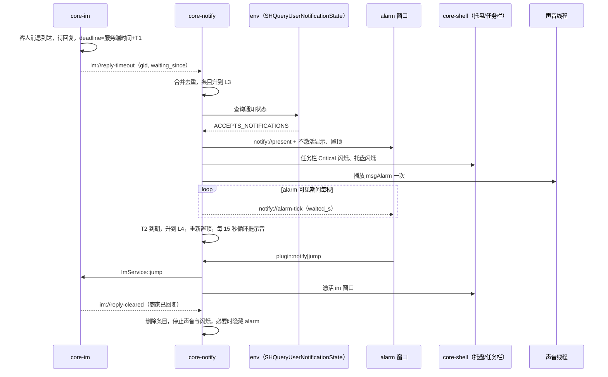

# 03 强提醒：core-notify + ui-popups

2026-10-30

本文是 [开发总纲](00-architecture.md) 下的模块文档，负责新消息提醒、回复超时强提醒、未读计数、托盘与任务栏提醒、提示音、系统通知，以及 alarm、notifier、notice、tooltip 四个小窗。命名、通道、权限、窗口标签与性能预算以总纲为准。文中接口都是示意。

官方源码出处的简写：`main` 指 `asar/dist-electron/main/index.js`，`const` 指 `constant-2w9sXoOv.js` 与渲染端常量，`*Window` 指 `renderer-dist/js/*Window-*.js`。

## 一、结论与定位

- **core-notify 是唯一的“要不要提醒、用什么方式提醒”的决策点**。core-im 只负责报告事实（新消息、未读数变化、某会话已超时、某会话已回复），core-notify 根据用户设置、勿扰状态、全屏状态、窗口焦点决定落到哪一级，再驱动小窗、托盘、任务栏、声音和系统通知。
- **回复超时的判定和计时全部移到 Rust**。官方是 IM 渲染进程每 5 秒轮询会话列表判断超时，alarm 渲染进程再用 1 秒 `setInterval` 自己算已等待秒数，两处都会被隐藏窗口节流。新方案由 core-im 按会话维护截止时间并发出 `im://reply-timeout`，core-notify 用 tokio 定时器做升级和声音循环，前端只显示 Rust 推来的秒数。
- **提醒分五级，逐级升级，每级可配置**：L0 静默计数 → L1 托盘与任务栏闪烁 → L2 横幅 → L3 回复超时强提醒窗 → L4 持续置顶 + 声音循环。
- **横幅改为一个常驻窗口里渲染卡片堆叠**。官方为每条消息占用一个 BrowserWindow（预建池 8 个），新方案只有一个 `notifier` 窗口，同一会话的多条消息合并为一张卡片。
- **所有小窗显示时都不抢焦点**。Windows 用 `WS_EX_NOACTIVATE` + 不激活显示；macOS 用非激活面板，需原型验证。
- **提示音在 Rust 播放（rodio）**，不再依赖某个窗口里的 `<audio>` 元素。
- **自绘横幅是默认通道，系统 Toast 是补充通道**：用户选择“使用系统通知”或处于全屏、演示状态时走 Toast，回复超时强提醒永远走自绘 alarm。

## 二、承接范围

### 2.1 官方窗口与参数

| 窗口 | 官方实现（出处） | 关键参数与行为 | 新客户端处理 |
| --- | --- | --- | --- |
| alarm | `main` 中 `title:"Alarm Dialog"` 的单例类，页面 `pages/alarm/index.html`，bundle `alarmWindow` | 宽 360（`hr=360`），高度由页面经 `windowHeightChange` 上报；`alwaysOnTop`、`skipTaskbar`、`minimizable:false`；**带系统边框**（未设 `frame:false`）；Windows 固定放在 `(0,0)` 左上角，macOS 放在工作区右下；`show(e)` 先 `showInactive()`，有新条目时再 `setAlwaysOnTop(true,"pop-up-menu")`；关闭被拦截为隐藏，并把全部条目标记为已忽略 | 重写为无边框常驻窗，默认贴右下工作区，可拖动并记忆位置 |
| notifier | `main` 中 `title:"Message Dialog"` 的池化类（`winCache`、`queue`、`activeList`），bundle `notifierWindow` | 每条消息一个窗口，345×80（`pr=345`、`ip=80`），预建池上限 8（`rp=8`）；`frame:false`、`focusable:false`、`movable:false`、`skipTaskbar`；从屏外 `x=width` 或 `-345` 进场；Windows 自底向上堆叠（底边距 25，间距 10），总高度超过工作区 66% 就排队；按 `messageId` 去重；账号不存在则丢弃；`powerMonitor` 的 `suspend` 后置为不活跃，期间的通知直接丢弃；页面 6 秒自动关闭，`optStatus==alert` 的系统通知 24 秒；主进程兜底 600 秒（`6e5`）强制关 | 合并为一个常驻窗口，内部渲染最多 3 张卡片 + “还有 N 条” |
| toolTip | `main` 中单例类，bundle `toolTipWindow` | 宽 300（`Xh=300`）、高度由内容决定；`focusable:false`；托盘 `mouse-move` 且有未读时显示；按托盘图标所在边计算位置；`showInactive()` + `pop-up-menu` 级置顶；**每秒轮询**鼠标是否离开托盘和窗口；内容是按账号分组的未读会话与系统通知 | 改用托盘 Enter/Leave 事件，仍不抢焦点 |
| notice | `main` 的 `Wo.notice="/pages/notice/index.html"`，作为主窗口里的 BrowserView（`jumpToMainUrl("notice",e,{hiden:!0})` 预加载隐藏）；深链 `initChat=3` 时切到它；bundle `noticeWindow` 42 KB | 实际是**系统通知中心页**（IQ 分类、未读数、每分类提示音、`optStatus` 为 ignore/alert 等），不是独立弹窗；它发出 `new_message` 且 `type:"notice"` 触发横幅 | 通知中心列表归主外壳的业务页；`notice` 标签改用于“需确认的系统通知”弹窗（见 5.1，待确认） |

注：[03 副窗口](../03-multi-window.md) 对 notice 的描述（无边框弹窗、预创建隐藏）与源码不符，预创建隐藏的是主窗口里的 BrowserView。

### 2.2 官方 IPC 与数据流

| IPC（`const` 中的名字） | 方向 | 官方行为（出处 `main`） |
| --- | --- | --- |
| `reply_timeout` | IM 页 → 主进程 → alarm | IM 页把“已超时会话列表 + 当前账号”整包发出，主进程原样转给 alarm（`En.instance.updateAlarm`） |
| `new_message` | IM 页 / 通知中心页 → 主进程 | 按偏好 `newMessageNotificationPop` / `newSystemNotificationPop` 决定是否弹 notifier；**无论是否弹窗都调用 `mainWin.flashFrame(true)`** |
| `unread_message_count` | IM 页 / 通知中心页 → 主进程 | `TrayManager.updateCount(type,count,buid)` 维护 `countMap[buid]={message,notice}`，同时转给 toolTip |
| `flash_main_window` | 渲染进程 → 主进程（invoke） | `win.flashFrame(e)` |
| `notify_info` | 主进程 → notifier | 推送 `{type,buid,notice,messageInfo}`，也可 invoke 拉取 |
| `jump_to_conversation` | notifier / alarm → 主进程 → IM | 点击横幅或双击 alarm 条目时定位会话，同时打埋点 `vbk_electron_message_click`（`readType` 为 `pop` 或 `alram`） |
| `clear_message_by_user` | 主进程 → alarm / toolTip | 移除账号时清掉该账号的条目 |
| `set_local_voice` | 设置页 → 主进程 | 把用户选的音频复制到 `userData`，扩展名白名单 `.mp3 .wav .ogg .m4a .aac .flac .opus` |
| `window_height_change`、`show_window`、`close_window` | 小窗 → 主进程 | 内容高度变化、请求显示、请求关闭 |

### 2.3 托盘、任务栏、Dock

| 能力 | 官方实现（出处 `main` 的 `TrayManager` 与主窗口类） |
| --- | --- |
| 未读总数 | 所有账号 `message + notice` 求和，超过 99 显示 `99+` |
| 托盘闪烁 | 有任一账号存在未读且对应偏好打开时，`setInterval` 每 500 ms 在正常图标和空图标间切换；macOS 不闪烁 |
| Windows 任务栏 | `setOverlay`：在主窗口 webContents 里 `executeJavaScript` 用 canvas 画红点数字（半径 8、底色 `#102247`），再 `setOverlayIcon` |
| macOS | `tray.setTitle(数字)` + `app.dock.setBadge(数字)` |
| 停止闪烁 | 主窗口 `focus` 时 `flashFrame(false)` 并停止托盘闪烁 |
| 托盘点击 | 聚焦主窗口（或登录、更新窗口），隐藏 toolTip |

### 2.4 回复超时判定（官方）

- IM 页 `startLoopConvList`：每 5 秒拉一次会话列表，然后 `checkConvTimeout`（`imWindow`）。
- 判定函数（压缩名 `JTe`）的规则：会话未结束、不属于 BOP 类会话、`inGroup==1`；从后往前找最近一条发送成功、`messageType<1000`、发送者不是机器人和携程客服的消息；它的发送者是客人（`fromUid==conv.uid`）才算待回复；租车会话的 `CAR_TIMEOUT` 动作单独处理。阈值 `replyTimeoutAlarmSecond`，默认 30，可选 30/60/90/120（`settingWindow`）。
- alarm 页用 `Date.now() - lastMessage.createTime` 每秒刷新已等待时长，超过 90 秒标红（`alarm:g>90`）。用的是本机时钟，没有用 IM 页里已有的服务端时差 `__server_client_timediff__`（推断：会受本机时钟偏差影响）。
- alarm 页的“清除 / 全部清除”只记在页面内存里的忽略列表（上限 1000 条），重启后丢失。
- 有新超时条目且 `replyTimeoutAlarmSound` 打开时播放一次 `/static/voice/msgAlarm.wav`，不循环。

### 2.5 提示音（官方）

- 播放位置：各页面 `BaseController.playVoice` 里的一个 `<audio>` 元素，加载失败回落到 `msgSound.wav`。
- 优先级：账号级自定义音 > 全局 `msgVoice` > 消息自带 `soundUrl` / 按 `voiceType` 映射的 B01–B04、C01–C08 > 默认 `msgSound.wav`；备选音色 M01–M10（mp3）。通知中心按分类有独立提示音。

### 2.6 相关偏好（`main` 中默认值对象）

`newMessageNotification`、`newMessageNotificationDetail`、`newMessageNotificationSound`、`newMessageNotificationPop`、`newSystemNotification*` 四项、`replyTimeoutAlarm`（默认开）、`replyTimeoutAlarmSecond`（30）、`replyTimeoutAlarmSound`（开）、`msgVoice`、`notifyPlatment`（`bottom-right` / 左下）。新客户端全部继承并扩充，见 4.9。

### 2.7 官方实现的问题

| 问题 | 影响 |
| --- | --- |
| 超时判定在 IM 页（主窗口里的 BrowserView）5 秒轮询 | 窗口隐藏或最小化时定时器被节流，提醒可能晚几十秒；粒度本身就有 5 秒误差 |
| alarm 计时在渲染进程、用本机时钟 | 同上，且本机时钟不准时显示错误 |
| 每条横幅一个 BrowserWindow | 连续消息时内存与创建开销高；20 条消息就是 20 次窗口显示与重排 |
| 睡眠期间通知直接丢弃，恢复后不补 | 合上笔记本再打开，看不到期间的消息提醒 |
| 每条新消息都 `flashFrame(true)`，不看勿扰与全屏 | 全屏演示、游戏、视频时打扰用户 |
| alarm 在 Windows 放左上角、带系统边框 | 与横幅位置不一致，容易被忽视 |
| toolTip 每秒轮询、托盘 500 ms 定时器常驻 | 常驻开销虽小，但都是轮询代替事件 |
| 没有使用系统通知 | 离开座位期间的提醒无处回看 |

## 三、Tauri / Rust 分工

| 职责 | 放 Rust（core-notify / core-im） | 放 WebView（ui-popups） |
| --- | --- | --- |
| 待回复判定、截止时间、超时事件 | core-im（判定规则移植自 `JTe`） | — |
| 提醒升级、队列、合并、去重、勿扰判断 | core-notify | — |
| 计时与倒计时秒数 | core-notify 1 Hz 推送 | 只显示收到的数字 |
| 小窗定位、显示、置顶、不抢焦点 | core-notify（借 core-shell 的窗口注册表） | 页面内滑入动画、卡片布局 |
| 托盘闪烁、任务栏闪烁、叠加图标、Dock 角标 | core-notify 决策，core-shell 执行托盘 | — |
| 提示音解码与播放、循环 | core-notify 声音线程（rodio） | 设置页只发“试听”命令 |
| 系统 Toast 与点击回调 | core-notify | — |
| 横幅、alarm、tooltip、notice 页面 | — | ui-popups 四个入口 |
| 设置项 UI | 设置的持久化由 core-telemetry 偏好负责 | ui-shell 的 setting 页 |

## 四、Rust 核心设计

### 4.1 内部结构

| 子模块 | 职责 |
| --- | --- |
| `actor` | 唯一状态持有任务；接收总线事件、命令、定时器到期，串行处理 |
| `policy` | 根据条目类型、已等待时长、设置、环境状态算出目标级别与通道 |
| `queue` | 提醒条目的增删改、合并、去重、优先级排序，维护 `seq` |
| `presenter` | 四个小窗的布局计算、显示与隐藏、高度、贴边与多屏 |
| `attention` | 托盘闪烁、任务栏闪烁、叠加图标、Dock 角标、Dock 弹跳 |
| `sound` | 独立线程上的 rodio 输出、音频缓存、循环与限频 |
| `toast` | 系统通知的发送、撤回、点击回调 |
| `env` | 前台窗口、全屏 / 演示 / 锁屏检测、应用内勿扰时间段 |
| `platform/win`、`platform/mac` | 平台调用，见 4.8 |

并发模型：`actor` 是一个 tokio 任务，输入来自 mpsc；升级与贪睡定时用 `tokio_util::time::DelayQueue`；快照通过 `watch` 发布给命令处理函数只读。rodio 的输出流不是 `Send`，放在一个专用 std 线程，用 channel 收播放指令。Toast 的 `Activated` 回调在 WinRT 线程池触发，只做转发。

### 4.2 提醒分级与升级

| 级别 | 表现 | 进入条件（默认） | 退出条件 |
| --- | --- | --- | --- |
| L0 静默计数 | 未读数更新：托盘提示文字、任务栏叠加数字 / Dock 角标、tooltip 内容 | 任何未读变化，始终执行 | 未读归零 |
| L1 闪烁 | 托盘图标 500 ms 闪烁；任务栏按钮闪烁（`FlashWindowEx`，`FLASHW_TRAY | FLASHW_TIMERNOFG`） | 有新消息且 main / im 都不在前台 | main 或 im 获得前台；未读归零 |
| L2 横幅 | notifier 卡片（或 Toast），播放一次新消息提示音 | 新消息，且用户不在看这个会话（im 在前台且当前会话就是它时不弹） | 6 秒自动收起（鼠标悬停时暂停）；点击跳转；点关闭 |
| L3 强提醒窗 | alarm 显示该会话与已等待秒数，置顶，不抢焦点；播放一次超时提示音；任务栏闪烁改为持续 | 收到 `im://reply-timeout`（等待 ≥ 阈值 T1，默认 30 秒） | 回复、读后标记、点“清除”、会话结束或转出 |
| L4 持续强提醒 | alarm 每次升级时重新置顶；超时提示音按间隔循环；macOS Dock 持续弹跳 | 进入 L3 后再过 T2（默认 60 秒，即等待 90 秒，对齐官方标红） | 同 L3；或用户“稍后提醒” |

规则：

1. 升级只看“该条目已等待多久”，不看收到多少条。每个条目各自计时，alarm 的显示级别取所有条目中的最高级。
2. 任一级别都可以在设置中关闭；关闭某级时直接跳到下一个打开的级别，不会因为中间某级关闭而停止升级。
3. 声音循环有上限：默认每 15 秒一次，最多持续 10 分钟，之后只保留闪烁，避免用户离开座位时一直响。
4. “稍后提醒”（snooze）把条目降回 L0，到期后从 L3 重新开始。
5. 环境降级（4.7）只改变表现通道，不改变条目的级别；环境恢复后按当前级别补发。

### 4.3 队列模型、合并与去重

```rust
pub struct AlertItem {
    pub id: AlertId,                 // 稳定 id = hash(account_id, kind, key)
    pub account_id: AccountId,
    pub kind: AlertKind,             // Message | ReplyTimeout | Notice
    pub key: String,                 // 会话 gid；系统通知用 category_id
    pub level: Level,                // L0..L4
    pub count: u32,                  // 合并的消息条数
    pub preview: Preview,            // 标题、摘要、头像 URL，已按设置脱敏
    pub last_msg_id: String,
    pub waiting_since_ms: i64,       // 服务端时间，超时类使用
    pub snoozed_until_ms: Option<i64>,
    pub presented: Presented,        // 已在哪些通道展示过
}
```

| 规则 | 说明 |
| --- | --- |
| 合并 | 同一 `(account_id, kind, key)` 只有一个条目。同会话的新消息更新 `count`、`preview`、`last_msg_id`，横幅卡片原地刷新并重置 6 秒计时，不新增卡片 |
| 去重 | 每账号一个最近 1000 条 `message_id` 的 LRU，重复推送（重连补发、sidecar 重放）直接丢弃；官方是按 `messageId` 在队列内查重，加 IM 页内 200 条集合 |
| 排序 | ReplyTimeout（按级别、等待时长降序）> 需确认的 Notice > Message（按时间降序）；同级按账号在账号列表中的顺序 |
| 横幅容量 | notifier 同时最多 3 张卡片，其余折叠为“还有 N 条新消息”，点击打开 im；不再按 66% 屏高排队 |
| alarm 容量 | 不设上限，列表虚拟滚动；标题显示“N 个回复超时提醒”（沿用词条 `key.im.timeoutAlarmTitle`） |
| 确认记录 | ack 写入 `(account_id, key, last_msg_id)`；同一条客人消息不再重复提醒，客人发新消息后重新计时。记录持久化 24 小时，重启后不重复弹（需 core-store 提供小表或 KV） |
| 多账号 | 所有在线账号都提醒，卡片上显示账号昵称；`account://removed` 或登出时清除该账号全部条目并撤回其 Toast；切换前台账号不清除后台账号的提醒 |
| 睡眠期间 | 不丢弃。恢复后先做一次校正（4.5），再把睡眠期间的新消息合并为每会话一张卡片 |

### 4.4 命令（`plugin:notify|…`）

| 命令 | 参数 → 返回 | 授权窗口 | 说明 |
| --- | --- | --- | --- |
| `queue_snapshot` | `()` → `{seq, items, unread_total, per_account}` | popups、shell、im | 窗口打开先拉快照 |
| `ack` | `{id}` → `()` | popups、im | alarm 的“清除”、横幅已读 |
| `ack_all` | `{account_id?}` → `()` | popups | alarm 的“全部清除” |
| `jump` | `{id}` → `()` | popups | 调 core-im 定位会话并让 core-shell 激活 im 窗口，然后 ack；附带埋点字段 `read_type` |
| `snooze` | `{id, minutes}` → `()` | popups | 新增“稍后提醒”，可选 5 / 10 / 30 分钟 |
| `dismiss` | `{id}` → `()` | popups | 只收起横幅卡片，不清未读、不停止超时计时 |
| `report_layout` | `{window, height, hover}` → `()` | popups | 页面上报内容高度与鼠标是否在窗口内（替代官方 `window_height_change` 与 toolTip 轮询） |
| `settings_snapshot` / `set_settings` | 设置结构 | shell | 设置页读写，落盘由 core-telemetry 偏好完成 |
| `set_dnd` | `{until_ms?}` → `()` | shell | 托盘菜单“勿扰 1 小时 / 直到明天”，`None` 取消 |
| `preview_sound` | `{sound_id}` → `()` | shell | 试听 |
| `import_sound` / `remove_sound` | `{path}` / `{sound_id}` | shell | 替代 `set_local_voice`；校验扩展名、大小 ≤ 2 MB、时长 ≤ 10 秒、可解码 |
| `test_alert` | `{level}` → `()` | shell | 设置页“测试提醒”，便于用户自查系统设置 |

popups capability 只授予 `queue_snapshot`、`ack`、`ack_all`、`jump`、`snooze`、`dismiss`、`report_layout`。总纲第五节写的是“只限确认、跳转、关闭”，需补上 `snooze` 与 `report_layout`。

### 4.5 事件

core-notify 发出：

| 事件 | 载荷 | 接收方 |
| --- | --- | --- |
| `notify://queue-changed` | `{seq, upserts, removes, unread_total}` | 四个小窗、main、im |
| `notify://present` | `{seq, window, item_ids, mode}`：让某个小窗显示哪些条目、是否播放进场动画 | 定向 `emit_to` 对应小窗 |
| `notify://alarm-tick` | `{items: [{id, waited_s, level}]}` | 只发给 alarm，且只在 alarm 可见时每秒一次 |
| `notify://settings-changed` | 设置全量 | shell、popups |
| `notify://dnd-changed` | `{until_ms, source: user|system}` | shell（托盘菜单勾选状态） |

core-notify 订阅（内部总线，契约名在各模块文档中定义；括号内是本文需要的字段）：

| 事件 | 来源 | 用途 |
| --- | --- | --- |
| `im://message-new` | core-im | 新消息（account_id、gid、message_id、发送者、摘要、created_at、voice_type、sound_url） |
| `im://unread-changed` | core-im | 每账号 message / notice 未读数，驱动 L0、L1 |
| `im://reply-timeout` | core-im | 某会话达到阈值（account_id、gid、last_customer_msg_id、waiting_since_ms、threshold_s） |
| `im://reply-cleared` | core-im | 已回复、已结束、已转出、已读（account_id、gid、reason） |
| `im://active-conversation` | core-im | im 窗口当前打开的会话与是否在前台，用于 L2 抑制 |
| `im://notice-new` | core-im | 系统通知（category_id、opt_status、标题、摘要、图标） |
| `account://changed`、`account://removed` | core-account | 账号名称、移除、登出 |
| `shell://foreground-changed` | core-shell | 本应用哪个窗口在前台，停止 L1 闪烁 |
| `shell://power-changed` | core-shell | `suspend`、`resume`、`lock`、`unlock`、`display-changed` |

### 4.6 回复计时放在 Rust

| 环节 | 设计 |
| --- | --- |
| 判定 | core-im 在每次会话或消息变化时重算该会话是否“待回复”（移植 2.4 的规则），事件驱动，不再 5 秒轮询；结果是 `waiting_since_ms`（最后一条客人消息的服务端时间） |
| 截止时间 | `deadline = waiting_since_ms + 阈值`，用服务端时间表示。core-im 从 IM 连接维护 `server_offset`（官方已有 `__server_client_timediff__`） |
| 定时 | core-im 用 `DelayQueue` 按截止时间排队，到期发 `im://reply-timeout`；core-notify 用同样的方式安排 L3→L4 和声音循环 |
| 显示 | alarm 可见时 core-notify 每秒推 `notify://alarm-tick`，秒数 = `server_now - waiting_since_ms`；alarm 不可见时不推。WebView2 对隐藏窗口的 JS 定时器节流因此无关紧要 |
| 睡眠 / 锁屏恢复 | 收到 `shell://power-changed{resume|unlock}` 时，core-im 与 core-notify 都按当前服务端时间全量重算：已过截止的立即触发，未到的重新排队。tokio 的定时器基于单调时钟，睡眠期间是否计入因平台而异（Windows QPC、macOS `mach_absolute_time`），所以不依赖它跨越睡眠，只用它做短间隔 |
| 漂移兜底 | 每 10 秒比对一次系统时间增量与单调时钟增量，差值超过 2 秒（用户改时间、未收到恢复通知）就全量重算 |
| 睡眠期间的超时 | 恢复后合并为一次 L3 弹出，不连续补放多次声音 |

### 4.7 勿扰、专注助手与全屏降级

Windows 用 `SHQueryUserNotificationState` 在每次需要展示 L2 及以上时查询一次（开销很小，不轮询）。

| 返回值 | 含义 | L2 横幅 | L3 / L4 alarm | 声音 | 任务栏 / 托盘 |
| --- | --- | --- | --- | --- | --- |
| `QUNS_ACCEPTS_NOTIFICATIONS` | 正常 | 自绘 | 自绘 | 按设置 | 按设置 |
| `QUNS_BUSY`、`QUNS_RUNNING_D3D_FULL_SCREEN`、`QUNS_APP` | 有全屏应用 / 游戏 | 改发 Toast（系统会静默收进通知中心） | 默认仍显示（设置“全屏时仍弹回复超时”，默认开），关闭则只闪烁 + 一次声音 | 只放 L3/L4 | 照常 |
| `QUNS_PRESENTATION_MODE` | 演示模式 | 不显示 | 不显示，只闪烁 | 静音 | 照常 |
| `QUNS_NOT_PRESENT` | 锁屏、屏保、切换用户 | 暂存 | 暂存，解锁后补弹 | L4 循环按设置“锁屏时仍响铃”（默认关） | 照常 |
| `QUNS_QUIET_TIME` | 首次安装后的安静期 | 自绘 | 自绘 | 按设置 | 照常 |

- **专注助手 / 勿扰**：Windows 没有公开 API 读取专注助手状态，不读取。系统 Toast 会自动遵守它；自绘窗口不受其约束，所以用户开启专注助手时自绘横幅仍会出现。提供设置“跟随系统勿扰：使用系统通知代替横幅”，打开后 L2 一律走 Toast。
- **应用内勿扰**：时间段（如 22:00–08:00）与托盘“勿扰 1 小时”。勿扰期间只保留 L0；回复超时是否例外由设置“勿扰时仍提醒回复超时”决定（默认开，商家考核相关）。
- macOS 第二阶段：锁屏用 `CGSessionCopyCurrentDictionary`，全屏用前台应用窗口是否全屏判断；专注模式只由系统通知遵守。

### 4.8 窗口、托盘与平台实现

**不抢焦点（Windows）**

| 步骤 | 做法 |
| --- | --- |
| 创建 | 启动时由 core-shell 窗口注册表预建 `notifier`、`alarm`、`tooltip`、`notice` 四个隐藏窗口：`decorations(false)`、`transparent(true)`、`skip_taskbar(true)`、`always_on_top(true)`、`focused(false)`、`resizable(false)`；若所用 Tauri 版本提供 `focusable(false)` 一并设置（需验证） |
| 扩展样式 | 拿到 HWND 后追加 `WS_EX_NOACTIVATE | WS_EX_TOOLWINDOW | WS_EX_TOPMOST`（`windows` crate 的 `SetWindowLongPtrW`） |
| 显示 | 不用 `show()`（可能走激活路径，需验证），统一用 `SetWindowPos(HWND_TOPMOST, …, SWP_NOACTIVATE | SWP_SHOWWINDOW)` 或 `ShowWindow(SW_SHOWNOACTIVATE)`，等价于官方 `showInactive()` |
| 点击 | 顶层窗口子类化处理 `WM_MOUSEACTIVATE` 返回 `MA_NOACTIVATE`，保证点击横幅不把焦点从用户正在输入的窗口抢走；WebView2 子窗口点击后是否仍会获取焦点需原型验证 |
| 激活目标窗口 | 用户点击横幅后本进程拿到了最近一次输入，`SetForegroundWindow` 激活 im 是允许的；绝不在没有用户输入时强行抢前台（前台锁 `ForegroundLockTimeout` 会让它失败并只闪任务栏） |

**位置、多屏与 DPI**

- 目标屏幕可选：主屏（默认，与官方一致）/ main 窗口所在屏 / 鼠标所在屏。
- 取该屏工作区（Tauri `Monitor` 的工作区接口，需验证；兜底 `GetMonitorInfoW` 的 `rcWork`），以物理像素计算，按该屏缩放比把逻辑尺寸换算后用 `PhysicalPosition` 设置。工作区已排除任务栏，任务栏在左侧、顶部也适用；任务栏自动隐藏时工作区等于全屏，额外留 8 px 边距。
- 布局（以右下为例）：alarm 贴右下角，notifier 堆在 alarm 上方，间距 10 px；左下模式镜像（继承 `notifyPlatment`）。
- 监听 `shell://power-changed{display-changed}`、窗口 `ScaleFactorChanged`，重新布局可见小窗。
- 进程声明 Per-Monitor V2 DPI 感知（Tauri 默认清单即如此，需确认）。

**滑入动画**：窗口直接放在最终位置，动画在页面内用 CSS `transform` 做（约 180 ms），不逐帧移动系统窗口。透明失效（远程桌面、部分老显卡）时退化为不透明背景、只做淡入。

**托盘与任务栏**

| 能力 | Windows | macOS（第二阶段） |
| --- | --- | --- |
| 托盘闪烁 | core-shell 持有托盘（tray-icon），core-notify 通过服务接口下发 `Flash/Steady`；闪烁定时器只在闪烁期间存在 | 不闪烁，用 `set_title` 显示数字（同官方） |
| 未读数字 | `ITaskbarList3::SetOverlayIcon`（Tauri 2 的 `set_overlay_icon`）；图标在 Rust 预渲染 1–99 与 `99+` 共 100 个小图并缓存，不再借 WebView canvas | Dock 角标（Tauri 2 的 `set_badge_label` / `set_badge_count`） |
| 任务栏闪烁 | `request_user_attention`：L1 用 `Informational`，L3 起用 `Critical`（对应 `FlashWindowEx` 的标志位需验证） | Dock 弹跳：L3 起 `Critical` |
| tooltip | 托盘 `TrayIconEvent` 的 Enter / Leave（带图标矩形）定位与显隐；离开 300 ms 后隐藏，期间鼠标进入 tooltip（`report_layout.hover`）则保持 | 同左 |

**macOS 非激活面板**：用 objc2 把 tooltip、notifier、alarm 的 NSWindow 换成 `NSPanel` 并设 `NSWindowStyleMaskNonactivatingPanel`、`level = NSStatusWindowLevel`、`collectionBehavior` 含 `canJoinAllSpaces | fullScreenAuxiliary`；WKWebView 需允许首次点击直接生效（acceptsFirstMouse）。社区 crate tauri-nspanel 可参考，是否采用需验证。

### 4.9 系统 Toast 与自绘横幅的分工

| 场景 | 通道 | 原因 |
| --- | --- | --- |
| 新消息，默认 | 自绘 notifier | 可合并、显示账号、跟随品牌样式、300 ms 内可见 |
| 用户设置“使用系统通知”或“跟随系统勿扰” | Toast | 遵守专注助手，可在通知中心回看 |
| 全屏应用中的新消息 | Toast | 系统负责静默收纳 |
| 锁屏期间累计的消息 | 解锁后自绘合并卡片；同时保留 Toast 在通知中心 | 便于回看 |
| 回复超时 L3 / L4 | 永远自绘 alarm | Toast 不能常驻、不能显示实时秒数 |
| 需确认的系统通知 | 自绘 notice | 需要“知道了”按钮且不能被系统静默 |

Toast 实现：

- 首选 `windows` crate 直接调用 `Windows.UI.Notifications.ToastNotificationManager`，用 `ToastNotification` 的 `Activated` 事件拿到点击与按钮参数（`launch` 字段里带 `account_id`、`gid`），回到 actor 执行 `jump`。应用常驻托盘，进程内回调即可覆盖绝大多数情况。
- 进程已退出时点击 Toast：`launch` 参数里放 `vbookingChat://` 深链，由 deep-link 插件拉起并跳转；不实现 COM 激活器。
- tauri-plugin-notification 在 Windows 桌面端能发通知，但点击回调与按钮支持不足以满足跳转需求（需验证当前版本），只在原型阶段用于对比。
- 前提：Toast 需要 AppUserModelID 与开始菜单快捷方式。NSIS 安装时创建带 AUMID 的快捷方式，AUMID 与 Tauri `identifier` 一致；开发构建没有快捷方式时 Toast 会失败，需在开发环境注册或降级为自绘。
- 撤回：ack 或账号移除时按 `tag`（= AlertId）/ `group`（= account_id）从通知中心移除，避免回看到已处理的提醒。

### 4.10 提示音：放 Rust

**结论：放 Rust，用 rodio（cpal → WASAPI / CoreAudio，symphonia 解码）。** 前端 `<audio>` 方案不采用。

| 比较项 | Rust（rodio） | 前端 `<audio>` |
| --- | --- | --- |
| 窗口隐藏、未加载、崩溃时 | 不受影响 | 依赖某个窗口存活且未被节流 |
| 循环与限频 | 由 actor 的定时器统一控制 | 需在某个窗口里写定时器，又回到节流问题 |
| 多个声音重叠 | 单一混音器，可按优先级打断 | 每个窗口各播各的，官方即如此 |
| 自动播放策略 | 不涉及 | WebView2 对无交互页面可能拦截自动播放（需验证） |
| 体积 | 增加约 1–2 MB（需实测） | 0 |

细节：

- 输出流按需打开，空闲 30 秒后释放，避免一直占用音频端点影响系统省电。
- 没有可用输出设备（远程桌面无音频、设备被独占）时记录日志，设置页显示“未检测到音频设备”，不报错。
- 默认设备变化（插拔耳机）后下次播放重新打开设备。
- 格式：内置音效全部转为 wav 打包。用户导入支持 wav、mp3、flac、ogg（vorbis）、m4a / aac；官方白名单里的 opus symphonia 不支持，导入时提示不支持（待确认是否需要）。
- 限频：新消息提示音 1.5 秒内最多一次；L4 循环音优先，播放时压掉新消息音。
- 音色优先级沿用官方（2.5），账号级设置存在 core-telemetry 偏好里按账号分组。

### 4.11 用户设置项

| 分组 | 设置项 | 默认 | 对应官方键 |
| --- | --- | --- | --- |
| 新消息 | 新消息提醒总开关 | 开 | `newMessageNotification` |
| | 显示消息内容（关闭时横幅只显示“你有一条新消息”） | 开 | `newMessageNotificationDetail` |
| | 弹出横幅 | 开 | `newMessageNotificationPop` |
| | 提示音、音色（全局 / 按账号） | 开、默认音 | `newMessageNotificationSound`、`msgVoice` |
| | 横幅停留时长 | 6 秒 | 新增 |
| | 使用系统通知代替横幅 | 关 | 新增 |
| 系统通知 | 同上四项 | 开 | `newSystemNotification*` |
| 回复超时 | 回复超时提醒 | 开 | `replyTimeoutAlarm` |
| | 阈值 T1 | 30 秒（30/60/90/120/180） | `replyTimeoutAlarmSecond` |
| | 超时提示音 | 开 | `replyTimeoutAlarmSound` |
| | 持续提醒（L4）及 T2、循环间隔、最长时长 | 开、60 秒、15 秒、10 分钟 | 新增 |
| 位置 | 右下 / 左下；目标屏幕 | 右下、主屏 | `notifyPlatment`；屏幕为新增 |
| 勿扰 | 勿扰时间段；勿扰时仍提醒回复超时 | 无；开 | 新增 |
| 全屏与锁屏 | 全屏时仍弹回复超时；锁屏时仍响铃；跟随系统勿扰 | 开；关；关 | 新增 |
| 托盘 | 托盘闪烁；任务栏数字 | 开；开 | 新增（官方不可关） |

## 五、前端设计（ui-popups）

### 5.1 四个窗口

| 标签 | 页面内容 | 尺寸（逻辑像素） | 交互 |
| --- | --- | --- | --- |
| `notifier` | 最多 3 张卡片：应用图标、账号昵称、会话标题、摘要、合并条数；底部可选“还有 N 条” | 宽 360，高度随内容 | 点击卡片 `jump`；关闭按钮 `dismiss`；悬停暂停自动收起 |
| `alarm` | 顶部当前选中会话详情（头像、昵称、最后一条客人消息、已等待时长，超过 90 秒标红）；下方超时会话列表；底部“清除”“全部清除”“稍后提醒” | 宽 360，高度随内容，最高为工作区 60%，超出滚动 | 单击选中、双击或点详情 `jump`（同官方）；可拖动 |
| `tooltip` | 按账号分组的未读会话与系统通知，每组标题“昵称（未读数）” | 宽 300，高度随内容，最高 560 | 点击条目 `jump` |
| `notice` | 需确认的系统通知：分类图标、标题、正文、“知道了”“查看详情” | 宽 400 | “知道了” `ack`；“查看详情” `jump` 到通知中心对应分类 |

### 5.2 状态与数据

- 每个窗口启动时先监听 `notify://queue-changed`、`notify://present`，再调 `queue_snapshot`，按总纲 4.3 处理 `seq`。
- 窗口内只保留视图状态（选中项、悬停、动画阶段），条目真相在 Rust。
- alarm 不使用任何 JS 定时器显示时长，只渲染 `notify://alarm-tick` 的数字。notifier 的 6 秒自动收起也由 Rust 计时（悬停通过 `report_layout.hover` 上报），保证窗口不在前台时也准确。
- 内容高度用 `ResizeObserver` 观察，变化时 `report_layout`，由 Rust 调整窗口尺寸与位置（与官方 `windowHeightChange` 思路相同，但定位在 Rust 统一计算）。

### 5.3 性能要求

| 指标 | 目标 |
| --- | --- |
| 单页包体 | ≤ 100 KB（gzip 前，不含共享 React 运行时），不引组件库 |
| 新消息到横幅可见 | ≤ 300 ms（总纲第八节）；其中 Rust 决策 ≤ 20 ms，窗口已预建，只做显示与渲染 |
| 连续 20 条消息 | 横幅窗口数恒为 1；CPU 峰值 ≤ 官方的 50%；结束后 1 分钟内存回落到峰值前 +5 MB 以内 |
| 四个小窗合计内存增量 | 需实测确定基线，目标不超过官方 notifier 池 + alarm + toolTip 合计的 1/3 |
| 动画 | 只用 `transform` 与 `opacity`；遵守 `prefers-reduced-motion` |
| 隐藏时 | 隐藏的小窗不做任何定时任务；可尝试把 WebView2 `MemoryUsageTargetLevel` 设为 Low（wry 是否暴露需验证） |

## 六、与其他模块的联动

| 模块 | 方向 | 内容 |
| --- | --- | --- |
| core-im（[10](10-im.md)） | im → notify | `im://message-new`、`im://unread-changed`、`im://reply-timeout`、`im://reply-cleared`、`im://active-conversation`、`im://notice-new`；待回复判定规则与截止时间计算归 core-im |
| core-im | notify → im | 服务接口 `ImService::jump(account_id, gid)`、`ImService::mark_read(...)`（ack 时是否顺带标已读待确认） |
| core-shell（[01](01-shell.md)） | 双向 | shell 预建四个小窗并提供 HWND；shell 持有托盘，notify 通过 `ShellService::set_tray_attention`、`set_tray_tooltip` 驱动；shell 发出 `shell://foreground-changed`、`shell://power-changed`；`jump` 时 shell 激活 im 窗口；托盘菜单增加“勿扰”子菜单 |
| core-account（[02](02-account-login.md)） | account → notify | `account://changed`（昵称、顺序）、`account://removed`（清队列、撤 Toast） |
| core-telemetry（[08](08-update-telemetry.md)） | 双向 | 设置项持久化在偏好里；埋点沿用 `vbk_electron_message_show`、`vbk_electron_message_click`（`readType`：pop / alram / toast / tooltip） |
| core-store（[05](05-store.md)） | notify → store | ack 记录小表或 KV（24 小时过期） |
| ui-shell setting | 命令 | `settings_snapshot`、`set_settings`、`preview_sound`、`import_sound`、`test_alert`、`set_dnd` |

## 七、关键流程

### 7.1 回复超时（主流程）



### 7.2 新消息

1. core-im 发出 `im://message-new` 与 `im://unread-changed`。
2. core-notify 去重；更新 L0（叠加数字、tooltip）。
3. 若 main 与 im 都不在前台，进入 L1 闪烁。
4. 若 im 在前台且当前会话就是该会话，停止；否则查询环境状态，选择自绘横幅或 Toast，合并到该会话的卡片，`notify://present` 给 notifier 并不激活显示，播放一次消息音（限频）。
5. 6 秒无悬停自动收起；点击则 `jump` 并 ack。

### 7.3 睡眠 / 锁屏恢复

1. core-shell 发出 `shell://power-changed{resume}` 或 `{unlock}`。
2. core-im 用服务端时间重算全部待回复会话的截止时间，已过期的批量发出 `im://reply-timeout`。
3. core-notify 重算所有条目的等待时长与级别，按当前级别一次性补发（声音只放一次），合并睡眠期间的新消息为每会话一张卡片。
4. 重新布局小窗（恢复后显示器配置可能已变化）。

### 7.4 点击 Toast

1. `Activated` 回调解析 `launch` 参数得到 `account_id`、`gid`。
2. 转给 actor 执行 `jump`。激活 im 窗口时若前台锁导致 `SetForegroundWindow` 失败，退化为任务栏闪烁。
3. 进程未运行时由 `vbookingChat://` 深链拉起，走 deep-link → account → im 的既有路径。

## 八、注意事项（Windows 优先）

- **前台锁**：Windows 只允许最近收到用户输入的进程或被授权的进程切换前台。小窗一律不激活显示；只在用户点击小窗或 Toast 之后激活 im。不要用 `AttachThreadInput`、模拟按键等绕过前台锁的技巧。
- **置顶冲突**：其他软件（千牛、企业微信等）的置顶小窗可能盖住我们。每次显示与升级时重新 `SetWindowPos(HWND_TOPMOST)`，但不要定时反复抢置顶。
- **WebView2 节流**：隐藏或最小化窗口的定时器会被节流甚至冻结，所以小窗里不放任何计时逻辑。
- **透明窗口**：需同时设置窗口透明与 WebView2 默认背景透明；远程桌面下可能失效，要有不透明样式。
- **DPI**：所有坐标在 Rust 以物理像素计算；副屏 125%、150% 缩放时验证位置与尺寸；监听显示器变化。
- **任务栏位置**：任务栏在顶部或左侧、自动隐藏、多屏都显示任务栏时，用目标屏的工作区而不是主屏尺寸（官方用 `getPrimaryDisplay().workAreaSize` 只有宽高没有原点，左/上任务栏时会偏）。
- **Toast 前提**：必须有 AUMID 与开始菜单快捷方式；企业环境可能通过组策略禁用通知，此时 Toast 发送不报错但不显示，设置页“测试提醒”用于自查。
- **声音设备**：远程桌面、无声卡、独占模式下可能打开失败，不能影响提醒其他部分。
- **时间**：所有比较用服务端时间；用户手动改系统时间时依赖 4.6 的漂移兜底。
- **单实例与退出**：退出时撤回本应用全部 Toast 可选；小窗关闭按钮只隐藏，不销毁窗口。

## 九、原型验证项与验收标准

| 编号 | 验证项 | 方法 | 通过标准 |
| --- | --- | --- | --- |
| P1 | macOS 非激活面板 | 在 IM 输入框（及其他应用如备忘录）连续打字，同时每 2 秒弹一次横幅、alarm、tooltip，并点击横幅 | 弹出时输入焦点不变、无丢字；点击横幅后才激活 im；全屏 Space 中也能看到 alarm |
| P2 | Windows 不抢焦点 + WebView2 点击 | 记事本中连续打字，同时弹横幅；点击横幅空白处与按钮 | 弹出不打断输入；点击空白不夺焦；点击按钮能正确跳转并激活 im |
| P3 | 连续 20 条消息的内存与 CPU | 5 个会话、10 秒内 20 条消息，对比官方 1.2.12 同机数据 | 横幅窗口数为 1；CPU 峰值与内存增量满足 5.3；卡片合并正确、无闪烁 |
| P4 | 计时误差 | 阈值 30 秒，分别在窗口隐藏、最小化、锁屏 10 分钟、睡眠 5 分钟、手动改系统时间 ±5 分钟后检查 | 超时事件触发时刻与理论值误差 ≤ 1 秒（睡眠场景以恢复时刻为准，恢复后 ≤ 1 秒内弹出）；alarm 显示秒数与服务端时间差 ≤ 1 秒 |
| P5 | 全屏与勿扰检测 | 全屏游戏、PowerPoint 放映、浏览器全屏视频、锁屏、开启专注助手 | `SHQueryUserNotificationState` 返回值与 4.7 表一致，各通道降级正确 |
| P6 | Toast 点击激活 | 应用在后台、最小化、托盘中、未运行四种状态点击 Toast | 都能打开正确账号的正确会话；前台锁导致失败时任务栏闪烁 |
| P7 | 提示音 | 连续触发、插拔耳机、远程桌面、无设备 | 首次播放延迟 ≤ 150 ms；设备切换后可继续播放；无设备时不崩溃 |
| P8 | 多屏与 DPI | 主屏 100% + 副屏 150%，任务栏分别在底部、左侧、自动隐藏 | 小窗贴目标屏工作区角落，误差 ≤ 2 物理像素 |

M3 里程碑验收以 P2、P3、P4、P6 为必过项，P1 为 macOS 阶段必过项。

## 十、开发步骤与工作量

| 步骤 | 内容 | 人日 |
| --- | --- | --- |
| 1 | 契约：命令、事件、DTO、设置结构写入 contracts；popups capability | 1 |
| 2 | actor、队列、合并去重、快照与 `seq` | 2.5 |
| 3 | 升级策略与 DelayQueue 定时、睡眠恢复与漂移校正 | 2 |
| 4 | platform-win：不激活显示、扩展样式、`WM_MOUSEACTIVATE`、工作区与 DPI 定位 | 2.5 |
| 5 | 托盘闪烁、叠加图标预渲染、任务栏闪烁（含 core-shell 接口） | 1.5 |
| 6 | 声音线程（rodio）、音色管理与导入校验 | 1.5 |
| 7 | 环境检测与降级矩阵、应用内勿扰 | 1 |
| 8 | Toast（windows crate）、点击回调、撤回、AUMID 联调 | 2 |
| 9 | ui-popups 四个页面与动画 | 4 |
| 10 | 设置页提醒分组（与 ui-shell 协作） | 1 |
| 11 | 原型 P2–P8 与性能对比、修正 | 3 |
| 12 | macOS 第二阶段：NSPanel、Dock 角标与弹跳、锁屏检测、P1 | 3（不计入一期） |
| 合计 | 一期 Windows | 22 |

core-im 侧的待回复判定移植与截止时间计时（约 2 人日）计入 [10 IM](10-im.md)。

## 十一、待确认问题

1. **notice 的定位**：官方 notice 是主窗口里的系统通知中心页，不是弹窗。新方案把列表放回主外壳业务页，`notice` 标签用于“需确认的系统通知”弹窗，需要产品确认哪些 `optStatus` 需要强制确认。
2. **回复超时的业务口径**：阈值是否要按会话类型（租车、门票、跟团）区分；转人工、机器人代回是否算已回复；是否要与携程后台的考核时长一致（建议向业务方要口径）。
3. ack（清除）是否同时把会话标为已读；官方只是本地忽略，不影响已读。
4. 默认是否开启 L4 声音循环、循环间隔与最长时长，需要商家用户访谈确认，避免过度打扰。
5. 是否需要支持用户导入 opus 格式提示音（symphonia 不支持）。
6. 勿扰期间回复超时是否例外提醒，默认值需产品拍板。
7. 横幅是否需要“快捷回复”输入框。若需要，横幅就必须能获取焦点，与“不抢焦点”冲突，建议点击后跳转 im 而不在横幅内输入。
8. tauri-plugin-notification 当前版本在 Windows 的点击回调能力、Tauri `focusable(false)` 与 `Monitor` 工作区接口的可用版本，需在原型阶段核实。
