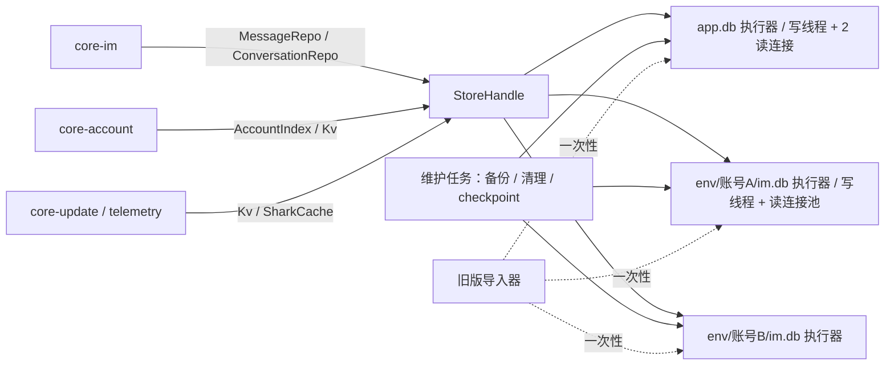

# 05 本地存储（core-store）

2026-10-30

本文是 core-store 模块的开发文档，公共约定以 [00 开发总纲](00-architecture.md) 为准。上游依据见 [04 模块划分与联动](../04-modules-and-integration.md) 与 [02 现有客户端缺陷](../02-current-client-defects.md)。文中接口签名都是示意。

官方源码出处的简写：`main` 指 `asar/dist-electron/main/index.js`，`preload/im` 指 `asar/dist-electron/preload/im.js`，`BaseController` 指 `renderer-dist/js/BaseController-_xbuiF6A.js`，`drizzle/` 指 `renderer-dist/drizzle/`。

## 一、结论与定位

- **core-store 是唯一碰磁盘数据库的模块**。它不向任何窗口开放 SQL，只向其他 Rust 模块提供仓储接口（消息、会话、通知、表情等）和 KV 接口。前端只能通过 core-im、core-account 等模块的业务命令间接读写。
- **选型：rusqlite（bundled SQLite，开启 FTS5）**，不选 sqlx。每个已打开库一个写入 actor 线程与按需只读连接，WAL 模式；连接/缓存有全局预算。
- **库的划分：每部署环境一个 `app.db` + 每账号一个库 `env/<environment>/acc/<account_id>/im.db`**，不采用单库加 `account_id` 列。
- **迁移：基于 `PRAGMA user_version` 的嵌入式迁移**（用 `rusqlite_migration` crate，或自研同等逻辑），不引入 refinery。
- **electron-store 由 `app.db` 里的 `kv` 表替代**，键是 Rust 侧的枚举，值是带版本的 JSON。密码、ticket 一律不进 KV，交给 core-account 放系统凭据库。
- **一期不做整库加密（SQLCipher）**，保留编译开关；是否需要取决于携程合规要求，列入待确认。
- **旧数据一次性导入**：首次启动时后台读取旧版 `vbk.db` 与 electron-store 的 `config.json`，按账号拆分导入，旧文件只读不改。
- **坏库不删数据**：官方遇到初始化失败直接删库重建，新版先停止该库业务并留证，再校验同环境同账号备份后恢复；无法恢复的本地草稿/发送未知状态必须显式保留为待处理，不能假定服务端可补齐。

## 二、承接范围

### 2.1 官方现状：渲染进程发 SQL

| 环节 | 官方做法 | 出处 |
| --- | --- | --- |
| 前端入口 | IM 窗口用 drizzle 的 sqlite-proxy 驱动，回调里调用 `dbExecute(sql, params, method)`；出错时吞掉异常返回空结果 `{rows:[]}` | `BaseController`：`cy(async(...n)=>{try{return{rows:await pr.dbExecute(...n)}}catch{return{rows:[]}}}` |
| preload | `appBridge.dbQuery` 先做一次正则校验，再 `ipcRenderer.invoke("execute_db", sql, params, method)` | `preload/im`、`preload/index`：`dbQuery(e,n=[],o="all")` |
| 主进程 | `ipcMain.handle(executeDB)`：校验发送方是本地页面（`Rt`），method 必须是 `get/all/run`，SQL 过一组正则（不许含 `;`，禁止 attach、pragma、drop、alter、create 等，`get/all` 只许 select/with），然后在主线程同步执行 `sqlite.prepare(sql)[method](...params)` | `main`：`hp()`、`pp()`、`op/ap/cp/lp` 正则、`DBManager` |
| 驱动 | better-sqlite3 11.1.2（同步 API），drizzle-orm ^0.32.0，开 `journal_mode = WAL`，未设置 `busy_timeout`、`synchronous` | `main`：`openAndMigrate()`；`asar/package.json` |
| 库文件 | `userData/vbk.db`，开发模式在应用目录 | `main`：`Nn=...getPath("userData"),"vbk.db"` |

主要风险：

| 风险 | 说明 |
| --- | --- |
| 阻塞主进程 | better-sqlite3 是同步调用，跑在主进程的 IPC 处理函数里。慢查询期间所有窗口的 IPC、窗口事件都排队（与文档 02 的“主进程负担重”一致） |
| 正则不是边界 | `run` 方法允许任意 insert/update/delete，没有 WHERE 约束；任何本地页面一旦被 XSS（IM 消息渲染是高风险面），可读出全部账号的聊天记录或整表删除 |
| 没有事务 | 禁止 `;`，每条语句单独一次 IPC；`begin/commit` 虽在白名单里，但多窗口并发时会交错（推断） |
| 静默失败 | 前端 catch 后返回空数组，insert 失败也是 `catch{}`，数据丢了没有任何日志 |
| 坏库即删 | `init()` 失败时 `removeDatabaseFiles()` 删掉 `vbk.db`、`-wal`、`-shm`、`-journal` 后重建，没有备份 |
| 账号混存 | 部分表有 `buid` 列，但 `messageInfo`、`groupMember`、`customEmoji` 没有，只能间接区分账号 |

### 2.2 两套 SQLite 并存

`asar/package.json` 同时依赖 `better-sqlite3`（11.1.2）和 `sqlite3`（^5.1.7），两者的原生模块（`better_sqlite3.node`、`node_sqlite3.node`）都随包分发。在主进程、preload、IM SDK 与 `@ctrip/*` 包里都没有找到 `require("sqlite3")`，`sqlite3` 应是遗留的无用依赖（推断）。新版只保留一套 rusqlite。

### 2.3 drizzle 迁移与 10 张表

迁移文件在 `drizzle/` 下，`0000`–`0011` 由 drizzle-kit 生成并带 `meta/NNNN_snapshot.json`；`0012_message_cite_msg_id` 是手写的，没有快照，`_journal.json` 的时间戳是整数 `1789709200000`（推断为手工补录）。迁移记录表为 `__drizzle_migrations`。

| 迁移 | 内容 |
| --- | --- |
| 0000 | 建 9 张表与全部索引 |
| 0001 | venAgentInfo 加 `messageVoice` |
| 0002–0004 | userInfo 加 `bu`、`businessline`、`nickName` |
| 0005–0006 | IQConversationInfo 加 `optStatus`、`soundUrl` |
| 0007 | messageInfo 加 `aiReply` |
| 0008 | conversationInfo 加 `isTop` |
| 0009 | userInfo 加 `registerCountry`、`registerProvince` |
| 0010–0011 | 建 customEmoji，再加 `width`、`height` |
| 0012 | messageInfo 加 `citeMsgId` |

最终表结构（字段按含义归组，不逐一列出 46 个会话字段的类型；类型只有 text 与 integer 两种）：

| 表 | 归属 | 主键 / 唯一 | 其他索引 | 主要字段 |
| --- | --- | --- | --- | --- |
| conversationInfo | IM | `gid` 唯一（非空，默认 `''`），无主键 | `buid`、`status`、`lastUpdateTime` | 归属：buid、uid、id；对方展示：displayName、displayUid、displayAvatar、remark；客服：venAgentId、ctripAgentId、serviceType、skillGroupCode、currentConversationRole；会话：threadId、conversationKey、sessionId、conversationType、status、originStatus、inQueueStatus；群：groupTitle、groupAvatar、memberList、customerInGroup、inGroup、isOwner、ownerDisplayName；关联：refId、relationOrderId、vendorId、vendorName、vendorRole；时间：firstMessageTime、lastMessageTime、lastUpdateTime、localNextTime；状态位：isHide、star、isTop、isRead、unreadCount；其他：lastMessageJsonString、message、ext、languageInfo、sensitiveWords、searchMatchUserName |
| messageInfo | IM | `msgId` 唯一 | `gid`；`(gid, createTime)` | gid、messageBody（JSON 文本）、fromJid、toJid、threadId、subject、createTime、bizType、status、msgtype、isread、isTargetRead、source、aiReply、citeMsgId |
| groupMember | IM | `username` 唯一 | — | username、userJid、nickName、nick、remark、avatar、gender、roles / rolesV2 / rolesV3 / rolesV2Map、status / statusV2、sortNo、createAt、visible、extPropertys。**没有 gid 也没有 buid**，同一 username 只能存一行；是否确为缺陷取决于它保存全局用户还是群内角色，现有证据不足 |
| IQConversationInfo | IM（系统通知分类，推断） | `id` 主键；`(buid, categoryId)` 唯一 | `(parentId, buid)` | buid、parentId、categoryId、categoryName、categoryNameShark、categoryIcon、unreadCount、unreadTimeline、lastMsg、lastMsgTime、lastMsgId、msgType、localNextTime、optStatus、soundUrl |
| IQMessageContent | IM（系统通知内容，推断） | `msgId` 唯一 | `(categoryId, categorySubId, buid)`；`createTime` | categoryId、categorySubId、buid、msgId、messageBody、msgType、bizType、messageCode、createTime、status |
| customEmoji | IM | `id` 主键 | — | title、desc、url、thumbUrl、rank、createTime、width、height。没有 buid（推断为各账号共用） |
| venAgentInfo | IM（客服坐席配置） | `buid` 唯一 | — | id、loginName、agentRefId、ctripUid、nickname、avatar、locale、email、serviceLimit、receiveLimit、jobPosition、im* 开关 4 个、show*Tab 2 个、disable、disableSetting、messageVoice，以及 11 个存 JSON 的业务类型列表（skillGroups、bizTypeShowTitle、systemNoticeBizTypes、departments 等） |
| workingSchedule | IM（坐席排班） | `(buid, locale)` 唯一 | — | timeZone、timeZoneDisplayName、sun–sat 七列、offdays、workdays |
| userInfo | 通用（账号资料） | `buid` 唯一 | — | account、partyId、partyName、email、mobilePhone、mobileAreaCode、positionCode、userGroupId、userGroupName、currentStatus、lastUpdateTime、bu、businessline、nickName、registerCountry、registerProvince |
| sharkInfo | 通用（多语言词条缓存） | `id` 主键；`(key, locale)` 唯一 | `locale` | key、value、locale |

读写分布：主进程 `DBManager` 只直接读写 userInfo（`getUserInfo`、`insertUser`、`setUserBu`）和 sharkInfo（`readShark`、`insertShark`）；其余 8 张表都由 IM 窗口经 `execute_db` 读写（`BaseController` 中 `ge.insert/select/update`，imWindow 中 customEmoji 的增删查与按 title 的 `LIKE '%…%'` 查询）。

现有清理逻辑：`checkExpireData()` 每天最多跑一次（`DATABASE_CLEAR_TIME_STAMP`），删除 `status = 4` 且 `lastUpdateTime` 早于“偏好 `chatCacheDays`（默认 180）天前”的会话，再按 500 个 gid 一批删除其消息。没有 VACUUM，文件不会缩小（推断）。“清除缓存”（`clearUserStore`）会清空 electron-store 并删 9 张表的数据（customEmoji 除外）。

### 2.4 electron-store

`main` 中 `z=new Fl`（`Fl=require("electron-store")`，8.2.0），无参数构造，即默认文件 `userData/config.json`，**未设置 `encryptionKey`**。键如下：

| 键 | 内容 | 读写处 | 新版去向 |
| --- | --- | --- | --- |
| `pwd_account_list` | 账号列表：buid、account、userInfo、bticket，以及开启“记住密码”（默认开）时的 **明文 password** | AccountManager、`loginSuccess`、`loginFailure`、`sortAccountList`、`getCacheAccountList` | 账号索引按字段白名单进 `app.db.accounts`；解析边界丢弃 password，候选 ticket 仅交 core-account 的受保护迁移流程 |
| `default_login_account` | 待合并进账号列表的默认账号 | `getLoginTicket` | 导入时合并，不保留 |
| `ZUCHE_ACCOUNT_LIST` | 租车业务线账号名列表 | 深链处理；`setCacheData` 白名单 | kv（account 模块） |
| `USER_PREFERENCE` | 偏好对象，默认值见 `mr={...}`：快捷键、通知 4 组开关、`replyTimeoutAlarmSecond`、`chatCacheDays`、`locale`、`scale`、`useSystemProxy`、`rememberPassword`、`lastFileSavePath` 等约 40 项 | PreferencesManager | kv `pref.*`（归 08 模块定义字段） |
| `current-locale` | 当前语言 | Shark 管理 | kv `pref.locale` |
| `ENV_STORE_KEY` | 非生产环境的 FAT/UAT/PROD 选择 | 启动、菜单 | kv（仅开发构建） |
| `BAOLEI_TAG_KEY` | 堡垒（灰度）标记 | `toggleBaolei`、`getAppConfig`、更新检查 | kv `update.baolei` |
| `WEB_URL_LIST` | 打开过的网页 URL，最多约 200 条 | `getCacheUrlList`、`clearCacheUrlList`、网页窗口 `did-finish-load` | kv（shell 模块） |
| `APP_STAY_KEY` | 按天记录的停留时长 | `getStayDuration` | kv（telemetry） |
| `app_launch_count` | 启动次数 | `getLaunchCount` | kv（telemetry） |
| `UPDATE_TIME_STAMP` | 上次提示重启更新的时间 | 更新提示 | kv（update） |
| `DATABASE_CLEAR_TIME_STAMP` | 上次清理过期数据的时间 | `checkExpireData` | kv（store 自用） |
| `businessMenu.properties`、`appDownload.properties`、`imIpollCheckDate` | 渲染进程经 `setCacheData` / `getCacheData` 存取的缓存，主进程用白名单 `Su` 限定只能用这 4 个键（含 ZUCHE_ACCOUNT_LIST） | `set_cache_data`、`get_cache_data` | kv，各自归属模块（待确认含义） |

## 三、Tauri / Rust 分工

| 放 Rust（core-store） | 放 WebView 前端 |
| --- | --- |
| 连接管理、PRAGMA、迁移、写入 actor、只读连接池 | 无业务数据直连；只展示其他模块命令返回的数据 |
| 消息、会话、系统通知、群成员、表情、坐席配置、账号索引、词条缓存的仓储 | 设置窗口里“存储占用 / 清理 / 保留天数”的展示与按钮 |
| FTS5 索引维护与搜索 | 搜索框与结果高亮渲染 |
| KV（替代 electron-store）及变更通知 | — |
| 旧版数据导入、备份、坏库恢复、容量清理 | 导入进度条（由 shell 外壳展示） |

## 四、Rust 核心设计



### 4.1 关键选型

| 问题 | 结论 | 理由 |
| --- | --- | --- |
| rusqlite 还是 sqlx | **rusqlite**（features：`bundled`、`backup`、`hooks`、`serde_json`，FTS5 随 bundled 编译需验证开关） | 本项目需要直接管理专用写线程、backup API 与每账号库，rusqlite 更贴合此实现选择。不能据此断言 sqlx 无异步价值或必须在线校验；包体和性能需在锁定版本后实测 |
| 单库加 account_id 还是每账号一库 | **每账号一库 + 每环境 app.db** | 账号数据归属清晰；删除仍须覆盖备份、隔离区、staging、媒体缓存与凭据，不是只删主库目录；旧表本来就缺 buid 列，拆库后不用给每张表补列和复合索引；单账号坏库不影响其他账号；备份、清理、VACUUM 都按账号独立进行；多账号同时在线时写入互不排队。代价是跨账号汇总（总未读数）要在 core-im 内存中合计，账号上限尚需产品与性能原型确认 |
| 迁移框架 | **`user_version` + 嵌入式 SQL**（`rusqlite_migration`，若不满足则评估自研，不能用行数代替迁移正确性成本） | 迁移随二进制发布、每个库各自升级；refinery 需要额外的历史表，主要优势（多数据库后端、文件扫描）用不上 |
| 是否加密 | **一期不整库加密**，预留 `bundled-sqlcipher` 编译特性 | 敏感凭据已不进库；库放在每用户目录，系统 ACL 隔离。SQLCipher 的实际读写开销须测量，另增加密钥管理（DPAPI / 凭据库）、坏库恢复与旧库导入的额外复杂度。聊天内容含客人手机号、订单号，是否必须加密请合规确认 |
| KV | **`app.db.kv` 表 + 每账号库内 `kv` 表** | 与数据库共用事务和备份；避免再引一个 JSON 文件库；变更可经 `watch` 通道推给订阅方 |

### 4.2 文件布局与连接参数

| 路径（Windows） | 内容 |
| --- | --- |
| `%LOCALAPPDATA%\<identifier>\store\env\<environment>\app.db` | accounts、shark_cache、kv、legacy_import |
| `...\env\<environment>\acc\<account_id>\im.db` | 该账号的 IM 数据与账号级 kv |
| `...\env\<environment>\backup\<account_id-or-global>\<db_id>\` | 每库最近 2 份已验证备份，升级前保护备份单独保留至升级验收 |
| `...\env\<environment>\quarantine\<account_id-or-global>\<db_id>\<generation>\` | 损坏库及 WAL 留证；未解决的本地唯一数据不自动到期删除 |

目录用 Tauri 的 `app_local_data_dir()`（Local 而非 Roaming，避免被企业漫游配置或 OneDrive 同步）。`<identifier>` 由 01 壳模块确定。

每个库内写入 `db_identity`；打开时必须与 account 分配的 `(environment, account_id, buid)` 匹配。`account_id` 是本地生成的安全路径段，不直接使用外部 buid 拼路径。

每条连接打开时设置：`journal_mode=WAL`（只在建库时）、`synchronous=FULL`、`foreign_keys=ON`、`busy_timeout=5000`、`temp_store=MEMORY`、按全局内存预算分配的 `cache_size`（不可每条连接固定 16 MB 后再乘账号数），新库建表前设 `auto_vacuum=INCREMENTAL`。只读连接用 `SQLITE_OPEN_READ_ONLY` 打开并设 `query_only=1`。

### 4.3 并发模型：写入 actor + 只读池

| 角色 | 实现 | 说明 |
| --- | --- | --- |
| 写入 actor | 每个库一个专用 OS 线程，独占唯一写连接，从 tokio mpsc 收 `WriteOp` | 应用内部写串行；外部锁、备份、checkpoint 与文件系统仍可能返回 `SQLITE_BUSY`，需有界处理；调用方 `await` oneshot 拿结果 |
| 批量合并 | actor 取到一条写操作后，再非阻塞地取队列中已有的写操作，最多 500 条或 10 ms，合并进一个事务 | 消息同步一次几百条时只提交一次，fsync 次数从几百降到一 |
| 只读池 | 每个账号库默认按需 1 条只读连接；热点账号可增至 2–4 条，总数与页缓存受全局上限约束，经 `spawn_blocking` 使用 | WAL 下读不阻塞写；会话列表与历史翻页走这里 |
| 维护任务 | 由写入 actor 在空闲时执行（checkpoint、增量 vacuum、过期清理） | 每次最多处理一批，避免长时间占写锁 |
| 写后通知 | 事务提交后由仓储层发内部总线事件（如“会话 x 有 n 条新消息”） | core-im 据此推 `im://message-new`；store 自己不直接推给窗口 |

写入队列必须有容量/字节上限与反压；满队列、磁盘满、提交失败不能返回“保存成功”。合并事务内每个逻辑业务操作保持原子边界，任一失败不得提前发成功事件；仅能证明可安全重试的整个事务才重试。窗口断开不能撤销已接收的持久化发送意图。

### 4.4 新版表结构（每账号库）

字段名改为 snake_case，旧字段一一映射（映射表放在代码的导入模块里，文档不重复列出）。原样保存 IM 协议的 JSON（`body_json`），另抽出查询需要的列。

| 表 | 主键 / 唯一 | 索引 | 相对旧表的变化 |
| --- | --- | --- | --- |
| conversations | `gid` 主键 | `(status, last_update_time DESC)`；`(is_top DESC, last_message_time DESC)` | 去掉 buid（库即账号）；`member_list`、`ext`、`language_info` 等仍为 JSON 文本 |
| messages | 本地 `rowid`；服务端消息键默认 `(gid, msg_id)` 唯一（非空消息 ID） | `(gid, create_time DESC, rowid)` | 加 `search_text`（写入时由 Rust 从 body 提取的纯文本）；翻页用键集（create_time + rowid），不用 OFFSET |
| messages_fts | FTS5，external content = messages，`tokenize='trigram'` | — | 新增，触发器同步插入、删除、更新 |
| outbox | `local_id` 唯一，绑定账号库、gid、发送状态与恢复证据 | `(state, created_at)` | 发送前持久化；保存 `unknown`，ACK/回推归并不能靠自动重发解决 |
| sync_cursors | `(stream, conversation_key)` | — | 保存完整同步水位与分页断点；与最新已见消息分离 |
| drafts | `gid` | — | 草稿文本与 revision；不作为可丢失缓存 |
| db_identity | 单行 | — | `environment/account_id/buid/db_id/schema_version`；打开、备份、恢复均核对 |
| group_members | `(gid, username)` 复合主键 | `username` | 显式区分群内成员属性与全局用户资料，避免角色覆盖 |
| notice_categories / notice_messages | 对应 IQConversationInfo / IQMessageContent | 沿用旧索引去掉 buid | 改名表达“系统通知”含义（待 10 IM 模块确认） |
| custom_emoji | `id` 主键 | `rank` | 改为账号级 |
| agent_profile | 单行 | — | venAgentInfo 中的 11 个列表合并为 `profile_json`，常用开关保留为列 |
| working_schedule | `locale` 主键 | — | 去掉 buid |
| kv | `key` 主键 | — | 账号级设置（如会话星标列表） |

每部署环境的 `app.db`：`accounts`（account_id 主键、environment、buid，`(environment,buid)` 唯一；profile_id、state、session_generation、sort_no、展示字段，承接登录模块模型）。展示 JSON 按白名单构造，不直接序列化含凭据的上游对象；另有全局库身份元数据、`shark_cache`（`(locale, key)` 主键）、`kv`、`legacy_import`（导入记录）。

### 4.5 FTS 消息搜索

- 用 FTS5 的 `trigram` 分词器（SQLite 3.34+），中文无需分词库，可做子串匹配。3 个字符以上走 FTS；1–2 个字符的查询退回在最近 N 天消息上做 `LIKE`。
- 只索引文本、链接标题、卡片标题等 `search_text`，不索引图片、语音等。
- 索引约为原文的 2–3 倍体积，需原型实测（P2）。若体积不可接受，备选方案是只给最近 90 天建索引。
- 官方客户端本地没有消息全文搜索，这是新增能力；产品是否需要列入待确认。若不需要，FTS 推迟到二期，表结构预留 `search_text` 列。

### 4.6 命令与事件（只给设置页所在可信本地 WebView）

业务数据不暴露命令。只有设置窗口（capability `shell.json`）需要以下维护命令：

| 命令 | 用途 |
| --- | --- |
| `plugin:store\|usage_snapshot` | 各库大小、消息条数、上次备份 / 清理时间 |
| `plugin:store\|clear_cache` | 仅清可重建缓存；删除聊天记录是独立显式动作，不能连带凭据、草稿、outbox 或未完成导入 |
| `plugin:store\|run_cleanup` | 立即按保留天数清理 |
| `plugin:store\|legacy_import_snapshot` | 旧数据导入状态与结果 |
| `plugin:store\|open_data_dir` | 打开数据目录（对应官方 `openDataDir`） |

| 事件 | 载荷（外包总纲 EventEnvelope；账号事件定向） |
| --- | --- |
| `store://legacy-import-progress` | `{batch_id, phase, done, total}` |
| `store://usage-changed` | `{usage}` |
| `store://recovered` | `{db_id, from: "backup", completeness}`；无法恢复另发明确失败，不把空库当恢复成功 |

错误码：`store.busy`、`store.corrupt`、`store.disk_full`、`store.migration_failed`、`store.not_found`。

### 4.7 给其他模块的接口（示意）

```rust
pub trait ConversationRepo {
    async fn upsert(&self, acc: &AccountContext, rows: Vec<ConversationRow>) -> Result<u32, StoreError>;
    async fn list(&self, acc: &AccountContext, f: ConvFilter, after: Option<ConvCursor>, limit: u32) -> Result<Page<ConversationRow>, StoreError>;
    async fn set_flags(&self, acc: &AccountContext, gid: &str, flags: ConvFlags) -> Result<(), StoreError>; // top/star/hide/read/unread
    async fn remove(&self, acc: &AccountContext, gid: &str, with_messages: bool) -> Result<(), StoreError>;
}
pub trait MessageRepo {
    async fn upsert(&self, acc: &AccountContext, gid: &str, rows: Vec<MessageRow>) -> Result<UpsertStats, StoreError>;
    async fn page(&self, acc: &AccountContext, gid: &str, before: Option<MsgCursor>, limit: u32) -> Result<Page<MessageRow>, StoreError>;
    async fn get(&self, acc: &AccountContext, gid: &str, msg_id: &str) -> Result<Option<MessageRow>, StoreError>;
    async fn search(&self, acc: &AccountContext, q: SearchQuery) -> Result<Vec<SearchHit>, StoreError>;
}
```

```rust
pub trait Kv {
    fn get<T: DeserializeOwned>(&self, scope: KvScope, key: KvKey) -> Result<Option<T>, StoreError>;
    async fn set<T: Serialize>(&self, scope: KvScope, key: KvKey, v: &T) -> Result<(), StoreError>;
    async fn delete(&self, scope: KvScope, key: KvKey) -> Result<(), StoreError>;
    fn watch(&self, scope: KvScope, key: KvKey) -> watch::Receiver<Option<serde_json::Value>>;
}
pub enum KvScope { Global(Environment), Account(AccountContext) }
```

另有 `NoticeRepo`、`GroupMemberRepo`、`EmojiRepo`、`AgentProfileRepo`（im 用），`AccountIndex`（account 用，只存非敏感字段），`SharkCache`（08 模块用）。`upsert` 的冲突策略沿用官方：`ai_reply` 不被覆盖，`cite_msg_id` 用 `COALESCE(excluded, 原值)`（`BaseController` 中 `onConflictDoUpdate`）。KV 读取走内存缓存（启动时全量载入，kv 数据量小），所以 `get` 是同步的。

所有业务仓储写入在执行前验证 AccountContext 仍有效；维护操作使用核心创建的固定数据库身份句柄，不凭全局当前账号。升级发现数据库 schema 新于当前二进制时必须拒绝写入并提供兼容错误；不自行降级 user_version 或删库。app.db 与各账号库迁移分别事务化，跨库发布用恢复标记协调，不能宣称跨库原子提交。

### 4.8 平台差异

数据库本身跨平台。差异只在路径（macOS 为 `~/Library/Application Support/<identifier>/store/`）与旧数据位置（见 7.3），收在 `platform/` 子目录里。

## 五、前端设计

core-store 没有自己的窗口。前端相关要求：

- 设置窗口的“存储”页：显示 `usage_snapshot`，提供保留天数（7 / 30 / 90 / 180 / 永久）、清除缓存、立即清理、打开数据目录；订阅 `store://usage-changed`。
- 旧数据导入进度显示在主外壳顶部的非阻塞横条中，不弹模态框。
- IM 窗口的流畅度依赖 store 的读延迟，具体指标见第九节；前端不缓存超过一屏加预取量的消息，翻页总是向 core-im 要下一页。

## 六、与其他模块的联动

| 模块 | 关系 |
| --- | --- |
| core-im（10） | 主要使用方：会话、消息、通知、群成员、表情、坐席配置的读写；监听 store 的写后内部事件生成 `im://*` 事件；跨账号未读数在 im 内汇总 |
| core-account（02） | 写 `accounts` 索引；登录成功后通知 store 打开该账号库；删除账号时调用 store 删除目录；旧版导入只接收过滤后的候选 ticket，password 在解析边界丢弃；账号身份校验与凭据提交由 account 完成，store 自己不落盘 |
| core-update / core-telemetry（08） | 偏好字段由 08 定义、经 Kv 存取；Shark 词条用 `SharkCache`；store 的坏库、迁移失败上报给 telemetry |
| core-shell（01） | 确定 identifier 与数据目录；设置窗口调用 store 维护命令；`WEB_URL_LIST` 等外壳 KV |
| core-assistant（09） | 如需翻译缓存，使用账号级 kv 或由 store 新增专用表，不自建库 |

启动顺序遵循总纲：telemetry → store → net → account。store 初始化只打开 `app.db` 并跑迁移；账号库在 account 选定账号后再打开。

## 七、关键流程

### 7.1 启动

1. 打开 `app.db`，迁移到最新 `user_version`，载入 kv 缓存（目标 ≤ 50 ms，无数据迁移时）。
2. account 选定当前账号后打开 `env/<environment>/acc/<account_id>/im.db` 并迁移；后台账号的库在其 IM 连接建立时再打开。
3. 启动 30 秒后在后台对已打开的库跑 `PRAGMA quick_check`，结果异常则走 7.5。
4. 检查是否需要旧数据导入（7.3）与每日维护（7.6）。

### 7.2 收到一批消息

core-im 调 `MessageRepo::upsert` → 写入 actor 合并同一时间窗内的写操作，一个事务完成 messages、messages_fts（触发器）、conversations 摘要更新 → 提交后发内部事件 → core-im 推 `im://message-new` 并更新未读。

### 7.3 从旧版导入

| 项 | 做法 |
| --- | --- |
| 定位 | Windows：`%APPDATA%\vbk-electron\vbk.db`（及 `-wal`、`-shm`）与 `%APPDATA%\vbk-electron\config.json`。目录名来自 `app.getName()`，打包后的 `package.json` 只有 `name: "vbk-electron"`、没有 productName，因此推断为 `vbk-electron`，需在真机确认。macOS：`~/Library/Application Support/vbk-electron/` |
| 时机 | 新库中 `legacy_import` 无记录，且旧文件存在时；在主外壳可交互之后后台进行，不阻塞启动 |
| 旧客户端在运行 | 不能仅凭进程名证明无写者。要求旧客户端退出并确认数据库文件集合稳定；有占用/活动写入则暂停，不强杀客户端 |
| 读取方式 | 源端采用可保证一致性的只读快照：旧写者退出且文件稳定后，将主库及存在的 WAL/SHM 作为同一集合复制到独立 staging，并验证复制前后源指纹未变化。仅对 staging 用 SQLite 打开/恢复与 backup API 生成标准快照；不对活动旧库设置 immutable，不修改源文件；无法取得一致快照就暂停 |
| 拆分账号 | conversationInfo、IQ* 两表、venAgentInfo、workingSchedule 按 `buid` 分到各账号库；messageInfo 经 `gid → conversationInfo.buid` 归属，缺失或多义归属不猜测、不丢弃原始证据：留在受限 staging 隔离表并计数，不展示到任一账号 |
| 不导入 | groupMember（缺 gid、buid，无法归属，进会话时从服务端重拉）、sharkInfo（启动时重新拉取）、customEmoji 无可靠账号归属时也先隔离，不按“上次登录账号”猜测；可重拉者验证后从服务端重拉 |
| electron-store | 解析 `config.json`：账号列表进 `accounts`；password 一律丢弃，仅候选 bticket 交 core-account 验证；不复制原始 config 到 staging/日志；`USER_PREFERENCE` 按 08 模块提供的映射写 `pref.*`；其他键按 2.4 表落 kv；`ENV_STORE_KEY` 只在开发构建导入 |
| 幂等 | 以不可变源快照指纹、来源环境、导入器版本和 batch_id 记录进度；在独立 staging 转换/校验，再按自然键逐批合并。重试只清该批次 staging，绝不清正式账号库；旧记录不得覆盖新版已有草稿/已读/星标/outbox 状态 |
| 进度 | 每 1000 行发一次 `store://legacy-import-progress` |

### 7.4 备份

每库在其环境/账号/db_id 命名空间内，通过在线 backup API 写 `<UTC-time>-<generation>.tmp`，成功结束后校验库内身份、schema 和完整性，再原子发布为 `.db`。清单记录来源身份、schema、生成原因和校验值，路径与库内身份必须同时匹配。每日备份保留最近 2 份；导入后、迁移前分别创建独立 generation，未完成升级验证不能提前淘汰保护备份。backup step 可返回 BUSY/LOCKED 或不可重试错误，失败产物不得发布。

### 7.5 损坏恢复

1. 打开或查询时遇到 `SQLITE_CORRUPT`、`SQLITE_NOTADB`，或 quick_check 失败，关闭该库全部连接。
2. 在该账号 namespace 下把主库及仍存在的 WAL/SHM 一并留证；禁止单独丢弃 WAL。暂停该库的 IM 写入与水位推进，不能把落盘失败消息当作已持久化。
3. 仅恢复通过完整性检查且 environment/account_id/buid/db_id 匹配、schema 可读的备份；先在 staging 验证后替换。恢复后的同步水位随备份回退再补拉，旧 outbox 的发送结果标为待核对，禁止直接重发。无可用备份时提供显式的受损状态与恢复选择；新空库不能被描述为完整恢复，草稿/本地状态/unknown 发送不保证可从服务器找回。
4. 迁移失败（`store.migration_failed`）不按损坏处理：不删库，回滚事务，提示用户并上报。

### 7.6 容量清理

| 规则 | 说明 |
| --- | --- |
| 过期会话 | 只有业务枚举已核实后才启用删除；`status = 4` 当前仍是静态推断，未确认前关闭按该条件的自动删除。已结束且超过保留天数的记录才成为候选，排除草稿/未决 outbox/未完成同步引用。保留天数默认 180，读偏好 `chatCacheDays` |
| 体积上限 | 单账号库超过待定预算时提示并启动同一可删除集合的清理；不能为强行降容删除活动会话、草稿、unknown/outbox 或未同步数据。空间仍不足则停止新写并明确降级 |
| 节奏 | 每天最多一次；每批 500 行一个事务，批间让出写入 actor |
| 回收空间 | 清理后执行 `PRAGMA incremental_vacuum(N)` 分步回收；退出时在写入停稳且读连接结束后有界 checkpoint；BUSY 不得无限阻塞退出，也不能手工删 WAL |
| 账号移除 | 用户在账号管理中“移除账号并删除本地记录”时先撤销该账号任务并关闭连接，再删除主库、备份、quarantine、staging、媒体缓存及关联索引；失败记待清理。仅退出登录保留本地记录的行为必须在 UI 说明 |

## 八、注意事项（Windows 优先）

- **杀毒软件**：Defender 等会扫描新写的 `-wal` 文件导致短暂锁定，靠 `busy_timeout` 与写入 actor 重试吸收；原型阶段在开启实时防护的机器上测。
- **路径**：用户名含中文、空格时路径要全程 UTF-8 / 宽字符处理，rusqlite 传入 `Path` 即可，需在中文用户名机器上验证。不要用 Roaming，避免域环境漫游时把几百 MB 的库同步到服务器。
- **磁盘满**：`SQLITE_FULL` 转 `store.disk_full`，写入 actor 进入只读降级，外壳提示清理；不要反复重试。
- **WAL 增长**：长事务或常驻读事务会阻止 checkpoint，只读连接不得持有跨 await 的事务；定期检查 `-wal` 大小，超过 64 MB 主动 checkpoint。
- **进程异常退出**：默认 WAL + `synchronous=FULL`，因为草稿、发送意图、unknown 状态与已读不能保证从服务端补回。NORMAL 可在断电时失去已提交事务，不作为本项目默认。硬件/文件系统故障仍需备份，不承诺绝对零丢失。
- **旧客户端共存**：新旧客户端可能同时安装，旧数据只读、只导一次；不要修改或删除 `%APPDATA%\vbk-electron`，也不改动其中明文密码（是否提示用户清理见待确认）。
- **不要把 SQL 带回前端**：任何“临时给前端开个查询命令”的需求都改为在仓储层加业务方法。
- **原生依赖**：rusqlite bundled 静态链接 SQLite，不需要 VC 运行库以外的 DLL；开启 SQLCipher 时需要 OpenSSL 或其替代的加密后端，会增大体积，需验证。

## 九、原型验证项与验收标准

| 编号 | 验证项 | 验收标准 |
| --- | --- | --- |
| P1 | 写入 actor + 只读池，单账号 100 万条消息、2 万会话 | 一次写入 1000 条消息 ≤ 100 ms；打开会话取首屏 50 条 ≤ 20 ms（P95）；会话列表首屏 ≤ 30 ms；写入期间读延迟不劣化超过 2 倍 |
| P2 | FTS5 trigram 中文搜索 | 100 万条消息内 3 字以上关键词 ≤ 200 ms；索引体积不超过消息表的 3 倍 |
| P3 | 真实旧库导入（测试夹具包含尚未 checkpoint 的已提交 WAL 与脱敏 config，写者停止后取一致快照） | 已归属+隔离条数与源快照一致（孤儿/多义单独计数）；10 万条消息导入 ≤ 30 s 且不阻塞界面；重复运行结果一致 |
| P4 | 坏库/副文件恢复（截断文件、改页头、正常关闭后移除可重建 SHM） | 真损坏留证并按身份恢复；正常 SHM 重建不误报坏库；无可用备份不得静默清库；不丢其他账号数据 |
| P5 | 3 个账号同时收消息 | 忙锁有界重试或明确返回，不能吞错；队列受限，慢账号不拖垮其他账号 |
| P6 | 中文用户名路径、Defender 实时防护开启 | 功能与性能同 P1 |
| P8 | 跨账号备份与环境 | 同日两账号多份备份不碰撞；错账号/错环境/错 schema 备份强制拒绝；恢复不读取他人数据 |
| P9 | 导入中断与并发写 | 导入中持续写新消息/草稿/已读，在各阶段中断重试；新版数据不丢失，旧批次不重复，孤儿/多义归属不跨账号展示 |
| P10 | 持久化故障 | 入库后、发网前、ACK 前后注入中断/磁盘满；不得丢发送意图后自动重发，不把 unknown 标为失败或成功 |
| P7 | 冷启动 | store 初始化（app.db 打开 + 迁移 + kv 载入）≤ 50 ms，不占用总纲 2 s 预算的主要部分 |

## 十、开发步骤与工作量估计

| 步骤 | 内容 | 人日 |
| --- | --- | --- |
| 1 | crate 骨架、连接参数、写入 actor、只读池、错误码 | 3 |
| 2 | 迁移框架与 v1 表结构（app.db、账号库） | 2 |
| 3 | IM 仓储：会话、消息、通知、群成员、表情、坐席配置 | 4 |
| 4 | KV（类型化键、内存缓存、watch） | 1.5 |
| 5 | 旧版导入：数据库拆分、electron-store 解析、与 account 的凭据交接 | 4 |
| 6 | 备份、损坏恢复、容量清理、维护命令与事件 | 2.5 |
| 7 | FTS5 搜索（若产品确认需要） | 2 |
| 8 | 基准数据生成器、P1–P7 测试、故障注入 | 3 |
| 合计 | | 22（不含 FTS 为 20） |

步骤 1–4 属于里程碑 M1（能登录需要 accounts、kv、shark_cache），步骤 3 的 IM 仓储与步骤 5 在 M2 前完成。

## 十一、待确认问题

1. 聊天记录是否必须加密落盘（携程或商家的合规要求）？若必须，一期就开 SQLCipher，密钥放凭据库。
2. 产品是否需要本地消息全文搜索？不需要则 FTS 推迟。
3. 旧版数据目录名是否确为 `vbk-electron`（需在已安装的 Windows 机器上确认 `%APPDATA%` 下的实际目录）。
4. 导入器一律只读旧文件；旧版密码清理由用户独立操作。
5. customEmoji、groupMember、venAgentInfo 能否全部从服务端重新拉取？能则导入时可全部跳过，进一步简化。
6. `status = 4` 是否就是“已结束会话”；单账号库的体积上限取多少合适。
7. `businessMenu.properties`、`appDownload.properties`、`imIpollCheckDate` 三个缓存键的具体用途与归属模块。
8. 新版应用 identifier（决定数据目录），由 01 壳模块确定。

## 十二、平台依据与结论边界

- [SQLite WAL](https://www.sqlite.org/wal.html)：WAL 是数据库持久状态的一部分；只读打开存在条件，不能裸拷主库或把删 SHM 等同于数据库损坏。
- [SQLite synchronous](https://www.sqlite.org/pragma.html#pragma_synchronous)：NORMAL 在 WAL 下保证一致性但可能失去断电前已提交事务；FULL 是本方案为本地唯一状态选择的默认。
- [SQLite backup API](https://www.sqlite.org/c3ref/backup_finish.html)：分步备份必须完成并检查错误，BUSY/LOCKED 与不可重试错误分开处理。

以上为设计修订与官方 API 依据；本轮没有运行新版存储实现，也没有删除或迁移真实客户记录。
