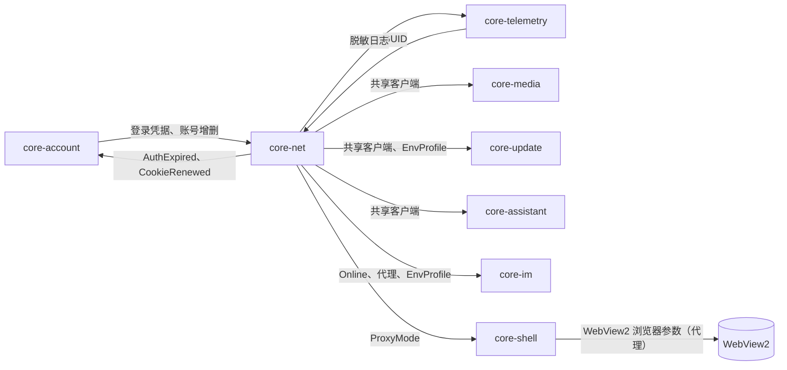

# 06 网络（core-net）

2026-10-30

本文是 [开发总纲](00-architecture.md) 下的模块文档，负责 Rust 核心模块 core-net。命名、通道、权限、错误码规则以总纲为准。

出处约定：`main/index.js` 指官方 1.2.12 解包后的 `dist-electron/main/index.js`，`preload/*.js` 指 `dist-electron/preload/`，`js/*.js` 指渲染进程产物 `renderer-dist/js/`。文件是压缩代码，出处写的是可以 grep 到的关键字。

## 一、结论与定位

- **core-net 是全应用唯一的 HTTP 客户端**。Rust 侧所有出站请求（业务接口、Shark 词条、qconfig、更新检查、上传下载、助手接口）都经过它，共用一套连接池、代理、TLS 配置、超时与日志脱敏。
- **WebView 里的请求不归 core-net 管**。远程 vbooking 页面和本地页面自己发的 `fetch` 走 WebView2 的网络栈，用 WebView 自己的 Cookie。core-net 只负责“需要 Rust 带账号 Cookie 代发”的请求，以及让 WebView 与 Rust 的代理、环境设置保持一致。
- **Cookie 的真相源分两层**：WebView Profile 是浏览器 Cookie 的真相源；core-account 是登录凭据（bticket 等）的真相源；core-net 每账号持有一个内存 Cookie Jar，只是二者的镜像，不落盘。
- **官方的三个启动参数不照搬**：`disable-http2` 默认不再加，`ignore-certificate-errors` 只在非生产环境、且只对测试域名生效，`disable-site-isolation-trials` 归 core-shell 处理（不加）。
- **给前端的 `fetch` 命令是受限代理**：只给本地窗口，只允许携程域名白名单，不允许前端自带登录 Cookie，响应里的 `Set-Cookie` 由 Rust 吸收，不回传。
- **TLS 默认用 native-tls（Windows SChannel）**，原因是企业代理和自签证书装在系统证书库里，SChannel 天然信任；rustls 作为可选特性保留，需要时配合系统证书验证器。

## 二、承接范围

### 2.1 官方 IPC 与相关代码

| 官方接口或代码 | 现状（出处） | 新设计中的去向 |
| --- | --- | --- |
| `netFetch`（`net_fetch`） | `main/index.js` 中 `f.ipcMain.handle(y.netFetch,…)`。校验发送方是本地页面（`Rt(n,"netFetch")`，名单 `bu`），URL 必须是 http/https 且命中域名白名单 `eu`（`Ot(e)`）。用 `n.session.cookies.get({url})` 取发送方会话的 Cookie，再合并调用方传入的 `cookies`；其中 `bticket/bduid/vbkticket/ticket`（集合 `Eu`）只有 login、launch、main 三个页面（`Ri`，名单 `Cu`）可以覆盖。用 `electron.net.request({useSessionCookies:false})` 发出，失败或非 2xx 一律返回 `null`；响应的 `Set-Cookie` 由 `_u` 写回发送方窗口会话（域 `.ctrip.com`，有效期一个月）。结果按 JSON 解析返回 | `plugin:net\|fetch`（受限，见 4.6）+ Rust 内部 `NetService` |
| 公共请求头 | `Tu()`：`Content-Type: application/json`、`x-ctx-locale`（当前语言）、`x-tour-auth-from: vbk_online` | 由 core-net 统一注入，见 4.5 |
| 主进程内部请求 | `Ou()`（GET，超时 1500 ms，用于读 `static.tripcdn.com/packages/…/packageVersion.json` 检查热更新）、`Mu()`（POST，用于 Shark `getLangDump`） | 改为调用 `NetService`，由 core-update、core-telemetry 使用 |
| `changeEnv`（`change_env`） | 只在非 production 构建生效；取值限 `FAT/UAT/PROD`，写入 electron-store 键 `ENV_STORE_KEY` 后 `app.relaunch()`。开发菜单“运行环境”也是同一逻辑（`["FAT","UAT","PROD"].map`）。production 构建固定 `PROD` | `plugin:net\|set_env`，仅开发构建开放 |
| `commonWebOption`（`common_web_option`） | **与网络无关**。实为对发送方 `webContents` 执行 copy、cut、paste、undo、redo、selectAll、findInPage 等编辑操作 | 不归 core-net；建议总纲把它划给 core-shell（编辑菜单与页内查找） |
| 系统代理 | 偏好项 `useSystemProxy`，**默认 `false`**。启动时 `defaultSession.setProxy({mode: rm?"system":"direct"})`；偏好变化时 `syncSessionProxy()` 对默认会话和每个账号 BrowserView 的会话设置代理并 `closeAllConnections()`（`syncProxyMode`） | 默认跟随系统代理，见 4.3 |
| 网关选择 | 偏好项 `gateway`，候选 `GATEWAY_DOMAIN_LIST = ["m.ctrip.com","online.ctrip.com","sec-m.ctrip.com"]`（`constant-*.js`）。登录窗口“网络设置”弹窗会对每个网关请求 `/restapi/soa2/12405/checkhealth` 显示在线状态（`js/loginWindow-*.js`） | 网关作为 `EnvProfile` 的一部分，运行时可切换 |
| `networkOptimization` | 偏好默认 `true`，设置弹窗有开关，但主进程中**没有找到使用点** | 不承接，待确认（见第十一节） |
| 启动参数 | `appendSwitch("disable-http2")`、`appendSwitch("ignore-connections-limit", ".ctrip.com,.c-ctrip.com,.tripcdn.com,.trip.cn")`（测试环境把 `.trip.cn` 换成 `.qa.nt.ctripcorp.com`）、非 PROD 时 `appendSwitch("ignore-certificate-errors")` | 见 4.8 与第八节 |

### 2.2 session.webRequest 与 Cookie 写入点

| 位置（`main/index.js`） | 做了什么 | 新设计 |
| --- | --- | --- |
| 账号会话 `m.webRequest.onBeforeRequest`（登录成功创建 `persist:<buid>` 分区之后） | 1. 把 `file://webresource.c-ctrip.com/*`、`file://static.tripcdn.com/*` 等 6 个静态资源域的请求重定向为 `https://`；2. 若用户选了 `gateway`，把发往 `https://<GATEWAY_DOMAIN_LIST>/restapi/soa2/` 的请求重定向到所选网关 | 1 是本地页面用协议相对地址 `//` 时在 `file://` 下被解析错的补丁，新客户端本地页面走 `tauri://`，统一写 `https://`，不再需要；2 见 4.4 |
| BrowserView `webRequest.onHeadersReceived`（每账号业务视图） | 对 `IFRAME_WHITE_DOMAINS = [".ctrip.com",".qa.nt.ctripcorp.com",".trip.com"]` 的响应删除 `X-Frame-Options` 与 `Content-Security-Policy` | 归 [04 业务页承载](04-business-pages.md) 决定；core-net 不改写远程页面响应头。如确需嵌入，优先改为顶层子 WebView 而不是 iframe |
| 登录成功处理 | 读取 `defaultSession` 的全部 Cookie，加上 `bticket`、`vbkticket`（同值）、`BDUID`，用 `zt()` 写入 `persist:<buid>` | core-account 负责，core-net 镜像，见 4.2 |
| `zt()` | 把给定 Cookie 同时写到 soa2 网关域与 trip 域：PROD 为 `.ctrip.com`、`.trip.com`，测试为 `.qa.nt.ctripcorp.com`、`.qa.nt.tripqate.com`；`httpOnly:false`、`sameSite:no_restriction`、有效期一个月 | 新设计保持域名映射，但 ticket 类 Cookie 要求 `HttpOnly`（需验证业务页是否用 JS 读取） |
| `initUbt` | 生成 `clientId` 后写 Cookie `GUID` 到默认会话和每个账号分区 | `GUID` 由 core-telemetry 生成，core-net 注入每账号 Jar |
| Shark 切换语言 | 写 Cookie `vbk-locale-lang` 到所有分区 | 同上，由 core-net 注入 |

### 2.3 环境与域名（能查到的）

| 用途 | FAT | UAT | PROD | 出处 |
| --- | --- | --- | --- | --- |
| soa2 网关（携程） | `gateway.m.fws.qa.nt.ctripcorp.com` | `gateway.m.uat.qa.nt.ctripcorp.com` | `m.ctrip.com` | `main/index.js` 常量 `Vo`；`js/ubt-*.js` 常量 `Pe` |
| soa2 网关（Trip） | `www.fws.qa.nt.tripqate.com` | `www.uat.tripqate.com` | `cbooking.trip.com` | 常量 `ou` |
| vbooking 站点 | `vbooking.ctrip.fat29/fat30/fws.qa.nt.ctripcorp.com` | `vbooking.ctrip.uat.qa.nt.ctripcorp.com` | `vbooking.ctrip.com` | `mp`（Shark）、`No`（qconfig）、`yp`（vbkChat 正则） |
| IM 页面 | `imvendor.fat44.qa.nt.ctripcorp.com` | `imvendor.uat.qa.nt.ctripcorp.com` | `imvendor.ctrip.com` | 常量 `Lo` |
| 热更新静态资源 | `static.fws.qa.nt.ctripcorp.com` | 同 FAT | `static.tripcdn.com` | 常量 `wo` |
| Cookie 域 | `.qa.nt.ctripcorp.com`、`.qa.nt.tripqate.com` | 同 FAT | `.ctrip.com`、`.trip.com` | `_u`、`zt` |

FAT 环境还有按服务号追加 `subEnv` 的规则（`js/ubt-*.js` 中 `M={21028:"fat29",12405:"fws",17264:"fat29",15529:"fat29",35240:"fat30"}`），URL 形如 `/restapi/soa2/<服务号>/<方法>?subEnv=fat29`。

## 三、Tauri / Rust 分工

| 能力 | 放 Rust（core-net） | 放 WebView 前端 |
| --- | --- | --- |
| 带账号 Cookie 的业务请求 | 统一客户端、Cookie Jar、公共头、超时重试、错误码映射 | 只调用 `plugin:net\|fetch` 或各业务模块命令 |
| 远程页面自己的请求 | 不参与，只保证 WebView 与 Rust 使用一致的代理与环境 | WebView2 网络栈 |
| 代理与 PAC | 读取系统设置、解析 PAC、监听变化、给 reqwest 下发 | 网络设置页展示与修改 |
| 环境与网关 | `EnvProfile` 计算与持久化、广播 | 开发菜单、网络设置页 |
| 网络状态 | 系统网络事件 + 主动探测，发 `net://online-changed` | 横幅提示“网络已断开” |
| 上传下载 | 提供共享客户端给 core-media | 进度条 UI |
| 日志 | 请求日志脱敏后交给 core-telemetry | 无 |

## 四、Rust 核心设计

### 4.1 结构与状态

core-net 按总纲 4.5 的 actor 写法组织：一个状态任务持有配置，读多写少的部分用 `watch` 通道发布。

```rust
pub struct NetState {
    env: EnvProfile,                         // 环境 + 网关 + 域名表，watch 发布
    proxy: ProxyMode,                        // System | Direct | Manual(url) | Pac(url)
    clients: HashMap<AccountId, AccountClient>, // 每账号一个 Jar，共享同一连接池
    online: OnlineState,                     // Online | Offline | Degraded，带 seq
    seq: u64,
}
pub trait NetService: Send + Sync {
    fn client(&self, account: Option<&AccountId>) -> AccountClient; // 给 media、update、assistant
    fn env(&self) -> watch::Receiver<EnvProfile>;
    fn online(&self) -> watch::Receiver<OnlineState>;
}
```

连接池只有一个 `reqwest::Client`。“每账号客户端”是同一个 `Client` 加上该账号的 Jar 和默认头，Cookie 在发送前由 core-net 自己拼接（不用 reqwest 内置 `cookie_store`），这样切换账号不需要重建连接池，也能精确控制哪些 Cookie 被带出。

### 4.2 Cookie Jar 与 WebView Cookie 的同步

| Cookie | 真相源 | 同步方向 | 说明 |
| --- | --- | --- | --- |
| `bticket`、`vbkticket`、`BDUID`（登录凭据） | core-account（系统凭据库） | 登录：WebView → core-account → core-net Jar；续期：Rust 响应 `Set-Cookie` → core-net → core-account → WebView | 只有 core-account 能写 WebView 中的这几项 |
| `GUID`（clientId）、`vbk-locale-lang` | core-telemetry、偏好 | Rust → Jar 与 WebView | 启动时与切换语言时下发 |
| 其他站点 Cookie（风控、AB、埋点等） | WebView Profile | 按需：Rust 发请求前从 WebView 读取指定域的 Cookie 合并（只读） | 官方 `netFetch` 也是先读会话 Cookie 再合并 |

规则：

1. core-net 的 Jar **不落盘**。重启后由 core-account 从凭据库恢复登录凭据，再从 WebView Profile 读取其余 Cookie。
2. Rust 收到的 `Set-Cookie` 只吸收白名单内的名字（上表前两行 + 配置项），其他丢弃并记日志（只记名字）。
3. 写 WebView Cookie 依赖 Tauri 2 的 `Webview::set_cookie` / `cookies_for_url`（需验证版本，Tauri 2.4 起陆续加入）；不可用时退回 `with_webview` 取 `ICoreWebView2CookieManager`。Tauri 文档提示在 Windows 上于同步命令中调用 Cookie 接口可能死锁，必须在异步任务里调用。
4. 每个账号对应一个 WebView2 Profile（总纲第六节），core-net 按 `AccountId → Profile 名` 定位要读写的 Cookie 存储。

### 4.3 TLS、代理与 PAC

**TLS 取舍**

| 方案 | 企业 MITM 代理、自签根证书 | HTTP/2 | 体积与维护 | 结论 |
| --- | --- | --- | --- | --- |
| reqwest + `native-tls`（SChannel） | 直接信任系统证书库中的企业根证书，与 WebView2 行为一致 | 需开 `native-tls-alpn` 特性（需验证 SChannel ALPN 在 1809 上可用） | 不增加体积 | **默认** |
| reqwest + `rustls` + `rustls-platform-verifier` | 通过平台验证器使用系统证书库，效果接近 SChannel | 原生支持 ALPN h2 | 增加约 1–2 MB，需跟进 rustls 版本 | 可选特性，macOS 阶段再评估 |
| reqwest + `rustls` + `webpki-roots` | 不信任企业根证书，企业网络会全部失败 | 支持 | — | 不采用 |

测试环境证书：不做全局 `danger_accept_invalid_certs`。仅当 `env != PROD` 且主机名以 `.qa.nt.ctripcorp.com`、`.tripqate.com` 结尾时，才允许测试 CA（优先把测试根证书加入 `add_root_certificate`，最后手段才是对这些域名放宽校验）。生产构建编译时去掉该代码路径。

**代理**

| 模式 | 行为 | 实现 |
| --- | --- | --- |
| `System`（新默认） | 读当前用户的 IE/WinINet 代理设置，含自动检测（WPAD）和 PAC 脚本 | `windows` crate 的 `Win32_Networking_WinHttp`：`WinHttpGetIEProxyConfigForCurrentUser` 取配置，`WinHttpGetProxyForUrl` 按 URL 解析 PAC；结果按主机缓存 5 分钟。reqwest 用 `Proxy::custom` 回调接入 |
| `Direct` | 不走代理（官方默认就是这个） | `Client::builder().no_proxy()` |
| `Manual(url)` | 用户手填 | `Proxy::all(url)`，支持 Basic 认证（凭据进凭据库） |

说明与需验证项：

- reqwest 0.12 自带读取 Windows 注册表代理（`ProxyServer`/`ProxyEnable`），但**不支持 PAC 与 WPAD**，所以 `System` 模式要自己接 WinHTTP。也可评估现成 crate（如 `sysproxy`、`proxy_cfg`），它们大多只读静态代理，PAC 支持需验证。
- WebView2 默认就使用系统代理（含 PAC），与 `System` 模式天然一致。`Direct` 或 `Manual` 时需要给 WebView2 传浏览器参数 `--no-proxy-server` 或 `--proxy-server=…`（Tauri 2 `WebviewWindowBuilder::additional_browser_args`，或 `proxy_url`，需验证 Windows 上是否映射为同一参数）。浏览器参数只在创建 WebView2 环境时生效，**改代理模式需要重启应用**，设置页要明确提示。
- 代理变化监听：订阅注册表 `HKCU\Software\Microsoft\Windows\CurrentVersion\Internet Settings` 变化（`RegNotifyChangeKeyValue`），变化后清 PAC 缓存并重建连接。
- 官方 IM SDK 使用 axios，只认 `HTTP(S)_PROXY` 环境变量（`s-node-imclient-core/main.js` 中 `proxyEnv`）。一期 sidecar 启动时由 core-im 向 core-net 取代理并以环境变量传入。

### 4.4 环境切换与广播

`EnvProfile` 是第 2.3 节表格的结构化版本，所有模块通过 `NetService::env()` 读取域名，**禁止在其他模块里硬编码携程域名**。

```rust
pub struct EnvProfile {
    pub env: Env,                 // Fat | Uat | Prod
    pub gateway: Option<String>,  // 用户选择的 soa2 网关，None 表示默认
    pub soa_base: Url, pub trip_soa_base: Url, pub vbooking: Url,
    pub im_page: Url, pub static_base: Url,
    pub cookie_domains: Vec<String>,
    pub fat_sub_env: HashMap<u32, String>, // 服务号 → subEnv
}
```

| 变化 | 是否需要重启 | 广播 |
| --- | --- | --- |
| 环境（FAT/UAT/PROD） | 需要。Cookie 域、登录态、IM 地址全部不同，热切换收益小、风险高；沿用官方“写配置后重启” | 内部总线 `EnvChanging` 让各模块落盘，随后重启 |
| 网关 | 不需要 | `watch` 更新 + 事件 `net://env-changed`；Rust 请求立刻用新网关 |
| 代理模式 | Rust 侧不需要，WebView 侧需要（见 4.3） | `net://proxy-changed` |

远程页面的网关重定向：官方用 `onBeforeRequest` 把业务页发往默认网关的请求改到所选网关。Tauri 没有通用的请求拦截 API，要做只能 `with_webview` 注册 WebView2 的 `WebResourceRequested` 并返回重定向响应（需验证对 `fetch` 的 POST 是否可行）。建议一期**只对 Rust 请求生效**，远程页面保持默认网关，等确认网关选择的真实使用率后再决定。

### 4.5 公共头、请求体 head 与签名

源码中没有发现请求签名（HMAC 等），鉴权依赖 Cookie 中的 ticket（推断）。core-net 统一注入以下内容，业务模块不再各自拼装：

| 项 | 值 | 出处 |
| --- | --- | --- |
| `Content-Type` | `application/json` | `Tu()` |
| `x-ctx-locale` | 当前语言，如 `zh-CN` | `Tu()`、`js/BaseController-*.js` 的 `post()` |
| `x-tour-auth-from` | `vbk_online`；取用户信息接口用 `merchants_online` | 同上，`getUserInfo` |
| 请求体 `head`（soa2） | `{cid: GUID, ctok:"", cver:"1.0", lang:"01", sid:"8888", syscode:"09", auth:"", extension:[]}` | `js/ubt-*.js` 函数 `gr`，`getVBKHead()` |
| 请求体 `head`（IM 类接口） | `{cver:"2", appId:"900004", extension:[cpc=pc, protocal=https, amp-product-type=IM, amp-account-source=VBK, client-source=pc-900004, locale]}` | `js/ubt-*.js` 函数 `pr`，`getHead()` |
| `User-Agent` | 建议与 WebView2 UA 保持同一产品标识并加 `vbk-desktop/<版本>` | 官方未设置（推断用 Electron 默认） |

响应处理也统一：解析 `ResponseStatus.Ack`、`Errors[0].ErrorCode`；`ResponseStatus.Timestamp` 用于计算服务器时间差（官方写入 `window.__server_client_timediff__`），新设计由 core-net 维护并通过 `plugin:net|status_snapshot` 提供给计时相关模块。`ErrorCode = AccountsMobileRequestFilterException` 映射为 `account.ticket_expired`，并在内部总线发 `AuthExpired{account}` 给 core-account。

### 4.6 命令

| 命令 | 参数 | 返回 | 可用窗口 | 说明 |
| --- | --- | --- | --- | --- |
| `plugin:net\|fetch` | `{url, method, body?, headers?, account?, timeout_ms?}` | `{status, headers(过滤后), body_json}` | shell、im、login | 受限代理，规则见下 |
| `plugin:net\|status_snapshot` | — | `{seq, online, env, gateway, proxy_mode, server_time_offset_ms}` | shell、im、login、setting | 快照 |
| `plugin:net\|set_gateway` | `{gateway: Option<String>}` | `()` | shell（setting） | 只能取 `GATEWAY_DOMAIN_LIST` 中的值 |
| `plugin:net\|probe_gateways` | — | `[{gateway, ok, rtt_ms}]` | shell、login | 调 `/restapi/soa2/12405/checkhealth` |
| `plugin:net\|set_proxy` | `{mode, manual_url?}` | `{restart_required}` | shell（setting） | |
| `plugin:net\|set_env` | `{env}` | `()` | 仅开发构建的 shell | 写配置并重启 |

`plugin:net|fetch` 的限制，防止它变成任意请求代理：

1. 只在 `shell.json`、`im.json`、`login.json` 三个 capability 中授予，**远程页面（`remote-bridge.json`）不授予**。
2. URL 必须是 `https`，主机名命中白名单。白名单从官方 `eu`（33 个携程系域名）**收紧**为实际用到的：当前环境 `EnvProfile` 中的域名 + `.ctrip.com`、`.trip.com`、`.c-ctrip.com`、`.tripcdn.com`；测试环境追加 `.qa.nt.ctripcorp.com`、`.tripqate.com`。
3. 方法只允许 GET、POST；请求体 ≤ 1 MB，响应体 ≤ 5 MB，超出返回 `net.payload_too_large`。
4. 前端不能传 `Cookie`、`Host`、`Authorization` 等头（黑名单过滤）；账号由 `account` 参数指定，默认当前账号；login 窗口可以指定“待确认账号”（对应官方 `Ri` 名单内页面才能覆盖 ticket 的规则）。
5. 响应头中的 `Set-Cookie` 由 Rust 吸收，不回传前端。
6. 失败返回 `AppError`，不再像官方一样吞成 `null`。

### 4.7 事件

| 事件 | 载荷 | 接收方 |
| --- | --- | --- |
| `net://online-changed` | `{seq, online: "online"\|"offline"\|"degraded", since}` | 所有本地窗口 |
| `net://env-changed` | `{seq, env, gateway}` | shell、im、setting |
| `net://proxy-changed` | `{seq, mode, restart_required}` | shell、setting |

内部总线（不出 Rust）：`NetEvent::Online(bool)`、`AuthExpired{account}`、`CookieRenewed{account, names}`、`EnvChanging`。

### 4.8 超时、重试、退避与 HTTP/2

| 类别 | 连接超时 | 总超时 | 重试 |
| --- | --- | --- | --- |
| 业务查询（幂等 GET、soa2 查询类 POST） | 5 s | 15 s | 最多 2 次，指数退避 300 ms × 2ⁿ，加 ±20% 抖动 |
| 写操作（提交、发送） | 5 s | 15 s | 不自动重试，由调用方决定 |
| 健康检查、热更新元数据 | 3 s | 3 s（官方 `Ou` 是 1.5 s） | 不重试 |
| 上传下载 | 10 s | 无总超时，按 30 s 无进度判定超时 | 断点续传由 core-media 处理 |

- 只对连接错误、超时、HTTP 502/503/504 重试；4xx 不重试。离线状态下直接返回 `net.offline`，不排队。
- 重试用 `backon` 或 `reqwest-middleware` + `reqwest-retry` 实现（选型时比较依赖体积）。
- **HTTP/2 恢复**：reqwest 对 HTTPS 通过 ALPN 自动协商 h2。WebView2 默认启用 HTTP/2，不加 `--disable-http2`，也不需要 `ignore-connections-limit`（HTTP/2 单连接多路复用）。

`disable-http2` 原因推断（源码无注释）：

1. 企业或运营商代理、部分安全软件对 HTTP/2 支持差，出现 `ERR_HTTP2_PROTOCOL_ERROR`，一刀切关掉最省事；
2. 同时加了 `ignore-connections-limit`，说明关掉后遇到了 HTTP/1.1 每主机 6 连接上限造成的排队，印证 1 中的问题出现在携程自家域名上；
3. 测试环境网关对 h2 的支持不完整（推断）。

### 4.9 网络状态检测

| 信号 | 来源 | 用途 |
| --- | --- | --- |
| 系统连通性 | Windows Network List Manager（`windows` crate `Win32_Networking_NetworkListManager`，`INetworkListManagerEvents::ConnectivityChanged`）。`NotifyNetworkConnectivityHintChange` 需要较新的 Windows 10，不满足 1809 下限，不用 | 断网立即判定离线 |
| 主动探测 | 系统报告在线后，请求当前网关 `/restapi/soa2/12405/checkhealth`；连续 3 次业务请求连接失败也触发一次 | 区分“连上了 Wi-Fi 但到不了携程”（`degraded`） |
| 防抖 | 状态需稳定 2 s 才广播 | 避免网卡切换时抖动 |

恢复在线时内部总线发 `NetEvent::Online(true)`，core-im 据此立即重连而不是等退避计时器。

### 4.10 日志脱敏

| 内容 | 处理 |
| --- | --- |
| URL | 保留主机与路径；查询串只保留键名，值替换为 `***`（`subEnv` 除外） |
| 请求头 | `Cookie`、`Authorization`、`Proxy-Authorization` 只记 Cookie 名列表 |
| 响应头 | `Set-Cookie` 只记名字与过期时间 |
| ticket 类值 | 任何位置出现都只保留前 4 位 + 长度，如 `bt_3f…(64)` |
| 请求与响应体 | 默认不记；开发构建可开，但仍过滤 `password`、`ticket`、`token`、手机号 |
| 每条记录 | 方法、主机、路径、状态码、耗时、重试次数、`CLOGGING_TRACE_ID`（如果响应带） |

脱敏在 core-net 写日志前完成，用 `tracing` 字段级处理，core-telemetry 拿到的已经是脱敏数据。

## 五、前端设计

core-net 没有独立窗口，前端只涉及三处：

| 位置 | 内容 | 要求 |
| --- | --- | --- |
| setting 窗口“网络”页 | 网关下拉（显示探测结果）、代理模式（跟随系统 / 不使用 / 手动）、环境（仅开发构建） | 打开时调 `status_snapshot` 和 `probe_gateways`，探测并发、整体 ≤ 3 s；改代理时如需重启给出明确提示 |
| login 窗口 | 保留官方“网络设置”入口（登录失败时用户最需要） | 与 setting 共用组件 |
| 所有本地窗口 | 订阅 `net://online-changed`，离线时顶部横幅 | 横幅组件放 `ui-kit`，不阻塞页面；不再各自读 `navigator.onLine` |

前端封装 `packages/ipc` 中的 `netFetch()` 只是 `plugin:net|fetch` 的薄封装，不做重试（重试在 Rust）。

## 六、与其他模块的联动



| 模块 | 关系 |
| --- | --- |
| core-account | 启动顺序 net 在 account 之前（总纲 4.5）。account 就绪后调用 `NetService` 注册账号 Jar；切换账号只改“当前账号”指针，不重建客户端 |
| core-shell | 创建 WebView2 环境时向 core-net 取代理模式，转为浏览器参数 |
| core-media | 上传下载用 `NetService::client(account)`，进度走 media 自己的 Channel |
| core-im | 一期 sidecar 的代理以环境变量传入；恢复在线时立即重连 |
| core-update | 热更新元数据、安装包下载用共享客户端；更新签名校验不依赖 TLS 放宽 |
| core-telemetry | 提供 `GUID`；接收脱敏后的请求日志与成功率指标（对应官方 `o_vbk_desktop_req_success/fail`） |

## 七、关键流程

**带账号 Cookie 的请求**

1. 调用方（命令或内部模块）给出 URL、账号。
2. core-net 校验域名白名单，按 `EnvProfile` 补全 URL（相对路径拼网关，FAT 追加 `subEnv`）。
3. 从账号 Jar 取凭据 Cookie，按需从 WebView Profile 读取该 URL 的其余 Cookie，合并。
4. 注入公共头与 `head`，经代理解析后发送。
5. 吸收白名单 `Set-Cookie`，发 `CookieRenewed`；解析 `ResponseStatus`，映射错误码。
6. 写脱敏日志，返回结果。

**登录后同步**

1. ui-login 中的网页登录完成，core-account 从该账号 Profile 读出 `bticket` 等并存入凭据库。
2. core-account 调 core-net 注册账号 Jar；core-net 写入 `GUID`、`vbk-locale-lang`。
3. core-net 用该账号请求 `getUserInfo`（对应官方 main 窗口 `onLoginSuccess` 中 `getUserInfo(!0,o,{cookies:{vbkticket:i},browser:!1})`），校验凭据有效后 account 发 `account://changed`。

## 八、注意事项（Windows 优先）

- **SChannel 与 TLS 1.3**：Windows 10 的 SChannel 默认不启用 TLS 1.3，只到 1.2。携程网关支持 1.2，不影响，但要在 1809 上实测。
- **企业代理认证**：NTLM/Kerberos 代理认证 reqwest 不支持。WebView2 支持（走系统）。若客户现场有此类代理，Rust 请求会失败而网页正常，需准备排查话术，并评估改用 WinHTTP 发请求的兜底实现（需验证必要性）。
- **PAC 解析耗时**：`WinHttpGetProxyForUrl` 首次可能要下载 PAC 并执行，最长数秒；必须在阻塞线程池执行并缓存，不能放在命令同步路径上。
- **Cookie 接口死锁**：见 4.2 第 3 条。
- **官方默认直连**：官方 `useSystemProxy` 默认 `false`。新客户端改为跟随系统，可能让原本“绕过代理才能用”的用户受影响。迁移时读取旧偏好：旧值为 `false` 的用户保留 `Direct`。
- **不加全局证书放宽**：官方非 PROD 时全局 `ignore-certificate-errors`，新客户端只对测试域名放宽，生产构建不含该逻辑。
- **时钟偏差**：ticket 有效期判断与回复倒计时都应使用服务器时间差修正后的时间（4.5），避免用户本机时间不准。

## 九、原型验证项与验收标准

| 编号 | 验证项 | 方法 | 验收标准 |
| --- | --- | --- | --- |
| N1 | HTTP/2 恢复 | WebView2 中打开业务页，DevTools Network 面板显示 Protocol 列；Rust 侧开启 `RUST_LOG=hyper=debug` 或打印 `Response::version()`；对照组为官方客户端（h1.1） | 携程主要域名协议为 `h2`；首页资源加载总时长较官方缩短；连续使用 1 天无 `ERR_HTTP2_*` 错误 |
| N2 | 企业代理与自签证书 | 搭 mitmproxy 或 Fiddler，根证书装入“受信任的根证书颁发机构”，系统代理指向它 | native-tls 下 Rust 与 WebView 请求全部成功；rustls + webpki-roots 对照组失败（证明取舍正确） |
| N3 | PAC 与 WPAD | 系统设置中配置 PAC 地址，脚本对 `*.ctrip.com` 返回代理、其他直连 | Rust 请求按 PAC 分流；修改 PAC 后 5 分钟内或监听到注册表变化后生效 |
| N4 | Cookie 同步 | 网页登录后，Rust 用该账号请求 `getUserInfo`；服务端续期 `Set-Cookie` 后刷新业务页 | Rust 请求成功；续期后 WebView 与凭据库中的值一致；两个账号互不串号 |
| N5 | 受限 fetch | 从远程页面 DevTools 尝试 `invoke("plugin:net\|fetch")`；本地页面请求非白名单域名、传 `Cookie` 头 | 远程页面无权限；后两者返回明确错误码 |
| N6 | 离线事件 | 拔网线、断 Wi-Fi、连上无外网的热点 | 2–3 s 内收到 `offline` 或 `degraded`；恢复后 IM 立即重连 |
| N7 | 日志脱敏 | 跑一遍登录、切账号、发消息后检查日志目录 | 搜不到完整 ticket、Cookie 值、密码 |

## 十、开发步骤与工作量估计

| 步骤 | 内容 | 人日 |
| --- | --- | --- |
| 1 | `NetService` 骨架、共享 `reqwest::Client`、`EnvProfile`、错误码映射 | 2 |
| 2 | 公共头与 `head` 注入、soa2 URL 拼装（网关、subEnv）、响应解析与服务器时间差 | 1.5 |
| 3 | 每账号 Cookie Jar、与 core-account 的接口、WebView Cookie 读写（含 Tauri API 验证） | 3 |
| 4 | 系统代理与 PAC（WinHTTP 封装放 `platform-win`）、注册表监听、WebView2 浏览器参数联动 | 3 |
| 5 | 超时、重试、退避；上传下载接口给 core-media | 1.5 |
| 6 | `plugin:net\|fetch` 受限命令与 capability 配置 | 1 |
| 7 | 网络状态检测（NLM + 主动探测）与事件 | 1.5 |
| 8 | 日志脱敏 | 1 |
| 9 | setting / login 网络设置页 | 1.5 |
| 10 | 原型验证 N1–N7 | 2 |
| 合计 | | **约 18 人日** |

依赖：步骤 3 需要 core-account 的账号模型先定；步骤 4 的浏览器参数需要 core-shell 创建 WebView2 环境的入口。属于里程碑 M1。

## 十一、待确认问题

1. `networkOptimization` 偏好在官方代码中没有使用点，是废弃项还是在远程页面或热更新组件中使用？
2. 网关选择（`online.ctrip.com`、`sec-m.ctrip.com`）的使用率与场景：是否必须对远程业务页也生效？这决定要不要做 WebView2 请求拦截。
3. 业务页是否有 JS 读取 `bticket`、`vbkticket`？若没有，新客户端可以把它们设为 `HttpOnly`。
4. 现场是否存在需要 NTLM/Kerberos 认证的企业代理？若有，Rust 请求需要 WinHTTP 兜底。
5. 测试环境能否提供测试 CA 根证书，以便不再放宽证书校验？
6. `disable-http2` 的真实原因能否从携程客户端团队得到确认（例如某代理或某网关的问题单）？
7. 官方 33 个白名单域名中，除携程、Trip 主域外，是否还有业务实际调用（如 `regmerchant.occpay.com` 支付注册）需要保留在 `plugin:net|fetch` 白名单内？
