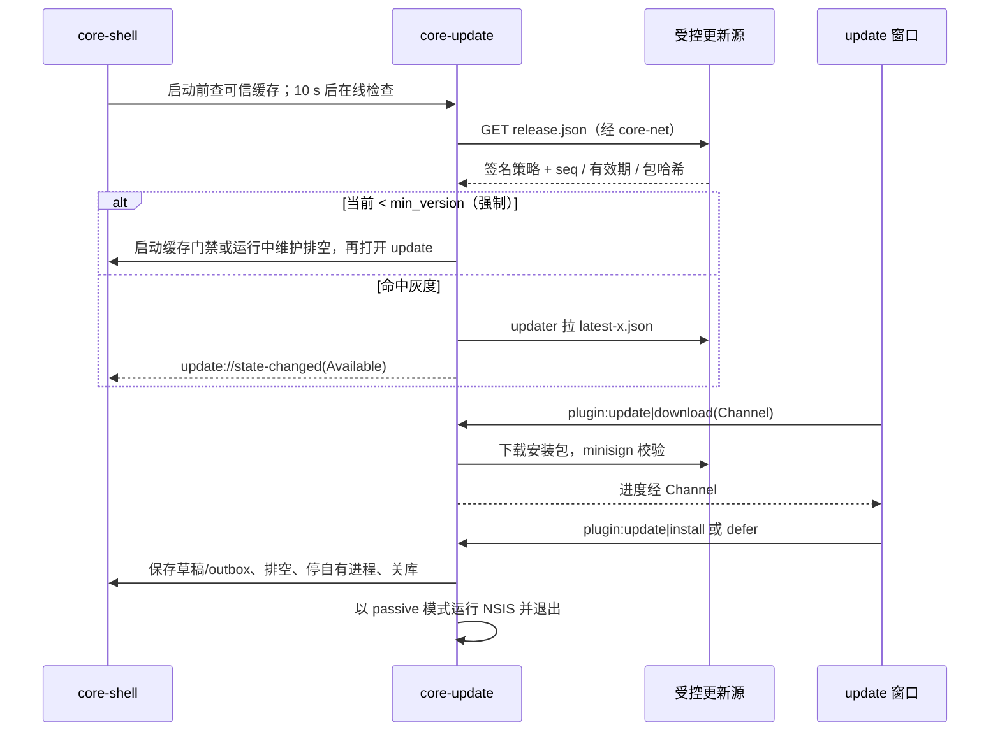

# 08 更新、诊断与偏好

2026-10-30

本文是 [开发总纲](00-architecture.md) 下的模块文档，覆盖 Rust 核心模块 core-update、core-telemetry，以及前端 `update` 窗口。上游依据见 [04 模块划分与联动](../04-modules-and-integration.md) 中“更新”“偏好与多语言”“统计与诊断”三行，以及 [02 现有客户端缺陷](../02-current-client-defects.md)。

本文中的接口签名都是示意，不是要落盘的代码。下文出处里的文件名均指官方 1.2.12 解包产物：`index.js` 即 `dist-electron/main/index.js`，`constant.js` 即 `constant-2w9sXoOv.js`，`log.js` 即 `main-DdiqF_NH.js`，窗口 bundle 在 `renderer-dist/js/` 下。

## 1. 结论与定位

- **整包更新换成 tauri-plugin-updater**，签名用 minisign 密钥，更新清单放在本项目有发布权限的 HTTPS 源上（能否使用携程 CDN 尚未确认），灰度与强制更新由 core-update 在调用插件之前自行判定。NSIS 每用户安装，更新时不需要管理员权限，可以做到“下载静默、安装需用户确认或退出时安装”。
- **本地前端资源热更新不保留**。官方的热更新是自研的 zip 覆盖（不是 `@ctrip/node-electron-hotfix`），下载时把 https 降级成 http，且没有任何签名校验，这是一条可被中间人利用的代码执行通道。新客户端的本地页面随签名产物发布；包含 Node sidecar、OCR 和离线依赖后的安装包大小必须实测，不能用“十几 MB”作为结论依据。远程 vbooking 业务页本来就是在线加载，天然“热更新”。
- **ArchGuide 删除**。它只在 macOS 上检测“x64 包跑在 Apple Silicon”并引导下载另一架构的包；新客户端 macOS 阶段直接发 universal 或按架构分发的更新清单，由 updater 按 `{{arch}}` 选包，用户无需手动换装。
- **core-telemetry 承担五件事**：日志（tracing + 文件滚动 + 脱敏 + 前端日志汇入）、崩溃（panic hook + minidump + WebView2 进程失败处理）、埋点（经授权的接收端 + 有界本地队列 + 隐私开关；UBT 复用待确认）、偏好（统一模型存 core-store KV）、多语言（Shark 词条拉取、缓存、广播）。另提供“一键导出诊断包”。
- core-telemetry 是启动顺序中的第一个模块（总纲 4.5），但只有日志与崩溃这两部分在 store 之前就绪；偏好、多语言、埋点队列依赖 store，在 store 就绪后再初始化。

## 2. 承接范围

### 2.1 官方现状：更新

| 能力 | 官方实现 | 出处 |
| --- | --- | --- |
| 版本清单 | 启动时读本地 `packageVersion.json`（字段 `aresGroup`、`aresName`、`pkgVersion`、`aresVersion`、`nodeEnv`），再拉远端 `${CDN}/packages/{aresGroup}/{aresName}/*/packageVersion.json?时间戳`，CDN 为 `static.tripcdn.com`（生产）或 `static.fws.qa.nt.ctripcorp.com`（测试） | `index.js` 关键字 `initUpdateInfo`、`wo={development:` |
| 整包更新 | electron-updater，`setFeedURL(feedUrl)`，feedUrl 来自远端清单；`autoDownload` 取参数、`autoInstallOnAppQuit=true`；请求头强制 no-cache | `index.js` 关键字 `checkPkgUpdate`、`Re.autoUpdater` |
| app-update.yml | generic 源，url 为空，运行时由 `setFeedURL` 覆盖 | 文档 01“自动更新”一行 |
| 强制更新 | 本地 `pkgVersion` 低于远端 `minPkgVersion` 时打开 `update` 窗口（`#force=true`，隐藏“取消”按钮）并关闭 launch 窗口 | `index.js` 关键字 `minPkgVersion`、`openUpdateWindow(!0)`；`updateWindow-*.js` 关键字 `s.query.force` |
| 状态推送 | 主进程向 update 窗口发 `update_status_change`，状态 `checking/available/notAvailable/downloading/downloaded`，下载中带 `progressInfo` | `index.js` 关键字 `wt={checking:` |
| IPC | `check_new_version`（`checkUpdateOnSetting`）、`download_new_version`（on）、`install_new_version`（`quitAndInstall`）、`update_new_version`（`doUpdateOnSetting`，打开更新窗口）、`get_update_info`、`get_cur_version_info` | `constant.js`；`index.js` 关键字 `ipcMain.handle(y.checkNewVersion` |
| 下载完成提示 | update 窗口不在时弹系统对话框“需重启应用程序后生效”，10 分钟内不重复（`UPDATE_TIME_STAMP`），确认后 `quitAndInstall(true,true)` | `index.js` 关键字 `showInstallNotice` |
| 菜单入口 | 帮助菜单“检测新版本”项 `click(){}` 是空函数 | `index.js` 关键字 `checkNewVersion]\|\|"检测新版本"` |
| 前端热更新 | 远端 `aresVersion` 高于本地时下载 `distUrl` 到 `userData/dist.zip`，**`https://` 被替换为 `http://`**，用 adm-zip 解到 `userData/dist`，原目录备份为 `dist.back`，失败回滚；下次启动 `isUserPath()` 比较版本后改用 `USER_DIST` 加载页面。全程无哈希与签名校验 | `index.js` 关键字 `checkRenderUpdate`、`downloadBundleZip`、`replaceNewVersion`、`USER_DIST` |
| `@ctrip/node-electron-hotfix` | 1.0.16 在 `package.json` 依赖里，`node_modules` 中存在（基于 p7zip 的补丁包机制，支持 canary client_id），但主进程代码没有 `require` 它，只在内嵌的 package.json 字符串里出现 | `node_modules/@ctrip/node-electron-hotfix/index.js`；`index.js` 仅一处字符串命中 |
| ArchGuide | 仅 macOS：检测 `v27`/`v22` 渠道与 CPU 架构是否匹配，不匹配时打开 archGuide 窗口，下载链接取自 `appDownload.properties` 的 `macDesktopIntel/...`；IPC `request_arch_guide`、`show_arch_guide`、`arch_guide_action`、`arch_guide_download_progress` 等 | `index.js` 关键字 `showManual(){`、`tryShow(`；`archGuideWindow-*.js` |

### 2.2 官方现状：日志、崩溃、埋点、偏好、多语言

| 能力 | 官方实现 | 出处 |
| --- | --- | --- |
| 日志 | electron-log 5，文件 `main.log`/`renderer.log`，单文件 `maxSize` 1 MB 后归档，同步写；渲染进程经 `__ELECTRON_LOG__` IPC 汇入；无脱敏 | `log.js` 关键字 `maxSize:1024**2`、`__ELECTRON_LOG__` |
| 崩溃 | `@ctrip/electron-crashreport` 2.0.1 封装 Electron `crashReporter`，`submitURL` 为 `https://sentrycollector.ctrip.com/collector/{appId}`，附 `sentry.environment`、`sentry.user.username`、`sentry.tags.clientId` | `node_modules/@ctrip/electron-crashreport/index.js`；`index.js` 关键字 `Bl.config(` |
| GPU 崩溃 | `child-process-gone` 中 GPU 崩溃按 5 分钟窗口计数，达到 2 次（已关加速则 6 次）就把 `disableGPUAcceleration` 写入偏好并重启 | `index.js` 关键字 `child-process-gone` |
| 渲染进程崩溃 | 未监听 `render-process-gone`，窗口崩溃后白屏 | `index.js` 无该关键字 |
| ClientId | `@ctrip/node-electron-clientid` 生成 GUID，失败时用 `"900004"+时间戳+随机数`；写入所有账号分区的 `GUID` Cookie | `index.js` 关键字 `initUbt(` |
| UBT 埋点 | 渲染进程用 `@ctrip/ubt-web` 1.4.5（SDK 从 `static.tripcdn.com/packages/ubt/websdk/` 动态加载，全局 `UBT_API`/`$_bf`），每个窗口有 `pageId`（如 update 窗口 `10650149748`）；业务埋点名如 `vbk_electron_first_launch`、`vbk_electron_stay_duration`、`mer_lang_expo`。依赖还有 `@ctrip/trip-component-ubt`、`trip-ubt` | `ubt-*.js`、`BaseController-*.js`、`loginWindow-*.js` 关键字 `devTraceLog` |
| 启动次数 | electron-store `app_launch_count`，每次创建窗口 +1；`get_launch_count` 返回该值，login 窗口用于 `vbk_electron_first_launch` | `index.js` 关键字 `z.set(Cr,i+1)`、`logLaunch` |
| 停留时长 | 监听 `browser-window-focus/blur` 累计聚焦毫秒，按日写 `APP_STAY_KEY`；`get_stay_duration` 返回“昨天”的值并删除（只能取一次），由 IM 窗口上报 | `index.js` 关键字 `browser-window-blur`、`y.getStayDuration`；`imWindow-*.js` |
| 偏好 | electron-store 键 `USER_PREFERENCE`，默认值对象 `mr` 共约 45 个字段（快捷键、通知、回复超时、代理、GPU、缩放、语言、聊天缓存天数等）；`change_user_preferences` 合并写入后逐个窗口 `webContents.send` 推送，并对 `gateway` 做白名单校验 | `index.js` 关键字 `const mr={`、`changeUserPreferences(e){` |
| 多语言 | 启动读 `current-locale`，没有则按系统语言选 zh-CN/en-US；`changeLocale` 先把 `vbk-locale-lang` Cookie 写进所有分区，再 POST `https://vbooking.ctrip.com/ivbk/accountV2/shark/getLangDump`（FAT/UAT 各有地址），成功写 `sharkInfo` 表，失败从表里读；最后**重载** login、main、IM 窗口 | `index.js` 关键字 `mp={FAT:`、`changeLocale(e){`、`readShark(` |
| sharkInfo 表 | 列 `id`、`key`、`value`、`locale`；`(key, locale)` 唯一，`locale` 有索引 | `index.js` 关键字 `Et("sharkInfo"` |
| IPC | `get_shark_info` 返回 `{locale, lang}`；`change_shark_locale`；`get_user_preferences`；`change_user_preferences` | `constant.js`、`index.js` |

### 2.3 新客户端承接表

| 官方 | 新客户端 | 处理 |
| --- | --- | --- |
| checkNewVersion / getUpdateInfo / getCurVersionInfo | `plugin:update\|check`、`plugin:update\|state_snapshot` | 重写 |
| downloadNewVersion / installNewVersion / updateNewVersion | `plugin:update\|download`、`plugin:update\|install`、`plugin:update\|open_window` | 重写 |
| update_status_change | 事件 `update://state-changed`、下载进度走 Channel | 重写 |
| 前端热更新、node-electron-hotfix | 无 | 删除 |
| requestArchGuide 及 archGuide 窗口 | 无 | 删除 |
| electron-log | tracing，`plugin:telemetry\|log_batch` | 替换 |
| electron-crashreport | panic hook + minidump + Sentry 兼容上报 | 替换 |
| UBT、getLaunchCount、getStayDuration | `plugin:telemetry\|track`、Rust 侧自动统计 | 重写，接口复用 |
| getUserPreferences / changeUserPreferences | `plugin:prefs\|snapshot`、`plugin:prefs\|set` | 重写 |
| getSharkInfo / changeSharkLocale | `plugin:i18n\|snapshot`、`plugin:i18n\|set_locale` | 重写，接口复用 |
| openDataDir / openInstallDir（排障用） | `plugin:telemetry\|export_diagnostics` | 增强 |

## 3. Tauri / Rust 分工

| 放 Rust 核心 | 放 WebView 前端 |
| --- | --- |
| 拉取版本清单、灰度判定、强制更新判定 | update 窗口的文案、进度条、按钮 |
| 调用 updater 下载、校验签名、启动安装器 | 设置页“检查更新”按钮与当前版本展示 |
| 日志写盘、滚动、脱敏、清理 | 调用 ipc 包的日志函数，批量发送 console 与未捕获异常 |
| panic hook、minidump、WebView2 ProcessFailed 监听与重载 | 崩溃后自动重载时的恢复提示 |
| 埋点队列、批量上报、隐私开关、启动次数与停留时长统计 | 埋点触发点（点击、曝光），只传事件名与参数 |
| 偏好读写、校验、默认值、持久化、变更广播 | 设置页表单；收到 `prefs://changed` 后更新视图 |
| Shark 词条拉取、缓存、回退、Cookie 同步 | i18n 包：词条查找、格式化、切换语言后重新渲染 |
| 诊断包收集与打包 | 设置页“导出诊断信息”入口 |

## 4. Rust 核心设计

### 4.1 crate 与插件划分

core-update 一个 crate、一个插件 `update`。core-telemetry 一个 crate，对外注册三个内部插件，以符合总纲 4.2“模块名即插件名”的规则，同时让偏好与多语言的权限可以单独授予：

| 插件 | 职责 | 事件前缀 |
| --- | --- | --- |
| `telemetry` | 日志、崩溃、埋点、诊断包 | `telemetry://` |
| `prefs` | 偏好 | `prefs://` |
| `i18n` | Shark 多语言 | `i18n://` |

### 4.2 core-update

**更新源与清单。** 沿用官方“两段式”思路，但两段都改为签名可信：

| 文件 | 位置（建议） | 内容 | 谁读 |
| --- | --- | --- | --- |
| `release.json` | `本项目受控更新源/{product}/{channel}/release.json` | 签名策略：`product/channel/platform`、单调 `policy_seq`、有效期、`latest/min_version`、灰度比例、包与清单 SHA-256、固定源内路径、多语言说明 | core-update 自己解析 |
| `latest-<版本>.json` | 同目录 | tauri-plugin-updater 标准格式：`version`、`pub_date`、`platforms["windows-x86_64"].{url, signature}` | tauri-plugin-updater |
| 安装包 | 同目录 | `vbk_<版本>_x64-setup.exe`（NSIS） | updater 下载 |

**安装包签名不能授权更新策略。** Tauri updater 的 `.sig` 验证安装产物，不自动覆盖本项目 `release.json`。[Tauri updater](https://v2.tauri.app/plugin/updater/)

本项目另为策略签署独立信封（固定字节编码与独立公钥），验签后再解析与执行；策略绑定产品、渠道、平台、版本、安装包和 manifest 哈希、单调序号及有效期。固定更新 origin 与重定向策略，不接受任意 `manifest_url`。下载完成、安装前复核同一已验签策略绑定的产物哈希，防止检查与使用之间远端内容改变；不能只校验先前读取过的 manifest。持久化最高已接受 `policy_seq` 和安全最低版本，拒绝跨产品/渠道、过期或重放策略；网络或时钟可信性不足时不得执行新回滚授权。

默认拒绝降级。紧急回滚须另有签名授权，绑定当前允许回退的版本区间、目标版本/哈希、渠道、序号、有效期和数据库兼容条件；历史安装包曾有有效签名不能单独授权本次回滚。优先发布更高版本的修复包。密钥泄漏时的恢复路线需提前演练，不能只依赖同一泄漏钥签新钥。

**灰度。** 客户端按 `hash(client_id) % 100 < rollout_percent` 判定是否命中；`client_id` 由 telemetry 提供。发行渠道只允许受控 stable / beta；测试环境用独立构建与数据命名空间，不能凭设置页隐藏入口把生产凭据带入 FAT。远程策略不能拓宽内置发布源或权限。

**强制更新的时序。** 启动前仅依据本地已验签、仍适用的策略缓存判断门禁；缓存明确当前版被禁止时不进入业务窗口，仍可打开更新/诊断与受控下载入口。无缓存、缓存过期或首次离线时先显示本地壳，并将策略状态标为未知，10 秒后在线检查；不能同时承诺“网络不阻塞启动”和“首次未知远端策略时绝不显示 main/login”。

运行中收到可信强更策略时，先进入维护预告/排空状态：保存草稿、停止接受新发送、等待已发送操作完成核对，将无法确定是否送达的任务持久化为 unknown；不突断会话或自动重发。应用停止业务后再安装。下载失败保留当前可用状态/诊断入口，明确重试；政策禁止业务的版本不绕过门禁恢复接单。

**签名密钥管理。**

| 事项 | 做法 |
| --- | --- |
| 生成 | `tauri signer generate` 生成 minisign 密钥对，私钥带口令 |
| 存放 | 私钥与口令只放 CI 的密钥库（环境变量 `TAURI_SIGNING_PRIVATE_KEY`、`TAURI_SIGNING_PRIVATE_KEY_PASSWORD`），另有一份离线备份由两人分持 |
| 公钥 | 写进 `tauri.conf.json` 的 `plugins.updater.pubkey`，编译进二进制 |
| 轮换 | 公钥在二进制里，换钥必须先发一个“用旧钥签名、内置新公钥”的过渡版本，覆盖率足够后再用新钥 |
| 与 Authenticode 的关系 | 两者独立：Authenticode 用于发布者身份和 Windows 信任链，不能保证 SmartScreen 或杀软不告警；minisign 解决安装产物签名校验。可选再加一层：安装前用 `WinVerifyTrust` 校验安装包的 Authenticode 签名与发布者（windows crate，需验证成本） |

**差量更新。** tauri-plugin-updater 只支持整包。新安装包体积待签名产物实测，统计必须含 sidecar/语言模型/附带运行时，并与同口径官方安装包比较；asar 体积不能直接当作安装包基线。结论：一期不做差量；若后续统计显示更新流量是问题，再评估 bsdiff 类方案，且差量补丁必须同样走 minisign 签名。

**NSIS 每用户安装下的静默更新。**

| 事项 | 结论 |
| --- | --- |
| 权限 | NSIS `installMode: "currentUser"`，装到 `%LOCALAPPDATA%` 下，更新不触发 UAC |
| 安装界面 | `plugins.updater.windows.installMode` 取 `"passive"`（只显示进度条，无需点击）；用户勾选“自动更新”时可用 `"quiet"` |
| 下载时机 | 发现新版本后后台下载，下载完成后提示“重启更新”；用户选择“退出时安装”则在下次明确退出时安装（关闭到托盘不是退出，“稍后提醒”也不等于同意安装），对应官方 `autoInstallOnAppQuit`。tauri-plugin-updater 没有内置“退出时安装”，由 core-update 在 `RunEvent::ExitRequested` 中调用已下载包的安装（需验证退出流程中启动安装器的可靠性） |
| 安装前清理 | 先执行维护排空屏障并保存草稿/outbox/同步游标，再停本应用拥有的 IM sidecar、刷日志、关数据库，避免丢操作与文件占用；不可按进程名杀其他应用的 Node/WebView2 |
| 安装后启动 | 安装器以更新模式运行后会重新拉起应用（需验证 Tauri 2 NSIS 模板的行为与参数） |
| 代理 | updater 的 HTTP 客户端使用 core-net 给出的代理配置（`UpdaterBuilder` 的 proxy 选项，需验证） |

**持久状态与恢复。** 下载写临时文件、完成并验签后原子登记 product/channel/version/hash/policy_seq；重启后复核文件与策略才可安装。安装失败保留可运行版本与清晰重试入口。数据库迁移与回滚兼容矩阵由 05 提供；不得启动不能读取当前 schema 的旧版本。跨版本升级、断电、空间不足与被杀软阻断均为发布验收，不由插件签名校验替代。

**状态与命令。**

```rust
pub enum UpdatePhase { Idle, Checking, UpToDate, Available, Downloading, Downloaded, Installing, Failed }
pub struct UpdateState {
    pub seq: u64, pub phase: UpdatePhase, pub current: String,
    pub target: Option<String>, pub force: bool, pub notes: Option<String>,
    pub downloaded: u64, pub total: Option<u64>, pub error: Option<AppError>,
}
```

| 命令 / 事件 | 说明 | 调用方 |
| --- | --- | --- |
| `plugin:update\|state_snapshot` | 返回 `{seq, UpdateState}` | main、setting、update |
| `plugin:update\|check` | 立即检查，参数 `manual: bool`（手动检查忽略灰度节流） | setting、菜单 |
| `plugin:update\|download` | 开始下载，参数带 `Channel<Progress>` 推送进度 | update |
| `plugin:update\|install` | 安装并重启 | update |
| `plugin:update\|defer` | 明确选择 `remind_later` 或 `install_on_exit`，不混用语义 | update |
| `plugin:update\|open_window` | 打开或聚焦 update 窗口 | main、setting |
| 事件 `update://state-changed` | 阶段变化，载荷 `{seq, phase, target, force}` | main（显示小红点）、setting、update |

检查节奏：启动后 10 秒检查一次，之后每 4 小时一次；进程内同时只有一个检查任务（官方用 `_checking` 静态标志，这里用 actor 自然串行）。

### 4.3 日志

| 项 | 设计 |
| --- | --- |
| 框架 | `tracing` + `tracing-subscriber`；写盘用 `tracing-appender` 的 `non_blocking`，不阻塞调用线程 |
| 文件 | `%LOCALAPPDATA%\<应用>\logs\vbk.YYYY-MM-DD.log`，按天滚动；单日超过 20 MB 再切分（tracing-appender 不支持按大小滚动，需自写或用 `rolling-file` 类 crate，需验证），保留 7 天、总量上限 200 MB |
| 格式 | 单行 JSON：时间、级别、模块、窗口标签、`trace_id`、消息、字段 |
| 级别 | 正式版默认 INFO；偏好 `diag.log_level` 可临时调到 DEBUG，24 小时后自动恢复 |
| 脱敏 | 字段白名单优先：只记事件码、模块、匿名任务号、耗时和结果类别；正文、请求/响应体、Cookie、凭据、客户资料、完整 URL/路径不进入日志。`Secret<T>` 的 Debug 遮蔽与输出正则只是兜底，不能证明已脱敏；手机号/邮箱等不靠局部遮蔽实现匿名化 |
| 前端日志 | 仅本地打包页面由 ipc 包收集经 schema 裁剪的错误码/栈位置；禁止原样收集任意 `console` 参数、异常消息和远程页面正文，每 2 秒或满 50 条调用一次 `plugin:telemetry\|log_batch`；Rust 侧按窗口限流（每秒 100 条），超出计数后丢弃并记一条汇总 |
| sidecar 日志 | IM sidecar 的 stdout 用作协议通道，stderr 只有结构化白名单诊断进入 `target=im.sidecar`；原始 stdout/stderr 不直接落盘，凭据和协议正文不得泄漏 |
| WebView2 日志 | 不开启 WebView2 自身的详细日志；排障时可通过偏好开关临时加启动参数（需验证 Tauri 2 的 `additional_browser_args` 对已创建环境的影响） |

### 4.4 崩溃

| 场景 | 处理 |
| --- | --- |
| Rust panic | `std::panic::set_hook`：记录 panic 信息与回溯到日志并 flush，写一个 `crash-<时间>.json` 标记；release 编译 `panic = "abort"` 与否需与各模块确认，建议主线程 panic 即退出，后台任务 panic 由 actor 监督重启 |
| 原生崩溃（访问违例等） | 用 Embark 的 `crash-handler` + `minidumper` crate：`vbk.exe --crash-monitor` 在程序入口、普通单实例插件之前分流，以父进程握手/随机一次性句柄约束内部模式，不创建普通窗口、不执行自动更新；作为独立监视进程启动，主进程崩溃时由监视进程写 minidump（这两个 crate 存在，Windows 支持与 Tauri 进程模型的配合需验证）。备选：Windows 自带 WER LocalDumps（注册表配置，需管理员，每用户安装下不适用） |
| 上报 | 下次启动时检查 `crashes\` 目录，默认不上报。minidump 可能包含消息、token 和内存中的密钥，不能依靠正则保证脱敏；单独展示该风险并取得具体上传同意后，才向本项目经授权接收端发送所选 dump 和已裁剪日志。携程 `sentrycollector` 与 appId 的复用未获确认，不作为默认目标。账号关联标识默认不附加；有统计需要时采用可轮换、带域隔离的匿名标识，简单账号哈希不等于匿名 |
| WebView2 进程失败 | 见下表 |

WebView2 的 `ProcessFailed` 事件 Tauri 2 没有直接暴露，需要通过 `Webview::with_webview` 拿到 `ICoreWebView2`，用 webview2-com 注册 `add_ProcessFailed`（需验证），封装在 `platform-win`。

| ProcessFailedKind | 含义 | 处理 |
| --- | --- | --- |
| `RENDER_PROCESS_EXITED` | 该窗口渲染进程退出，页面白屏 | 本地窗口：递增 view_generation 后调用 `Reload`，页面启动时按总纲 4.3 先订阅缓冲再取快照；持久状态可恢复，未持久化输入不能承诺不丢；远程业务页：重新导航到崩溃前 URL。5 分钟内同一窗口超过 3 次则停止自动重载，显示本地错误页与“重新加载”“导出诊断包”按钮 |
| `RENDER_PROCESS_UNRESPONSIVE` | 渲染进程卡死 | 等待 10 秒仍未恢复则提示用户“页面无响应”，可选重载 |
| `FRAME_RENDER_PROCESS_EXITED` | iframe 进程退出 | 只记日志，由页面自己处理 |
| `GPU_PROCESS_EXITED` | GPU 进程退出，WebView2 自动重启 | 记日志与计数；10 分钟内超过 3 次时提示用户可在设置中关闭硬件加速（不像官方那样自动改偏好并重启，见总纲第九节） |
| `BROWSER_PROCESS_EXITED` | 整个浏览器进程组退出，所有 WebView 失效 | 按 Environment 与故障代次去重处理一次；递增环境/视图代次并失效全部控制器（含隐藏预热、下载和订单面板），重建可见窗口，隐藏窗口下次使用时重建并握手；恢复前核对账号绑定。重建失败则提示重启应用 |
| 其他 utility 进程 | 网络、音频等工具进程 | 只记日志 |

每次去重后的 ProcessFailed 在 analytics 允许且接收端已配置时才上报一条埋点（窗口标签、类型、退出码），用于发版后观察稳定性。

### 4.5 埋点

| 项 | 设计 |
| --- | --- |
| 接口 | UBT 仅为候选，未确认协议与使用权限前远程上报关闭。官方渲染进程通过 `@ctrip/ubt-web` 从 CDN 动态加载 SDK 再上报，新客户端本地窗口开启 CSP 后不应再加载远程脚本，因此由 Rust 直接调用 UBT 的采集接口（具体协议、端点与 appId 需向携程确认，见第 11 节）。远程业务页自带的 UBT 不受影响 |
| 事件模型 | `{name, page_id, ts, props, account_hash, session_id}`；`client_id`、版本、OS、WebView2 版本等公共字段由 Rust 自动附加 |
| 队列 | 内存队列 + 落盘（store 中的 `telemetry_queue` 表，需 05 配合），每 30 秒或满 50 条批量发送；事件有稳定 event_id，失败指数退避，队列上限 5000 条并设保存期限，超出丢最旧的并累计丢弃数；服务端未确认按 event_id 去重前，只承诺有界尽力投递，不承诺不重复；退出时尽量 flush 1 秒 |
| 自动统计 | 启动次数（替代 `app_launch_count`）、每日前台时长（Rust 监听窗口焦点事件累计，次日首次启动直接上报，替代 `get_stay_duration` 的“取一次即删”）、冷启动耗时、更新结果、崩溃与 ProcessFailed |
| 隐私开关 | 偏好 `privacy.analytics_enabled`、`privacy.crash_upload_enabled`。默认均关闭；开启必须有明确用途/接收端/保留策略。关闭时递增采集代次、清空队列、取消未发送批次并在发送前再查开关；已经发出的请求不能承诺撤回。dump 本地有界保存、可删除，不能混入常规日志包 |
| 禁止内容 | 消息正文、客户昵称、手机号、Cookie、完整 URL 查询串一律不进入埋点；`props` 在 Rust 侧过一遍与日志相同的脱敏规则 |
| ClientId | 首次启动生成 UUID 存 store；能否读取旧客户端的 GUID 以保持连续性需确认（第 11 节） |

### 4.6 偏好

**统一模型。** 官方 `USER_PREFERENCE` 是一个平铺对象，字段散落在各模块。新客户端按命名空间组织，定义集中在 contracts，带类型、默认值与校验：

| 命名空间 | 字段示例（对应官方字段） | 生效模块 |
| --- | --- | --- |
| `general` | `locale`、`scale`、`auto_launch`（isAutoLaunch/isRunOnStart）、`close_to_tray` | shell、i18n |
| `shortcut` | `capture`（screenShotKey）、`toggle_main`（openVbkKey） | shell |
| `notify` | `message.{enabled, detail, sound, popup}`、`system.{...}`、`placement`（notifyPlatment）、`reply_timeout.{enabled, seconds, sound}`、`voice` | notify |
| `im` | `send_key`、`show_time`、`auto_link`、`confirm_delete`、`cache_days`、`spell_check`、`translate_target`、`show_ai_reply` | im、media、assistant |
| `network` | `use_system_proxy`、`gateway`（白名单校验）、`env`（manualEnv） | net |
| `update` | `auto_update`、`channel` | update |
| `privacy` | `analytics_enabled`、`crash_upload_enabled` | telemetry |
| `diag` | `log_level`、`disable_gpu`（disableGPUAcceleration） | telemetry、shell |

官方的 `imProvidersArch`、`imVersion`、`openDevToolsOnStart`、`networkOptimization`、`eventDot`、`starList`、`lastFileSavePath` 逐个确认后归入对应命名空间或移出偏好（如 `lastFileSavePath` 属于 media 的运行状态）。

**存储。** 存于 core-store 的 KV 表（键 `prefs.<命名空间>`，值 JSON，带 `schema_version`）。读取时与默认值合并，未知字段保留，便于降级。外观、快捷键为设备级；翻译提供方、目标语言、TSim 绑定、账号通知策略、隐私同意从一期起按 `(environment, account_id)` 隔离。模型显式标注 scope，迁移全局旧值时只提供默认候选，不能覆盖其他账号。远程策略和账号权限是硬上限，用户偏好不得重新开启被禁用功能。

| 命令 / 事件 | 说明 |
| --- | --- |
| `plugin:prefs\|snapshot` | 返回 `{seq, prefs}`，可按命名空间过滤 |
| `plugin:prefs\|set` | 参数 `{path, value}` 或补丁对象；Rust 校验类型与取值，失败返回 `prefs.invalid` |
| `plugin:prefs\|reset` | 恢复某命名空间默认值 |
| 事件 `prefs://changed` | 载荷 `{seq, changed: [path], prefs: 变更后的命名空间}`，按 scope 定向发给具有对应权限与账号绑定的本地窗口 |

核心模块之间不经事件名订阅，而是通过 `watch` 通道拿到偏好的只读快照（总纲 4.5），例如 core-shell 收到 `shortcut` 变化后重新注册全局快捷键，注册失败把原因写回状态并在设置页提示（官方只打日志，关键字 `register shortcut failed`）。

### 4.7 多语言

| 项 | 设计 |
| --- | --- |
| 词条来源 | 沿用 `getLangDump` 接口（POST `{locale}`，FAT/UAT/PROD 三个地址），经 core-net 发出 |
| 缓存 | 写入 core-store 的 `shark_info` 表（承接官方 `sharkInfo`，`(key, locale)` 唯一），另记每个语言的拉取时间与哈希 |
| 启动 | 先用缓存，立即可用；后台拉新，有变化再广播。无缓存时用前端包内置的兜底词条，不阻塞冷启动（官方是先等网络请求，1.5 秒超时） |
| 初始语言 | 偏好 `general.locale`，为空时按系统语言：中文取 zh-CN，其余 en-US（与官方一致） |
| 切换 | `plugin:i18n\|set_locale`：写偏好 → 通知 core-account 把 `vbk-locale-lang` Cookie 写入所有账号的 WebView 存储 → 拉词条 → 广播 `i18n://locale-changed`。本地窗口原地重渲染，不重载；远程业务页依赖 Cookie，由 [04 业务页承载](04-business-pages.md) 决定是否重载 |
| 命令 | `plugin:i18n\|snapshot` 返回 `{seq, locale, entries}`；`plugin:i18n\|set_locale`；`plugin:i18n\|refresh` |
| 前端包 | `ui/packages/i18n`：构建时从 Shark 导出 zh-CN、en-US 兜底包（官方开发依赖里有 `@ctrip/shark-l10n`、`shark-dev-js2xlsx`）；运行时以 Rust 下发的词条覆盖兜底；提供 `t(key, params)`，参数占位沿用官方的替换写法（如 `newVersionTips` 中的 `XXXX`），新词条建议改为命名占位 |

### 4.8 诊断包导出

`plugin:telemetry|export_diagnostics` 在阻塞线程池里生成 zip，用 tauri-plugin-dialog 让用户选保存位置：

| 内容 | 说明 |
| --- | --- |
| 日志 | 最近 3 天日志（已脱敏），sidecar 日志 |
| 崩溃 | 默认只含无敏感字段的崩溃标记；minidump 独立显式选取，不纳入默认诊断包 |
| 环境 | 应用版本与渠道、Windows 版本与构建号、WebView2 Runtime 版本、CPU/内存/显卡、显示器数量与缩放、代理模式、磁盘剩余空间、安装路径是否每用户 |
| 运行状态 | 各模块快照摘要（账号数量而非账号名、IM 连接状态、更新状态、数据库 schema 版本）、最近 50 条 ProcessFailed 与 GPU 事件 |
| 偏好 | 仅导出字段白名单与功能开关；去掉账号绑定、代理用户名/URL、个人路径、业务标识，不因“不是凭据”就整对象导出 |

打包前列出清单与预计体积，默认包按 20 MB 上限裁剪日志并记录裁剪信息，不读取账号数据库、WebView Profile 或会话文件。生成后再扫描文本脱敏规则作为兜底；此扫描不覆盖二进制 dump，也不是“绝无敏感数据”的证明。一期只导出到本地，由用户自行发给客服；是否提供一键上传待确认。

## 5. 前端设计

| 窗口 / 页面 | 内容 | 要求 |
| --- | --- | --- |
| `update`（单例，约 510×300，无边框，对齐官方尺寸） | 版本号、更新说明（Markdown 渲染为纯文本列表）、进度条、速度、按钮“稍后/立即更新”；强制模式隐藏“稍后” | 不引组件库，包体 ≤ 100 KB；按总纲先订阅缓冲再取原子 `state_snapshot`，重放新事件并处理 epoch/seq 缺口；进度只从 Channel 来，前端不计算状态 |
| main 外壳 | 有可用更新时在头像菜单显示小红点与“重启更新” | 订阅 `update://state-changed` |
| setting | 关于与更新、通知、快捷键、网络、隐私、诊断（导出诊断包、日志级别、关闭硬件加速）各分区 | 表单值来自 `prefs` 快照；修改即调用 `set`，以 `prefs://changed` 回写，不做本地乐观状态之外的缓存 |
| 本地错误页 | 渲染进程反复崩溃后显示 | 静态页，内置在应用资源中 |

所有本地窗口都通过 ipc 包自动接入：日志汇入、`prefs://changed`、`i18n://locale-changed` 三个订阅在 ipc 包初始化时完成，页面不需要各自处理。

## 6. 与其他模块的联动

| 对方模块 | 联动 |
| --- | --- |
| core-shell | 启动编排：启动前可信缓存明确禁止当前版本时不创建业务 main/login；未知策略和运行中强更按 4.2 区分；创建与聚焦 `update` 窗口；提供窗口焦点事件给停留时长统计；收到 ProcessFailed 后执行重载或重建；读取 `shortcut`、`general` 偏好 |
| core-store | 提供 KV 表（偏好、client_id）、`shark_info` 表、`telemetry_queue` 表；启动早于偏好与多语言 |
| core-net | Shark、UBT、崩溃上报、更新清单的 HTTP 请求与代理；updater 使用同一代理配置 |
| core-account | 切换语言时写 `vbk-locale-lang` Cookie；提供已脱离业务身份的统计 scope（默认不上传账号关联标识） |
| core-im | 安装更新前停止 sidecar；转发 sidecar 日志；读取 `im` 偏好 |
| core-notify | 读取 `notify` 偏好；更新下载完成时可用系统通知提醒 |
| bridge（04） | 远程业务页如需读取语言或版本号，只通过 bridge 暴露只读命令；官方 `preload/web.js` 中只看到 IPC 常量表，未确认远程页实际调用更新与偏好接口（推断不需要） |

## 7. 关键流程



| 流程 | 步骤 |
| --- | --- |
| 渲染进程崩溃 | ProcessFailed → 记日志与埋点 → 判断次数 → 本地窗口 Reload → 页面拉快照恢复；超限显示错误页 |
| 原生崩溃 | 监视进程写有界本地 dump → 下次启动显示待诊断 → 用户单独选择是否上传该 dump → 成功后按保留策略删除 |
| 切换语言 | setting 调 `i18n\|set_locale` → Cookie 同步 → 拉词条（失败用缓存）→ 广播 → 各窗口重渲染 |
| 导出诊断包 | setting 调 `export_diagnostics` → 选路径 → 后台打包 → 返回路径 → 前端提示“在文件夹中显示” |

## 8. 注意事项（Windows 优先）

- 官方热更新把下载地址降级为 http 且无校验，新客户端任何下载（更新、词条、诊断上传）都必须 https，并拒绝降级。
- 每用户安装时安装目录在 `%LOCALAPPDATA%`，WebView2 用户数据目录、日志、数据库也在用户目录，卸载时要提示是否保留数据。
- 更新覆盖前必须确保 sidecar 的 `node.exe` 与所有 WebView2 子进程已退出，否则 NSIS 会因文件占用失败；安装器只能按本应用持有的进程句柄/安装路径和代次验证后清理残留，不能全局结束 `node.exe/msedgewebview2.exe`。
- 静默安装器可能被杀软拦截，安装包与 vbk.exe 需要受信 Authenticode 签名；证书类型与成本另行确定，不能承诺 EV 免告警，发版前在主流国产杀软上回归。
- 企业网络可能做 TLS 中间人，updater 与上报请求要使用系统证书库（reqwest 的 native-tls 或 rustls-platform-verifier，需与 core-net 统一）。
- tracing 的 `non_blocking` 在进程被强杀时会丢最后几条日志；崩溃路径上 panic hook 只做有界尽力记录/flush，不假定 abort 或死锁时一定写盘成功。
- 时间统计以 UTC 存储、按本地日期聚合，避免官方按 `getDate()` 跨天判断带来的时区与休眠误差。
- 偏好迁移：官方偏好在旧客户端 electron-store 的 `USER_PREFERENCE` 键，首次启动可尝试读取旧 `config.json` 迁移（路径与是否加密需验证，与 05 共同处理）。

## 9. 原型验证项与验收标准

| 验证项 | 验收标准 |
| --- | --- |
| updater 端到端 | 1.0.0 → 1.0.1 在每用户安装下无 UAC 完成更新并自动重启；篡改安装包 1 字节后校验失败并提示 |
| 退出时安装 | 选择“稍后”后正常退出，安装器被拉起并完成；断电模拟下次启动仍能识别待安装状态 |
| 灰度与强制 | `rollout_percent=10` 时 1000 个模拟 client_id 命中率 8%–12%；分别覆盖有效缓存禁止版、首次离线、策略过期、运行中强更；维护排空不丢草稿且未知发送不自动重发。篡改策略、旧有效签名包伪造降级、跨渠道/过期/重放均拒绝 |
| minidump | 内部监视模式不被单实例退出，访问违例生成可读 dump；默认无上传，选择该 dump 并同意后才发送至授权测试收集器 |
| ProcessFailed | 用任务管理器结束某窗口的渲染进程，2 秒内自动恢复且 IM 会话列表不丢；结束浏览器主进程后所有可见窗口重建 |
| 日志脱敏 | 构造包含 Cookie、ticket、手机号、邮箱的日志，输出文件中全部被遮蔽 |
| 埋点队列 | 断网 1 小时后恢复，有界队列按策略补报，丢弃数可见；ACK 丢失场景验证服务端去重（未支持则注明可能重复）；关闭后无新发送，旧请求不能回填队列 |
| 语言切换 | 切换后本地窗口 300 ms 内完成重渲染且不重载，远程页显示对应语言 |
| 诊断包 | 一键生成 zip ≤ 20 MB，耗时 ≤ 5 s，默认内容遵守第 4.8 节白名单，自动排除 dump/Profile/凭据，文本扫描零已知敏感样本命中；显式选 dump 另包且单独提示风险 |
| 性能 | telemetry 初始化 ≤ 30 ms，不进入冷启动关键路径；日志写入对调用线程的开销 P99 ≤ 50 µs |

## 10. 开发步骤与工作量估计

| 步骤 | 内容 | 人日 |
| --- | --- | --- |
| 1 | 日志：tracing、滚动、脱敏、前端汇入、ipc 包接入 | 3 |
| 2 | 偏好：模型定义、KV 存取、校验、`prefs://changed`、旧偏好迁移 | 3 |
| 3 | 多语言：Shark 拉取与缓存、Cookie 同步、i18n 前端包、兜底包导出脚本 | 3 |
| 4 | 崩溃：panic hook、crash-handler/minidumper 原型、上传 | 4 |
| 5 | WebView2 ProcessFailed 封装、重载与重建策略、错误页 | 3 |
| 6 | 埋点：队列、批量上报、自动统计、隐私开关（不含 UBT 协议对接等待时间） | 3 |
| 7 | 更新：密钥与 CI、清单格式、灰度与强制、updater 接入、退出时安装 | 5 |
| 8 | update 窗口与设置页相关分区 | 2 |
| 9 | 诊断包导出 | 1.5 |
| 10 | 联调与第 9 节验证 | 3 |
| 合计 | | 约 30.5 |

里程碑：步骤 1–2 属于总纲 M0/M1 前置（日志与偏好其他模块都要用）；其余在 M7 完成。

## 11. 待确认问题

1. 更新通道：是否能使用携程 CDN（Ares）发布新客户端的清单与安装包，`group` 与路径由谁分配；新旧客户端如何过渡（官方 1.2.x 通过 electron-updater 能否直接装上 Tauri 版 NSIS 包）。
2. UBT 采集接口的协议、端点、appId 与 pageId 规划；能否在非浏览器环境（Rust）直接上报。
3. `sentrycollector.ctrip.com` 是否接受非 Electron 客户端上传 minidump，或改用标准 Sentry DSN。
4. ClientId 是否需要与旧客户端保持连续（影响 UBT 新老用户口径），旧 GUID 存放位置需确认。
5. 埋点与崩溃上报是否默认开启，隐私政策是否需要更新。
6. 是否保留“热更新”的业务诉求（例如紧急修复本地 IM 界面）。若必须保留，可选方案为“签名资源包 + 自定义协议加载 + 版本绑定整包”，但会增加约 8 人日与安全审计，本文结论是不做。
7. macOS 阶段是发 universal 包还是按架构分包（影响清单 `platforms` 键），以及是否需要给仍在用 x64 Electron 版的 Apple Silicon 用户一次性迁移提示。
8. 诊断包是否需要一键上传，上传到哪里、保存多久。

## 12. 发布前不可省略的关口

- 更新源、签名策略协议、密钥保管与灾难恢复由本项目控制；没有携程发布/遥测权限时使用自有受控设施，不拿已观察到的 appId 当授权。
- 普通每用户 NSIS 与 Windows OCR 的 package identity 要求必须同 07 一起决策；若保留 NSIS 则选择受支持的 OCR 路线，不能以开发机可运行代替干净安装验收。
- 状态、事件、偏好与账号隔离遵循总纲公共契约；环境重建和退出必须完成真实产物验收，文档改正不代表这些测试已经通过。
