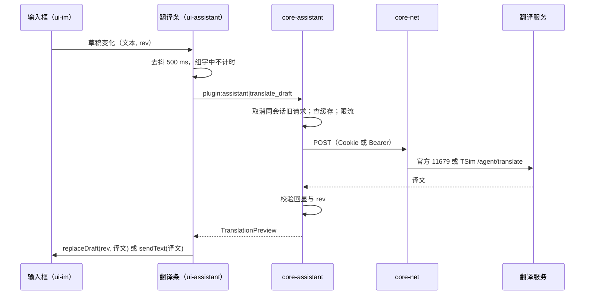

# 09 商家助手：core-assistant + ui-assistant

2026-10-30

本文描述如何把用户自己的插件「旅游商家助手」（trip_vendor_im_companion，以下简称“插件”）的功能做成新客户端的内置模块。公共约定（命名、通道、权限、窗口标签、性能预算）以 [00 开发总纲](00-architecture.md) 为准。本文中的接口都是示意。

证据来源（$S 指本地解包目录）：

| 简称 | 文件 | 内容 |
| --- | --- | --- |
| bootstrap | `$S/asar/trip-vendor-bootstrap.cjs` | 插件注入到官方 app.asar 的入口：强制站点隔离、打开 CDP 端口、拉起助手进程、启动进度条、运行日志面板、主窗口最大化 |
| original-main | `$S/asar/companion-vendor-original-main.json` | 只有一行 `{"main":"dist-electron/main/index.js"}`，用来在注入后再加载官方入口 |
| manifest | `resources/TripVendorCompanion/vendor-runtime-manifest.json` | 插件对官方 1.2.12 的 exe、asar、imWindow/mainWindow 产物做 SHA-256 校验的白名单 |
| companion | `resources/TripVendorCompanion/resources/app.asar`（插件自带 Electron 44.7.2，包名 `trip_vendor_im_companion` 0.3.2） | 只取了 `package.json`、`dist-electron/preload.cjs`、`dist-electron/main.cjs` 三个文件查证 |
| 官方翻译 | `$S/renderer-dist/js/buildTranslateRequest-DXdaDugz.js`、`parseTranslateResponse-DQVGkmSi.js`、`imWindow-DeDFr-7q.js`、`BaseController-_xbuiF6A.js` | 官方 IM 页的实时翻译与消息翻译 |

## 1. 结论与定位

- **core-assistant 是一个可整体关闭的 Rust 内部插件 `assistant`**，负责翻译请求、TSim 会话、客户语言识别、订单与套餐查询、助手日志。**ui-assistant 不是独立窗口**，而是一组懒加载的前端组件，挂在 ui-im 预留的扩展槽位里（输入框上方的翻译条、侧栏面板、消息内的订单号标记）。
- **不再有 CDP、注入脚本、页面指纹校验**。插件为了在官方页面里工作，要打开 127.0.0.1 调试端口（bootstrap `remote-debugging-port`）、校验官方产物哈希（manifest）、通过 `chat-editor`、`setContent`、`btn_send` 等 DOM 约定读写输入框（preload `IM_CONTRACT`）。新客户端的 IM 页是自己写的，这些全部改成 ui-im 的正式接口。
- **翻译有两个来源，做成可切换的提供方**：
  - 官方：携程 SOA2 服务 `/11679/getMessageTranslate`（输入框实时翻译，停笔 500 ms 触发）和 `/11679/batchTranslateByMsgIds`（客户消息翻译），用携程登录 Cookie。
  - 插件：TSim 服务 `https://csapi.tsim.tech/agent/translate`，用 TSim 账号的 Bearer token，服务端再转给 DeepL、DeepSeek、OpenAI 等上游。
  - 两者都由 Rust 发请求，前端只负责 500 ms 去抖后发起命令。
- **订单查询和套餐速览的数据来自 TSim，不来自携程**。插件调用的是 `csapi.tsim.tech/agent/package-query/*`，凭据是 TSim token，不是携程 Cookie。携程 Cookie 只在“从携程会话里拿到订单号”这一步用到。推荐：套餐速览做成原生面板（Rust 调 API）；完整订单查询一期继续内嵌 TSim 远程页 `csagent.tsim.tech`，放在 IM 侧栏的子 WebView 里，见第 5.3 节取舍。
- **会话滚到底部、启动最大化不属于助手的业务逻辑**，分别交给 ui-im 和 core-shell 实现，助手只保留开关。

## 2. 承接范围

### 2.1 插件功能清单与出处

| 功能 | 插件实现（出处） | 新客户端归属 |
| --- | --- | --- |
| 出站翻译 | companion `OwnedPsimService.translate`：`POST /agent/translate`，字段 `text、target_lang、source_lang、purpose、draft_request_id、composer_content_version`；只接受 `purpose=outbound`、`source_lang=zh`、文本 ≤ 20000 字；校验回显的 `draft_request_id` 与版本号，不一致报 `OUTBOUND_ECHO_MISMATCH` | core-assistant 翻译服务 |
| 草稿替换与发送 | 状态 `outboundMode: "send" / "replace"`；快捷键事件 `replace-shortcut`、`send-shortcut`；回车发送开关 `enterSend`；比对后写入，失败码 `DRAFT_COMPARE_AND_SWAP_FAILED`、`DRAFT_CHANGED`、`INPUT_COMPOSING` | ui-im 输入框槽位 + ui-assistant 翻译条 |
| 去抖时长 | `/agent/profile` 返回 `outbound_wait {enabled,min_ms,max_ms}`，限制 100–3000 ms（`parseOutboundWaitBounds`） | 前端去抖，默认 500 ms，TSim 提供方按服务端下发值 |
| 客户语言识别 | 页面脚本内置 tinyld 词典（main.cjs 第 6100 行注入脚本），asar 附带 `licenses/eld-Apache-2.0.txt`、`tinyld-MIT.txt`；状态 `customerLanguage`、`followCustomerLanguage`、`fallbackTarget: "en"`；目标来源 `manual / recognized / fallback` | core-assistant 语言识别 |
| 支持语言 | 面板目标 16 种：`en ja ko th vi id ms es fr de ru ar zh-TW pt it tr`（`PANEL_TARGETS`） | 沿用 |
| TSim 登录 | macOS：自有登录窗 + `safeStorage` 加密的 `account/session.enc`；Windows：到用户 Edge/Chrome 配置目录的 `Local Storage/leveldb` 里读 `csagent.tsim.tech` 的登录态（`browser-profile-session.ts`）；接口 `/agent/login`（表单 username/password）、`/agent/profile`、`/agent/auth/refresh`、`/agent/logout`；token 到期前 5 分钟刷新，非 JWT 每 30 分钟刷新 | core-assistant TSim 会话，凭据进系统凭据库 |
| 订单查询 | 在客服页 iframe 里加载 `https://csagent.tsim.tech`（`tsim-operator-frame`），用 `postMessage` 传 `TSIM_OPERATOR_SESSION {accessToken, sessionRef}` 和 `TSIM_OPERATOR_SET_IDENTIFIER` | IM 侧栏面板（内嵌远程页） |
| 套餐速览 | `collectOrderSummary`：`perform → dataplan-list → detail + live-detail + cdr-more`，最多 5 个套餐、每个 10 条用量记录；需要权限 `complaint_records` | IM 侧栏面板（原生） |
| 订单号来源 | 读官方客服页 `.customer_info iframe.customer_order-detail`，地址必须是 `https://vbooking.ctrip.com/tour/im/ex-area/b`，取 `groupid、sessionid、serviceType、status`；另在消息里识别订单号、ICCID、EICCID（`identifierType`），最多 12 个可点击 | core-assistant 从 core-im 会话信息与消息文本识别 |
| 会话滚到底部 | 页面脚本 `z4`：切会话后 2 s 内每 50 ms 把消息列表滚到底，用户滚轮、按键、点击即停止 | ui-im 列表默认行为 + 开关 |
| 启动最大化 | bootstrap `maximizeMainWindowOnOpen`：标题为 `Main window` 的窗口首次显示时最大化一次，之后尊重用户调整 | core-shell 偏好项 |
| 运行日志 | `userData/logs/runtime.log`（加 `.1` 轮转，文件权限 0600），内存保留最近 1000 条；字段白名单脱敏（`sanitizeTelemetry`）；页面内日志对话框可复制 | core-telemetry 的 `assistant` 通道 + 助手日志面板 |

插件 preload 暴露给自身面板的接口（`window.standalone`）是迁移时的功能对照表：`getState / translate / cancelTranslation / resumeTranslation / replaceDraft / copyTranslation / setTranslationOptions / openLogin / logout / openOrder / closeOrder / openSettings`。

### 2.2 官方客户端已有的翻译能力

| 能力 | 出处 | 说明 |
| --- | --- | --- |
| 输入框实时翻译（rtt） | imWindow `realTimeTranslate`；`buildTranslateRequest` 生成 `{sessionId, groupId, messageTxt, source:"AUTO", target, appId:"900004", bizType, timeoutInSeconds:10}`；POST `this.API.getMessageTranslate` = `/11679/getMessageTranslate`（BaseController） | 停笔延时常量 `uOt=500`；每会话记住开关与目标语言，默认 `en-US`；切会话后丢弃旧结果（埋点 `status:"discard"`） |
| 解析 | `parseTranslateResponse`：依次检查 `ResponseStatus.Ack`、`status.code`、`translate.status`，成功取 `translate.translateText` | 错误只分“服务异常 / 翻译失败 / 结果为空” |
| 客户消息翻译 | `/11679/batchTranslateByMsgIds`（`appId:"100017720"`，按消息 ID 批量），结果带 `supplier`；另有 `/11679/translateIQMessage` | 偏好项 `updateAutoTranslate` 控制自动翻译 |
| 网关 | BaseController 按环境拼 `…/restapi/soa2`（生产为 `m.ctrip.com` 等），请求带 `head` 与登录 Cookie | 走 core-net |

### 2.3 两种翻译对比

| 维度 | 官方 SOA2 11679 | 插件 TSim `/agent/translate` |
| --- | --- | --- |
| 凭据 | 携程登录 Cookie（core-account） | TSim 账号 Bearer token |
| 适用对象 | 所有商家 | 只限有 TSim 账号且有翻译权限的商家（403 → `TRANSLATION_PERMISSION_REQUIRED`） |
| 方向 | 出站草稿 + 入站消息 | 只有出站，源语言固定 `zh` |
| 上游 | 携程内部，接口不暴露供应商（批量结果带 `supplier`） | TSim 服务端转发，枚举里有 deepl、deepseek、openai、google、anthropic、azure、tencent、baidu |
| 一致性保护 | 只比对会话 ID | 回显请求 ID 和输入框版本，防止旧译文覆盖新草稿 |
| 去抖 | 前端固定 500 ms | 服务端下发 100–3000 ms |
| 隐私 | 数据不出携程 | 草稿发往第三方服务及其上游模型 |

结论：两者并存，抽象成 `TranslateProvider`。默认用官方提供方；登录了 TSim 且有翻译权限、并且用户在设置里选择 TSim 时，出站翻译走 TSim。入站消息翻译继续用官方批量接口（它按消息 ID 工作，归 core-im，见第 6 节）。

## 3. Tauri / Rust 分工表

| 放 Rust（core-assistant） | 放 WebView（ui-assistant，运行在 im 窗口） |
| --- | --- |
| 翻译请求、提供方选择、限流、缓存、取消与“新请求作废旧请求” | 500 ms 去抖、输入法组字期间不触发、显示译文预览 |
| TSim 登录、token 刷新、加密保存、权限解析 | 登录表单、登录状态徽标 |
| 客户语言识别（订阅 core-im 的入站消息） | 显示识别结果、手动改目标语言 |
| 订单号识别、套餐速览请求与字段裁剪 | 侧栏卡片、订单号点击高亮 |
| 订单查询子 WebView 的创建、定位、token 交接、销毁 | 侧栏容器尺寸上报、加载与失败占位 |
| 特性开关与灰度判定 | 按开关显示或隐藏组件 |
| 日志写入、脱敏、环形缓冲 | 日志查看对话框、复制 |

草稿文本本身的真相在 ui-im 的输入框里（输入框是纯前端状态，按总纲属于“窗口内部交互”）。替换草稿由前端按版本号比对后执行，Rust 不直接改输入框。

## 4. Rust 核心设计

### 4.1 状态

模块内部按总纲 4.5 用“一个状态持有任务 + mpsc”的 actor 写法，再拆出三个子任务：`TsimSession`（登录与刷新串行化）、`Translator`（每会话最多一个在途请求）、`OrderService`。

```rust
pub struct AssistantState {
    pub seq: u64,
    pub features: FeatureSet,              // 生效后的开关（见 4.5）
    pub tsim: TsimStatus,                  // SignedOut | Connecting | Ready{account_id, permissions} | Failed{code}
    pub provider: ProviderKind,            // Ctrip | Tsim
    pub outbound_wait: WaitBounds,         // 默认 500 ms；TSim 下发 min/max
    pub conversations: HashMap<ConvId, ConvAssist>, // 只保存当前账号最近 50 个
}
pub struct ConvAssist {
    pub customer_lang: LangGuess,          // {lang, confidence, source: Recognized|Manual|Fallback}
    pub target_lang: Lang,
    pub translate_enabled: bool,
    pub order_ids: Vec<OrderRef>,          // {identifier, kind: OrderNumber|Iccid|Eiccid}
}
```

TSim 会话沿用插件的“代次”概念：每次登录、刷新、登出、权限变化都让 `auth_generation` 加一，所有在途请求带上发起时的代次，返回时代次不同就作废（插件 `AUTH_CHANGED`）。

### 4.2 命令

均为 `plugin:assistant|<命令>`，只授予 `im.json` 与 `shell.json`（设置页）。

| 命令 | 参数 → 返回 | 说明 |
| --- | --- | --- |
| `state_snapshot` | → `{seq, AssistantState}` | 窗口打开时先调用 |
| `translate_draft` | `{conv_id, draft_rev, text, target?}` → `TranslationPreview {draft_rev, text, provider, cached}` | 同一会话新请求自动取消旧请求，旧请求返回 `assistant.superseded` |
| `cancel_translation` | `{conv_id}` | 用户清空输入或关闭翻译 |
| `set_conversation_options` | `{conv_id, target?, translate_enabled?}` | 手动指定目标语言后不再跟随识别 |
| `set_options` | `{provider?, follow_customer_lang?, fallback_target?, outbound_mode?, shortcut_enabled?}` | 写入 core-store 偏好 |
| `tsim_login` | `{username, password}` → `TsimStatus` | 表单登录，密码不落盘 |
| `tsim_logout` | — | 本地先清，再通知服务端 |
| `tsim_session_snapshot` | → `TsimStatus` | 设置页使用 |
| `order_summary` | `{identifier, kind}` → `OrderSummary {plans[≤5], total}` | 套餐速览；需要 `complaint_records` 权限 |
| `order_panel_open` | `{conv_id, identifier, kind, bounds}` | 在 im 窗口创建或复用订单查询子 WebView |
| `order_panel_set_bounds` / `order_panel_close` | `{bounds}` / — | 侧栏拖动、折叠时调用 |
| `log_snapshot` | → 最近 1000 条脱敏记录 | 日志对话框 |
| `log_export` | → 文件路径 | 打包最近日志，供用户发给支持人员 |
| `features_snapshot` | → `FeatureSet` + 每项的来源 | 设置页与排障 |

### 4.3 事件

| 事件 | 载荷 | 接收窗口 |
| --- | --- | --- |
| `assistant://state-changed` | `{seq, patch}` | im、setting |
| `assistant://customer-language-changed` | `{seq, conv_id, guess}` | im |
| `assistant://tsim-session-changed` | `{seq, status}` | im、setting |
| `assistant://order-ids-changed` | `{seq, conv_id, order_ids}` | im |
| `assistant://features-changed` | `{seq, features}` | im、setting、main |

翻译结果直接作为 `translate_draft` 的返回值，不另发事件：翻译只服务于发起它的那个输入框，没有多窗口共享的必要。

### 4.4 翻译管线

```rust
#[async_trait]
pub trait TranslateProvider: Send + Sync {
    fn kind(&self) -> ProviderKind;
    async fn translate(&self, req: &OutboundRequest, cancel: CancellationToken)
        -> Result<String, AppError>;
}
pub struct OutboundRequest {
    pub conv: ConvContext,     // sessionId、groupId、bizType（官方需要）
    pub text: String, pub source: Lang, pub target: Lang,
    pub draft_rev: u64,        // TSim 映射为 composer_content_version
    pub request_id: String,    // TSim 映射为 draft_request_id
}
```

| 环节 | 做法 |
| --- | --- |
| 去抖 | 前端：停笔后等 `outbound_wait`（默认 500 ms，与官方 `uOt=500` 一致），输入法组字中不计时。Rust 不再二次去抖 |
| 作废 | Rust 每会话保存一个 `CancellationToken`；新请求到达即取消旧请求，并在返回前再比对 `draft_rev` |
| 缓存 | 内存 LRU（`moka` 或 `lru` crate），键为 `(提供方, 目标语言, 文本 SHA-256)`，上限 500 条、存活 10 分钟。不写磁盘 |
| 合并 | 相同键的并发请求只发一次（single-flight） |
| 限流 | `governor` crate 令牌桶，按提供方设置，初值每秒 2 次、突发 4 次；服务端 429 时按 `Retry-After` 暂停该提供方 |
| 超时 | 官方 10 s（与请求体 `timeoutInSeconds:10` 对齐），TSim 30 s（插件 `AbortSignal.timeout(3e4)`） |
| 校验 | TSim：回显的 `draft_request_id`、`composer_content_version` 必须一致，译文非空且 ≤ 50000 字；官方：按 `parseTranslateResponse` 的三层状态判断 |
| HTTP | 统一经 core-net：官方提供方带当前账号 Cookie；TSim 提供方由 assistant 注入 `Authorization: Bearer`，禁止重定向（插件 `redirect:"error"`），响应体上限 2 MB |

### 4.5 特性开关与灰度

| 开关 | 默认 | 依赖 |
| --- | --- | --- |
| `assistant.enabled`（总开关） | 开 | — |
| `assistant.translate_outbound` | 开（官方提供方） | TSim 提供方另需 TSim 登录与翻译权限 |
| `assistant.customer_lang_detect` | 开 | — |
| `assistant.package_summary` | 关，TSim 登录且有 `complaint_records` 时自动开 | TSim 权限 |
| `assistant.order_panel` | 同上 | TSim 权限 |
| `assistant.stick_bottom_on_switch` | 开 | ui-im 实现 |
| `shell.start_maximized` | 开 | core-shell 实现 |

生效值按“编译默认 → 远程配置 → 账号权限 → 用户设置”叠加，后者覆盖前者，但远程配置可以下发强制关闭（kill switch）。灰度用 `hash(账号 ID) % 100 < 比例` 分桶，结果缓存到下次启动，避免一天内反复切换。远程配置的来源（携程配置中心、TSim `/agent/profile` 扩展字段或自建）待确认。

### 4.6 错误分类

`AppError.code` 统一为 `assistant.*`，前端按类别给出固定提示与动作：

| 类别 | code（来源） | 提示与动作 | retryable |
| --- | --- | --- | --- |
| 需要登录 | `assistant.tsim_login_required`（401、423、`PSIM_LOGIN_REQUIRED`） | “TSim 登录已失效”，按钮“去登录” | 否 |
| 无权限 | `assistant.permission_denied`（403；`TRANSLATION_PERMISSION_REQUIRED`、`ORDER_PERMISSION_REQUIRED`） | “账号未开通此功能”，自动隐藏入口 | 否 |
| 限流 | `assistant.rate_limited`（429、`RATE_LIMITED`） | “请求太频繁，x 秒后自动恢复” | 是 |
| 超时、网络 | `assistant.timeout`、`net.*` | “翻译超时”，按钮“重试” | 是 |
| 服务异常 | `assistant.service_error`（5xx、`ResponseStatus.Ack≠Success`、`INVALID_SERVICE_RESPONSE`） | “翻译服务暂不可用”，可切换提供方 | 是 |
| 参数错误 | `assistant.invalid_request`（422，记录 `x-request-id`） | “这段内容无法翻译” | 否 |
| 内容已变 | `assistant.superseded`、`assistant.draft_changed`、`OUTBOUND_ECHO_MISMATCH` | 静默丢弃，不提示 | — |
| 结果为空 | `assistant.empty_result` | “未得到译文” | 是 |

### 4.7 客户语言识别

- 输入：core-im 内部总线上的入站消息（只取客户发的纯文本，排除商家消息，插件同样排除 `.tag-merchant`）。
- 方法：先按文字系统直接判定（假名 → ja，谚文 → ko，泰文 → th，阿拉伯字母 → ar，繁体字比例 → zh-TW），其余用统计模型。候选 crate：`whatlang`（小、快，短句准确度一般）、`lingua`（准确，可只加载 17 种语言，体积需验证）。原型阶段两者对比后选一个。
- 规则：取该会话最近 5 条客户消息加权，置信度不足保持上次结果；识别为 zh 时不翻译；结果 unknown 时用 `fallback_target`（默认 en）。用户手动选过目标语言的会话不再自动改。
- 识别在 tokio 阻塞线程池执行，单条耗时目标 ≤ 2 ms。

### 4.8 TSim 会话与凭据

| 项 | 设计 |
| --- | --- |
| 登录方式 | 首选表单直连 `POST /agent/login`（与插件 macOS 版一致）。不再读取用户浏览器的配置目录：插件 Windows 版读 Edge/Chrome 的 leveldb，既脆弱又越权 |
| 保存 | `accessToken`、`sessionRef` 用随机 256 位密钥做 AES-GCM 加密后写入应用数据目录；密钥存在 Windows 凭据管理器（`keyring` crate），目标名 `vbk/assistant/tsim/<TSim 账号>` |
| 密码 | 默认不保存；勾选“记住密码”时只存凭据管理器 |
| 刷新 | JWT 到期前 5 分钟刷新；非 JWT 每 30 分钟刷新；刷新与登录串行执行 |
| 失效 | 401、423 立即清本地会话并发 `assistant://tsim-session-changed` |
| 与携程账号的关系 | TSim 账号与携程账号多对多，按“携程账号 → 绑定的 TSim 会话”保存；切换携程账号时切换对应 TSim 会话，没有绑定则为未登录 |

### 4.9 平台差异

| 项 | Windows（一期） | macOS（二期） |
| --- | --- | --- |
| 凭据库 | 凭据管理器，单条上限 2560 字节，所以只存密钥 | 钥匙串，无此限制，仍沿用同一方案 |
| 子 WebView | WebView2 子控件 | WKWebView 子视图 |
| 最大化 | `WebviewWindow::maximize` | 同左，注意全屏与最大化的区别 |

## 5. 前端设计

### 5.1 ui-im 扩展槽位

ui-assistant 只通过 ui-im 公开的槽位接入，ui-im 不依赖 ui-assistant 的内部实现。总开关关闭时槽位为空，IM 照常工作。

| 槽位 | 位置 | ui-im 提供 | ui-assistant 提供 |
| --- | --- | --- | --- |
| `composer.addon` | 输入框上方一条 | 当前会话、草稿文本与版本号、是否在输入法组字、`replaceDraft(expectedRev, text)`、`sendText(text)` | 翻译条：目标语言、译文预览、替换、复制、发送 |
| `composer.keymap` | 输入框键盘处理 | 回车与快捷键的拦截钩子，可返回“已处理” | 发送模式下回车先发译文 |
| `message.decorator` | 消息气泡文本 | 消息纯文本与范围标记接口 | 订单号、ICCID 高亮与点击 |
| `sidebar.panel` | 会话右侧栏的标签页 | 面板容器、尺寸变化回调 | 套餐速览、订单查询、助手日志 |
| `conversation.onEnter` | 切入会话 | 列表滚动控制 | 不需要，滚到底由 ui-im 自己完成 |

### 5.2 翻译条交互

| 场景 | 行为 |
| --- | --- |
| 停笔 | 去抖结束后调用 `translate_draft`，预览区显示“翻译中” |
| 继续输入 | 前端丢弃旧预览；Rust 取消旧请求 |
| 替换模式 | 点击“替换”或快捷键：`replaceDraft(rev, 译文)`；版本不一致就提示“草稿已改动”并重新翻译 |
| 发送模式 | 回车：预览版本等于当前版本时发送译文；仍在翻译时最多等待 `outbound_wait.max`（≤ 3 s）；失败时不自动发送原文，显示“发送原文 / 重试” |
| 输入法组字 | 组字中不触发翻译，回车交给输入法 |
| 识别语言为中文或关闭翻译 | 翻译条折叠为一行开关，回车恢复为普通发送 |

### 5.3 订单查询：原生面板与内嵌远程页的取舍

| 方案 | 做法 | 优点 | 缺点 |
| --- | --- | --- | --- |
| A 原生面板 | Rust 调 `/agent/package-query/*`，前端画卡片 | 快、样式统一、字段可控、无第三方页面进程 | 只能覆盖已知字段；TSim 运营后台的操作（换卡、充值等，推断）无法复刻 |
| B 内嵌远程页 | im 窗口内创建子 WebView（Tauri 2 `Window::add_child`，需开启 `unstable` 特性，需验证）加载 `https://csagent.tsim.tech`，按订单号打开 | 功能与 TSim 后台完全一致，TSim 改版不需要我们发版 | 需要把 token 交给远程页；多一个渲染进程（约 60–100 MB，需实测）；子 WebView 定位与 DPI 要处理 |

推荐：**套餐速览用 A，完整订单查询用 B**。B 的约束：

- 子 WebView 标签 `im-order-panel`，使用独立的 WebView2 Profile，与携程页面的 Cookie 隔离；不授予任何 IPC 权限；只允许 `csagent.tsim.tech` 导航，其余交给系统浏览器。
- token 交接：插件用 `postMessage` 把 token 发进页面。新客户端优先请 TSim 提供一次性登录码（如 `?code=` 换 token），其次才用初始化脚本传 token。这一项要和 TSim 侧确认。
- 侧栏折叠 5 分钟后销毁子 WebView，释放内存。

### 5.4 性能要求

| 指标 | 目标 |
| --- | --- |
| 按键到上屏 | 开启翻译后仍满足总纲 ≤ 50 ms（P95）；按键过程中不发任何 IPC |
| 停笔到译文出现 | 缓存命中 ≤ 100 ms；未命中时 P50 ≤ 1.5 s（取决于服务端，原型实测） |
| ui-assistant 包体 | 翻译条 ≤ 30 KB（gzip），侧栏面板按需加载 |
| 语言识别 | 不在前端执行，前端无模型文件 |
| 子 WebView | 打开侧栏到首屏 ≤ 2 s；未打开订单查询时不创建 |

## 6. 与其他模块的联动

| 模块 | 联动 |
| --- | --- |
| [10 IM](10-im.md) | ui-im 预留 5.1 节的槽位；core-im 在内部总线发布入站消息与会话上下文（sessionId、groupId、bizType、客户订单号字段），供语言识别与订单号识别；官方入站批量翻译 `/11679/batchTranslateByMsgIds` 留在 core-im |
| [06 网络](06-net.md) | 所有请求经 core-net；需要支持“调用方注入 Authorization、禁止重定向、响应体上限” |
| [02 账号与登录](02-account-login.md) | 官方提供方取当前账号 Cookie；`account://changed` 时切换 TSim 绑定、清空翻译缓存 |
| [05 本地存储](05-store.md) | 偏好项（提供方、跟随客户语言、发送模式）与每会话目标语言写入偏好表；不存译文 |
| [01 壳与窗口管理](01-shell.md) | `shell.start_maximized` 偏好：主窗口首次显示时最大化一次，与窗口状态恢复插件不冲突 |
| [08 更新、诊断与偏好](08-update-telemetry.md) | 日志写入 `assistant` 通道；远程配置下发开关；埋点只记耗时与结果类别 |

启动顺序：在 im 之后启动；assistant 失败不影响 IM。

## 7. 关键流程



其他流程：

| 流程 | 步骤 |
| --- | --- |
| 客户语言识别 | core-im 入站消息 → assistant 识别 → 结果变化时发 `customer-language-changed` → 翻译条更新目标语言（用户手动设置过的会话不变） |
| TSim 登录 | 设置页或翻译条表单 → `tsim_login` → `/agent/login` → `/agent/profile` 取账号与权限 → 加密保存 → 发 `tsim-session-changed` → 按权限重算开关 |
| 套餐速览 | 切入会话 → assistant 从会话信息和最近消息识别订单号 → 侧栏打开时调用 `order_summary` → `perform → dataplan-list → detail（并发 live-detail、cdr-more）` → 裁剪字段后返回 |
| 订单查询 | 点击订单号或侧栏“打开完整查询” → `order_panel_open` → 创建子 WebView → token 交接 → 加载指定订单 |
| 切换携程账号 | `account://changed` → 取消在途请求、清缓存、切换 TSim 绑定、重发快照 |

## 8. 注意事项（Windows 优先）

- **凭据管理器容量**：单条凭据数据上限 2560 字节，插件允许 token 长到 16000 字符，所以只能存密钥，token 加密后放文件。
- **输入法**：中文输入法组字时 `keydown` 的回车属于输入法，必须检查组字状态，否则会误发送。插件为此有 `INPUT_COMPOSING` 错误码。
- **子 WebView 的 DPI 与定位**：侧栏尺寸由前端以 CSS 像素上报，Rust 换算为物理像素；多显示器不同缩放下拖动窗口要重新定位。Tauri 2 多 WebView 仍属 `unstable` 特性，需验证。
- **隐私与合规**（发往第三方的内容）：
  - TSim 提供方会把商家草稿发到 TSim 服务器，再转给上游大模型或翻译供应商。首次启用 TSim 提供方时弹出同意说明，列出发送内容、接收方与保留策略，用户同意后才生效，同意记录随账号保存。
  - 只发送商家自己输入的草稿；不发送客户消息原文，也不发送会话上下文（插件请求体同样没有上下文字段）。
  - 日志与埋点只记字数、耗时、语言、结果类别，不记文本（沿用插件的字段白名单思路）；缓存只在内存；登出或切换账号即清空。
  - 草稿中的手机号、邮箱是否先替换为占位符再发送，需要评估对译文质量的影响，列为原型验证项。
  - 官方提供方的数据不出携程，作为默认值。
- **代理与 TLS**：企业网络常有代理或 TLS 中间人，统一由 core-net 读取系统代理与证书，不在助手里单独处理。
- **不再需要的东西**：调试端口、`site-per-process` 开关、产物哈希白名单、`TravelMerchant.WindowHelper.exe`（插件附带的 WPF 窗口辅助程序，推断用于定位官方窗口），新客户端都不带。
- **滚到底部**：ui-im 用虚拟列表后，切会话应直接以底部为锚点渲染，不要照搬插件“2 s 内每 50 ms 强制滚动”的轮询。

## 9. 原型验证项与验收标准

| 验证项 | 方法 | 通过标准 |
| --- | --- | --- |
| 官方翻译接口可用 | Rust 经 core-net 带 Cookie 调 `/11679/getMessageTranslate` | 返回 `translate.translateText`；生产网关地址与 `head` 结构确认 |
| TSim 接口可用 | 表单登录 → profile → translate → package-query 全链路 | 与插件结果一致；401、403、422、429 各构造一次，提示正确 |
| 去抖与作废 | 连续输入 30 秒、随机停顿 | 只有最后一次停笔的结果被显示；旧结果 0 次覆盖新草稿 |
| 输入延迟 | 开启翻译，按总纲方法测按键到上屏 | P95 ≤ 50 ms |
| 语言识别准确率 | 用 17 种语言、每种 50 条短消息（≤ 20 字）测试 | 选定的 crate 准确率 ≥ 90%，单条 ≤ 2 ms |
| 子 WebView | 在 im 窗口侧栏加载 `csagent.tsim.tech`，150% 与 100% 双屏拖动 | 定位无偏移；无 IPC 权限；关闭后内存回落 |
| token 交接 | 与 TSim 确认的方式实测 | 远程页免二次登录 |
| 凭据 | 重启、切换 Windows 用户 | 本用户可恢复会话；其他用户无法解密 |
| 开关 | 远程下发 `assistant.enabled=false` | 所有槽位为空，IM 正常收发 |

M6 验收：第 2.1 节全部功能可用；无调试端口（`netstat` 无 127.0.0.1 监听）；助手异常时 IM 不受影响。

## 10. 开发步骤与工作量估计

| 步骤 | 内容 | 人日 |
| --- | --- | --- |
| 1 | contracts：命令、事件、错误码；ui-im 槽位接口评审 | 1.5 |
| 2 | 翻译管线：提供方抽象、官方提供方、作废、缓存、限流 | 3 |
| 3 | TSim 会话：登录、刷新、加密保存、权限、账号绑定 | 3 |
| 4 | TSim 翻译提供方与回显校验 | 1 |
| 5 | 翻译条（替换、发送、组字处理、错误提示） | 3 |
| 6 | 客户语言识别：crate 选型对比与实现 | 2 |
| 7 | 订单号识别 + 套餐速览原生面板 | 2.5 |
| 8 | 订单查询子 WebView、定位、token 交接 | 3 |
| 9 | 特性开关、灰度、远程配置接入 | 1.5 |
| 10 | 日志通道、日志面板、导出 | 1 |
| 11 | 隐私同意流程、设置页条目 | 1 |
| 12 | 联调、原型验证项、修复 | 3 |
| 合计 | | 26.5 |

不含 ui-im 槽位本身（计入 10 IM）和 core-shell 最大化偏好（计入 01 壳）。

## 11. 待确认问题

1. 新客户端是否面向所有携程商家发布。如果是，TSim 相关功能（登录、TSim 翻译、套餐速览、订单查询）应只在灰度名单或检测到 TSim 账号时出现，默认对其他商家隐藏。
2. 官方 SOA2 11679 翻译接口在新客户端（非官方 appId、非官方 UA）下是否允许调用，`appId` 900004 与 100017720 能否沿用。
3. TSim 能否提供一次性登录码或其他正式方式，让订单查询远程页免登录，替代 `postMessage` 传 token。
4. 订单号的正式来源：core-im 会话信息里是否带订单号；如果没有，是否改为由 core-net 带携程 Cookie 请求 `vbooking.ctrip.com/tour/im/ex-area/b` 背后的接口（接口未查证）。
5. 发送模式下译文失败时的默认行为：本文建议“不自动发原文”，需要业务确认。
6. 是否需要同时发送原文和译文（插件与官方都只发一种）。
7. 远程开关配置放在哪里：携程配置中心、TSim profile 扩展字段，还是自建。
8. 翻译同意说明的文案与法务要求，以及 TSim 上游供应商清单是否需要向用户展示。
