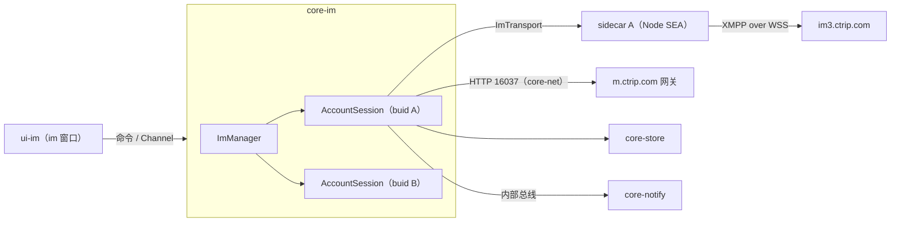

# 10 IM：core-im、传输候选与 ui-im

> **范围已变更（2026-10-30）**：以[网页版范围决定](../decisions/2026-10-30-web-only-scope.md)为准。只做目标网页已有的消息、通知和订单联系入口；网页没有的功能不做。本文超出该范围的桌面对齐、扩展功能与验收要求均作为历史参考，不再执行。

2026-10-30

本文覆盖 Rust 核心模块 core-im、传输候选和前端模块 ui-im。公共约定（命名、通道、权限、窗口标签、性能预算）以 [00 总纲](00-architecture.md) 为准。本文原先以非 IM 重构为重点；按后续补充要求，成员管理、结束动作、产品推荐及携程原生侧栏契约见下方接口调查。

> **2026-10-30 选型补充**：Node sidecar 是现有静态证据支持的候选基线，不再视为已经锁定的一期实现。网页接口调查与替换条件见 [IM 接口选型决策](../decisions/2026-10-30-im-transport.md)，客户端新增证据见 [源码核对](../research/2026-10-30-client-im-static-evidence.md)。以下 sidecar 工程设计在选择该路线时适用。

> **边际功能补充**：[成员管理、侧栏、推荐与订单接口](../research/2026-10-30-im-peripheral-apis.md)。移除成员与结束动作共用 `finishConversation` 但参数和语义不同；移除命令必须拒绝空目标列表。主客服转移有普通与旅游群主两个分支；产品卡片使用独立发送接口，超时不可按普通文本兜底重发。写操作状态闭环仍待受控验收。

## 1. 结论与定位

- **官方 IM 的“业务大脑”在页面里**：会话列表每 5 秒 HTTP 轮询一次、回复超时每 5 秒在页面里计算一次、未读数和新消息横幅都由页面算好再发给主进程。IM SDK 子进程只负责长连接收发。新客户端把这些全部搬进 core-im，页面只做渲染。
- **协议骨架已有静态证据，完整语义未验收**：`@ctrip/s-node-imclient-core` 是 **XMPP over WebSocket**（`wss://im3.ctrip.com/ws-xmpp/`），SASL 用户名是 UID、密码是 token（官方传入 `bticket`），应用层每 5 秒发一次 XEP-0199 ping。旧商家 UI 的历史消息和会话列表使用 HTTP SOA 服务 16037；SDK 另有 11679 增量补偿、历史及会话接口，不能只实现 16037 就声称消息同步完整。
- **一期候选 C（通过原型后才冻结）**：每个已登录账号一个 Node sidecar 进程（与官方“每账号一个 utilityProcess”一致，SDK 是全局单例），用 Node SEA 打成单文件。与 Rust 之间用**命名管道 + 4 字节长度前缀 JSON**；stdout/stderr 只收日志。
- **二期**：Rust 原生实现 XMPP over WebSocket，替换 sidecar 的 `ImTransport` 实现，core-im 对外接口不变。前提是拿到协议授权或说明，以及一期录制的报文样本做回归。
- **ui-im 必须重写**：官方输入框每次变更都会重算整个会话列表（草稿写进 `conversationList`），这是可疑的渲染放大路径；没有隔离变量的性能剖析，不能认定为已证明的卡顿根因。新页面的输入框独立于消息流和会话列表渲染；保留 tiptap（ProseMirror）但改为非受控用法。

## 2. 承接范围

### 2.1 官方进程与通道拓扑

| 组件 | 现状 | 出处 |
| --- | --- | --- |
| IM 子进程 | `utilityProcess.fork("../main/imsdk.js")`，按 `buid` 存进 `imProcessMap`；token 取账号的 `bticket` | index.js `createIMProcess` |
| 守护重启 | 非 0 退出码 1 秒后重启，累计 10 次放弃（`im process crash too many times`） | index.js `createIMProcess` |
| SDK 初始化 | `IMClient.init({env, appId:"900004", network:EXTERNAL, conversationType:ConversationList, initPageSize:0, withoutExtra:true, token})` | imsdk.js 函数 `k` |
| 子进程消息 | `init_im_sdk`、`append_port`、`remove_port`、`close_port`、`destroy` | constant-2w9sXoOv.js `PROCESS_MESSAGE_NAME` |
| 端口消息 | `send_message`、`message_send_status`、`new_message`、`new_notice`、`send_input_state`、`send_message_receipt`、`unread_count_change`、`bu_type_changed`、`connect_status_change` | constant-2w9sXoOv.js `PORT_MESSAGE_NAME` |
| 发送策略 | 先 `sendMessageInSocket`（SDK 在 socket 未连接时已转 HTTP），包装层失败后再调 HTTP `sendMessage`；两次调用必须保留相同 `localId` | imsdk.js 函数 `P`、`I` |
| 断线处理 | `DISCONNECTED` 时调用 `IMClient.reconnect(true)`；`CURRENT_TOKEN_UNAVAILABLE` 只记日志 | imsdk.js 函数 `f` |

MessagePort 拓扑：

| 端口 | 两端 | 建立方式 | 出处 |
| --- | --- | --- | --- |
| IM 端口 | IM 子进程 ↔ imPlus / notice 页面 | 页面 `invoke("get_im_channel_port", buid, "imPlus")` → 主进程 `MessageChannelMain`，port2 经 `append_port` 交给子进程，port1 回传页面 | index.js `generateRenderPortByBuid`；preload/im.js |
| Main 端口 | main 外壳渲染进程 ↔ imPlus / notice 页面 | `get_main_channel_port` → `generatePortById`，一端发给 main 窗口 | index.js `generatePortById`；preload/main.js `setMainMessageHandler`、`postPortMessage` |
| 重连 | 主进程 → 页面 | 子进程重启后主进程广播 `im_process_started`，页面重新要两个端口 | preload/im.js |

imPlus 与 notice 页面是挂在 main 窗口里的 BrowserView（按账号 `persist:` 分区，`webSecurity:false`），不是独立窗口（index.js，`pages/imPlus/index` 判断后改用 preload/im.js）。

### 2.2 IM 相关 IPC（页面 → 主进程方向居多）

| IPC | 方向与作用 | 出处 |
| --- | --- | --- |
| `new_message` | 页面 → 主进程：按偏好 `newMessageNotificationPop` 弹 notifier 横幅，并 `flashFrame(true)` | index.js `ipcMain.on(y.newMessage` |
| `unread_message_count` | 页面 → 主进程：更新托盘数字与 toolTip 列表 | index.js `ipcMain.on(y.unreadMessageCount` |
| `reply_timeout` | 页面 → 主进程：把超时会话列表转给 alarm 窗口 | index.js `ipcMain.on(y.replyTimeout`；imWindow `checkConvTimeout` |
| `jump_to_conversation` | 横幅 / toolTip → 主进程：切账号、聚焦主窗口、切到 im 页、定位会话 | index.js `ipcMain.on(y.jumpToConversation` |
| `get_current_messages` | ai 窗口向主进程取打开时传入的消息 | index.js `ipc.handle(y.getCurrentMessages` |
| `clear_message_by_user` | 主进程 → 提醒窗口：账号移除时清空 | index.js `removeAccount` |

preload/im.js 暴露给页面的 API：`appBridge`（`send`、`invoke`、`receive`、`dbQuery`、`netFetch`、`openExtraWindow`、`downloadFile`、`setLocalVoice`、`getLoginCookie`、`getAllLoginCookies`、`getCacheAccountList`）、`postImMessage`、`postMainMessage`、`setIMMessageHandler`、`reconnectImPort`、`getImPortStatus`。新客户端的 ui-im 是本地重写页面，**不需要兼容这些 API**。

### 2.3 imWindow bundle（`renderer-dist/js/imWindow-DeDFr-7q.js`，约 2.7 MB）

| 发现 | 证据 |
| --- | --- |
| 富文本：tiptap（StarterKit、Placeholder、Link、History、HardBreak） | `[tiptap error]`、`name:"starterKit"`、`name:"placeholder"` |
| 虚拟列表：@tanstack/virtual-core | `measureElement`、`estimateSize`、`overscan` |
| 会话列表每 5 秒 HTTP 轮询，并在同一定时器里算回复超时 | `startLoopConvList` → `setInterval(getConversationList + checkConvTimeout, 5e3)`；`replyTimeoutAlarmSecond` 默认 30 |
| 草稿改动会重建整个 `conversationList` | reducer 中 `draftHtml`、`draftDesc` 写回 `conversationList.map(...)` |
| 引用消息 | `citeMsgId` / `citemsgid` / `citeMessageInfo`；drizzle `0012_message_cite_msg_id.sql` 给 `messageInfo` 加 `citeMsgId` |
| 截图联动 | `openScreenShotPanel(isHiddenThisWindows)`，收到截图后插入 `` |
| 其他 | 输入状态 `isTyping`、`@` 提及、emoji、拼写检查 `spell_check`、打开 AI 窗口 `openAi` |

HTTP 接口表在 `BaseController-_xbuiF6A.js`：16037 服务提供 `getConversationList`、`getLatestConversationByGid`、`getConversationInfoByGidList`、`getMessageList`、`finishConversation`、`getCustomerScripts` 等；11679 提供 `getMessageTranslate`、`batchTranslateByMsgIds`、`getIQMessages`。

长任务实测（文档 02，来自插件仓库卡顿修复计划）：123 秒内 130 个长任务，合计约 26.9 秒，最长 1.8 秒；按键事件最长约 3.08 秒；React 提交约 1.47 秒。

### 2.4 SDK 包本身（`node_modules/@ctrip/s-node-imclient-core` 1.0.24）

| 项 | 结论 | 出处（main.js，未压缩，约 1 MB） |
| --- | --- | --- |
| 入口 | `main.js`（webpack UMD），另有 `parser.js`；无原生依赖，只用 Node 内置模块 | package.json；`require("net"/"tls"/"https"/"zlib"…)` |
| 对外 API | `IMClient.init/destroy/reconnect/sendMessage/sendMessageInSocket/sendInputState/putAdviceOfReadByMsgId`，`set*Listener`（连接状态、消息、通知、会话、同步、群信息、@数）；`CommonEnum`、`MessageFactory`（14 种消息类型） | `setOnReceiveConversationListener` 等；imsdk.js 函数 `C` |
| 传输 | xmpp.js 客户端，`wss://<websocketHost>/ws-xmpp/`，生产 host `im3.ctrip.com`，服务名 `im.ctrip.com` | 第 17706 行 `buildWebSocketUrl`；第 18555 行 `im.api.js` |
| 登录凭据 | SASL（PLAIN / SCRAM-SHA-1 / ANONYMOUS 三种机制），`username=UID`，`password=token` | 第 18138 行 `connectXMPP`；第 18109 行 `getWSPassword` |
| 心跳 | 每 5 秒发 `urn:xmpp:ping`；连续 3 次无响应或 60 秒未连上就重建客户端；xmpp.js 自动重连延迟在 Node 下取 5–10 秒随机 | 第 18255 行 `startConnectionCheck`；`reconnectTimeDelay` |
| WebSocket 实现 | `global.WebSocket \|\| WS`：有全局 WebSocket 就用全局的 | 第 2961 行 |

最后一条是一期风险：Node 22 起自带全局 WebSocket（undici），SDK 会改走它而不是内置的 `websocket` 库，行为可能不同（推断，需验证）。

### 2.5 网页端实际对照（2026-10-30）

已在既有 Ego 空间验证 `/vbk/im/main` 无 iframe，加载 Web SDK 3.0.0（XMPP 标记1.3.1），创建 `im3.ctrip.com` 和 `im.ctrip.com` 两条 `/ws-xmpp/` 连接，完成 SASL/bind。130秒自然采集见164个入站 message 帧；可能含双连接重复、邀请或控制消息，不能当成164条独立客户消息。

网页 SDK init 的 `appId` 为 **100067816**，网页业务 `getHead` 默认900004；客户端 SDK init 则为900004。网页 init 无显式 token，SDK 无 token 分支以浏览器 credentials 访问 HTTP，并以自定义扩展构造 SASL 密码；不能直接套用客户端的 bticket 认证。网页和客户端均有 `/11679/SendMessage.json`，但网页仅在 SDK 内部未连接或 `error=-2` 时 HTTP 回退，页面包装未发现客户端式额外通用失败重试。

网页实测还包括 `16037/getConversationList.json`、`getLatestSingleChat`、`getConversationInfoByGidList` 和 `11679/getRecentMessages`、`getIQConversations`。这既支持业务服务复用，也说明不能简单断言“网页历史全走16037”。130秒窗口内 `getRecentMessages` 有26次、呈两路约10秒交错，`getConversationList.json` 仅2次；网页本窗口未见旧客户端的5秒会话列表轮询，双调用来源尚未确定。端点、字段、静态/动态证据及未覆盖项见 [网页调查](../research/2026-10-30-web-im-observation.md)。

推荐优先验证 Web SDK 的独立传输 WebView 原型，保持 core-im/ui-im 边界；通过后台、恢复、发送确认和多账号验收后再替换 sidecar。不得将本次浏览器成功收帧视为本地集成已通过。完整权衡见 [决策记录](../decisions/2026-10-30-im-transport.md)。

## 3. Tauri / Rust 分工

下表与 sidecar 图描述候选 C；B1 的 `WebSdkTransport` 与 C 的 `SidecarTransport` 均必须实现相同领域契约。没有任何候选已通过生产替换验收；不得把“保留 C 基线”理解为 C 已可交付。

| 放 Rust（core-im） | 放 sidecar（候选 C） | 放 WebView（ui-im） |
| --- | --- | --- |
| 账号级 IM 会话 actor、连接状态机、重启与退避 | 只跑 SDK：连接、心跳、收发、回执、输入状态 | 会话列表、消息列表、输入框渲染 |
| 会话列表（HTTP 拉取 + 推送合并）、未读、草稿、输入状态、回复等待时刻 | 不碰数据库、窗口、界面、偏好 | 虚拟列表、滚动锚定、图片懒加载 |
| 消息写入 core-store、离线补拉、去重 | 把 SDK 回调原样转成管道帧 | 富文本编辑、表情、@ 弹层、引用条 |
| 文件上传（经 core-net）、搜索（store FTS） | | 显示 Rust 推送的倒计时与未读 |
| 向 core-notify 发新消息、未读、回复超时 | | 助手插槽、截图按钮 |

## 4. Rust 核心设计

### 4.1 结构



每个 `AccountSession` 是一个 actor（总纲 4.5），持有本账号全部 IM 状态；`ImTransport` 是一期与二期之间的唯一接缝：

```rust
#[async_trait]
pub trait ImTransport: Send {
    async fn connect(&mut self, cred: ImCredential) -> Result<(), AppError>;
    async fn send(&mut self, msg: OutgoingMessage) -> Result<SendDisposition, AppError>; // Accepted / Rejected / Unknown
    async fn send_input_state(&mut self, gid: &str, typing: bool) -> Result<(), AppError>;
    async fn read_receipt(&mut self, gid: &str, msg_id: &str) -> Result<(), AppError>;
    async fn shutdown(&mut self);
    fn events(&mut self) -> mpsc::Receiver<TransportEvent>; // Status / Messages / Notices
}
```

原型对照 `WebSdkTransport` 与 `SidecarTransport`，二期再评估 `XmppTransport`；测试用 `MockTransport` 注入消息，用于性能压测（第 9 节）。

所有调用使用总纲公共类型：`AccountContext{account_id,environment,session_generation}`、`ConversationRef{account:AccountContext,gid}`；上游 `buid` 由核心映射。`ViewContext{webview_label,view_generation}` 由核心校验。前端声明的账号、旧 Channel 或深链参数都不是授权。账号注销、环境切换、登录替换后拒绝旧 generation 的响应、写入和通知。

### 4.2 状态

| 状态 | 内容 | 来源 | 持久化 |
| --- | --- | --- | --- |
| 连接状态 | NotConnected / Connecting / Connected / Kicked / TokenInvalid / NetworkUnavailable | SDK `ConnectionStatus` | 否 |
| 会话列表 | gid、标题、头像、最后消息摘要、状态、`inGroup`、置顶、`seq` | 16037 `getConversationList` + 新消息合并 | `conversationInfo` |
| 未读 | 服务端已确认未读基线 + 已去重入站增量 + 待确认已读水位 | 服务端对账与 `mark_read` 确认；重放不能重复加计数 | 随会话表 |
| 草稿 | 每个账号/环境/会话的 ProseMirror JSON、版本和纯文本摘要 | ui-im 防抖保存，窗口切换/关闭前刷写；同一草稿按版本防旧写覆盖 | core-store 独立草稿表（05） |
| 输入状态 | 对方正在输入，3 秒无刷新自动清除 | SDK `InputStateMessage` | 否 |
| 回复等待 | 每个归当前客服负责会话的首条未回复客户消息、等待轮次、截止时间、可信度 | 已去重消息 + 发送确认 + 会话归属/结束状态 | 持久化事实及对账水位；启动/恢复先 reconcile，缓存不全时不得假定已回复 |
| 发送队列 | 稳定 `localId` → queued / sending / confirmed / rejected / unknown | 业务接受确认、回执及历史核对；confirmed仅代表服务器已接受，不等于客户已读/已送达；超时/断线结果为 unknown | 持久化 outbox，与本地消息同事务 |

回复计时的分工：core-im 持有带 `ConversationRef`、等待轮次、首条未回复客户消息 ID/服务端时间的事实；同轮后续客户消息不能不断延后截止时间。只有已证实商家有效回复、会话结束或责任转移才清除该轮等待；发送按钮、乐观发送、已读、点击提醒都不清除。阈值取本地提醒偏好，不宣称等同携程考核口径。首条未回复规则是本轮新客户端本地提醒的产品选择，不是已证明的携程SLA复刻。core-im 使用 core-net 唯一 ClockService 计算 deadline 并负责首次 T1 到期事件 `ReplyTimeout`，core-notify 只负责展示、重复与升级；睡眠/重启后先补拉、重建等待，再恢复提醒，见 [03 强提醒](03-strong-alert.md)。

### 4.3 命令（插件名 `im`，capability `im.json`）

以下所有账号操作隐含由核心验证的 `AccountContext` 和调用方 `ViewContext`；会话操作显式携带 `ConversationRef`。不可用“当前选中账号”补齐异步请求的账号，不能按裸 gid 查询全账号库。

| 命令 | 关键参数 → 返回 | 说明 |
| --- | --- | --- |
| `plugin:im\|conversation_snapshot` | `{account}` → `{epoch,seq,data}` | 在订阅确认后获取原子快照 |
| `plugin:im\|unread_snapshot` | `{aggregate_scope}` → `{epoch,seq,data}` | 核心创建AggregateScope绑定账号集合和来源视图；跨账号仅返回调用方获准的计数汇总 |
| `plugin:im\|connection_snapshot` | `{authorized_accounts}` → 连接状态 | 身份、工作状态、连接状态分别返回 |
| `plugin:im\|open_conversation` | `{conversation,channel}` → `{subscription_id,epoch,seq,data}` | 原子建订阅及初始页；打开不自动等同已读 |
| `plugin:im\|close_conversation` | `{conversation,subscription_id}` | 释放本窗口订阅，不停止账号传输 |
| `plugin:im\|load_history` | `{conversation,cursor,limit}` → `{messages,next_cursor,complete}` | core-im 内部游标，不能直接假定映射为上游 after_msg_id |
| `plugin:im\|send` | `{conversation,local_id,kind,body,cite_msg_id?,at_uids?}` → `{operation_id,local_id}` | 完成持久化受理后返回；结果经 Channel；同 local_id 改正文必须拒绝 |
| `plugin:im\|resend` | `{conversation,local_id,expected_version}` | 仅明确拒绝/可安全重试时执行；unknown 先核对，不无条件重发 |
| `plugin:im\|mark_read` | `{conversation,up_to_msg_id,observed_version}` | 核验窗口可见/聚焦和已展示水位，成功才推进确认水位 |
| `plugin:im\|set_typing` | `{conversation,typing}` | 2 秒节流，不持久化 |
| `plugin:im\|save_draft` | `{conversation,expected_version,doc,preview}` | 乐观并发控制；只更新当前项摘要 |
| `plugin:im\|upload` | `{conversation,media_id}` → `{operation_id}` | media_id 必须属于当前账号、调用方和有效会话；大小/类型限额；进度走 Channel |
| `plugin:im\|search` | `{account,query,gid?,limit}` → 命中 | 只搜该账号/环境的已缓存消息 |
| `plugin:im\|jump` | `{conversation,msg_id?}` | notify、深链先经 core-shell 授权与会话归属校验 |
| 业务命令 | 类型化的工作状态/结束/转接/话术命令 | 每项独立请求与成功判据；不开放 `{op,payload}` 通用透传 |

### 4.4 事件与 Channel

全部事件按总纲 `EventEnvelope{scope,stream,epoch,seq,payload}` 下发。scope 为AccountContext、核心创建的 `AggregateScope{subscription_id,authorization_revision}`，或无敏感app全局。AggregateScope绑定获授权账号集合与来源视图；集合变化递增authorization_revision，旧快照/事件失效并重订阅。多账号未读/账号列表不能降为无授权全局流；每次下发验证账号/session_generation 与 view_generation。使用“先订阅并缓冲 → 原子快照 → 丢弃 ≤快照 seq → 有序重放”，不能先快照后订阅；跳号、epoch 改变或缓冲溢出则重取快照。

| 名称 | 通道 | payload | 订阅方 |
| --- | --- | --- | --- |
| `im://conversation-changed` | 账号定向事件 | `{upserts,removed}` | 获准的 im 窗口 |
| `im://unread-changed` | 定向计数汇总 | `{total,by_account}` | im、main、tooltip；不附客户正文 |
| `im://connection-changed` | 账号定向事件 | `{status}` | im、main |
| `im://typing-changed` | 会话定向事件 | `{conversation,typing}` | 当前会话窗口 |
| `im://reply-pending-changed` | 账号定向事件 | `{conversation,pending_version,first_unanswered_id,deadline_ms,confidence}` | im / notify；按版本拒绝旧清除 |
| `im://jump` | 调用方定向事件 | `{conversation,msg_id?}` | im |
| 会话消息流 | 有界 Channel | `messages` / `send-status` / `recalled` | 绑定 subscription_id 的窗口 |
| 上传进度 | 有界 Channel | `{operation_id,sent,total,status}` | 上传调用方 |

内部总线不向远程页开放：`MessageNew` 仅在首次成功持久化后触发；历史导入/补拉和已存在消息不能再次触发“新消息”声响。`ReplyCleared` 必须携带等待轮次/版本与服务端事实原因；已读和提醒 ack 均不是有效原因。所有队列有容量、过载与重取策略；界面关闭不使内核无界积压。

### 4.5 消息写入、离线补拉与去重

1. 收到推送 → 校验来源与 account/session_generation → 规范化 → 50 ms 或 100 条一批持久化。消息正文作为不可信内容存储，渲染时禁止脚本、事件属性与任意本地文件 URL；未知消息类型保留结构并显示可降级占位，不能静默丢弃。
2. 持久化身份包含账号与环境。消息唯一约束使用 `(account_id, environment, gid, msgId)`（分库可隐含账号/环境）；未有服务端 ID 时用同 scope 的稳定 localId。localId 与 msgId 必须原子合并同一条本地消息，不得形成两条。若业务证明 msgId 跨会话全局唯一才可收窄键；禁止跨账号共享去重集合。
3. 消息落库、outbox 状态与补偿水位推进保持同事务。数据库失败不推进水位、不发“已持久化”事件，并显式进入故障/补偿状态。SDK 是否在落库前已自动确认收到需原型验证，不能凭“先写库后推 UI”保证崩溃不丢。
4. 启动、断线、睡眠恢复与会话归属变化均执行 reconcile。HTTP 分页须消费全部 `haveRest`/cursor，并重叠拉取后去重；同时间戳、迟到、撤回、归属改变都不能只靠 lastMessageTime 大小判断。当前网页静态 getMessageList 使用 `groupId,conversationType,pageSize`，历史双向分页另传 `endTime,direction:prev` 或 `beginTime,direction:next`，响应读取 `rangeMessage.messages,lastMessageTime`。原设计 `getMessageList(gid,after=本地最新)` 没有接口证据，已撤销；参数类型、边界包含性、排序、空页、同毫秒满页及增量水位须受控样本冻结。
5. HTTP 会话对账与 SDK 内部补偿分别建模，避免无依据叠加。旧客户端约 5 秒会话轮询已有动态支持，网页 130 秒只见两次会话列表和两路约 10 秒补偿；原型先测漏项/负载，再冻结间隔。断网、限流和服务异常采用有界退避，禁止固定 5 秒全量重试所有账号。

HTTP 发送实际路径为 `/11679/SendMessage.json`，SDK 使用请求体 `head.auth` 鉴权（Node 分支 `withCredentials:false`）；不能将其当作只带 Cookie 的 16037 业务请求。`status.code` 0 或 3 被 SDK 当作成功，包装层另检查 `ResponseStatus.Ack`。重试始终保留原 `localId`；超时不等于服务端未接受，需通过回执/历史核对后决定后续动作。详见源码核对记录。

### 4.6 一期候选 C：sidecar

| 议题 | 结论 |
| --- | --- |
| 内容 | 一个 esbuild 打成单个 CJS 的脚本：SDK + 有版本的适配层；不照搬含二次通用重试/明文日志/TLS降级的包装逻辑 |
| 打包 | **Node SEA** 候选。选择固定、受维护的Node版本并按其对应官方流程制作；打包命令、SDK模块兼容、资源与签名必须由Windows原型冻结，不把跨版本SEA命令当已验证步骤 |
| 运行时版本 | 先验证保留与关闭全局 WebSocket 的两种路径，再固定运行时与 SDK 补丁；关闭后也不能宣称与 Electron 行为完全相同 |
| 体积 | node.exe 约 80 MB，LZMA 后约 25 MB（均待实测）。按总纲现行预算：一期完整安装包 ≤ 45 MB，二期移除 sidecar 后 ≤ 30 MB；`small-icu` 等缩减方案先验证兼容性 |
| Tauri 配置 | `bundle.externalBin: ["binaries/vbk-im-node"]`，文件名带目标三元组（`vbk-im-node-x86_64-pc-windows-msvc.exe`）。启动由 core-im 用 `tokio::process` 自行完成，不依赖 tauri-plugin-shell，以便挂 Job Object |
| 进程数 | 每个已登录账号一个（SDK 用模块级全局变量，不能多账号复用） |
| 通信 | **命名管道 `\\.\pipe\vbk-im-<pid>-<随机>` + 4 字节小端长度前缀 + UTF-8 JSON**。管道名与一次性握手 token 通过最小环境传入；不传给SDK创建的其他子进程，不输出环境。不用 stdout 做数据通道：SDK 大量 `console.log`，会污染数据流 |
| 帧类型 | 以下仅为payload示意，所有帧均带公共scope/generation/request_id信封。请求：`init{env,uid,token}`、`send`、`input_state`、`receipt`、`reconnect`、`destroy`、`ping`；事件：`status`、`messages`、`notices`、`send_result{local_id,outcome,msg_id?,create_time?,err?}`（outcome为accepted/rejected/unknown，不能用ok布尔值合并未知）、`pong`。名称对齐官方 `PORT_MESSAGE_NAME`；额外要求协议版本、request_id、完整AccountContext与transport_generation、帧长上限4 MiB、UTF-8/JSON schema校验、背压与超时；媒体本体走受控文件句柄，不塞入管道JSON |
| 健康检查 | Rust 每 10 秒发 `ping`；唤醒后先标记恢复并重置健康窗口，排除系统睡眠，再以30秒无pong判失联；重启前将进行中的写操作置 unknown |
| 崩溃重启 | 退避 1、2、4…30 秒；10 分钟内 10 次失败则标记账号 IM 不可用并上报 telemetry；每次重启后执行 4.5 的补拉 |
| 凭据 | token 从 core-account 取（官方用 `bticket`）；`TokenInvalid` 时停写并交 core-account 经已验证身份恢复流程取得新 generation 后再 `init`（authToken 自动续期未证实）；`Kicked` 不自动重连 |
| 代理 | Node 默认不读系统代理。core-net 把当前代理配置放进 `init`，包装层为 SDK 设置 agent（SDK 内有 `agent` 参数，是否可传需验证） |

### 4.7 二期 Rust 原生协议

| 项 | 内容 |
| --- | --- |
| 技术 | tokio-tungstenite（WSS）+ quick-xml 解析 stanza，SASL PLAIN / SCRAM-SHA-1 自写或用现成 crate（tokio-xmpp 是否支持 WebSocket 需验证）；XEP-0199 ping的5秒仅为已读SDK静态基线，具体间隔/超时必须按网络与后台原型冻结 |
| 前提 | ① 获得携程对私有协议使用的许可或协议说明；② 已选B1/C适配在开发构建里录制脱敏stanza、业务确认和故障结果，形成回放测试集；③ FAT/UAT 测试账号 |
| 风险 | 服务端扩展字段与消息类型没有文档，SDK 升级后行为漂移；SDK 中还有 HTTP 发送兜底与群同步等隐性逻辑；IBU / Trip 站点走 `getImServer` 动态取地址 |
| 退出条件 | 回放集 100% 通过，对照已通过验收的B1/C进行灰度；完整业务/故障矩阵通过且灰度两周不退化，才删除对应旧适配（若为C才移除externalBin） |

## 5. 前端设计（ui-im）

窗口标签 `im`，采用独立本地窗口，首次打开后常驻、关闭即隐藏（总纲第七节）；这是本轮冻结的产品边界。页面结构：左侧会话列表、中间消息区、底部输入区、右侧助手面板（可收起）。

| 主题 | 设计 |
| --- | --- |
| 状态分区 | 三个独立 store：会话列表、当前会话消息、输入区。输入区 store 不被任何列表组件订阅；草稿防抖 500 ms 调 `save_draft`，会话列表只更新那一项的摘要 |
| 虚拟列表 | 继续用 @tanstack/react-virtual，底部锚定，key 用不变的本地 message_uid（含账号/会话作用域）；ack 回填不改 key；高度按 key 缓存；图片消息用消息体里的宽高先占位，避免回流；内存只保留每会话最近约 200 条，向上滚动再 `load_history` |
| 会话列表 | 同样虚拟化；事件只带变化项，按 ConversationRef 局部更新，不整表替换 |
| 编辑器 | **保留 tiptap**（团队熟悉，粘贴、提及、图片节点都有现成扩展），但改为非受控：不把文档 state 同步进 React，发送时才读取；不用 React NodeView。原型不达标时退到 ProseMirror 直用或 Lexical |
| 输入法 | `isComposing` 期间 Enter 不发送，不做任何同步 |
| 图片与文件 | 粘贴或拖入先经 core-media 暂存得到绑定账号的 media_id，再交给 `plugin:im\|upload`，前端只显示进度；大图缩略显示，点击由 core-media 打开 `viewer-image` |
| 引用 | 消息菜单“引用”→ 输入区上方引用条 → `send` 带 `cite_msg_id`；渲染时引用块从当前会话缓存取，缺失再按 id 查 store |
| 表情 | 标准表情面板与自定义表情（`customEmoji` 表）懒加载，首次打开才载入 |
| @ | tiptap Mention 扩展，候选来自 `groupMember`；发送时附 `at_uids` |
| 搜索 | 会话名本地过滤；消息全文走 `plugin:im\|search`，结果点击后 `open_conversation` 并定位 |
| 助手插槽 | 输入区上方“译文预览”、消息悬浮菜单项、右侧面板（订单查询、套餐速览）、会话头部语言标签。插槽只接收数据与回调，由 ui-assistant 填充（见 [09 商家助手](09-assistant.md)） |
| 截图 | 按钮或快捷键 → `plugin:media\|capture_start`；`media://captured` 携带 `media_id`，编辑器插入图片节点引用该 id，发送时 `upload{media_id}`，不经前端中转 base64 |
| 倒计时显示 | 用 `im://reply-pending-changed` 里的绝对截止时间本地显示；隐藏时停止刷新，不影响 Rust 计时 |

## 6. 与其他模块的联动

| 模块 | 关系 |
| --- | --- |
| core-account | `account://ready` 后为每个账号建 `AccountSession`；提供绑定环境的登录材料与经验证的身份恢复；`account://changed` 时切换当前账号 |
| core-store | 会话、消息、群成员、自定义表情表的业务接口；新增唯一索引、草稿、FTS5 |
| core-net | 16037 / 11679 HTTP、上传、代理配置 |
| core-notify | 订阅 `MessageNew`、`UnreadChanged`、`ReplyTimeout`；点击后调用 `plugin:im\|jump` |
| core-shell | 显示与聚焦 `im` 窗口；深链 `vbookingChat://` 转为 `jump` |
| core-media | 截图、图片预览、拼写检查 |
| core-assistant | 翻译、TSim；通过插槽进入 ui-im |
| ai 窗口（ui-business） | 取当前会话消息改为 `plugin:im\|load_history`，替代 `get_current_messages` |

## 7. 关键流程

| 流程 | 步骤 |
| --- | --- |
| 登录后连接 | account ready → 启动已选 Transport → 验证初始化 → transport Connected → reconcile身份/工作状态/会话/消息 → 领域Ready并发布快照；连接成功不等于业务Ready |
| 收消息 | Transport `messages` → 规范化、去重、批量入库 → Channel 推当前会话、`conversation-changed`、`unread-changed` → 总线 `MessageNew` → notify 横幅 |
| 发消息 | 前端稳定 localId → 原子落库queued/outbox → Transport按已核实错误分类发送 → 业务确认回填msgId或rejected；超时/断线为unknown，先核对，禁止外层无条件HTTP兜底 |
| sidecar 崩溃 | 进程退出或确认健康超时 → 未确认发送置unknown、界面显示不可用 → 退避重启 → reconcile完成后恢复；不得隐藏数据缺口或宣称一定只闪一下 |
| 回复超时 | 首次未回复客户消息入库 → 按归属建立等待轮次 → 经业务确认的回复/结束/转移清除 → core-im依可信事实计算首次T1、notify展示升级；点击/已读不清除 |

## 8. 注意事项（Windows 优先）

- **控制台窗口**：SEA 产物是控制台程序，启动必须带 `CREATE_NO_WINDOW`，否则会闪黑框。
- **随父退出**：sidecar 放进 Job Object 并设 `JOB_OBJECT_LIMIT_KILL_ON_JOB_CLOSE`，主进程崩溃时不留孤儿进程。
- **命名管道安全**：首实例创建（`first_pipe_instance`）、拒绝远程客户端、ACL 仅当前用户；握手 token 不对再断开。
- **签名**：若流程含二进制注入，应在最终修改完成后分别签名与验证sidecar/主程序；证书与发布流程按平台要求确定，签名或EV证书都不是免杀/SmartScreen放行承诺。
- **非 ASCII 路径**：用户名含中文时验证 sidecar 路径与日志路径。
- **TLS**：源码除内网分支外，还在 `UNABLE_TO_VERIFY_LEAF_SIGNATURE` 错误处理中设置 `NODE_TLS_REJECT_UNAUTHORIZED=0`。即使固定 `EXTERNAL` 也不能规避；采用 sidecar 必须删除全局关闭校验的路径，证书错误应明确失败。
- **SDK 日志**：初始化、socket 与消息日志必须在包装/构建阶段脱敏，禁止原样记录 token、认证报文和客户正文。
- **睡眠恢复**：监听电源事件，恢复后按当前SDK状态决定重连并完整对账，不直接把睡眠时段算作健康失败；同账号避免多个恢复任务并发。
- **macOS（二期）**：管道换 Unix 域套接字；进程组不等价于 Windows KILL_ON_JOB_CLOSE。需父进程死亡检测、私有socket目录权限、签名/公证、后台与睡眠独立验收。

## 9. 原型验证项与验收标准

| 验证项 | 方法 | 通过标准 |
| --- | --- | --- |
| 候选B1 | 独立账号WebView初始化、最小化/隐藏/锁屏、睡眠/断网、窗口关闭、被踢、过期 | 通过与C相同的收发/回执/恢复矩阵；仅原站浏览器成功不足以放行 |
| SEA 打包 SDK | Node 22 / 24 打包，分别测删除与保留全局 WebSocket | 连接、收发、重连与官方一致 |
| 安装包体积 | 完整 NSIS 包 | 一期 ≤ 45 MB；二期移除 sidecar 后 ≤ 30 MB（与总纲一致） |
| 管道吞吐 | Mock 每秒 500 条消息 | 仅序列化/IPC 传输/解析 P95 ≤ 20 ms，无丢帧；不含最多 50 ms 入库批次等待。接收至落库后上屏另按下表 ≤100 ms 目标测量 |
| 崩溃恢复 | 发送前/发送中/服务端接受但本地未记账时强杀Transport；重启主程序 | 网络正常且凭据有效时目标10秒恢复；每个操作均可追溯为confirmed/rejected/unknown，确认消息不重复显示，不把未证实的exactly-once当承诺 |
| 编辑器 | 1 万字草稿、连续输入、IME | 按键 P95 ≤ 50 ms |
| 长列表 | 1 万条消息会话来回滚动 | 帧耗时 P95 ≤ 16 ms |

性能测量方法：

| 指标 | 采集方式 | 预算 |
| --- | --- | --- |
| 长任务 | `PerformanceObserver('longtask')` 记录次数与时长，开发构建上报 telemetry | 10 分钟脚本内 ≤ 5 次，单次 ≤ 100 ms |
| 按键延迟 | Event Timing API（`event` 条目，`durationThreshold: 16`）取 keydown / input 到下一帧 | P95 ≤ 50 ms，最大 ≤ 100 ms |
| 新消息上屏 | 同进程单调时钟测核心耗时；跨Rust/WebView先校准时钟偏差，或在UI采接收到rAF耗时，不直接相减不同时间基准 | ≤ 100 ms |
| 切换会话 | 点击到消息区首帧 | ≤ 150 ms（本地有缓存） |
| 内存 | im 窗口渲染进程 + 每个 sidecar 工作集 | im ≤ 150 MB，sidecar ≤ 60 MB（需实测定标） |

压测脚本：MockTransport 每分钟注入 200 条消息，3 个活跃会话，每 30 秒切会话，模拟 60 字/分钟输入并向上翻历史，连续 10 分钟。测试构建用 tauri-driver + msedgedriver 驱动；正式构建不开调试端口。对照组为官方 1.2.12 同场景。

## 10. 开发步骤与工作量估计

以下41人日仅为候选C旧估算，不包含本轮发现的业务契约取证、分页/水位、结果unknown恢复、隔离与后台故障验证，不作为交付承诺。B1/C完成同场景原型后重新估算。

| 步骤 | 内容 | 人日 |
| --- | --- | --- |
| 1 | sidecar 包装脚本、SEA 打包、签名、体积验证 | 4 |
| 2 | 管道协议、SidecarTransport、Job Object、健康检查与重启 | 4 |
| 3 | AccountSession：会话列表、未读、草稿、输入状态、回复等待 | 5 |
| 4 | 入库、去重、补拉；16037 接口接入 | 4 |
| 5 | 命令、事件、Channel 与 contracts 类型 | 2 |
| 6 | ui-im 框架：三分区 store、会话列表、消息虚拟列表 | 6 |
| 7 | 编辑器、表情、@、引用、草稿、IME | 5 |
| 8 | 图片文件上传与预览、截图联动、搜索 | 4 |
| 9 | 助手插槽、业务操作（结束会话、话术等） | 3 |
| 10 | MockTransport 压测、性能调优、验收 | 4 |
| 合计（一期） | | **41** |
| 二期 | Rust XMPP、回放测试、灰度 | 15–25（取决于协议资料） |

## 11. 开发与发布门槛

可先开发：本地 ui-im、MockTransport、账号作用域、存储/outbox、事件/快照、脱敏诊断，以及B1/C隔离原型。下列条件未通过，不能冻结正式传输方案或宣称可替代现有客服客户端：

1. **受控端到端写路径**：文本、引用、图片/文件、撤回、已读、工作状态、分配/转接/结束的请求结构、业务成功判据、权限失败、超时结果查询，均有测试会话样本；自然帧不能替代发送成功样本。
2. **可靠性闭环**：多账号、断网/睡眠、被踢、凭据过期、发送中崩溃、同时间戳分页、重复/乱序入站、数据库写失败都可恢复或显式显示待核对，不能静默丢弃或自动重复发送。
3. **SDK与部署**：B1在本地账号隔离WebView中运行，或C的SEA/代理/TLS/脱敏/进程回收通过；两者均未测前，没有“保留sidecar即可上线”的退路。
4. **权限与来源**：确认SDK/协议使用及再分发安排；现有拆包样本不是已验证的官方原包，性能和错误必须写明来源。
5. **冻结范围**：im采用独立本地窗口；回复事实和首次T1由core-im维护、展示升级由core-notify负责；一期草稿仅本地持久化，跨设备同步不纳入一期承诺。

## 12. 实机观测补充（2026-10-30）

参见 [客户端实机观测与接口决策](../observations/2026-10-30-desktop-runtime.md)。本轮确认本地 IM 页面、SDK 初始化及 Chromium/Node 双层外连，但未取得收发报文；本篇协议与轮询描述仍应区分静态分析与动态验证。网页传输与 SDK/sidecar 的最终选择保持待决策，现场助手环境的性能数字不能作为纯官方基线。


### 应用层抓包更新（2026-10-30 15:26）

已完成两轮客户端 HTTP 抓包，共 546 条请求、538 条响应正文结构；见 [实机观测末节](../observations/2026-10-30-desktop-runtime.md#实际抓包补充15221526)。约 5 秒会话列表轮询已获动态支持，同时存在事件触发的追加请求。会话、历史、翻译等接口已有实际字段结构；Node WSS 与发送回执仍未覆盖，不据此取消 sidecar。HTTP 200 / Ack Success 不等同于业务有权限（实测 hasAuth=false），状态码还存在字符串与数字两种类型。
