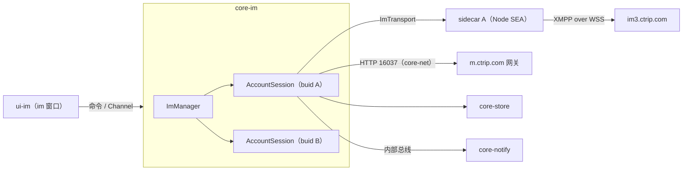

# 10 IM：core-im（含一期 Node sidecar）与 ui-im

2026-10-30

本文覆盖 Rust 核心模块 core-im、一期 IM sidecar 和前端模块 ui-im。公共约定（命名、通道、权限、窗口标签、性能预算）以 [00 总纲](00-architecture.md) 为准。用户要求本项目重点放在非 IM 部分，所以本篇只写到能指导开发与验收的程度。

## 1. 结论与定位

- **官方 IM 的“业务大脑”在页面里**：会话列表每 5 秒 HTTP 轮询一次、回复超时每 5 秒在页面里计算一次、未读数和新消息横幅都由页面算好再发给主进程。IM SDK 子进程只负责长连接收发。新客户端把这些全部搬进 core-im，页面只做渲染。
- **协议已基本看清**：`@ctrip/s-node-imclient-core` 是 **XMPP over WebSocket**（`wss://im3.ctrip.com/ws-xmpp/`），SASL 用户名是 UID、密码是 token（官方传入 `bticket`），应用层每 5 秒发一次 XEP-0199 ping。历史消息和会话列表走 HTTP SOA 服务 16037，不走长连接。
- **一期**：每个已登录账号一个 Node sidecar 进程（与官方“每账号一个 utilityProcess”一致，SDK 是全局单例），用 Node SEA 打成单文件。与 Rust 之间用**命名管道 + 4 字节长度前缀 JSON**；stdout/stderr 只收日志。
- **二期**：Rust 原生实现 XMPP over WebSocket，替换 sidecar 的 `ImTransport` 实现，core-im 对外接口不变。前提是拿到协议授权或说明，以及一期录制的报文样本做回归。
- **ui-im 必须重写**：官方输入框每次变更都会重算整个会话列表（草稿写进 `conversationList`），这是按键卡顿的直接原因之一。新页面的输入框独立于消息流和会话列表渲染；保留 tiptap（ProseMirror）但改为非受控用法。

## 2. 承接范围

### 2.1 官方进程与通道拓扑

| 组件 | 现状 | 出处 |
| --- | --- | --- |
| IM 子进程 | `utilityProcess.fork("../main/imsdk.js")`，按 `buid` 存进 `imProcessMap`；token 取账号的 `bticket` | index.js `createIMProcess` |
| 守护重启 | 非 0 退出码 1 秒后重启，累计 10 次放弃（`im process crash too many times`） | index.js `createIMProcess` |
| SDK 初始化 | `IMClient.init({env, appId:"900004", network:EXTERNAL, conversationType:ConversationList, initPageSize:0, withoutExtra:true, token})` | imsdk.js 函数 `k` |
| 子进程消息 | `init_im_sdk`、`append_port`、`remove_port`、`close_port`、`destroy` | constant-2w9sXoOv.js `PROCESS_MESSAGE_NAME` |
| 端口消息 | `send_message`、`message_send_status`、`new_message`、`new_notice`、`send_input_state`、`send_message_receipt`、`unread_count_change`、`bu_type_changed`、`connect_status_change` | constant-2w9sXoOv.js `PORT_MESSAGE_NAME` |
| 发送策略 | 先 `sendMessageInSocket`，失败再走 HTTP `sendMessage` | imsdk.js 函数 `P`、`I` |
| 断线处理 | `DISCONNECTED` 时调用 `IMClient.reconnect(true)`；`CURRENT_TOKEN_UNAVAILABLE` 只记日志 | imsdk.js 函数 `f` |

MessagePort 拓扑：

| 端口 | 两端 | 建立方式 | 出处 |
| --- | --- | --- | --- |
| IM 端口 | IM 子进程 ↔ imPlus / notice 页面 | 页面 `invoke("get_im_channel_port", buid, "imPlus")` → 主进程 `MessageChannelMain`，port2 经 `append_port` 交给子进程，port1 回传页面 | index.js `generateRenderPortByBuid`；preload/im.js |
| Main 端口 | main 外壳渲染进程 ↔ imPlus / notice 页面 | `get_main_channel_port` → `generatePortById`，一端发给 main 窗口 | index.js `generatePortById`；preload/main.js `setMainMessageHandler`、`postPortMessage` |
| 重连 | 子进程重启后主进程广播 `im_process_started`，页面重新要两个端口 | preload/im.js |

imPlus 与 notice 页面是挂在 main 窗口里的 BrowserView（按账号 `persist:` 分区，`webSecurity:false`），不是独立窗口（index.js，`pages/imPlus/index` 判断后改用 preload/im.js）。

### 2.2 IM 相关 IPC（页面 → 主进程方向居多）

| IPC | 方向与作用 | 出处 |
| --- | --- | --- |
| `new_message` | 页面 → 主进程：按偏好 `newMessageNotificationPop` 弹 notifier 横幅，并 `flashFrame(true)` | index.js `ipcMain.on(y.newMessage` |
| `unread_message_count` | 页面 → 主进程：更新托盘数字与 toolTip 列表 | index.js `ipcMain.on(y.unreadMessageCount` |
| `reply_timeout` | 页面 → 主进程：把超时会话列表转给 alarm 窗口 | index.js `ipcMain.on(y.replyTimeout`；imWindow `checkConvTimeout` |
| `jump_to_conversation` | 横幅 / toolTip → 主进程：切账号、聚焦主窗口、切到 im 页、定位会话 | index.js `ipcMain.on(y.jumpToConversation` |
| `get_current_messages` | ai 窗口向主进程取打开时传入的消息 | index.js `ipc.handle(y.getCurrentMessages` |
| `clear_message_by_user` | 主进程 → 提醒窗口：账号移除时清空 | index.js `removeAccount` |

preload/im.js 暴露给页面的 API：`appBridge`（`send`、`invoke`、`receive`、`dbQuery`、`netFetch`、`openExtraWindow`、`downloadFile`、`setLocalVoice`、`getLoginCookie`、`getAllLoginCookies`、`getCacheAccountList`）、`postImMessage`、`postMainMessage`、`setIMMessageHandler`、`reconnectImPort`、`getImPortStatus`。新客户端的 ui-im 是本地重写页面，**不需要兼容这些 API**。

### 2.3 imWindow bundle（`renderer-dist/js/imWindow-DeDFr-7q.js`，约 2.7 MB）

| 发现 | 证据 |
| --- | --- |
| 富文本：tiptap（StarterKit、Placeholder、Link、History、HardBreak） | `[tiptap error]`、`name:"starterKit"`、`name:"placeholder"` |
| 虚拟列表：@tanstack/virtual-core | `measureElement`、`estimateSize`、`overscan` |
| 会话列表每 5 秒 HTTP 轮询，并在同一定时器里算回复超时 | `startLoopConvList` → `setInterval(getConversationList + checkConvTimeout, 5e3)`；`replyTimeoutAlarmSecond` 默认 30 |
| 草稿改动会重建整个 `conversationList` | reducer 中 `draftHtml`、`draftDesc` 写回 `conversationList.map(...)` |
| 引用消息 | `citeMsgId` / `citemsgid` / `citeMessageInfo`；drizzle `0012_message_cite_msg_id.sql` 给 `messageInfo` 加 `citeMsgId` |
| 截图联动 | `openScreenShotPanel(isHiddenThisWindows)`，收到截图后插入 `` |
| 其他 | 输入状态 `isTyping`、`@` 提及、emoji、拼写检查 `spell_check`、打开 AI 窗口 `openAi` |

HTTP 接口表在 `BaseController-_xbuiF6A.js`：16037 服务提供 `getConversationList`、`getLatestConversationByGid`、`getConversationInfoByGidList`、`getMessageList`、`finishConversation`、`getCustomerScripts` 等；11679 提供 `getMessageTranslate`、`batchTranslateByMsgIds`、`getIQMessages`。

长任务实测（文档 02，来自插件仓库卡顿修复计划）：123 秒内 130 个长任务，合计约 26.9 秒，最长 1.8 秒；按键事件最长约 3.08 秒；React 提交约 1.47 秒。

### 2.4 SDK 包本身（`node_modules/@ctrip/s-node-imclient-core` 1.0.24）

| 项 | 结论 | 出处（main.js，未压缩，约 1 MB） |
| --- | --- | --- |
| 入口 | `main.js`（webpack UMD），另有 `parser.js`；无原生依赖，只用 Node 内置模块 | package.json；`require("net"/"tls"/"https"/"zlib"…)` |
| 对外 API | `IMClient.init/destroy/reconnect/sendMessage/sendMessageInSocket/sendInputState/putAdviceOfReadByMsgId`，`set*Listener`（连接状态、消息、通知、会话、同步、群信息、@数）；`CommonEnum`、`MessageFactory`（14 种消息类型） | `setOnReceiveConversationListener` 等；imsdk.js 函数 `C` |
| 传输 | xmpp.js 客户端，`wss://<websocketHost>/ws-xmpp/`，生产 host `im3.ctrip.com`，服务名 `im.ctrip.com` | 第 17706 行 `buildWebSocketUrl`；第 18555 行 `im.api.js` |
| 登录凭据 | SASL（PLAIN / SCRAM-SHA-1 / ANONYMOUS 三种机制），`username=UID`，`password=token` | 第 18138 行 `connectXMPP`；第 18109 行 `getWSPassword` |
| 心跳 | 每 5 秒发 `urn:xmpp:ping`；连续 3 次无响应或 60 秒未连上就重建客户端；xmpp.js 自动重连延迟在 Node 下取 5–10 秒随机 | 第 18255 行 `startConnectionCheck`；`reconnectTimeDelay` |
| WebSocket 实现 | `global.WebSocket \|\| WS`：有全局 WebSocket 就用全局的 | 第 2961 行 |

最后一条是一期风险：Node 22 起自带全局 WebSocket（undici），SDK 会改走它而不是内置的 `websocket` 库，行为可能不同（推断，需验证）。

## 3. Tauri / Rust 分工

| 放 Rust（core-im） | 放 sidecar（一期） | 放 WebView（ui-im） |
| --- | --- | --- |
| 账号级 IM 会话 actor、连接状态机、重启与退避 | 只跑 SDK：连接、心跳、收发、回执、输入状态 | 会话列表、消息列表、输入框渲染 |
| 会话列表（HTTP 拉取 + 推送合并）、未读、草稿、输入状态、回复等待时刻 | 不碰数据库、窗口、界面、偏好 | 虚拟列表、滚动锚定、图片懒加载 |
| 消息写入 core-store、离线补拉、去重 | 把 SDK 回调原样转成管道帧 | 富文本编辑、表情、@ 弹层、引用条 |
| 文件上传（经 core-net）、搜索（store FTS） | | 显示 Rust 推送的倒计时与未读 |
| 向 core-notify 发新消息、未读、回复超时 | | 助手插槽、截图按钮 |

## 4. Rust 核心设计

### 4.1 结构



每个 `AccountSession` 是一个 actor（总纲 4.5），持有本账号全部 IM 状态；`ImTransport` 是一期与二期之间的唯一接缝：

```rust
#[async_trait]
pub trait ImTransport: Send {
    async fn connect(&mut self, cred: ImCredential) -> Result<(), AppError>;
    async fn send(&mut self, msg: OutgoingMessage) -> Result<SendAck, AppError>;
    async fn send_input_state(&mut self, gid: &str, typing: bool) -> Result<(), AppError>;
    async fn read_receipt(&mut self, gid: &str, msg_id: &str) -> Result<(), AppError>;
    async fn shutdown(&mut self);
    fn events(&mut self) -> mpsc::Receiver<TransportEvent>; // Status / Messages / Notices
}
```

一期实现 `SidecarTransport`，二期实现 `XmppTransport`；测试用 `MockTransport` 注入消息，用于性能压测（第 9 节）。

### 4.2 状态

| 状态 | 内容 | 来源 | 持久化 |
| --- | --- | --- | --- |
| 连接状态 | NotConnected / Connecting / Connected / Kicked / TokenInvalid / NetworkUnavailable | SDK `ConnectionStatus` | 否 |
| 会话列表 | gid、标题、头像、最后消息摘要、状态、`inGroup`、置顶、`seq` | 16037 `getConversationList` + 新消息合并 | `conversationInfo` |
| 未读 | 每会话未读数、账号合计、全局合计 | 新消息与 `mark_read` | 随会话表 |
| 草稿 | 每会话 ProseMirror JSON + 纯文本摘要 | ui-im 防抖保存 | 新增 `draft` 列或表（需与 05 确认） |
| 输入状态 | 对方正在输入，3 秒无刷新自动清除 | SDK `InputStateMessage` | 否 |
| 回复等待 | 每会话“客人最后一条未回复消息的时间” | 消息流推导 | 否（启动时由消息表重算） |
| 发送队列 | `localId` → 状态（sending / sent / failed） | send 与 ack | `messageInfo.status` |

回复计时的分工：core-im 只负责事实（“会话 X 从 T 起等待回复”，阈值取偏好 `replyTimeoutAlarmSecond`，默认 30 秒）并用 tokio 定时器在到期时发内部事件 `ImEvent::ReplyTimeout`；提醒的展示、重复与升级由 core-notify 负责（见 [03 强提醒](03-strong-alert.md)）。

### 4.3 命令（插件名 `im`，capability `im.json`）

| 命令 | 参数 → 返回 | 说明 |
| --- | --- | --- |
| `plugin:im\|conversation_snapshot` | `{buid}` → `{seq, items}` | 窗口打开或跳号时调用 |
| `plugin:im\|unread_snapshot` | — → `{seq, total, by_account}` | |
| `plugin:im\|connection_snapshot` | — → 各账号连接状态 | |
| `plugin:im\|open_conversation` | `{buid, gid, channel}` → 最近一页消息 | 之后的新消息、状态变化走该 Channel |
| `plugin:im\|close_conversation` | `{gid}` | 释放 Channel |
| `plugin:im\|load_history` | `{gid, before_msg_id, limit}` → 消息页 | 先读 store，不足再调 `getMessageList` |
| `plugin:im\|send` | `{gid, local_id, kind, body, cite_msg_id?, at_uids?}` → `{local_id}` | 结果经 Channel 回 `send-status` |
| `plugin:im\|resend` | `{local_id}` | |
| `plugin:im\|mark_read` | `{gid, up_to_msg_id}` | 发回执、清未读 |
| `plugin:im\|set_typing` | `{gid, typing}` | 2 秒节流 |
| `plugin:im\|save_draft` | `{gid, doc, preview}` | 只改草稿，不触发列表全量刷新 |
| `plugin:im\|upload` | 原始字节（InvokeBody::Raw）或 `{media_id}` → `{file_id}` | 进度走 Channel |
| `plugin:im\|search` | `{query, gid?, limit}` → 命中 | store FTS5，仅本地已缓存消息 |
| `plugin:im\|jump` | `{buid, gid, msg_id?}` | notify、深链、toolTip 调用 |
| `plugin:im\|business_op` | `{op, payload}` | `finishConversation`、话术等 16037 接口，按页面需要逐个白名单 |

### 4.4 事件与 Channel

| 名称 | 通道 | 载荷 | 订阅方 |
| --- | --- | --- | --- |
| `im://conversation-changed` | 事件 | `{seq, upserts, removed}`，只含变化项 | im 窗口 |
| `im://unread-changed` | 事件 | `{seq, total, by_account}` | im、main、tooltip |
| `im://connection-changed` | 事件 | `{buid, status}` | im、main |
| `im://typing-changed` | 事件 | `{gid, typing}` | im |
| `im://reply-pending-changed` | 事件 | `{gid, deadline_ms}` 列表 | im（显示倒计时） |
| `im://jump` | 事件 | `{buid, gid, msg_id?}` | im |
| 会话消息流 | Channel | `messages` / `send-status` / `recalled` | 当前打开会话 |
| 上传进度 | Channel | `{file_id, sent, total}` | 调用方 |

内部总线（不出 Rust）：`ImEvent::MessageNew`（core-notify 用于横幅、闪烁、提示音）、`ImEvent::UnreadChanged`、`ImEvent::ReplyTimeout`、`ImEvent::ReplyCleared`。

### 4.5 消息写入、离线补拉与去重

1. 收到推送 → 规范化（`MessageFactory` 类型映射为 Rust 枚举，`messageBody` 原样保留 JSON）→ 批量写 `messageInfo`（50 ms 或 100 条一批，一个事务）→ 写成功后再推 Channel 和总线。
2. 去重键：服务端 `msgId`；自己发出的消息先以 `localId` 落库，ack 后回填 `msgId`。store 需在 `messageInfo(msgId)` 上加唯一索引（官方表没有主键，见 drizzle 0000）。
3. 补拉时机：sidecar 重启、`Connected` 恢复、系统从睡眠恢复、账号切回前台。做法：先拉 `getConversationList`，对 `lastMessageTime` 晚于本地的会话调用 `getMessageList(gid, after=本地最新)`，结果走同一去重写入。
4. 会话列表：保留与官方相同的 5 秒对账轮询，但放在 Rust、只在有变化时发事件；确认 SDK 的 `setOnReceiveConversationListener` 推送覆盖哪些变化后，再把轮询放宽到 30–60 秒（需验证）。

### 4.6 一期 sidecar

| 议题 | 结论 |
| --- | --- |
| 内容 | 一个 esbuild 打成单个 CJS 的脚本：SDK + 约 200 行包装（照搬 imsdk.js 的分发逻辑） |
| 打包 | **Node SEA**（Node 22/24 LTS 的 `--experimental-sea-config` + postject，或新版的 `--build-sea`，需验证）。pkg 已停止维护，yao-pkg 作为备选 |
| 运行时版本 | 先启动时删除 `globalThis.WebSocket`，让 SDK 使用内置 `websocket` 库，与 Electron 27（Node 18）行为一致；原型验证两种路径 |
| 体积 | node.exe 约 80 MB，LZMA 后约 25 MB，会突破总纲 30 MB 安装包预算。用 `--with-intl=small-icu` 自编 Node 或 UPX 前先测（需验证）；不达标则申请放宽一期预算 |
| Tauri 配置 | `bundle.externalBin: ["binaries/vbk-im-node"]`，文件名带目标三元组（`vbk-im-node-x86_64-pc-windows-msvc.exe`）。启动由 core-im 用 `tokio::process` 自行完成，不依赖 tauri-plugin-shell，以便挂 Job Object |
| 进程数 | 每个已登录账号一个（SDK 用模块级全局变量，不能多账号复用） |
| 通信 | **命名管道 `\\.\pipe\vbk-im-<pid>-<随机>` + 4 字节小端长度前缀 + UTF-8 JSON**。管道名与一次性握手 token 通过环境变量传入。不用 stdout 做数据通道：SDK 大量 `console.log`，会污染数据流 |
| 帧类型 | 请求：`init{env,uid,token}`、`send`、`input_state`、`receipt`、`reconnect`、`destroy`、`ping`；事件：`status`、`messages`、`notices`、`send_result{local_id,ok,msg_id,create_time,err}`、`pong`。名称对齐官方 `PORT_MESSAGE_NAME` |
| 健康检查 | Rust 每 10 秒发 `ping`，30 秒无 `pong` 视为卡死，强杀重启 |
| 崩溃重启 | 退避 1、2、4…30 秒；10 分钟内 10 次失败则标记账号 IM 不可用并上报 telemetry；每次重启后执行 4.5 的补拉 |
| 凭据 | token 从 core-account 取（官方用 `bticket`）；`TokenInvalid` 时请 core-account 刷新再 `init`；`Kicked` 不自动重连 |
| 代理 | Node 默认不读系统代理。core-net 把当前代理配置放进 `init`，包装层为 SDK 设置 agent（SDK 内有 `agent` 参数，是否可传需验证） |

### 4.7 二期 Rust 原生协议

| 项 | 内容 |
| --- | --- |
| 技术 | tokio-tungstenite（WSS）+ quick-xml 解析 stanza，SASL PLAIN / SCRAM-SHA-1 自写或用现成 crate（tokio-xmpp 是否支持 WebSocket 需验证）；XEP-0199 ping 每 5 秒 |
| 前提 | ① 获得携程对私有协议使用的许可或协议说明；② 一期 sidecar 在开发构建里录制脱敏 stanza，形成回放测试集；③ FAT/UAT 测试账号 |
| 风险 | 服务端扩展字段与消息类型没有文档，SDK 升级后行为漂移；SDK 中还有 HTTP 发送兜底与群同步等隐性逻辑；IBU / Trip 站点走 `getImServer` 动态取地址 |
| 退出条件 | 回放集 100% 通过，灰度两周连接成功率与消息到达率不低于 sidecar，之后删除 sidecar 与 externalBin |

## 5. 前端设计（ui-im）

窗口标签 `im`，首次打开后常驻、关闭即隐藏（总纲第七节）。页面结构：左侧会话列表、中间消息区、底部输入区、右侧助手面板（可收起）。

| 主题 | 设计 |
| --- | --- |
| 状态分区 | 三个独立 store：会话列表、当前会话消息、输入区。输入区 store 不被任何列表组件订阅；草稿防抖 500 ms 调 `save_draft`，会话列表只更新那一项的摘要 |
| 虚拟列表 | 继续用 @tanstack/react-virtual，底部锚定，key 用 `msgId ?? localId`；高度按 key 缓存；图片消息用消息体里的宽高先占位，避免回流；内存只保留每会话最近约 200 条，向上滚动再 `load_history` |
| 会话列表 | 同样虚拟化；事件只带变化项，按 gid 局部更新，不整表替换 |
| 编辑器 | **保留 tiptap**（团队熟悉，粘贴、提及、图片节点都有现成扩展），但改为非受控：不把文档 state 同步进 React，发送时才读取；不用 React NodeView。原型不达标时退到 ProseMirror 直用或 Lexical |
| 输入法 | `isComposing` 期间 Enter 不发送，不做任何同步 |
| 图片与文件 | 粘贴或拖入的文件以原始字节交给 `plugin:im\|upload`，前端只显示进度；大图缩略显示，点击由 core-media 打开 `viewer-image` |
| 引用 | 消息菜单“引用”→ 输入区上方引用条 → `send` 带 `cite_msg_id`；渲染时引用块从当前会话缓存取，缺失再按 id 查 store |
| 表情 | 标准表情面板与自定义表情（`customEmoji` 表）懒加载，首次打开才载入 |
| @ | tiptap Mention 扩展，候选来自 `groupMember`；发送时附 `at_uids` |
| 搜索 | 会话名本地过滤；消息全文走 `plugin:im\|search`，结果点击后 `open_conversation` 并定位 |
| 助手插槽 | 输入区上方“译文预览”、消息悬浮菜单项、右侧面板（订单查询、套餐速览）、会话头部语言标签。插槽只接收数据与回调，由 ui-assistant 填充（见 [09 商家助手](09-assistant.md)） |
| 截图 | 按钮或快捷键 → `plugin:media\|capture_start`；`media://captured` 携带 `media_id`，编辑器插入图片节点引用该 id，发送时 `upload{media_id}`，不经前端中转 base64 |
| 倒计时显示 | 用 `im://reply-pending-changed` 里的绝对截止时间本地显示；隐藏时停止刷新，不影响 Rust 计时 |

## 6. 与其他模块的联动

| 模块 | 关系 |
| --- | --- |
| core-account | `account://ready` 后为每个账号建 `AccountSession`；提供 token 与刷新；`account://changed` 时切换当前账号 |
| core-store | 会话、消息、群成员、自定义表情表的业务接口；新增唯一索引、草稿、FTS5 |
| core-net | 16037 / 11679 HTTP、上传、代理配置 |
| core-notify | 订阅 `MessageNew`、`UnreadChanged`、`ReplyTimeout`；点击后调用 `plugin:im\|jump` |
| core-shell | 显示与聚焦 `im` 窗口；深链 `vbookingChat://` 转为 `jump` |
| core-media | 截图、图片预览、拼写检查 |
| core-assistant | 翻译、TSim；通过插槽进入 ui-im |
| ai 窗口（ui-business） | 取当前会话消息改为 `plugin:im\|load_history`，替代 `get_current_messages` |

## 7. 关键流程

| 流程 | 步骤 |
| --- | --- |
| 登录后连接 | account ready → 启动 sidecar → 管道握手 → `init` → `status=Connected` → 拉会话列表 → 补拉 → 发快照版本 |
| 收消息 | sidecar `messages` → 规范化、去重、批量入库 → Channel 推当前会话、`conversation-changed`、`unread-changed` → 总线 `MessageNew` → notify 横幅 |
| 发消息 | 前端生成 `localId` 并乐观显示 → `send` → 落库 sending → sidecar socket 发送，失败自动 HTTP 兜底 → `send_result` → 回填 `msgId` → Channel `send-status` |
| sidecar 崩溃 | 进程退出或 ping 超时 → 状态 Connecting → 退避重启 → 重连成功后补拉 → 前端只看到连接条闪一下 |
| 回复超时 | 客人消息入库 → 记录等待起点并设定时器 → 商家回复则取消 → 到期发 `ReplyTimeout` → notify 打开 alarm |

## 8. 注意事项（Windows 优先）

- **控制台窗口**：SEA 产物是控制台程序，启动必须带 `CREATE_NO_WINDOW`，否则会闪黑框。
- **随父退出**：sidecar 放进 Job Object 并设 `JOB_OBJECT_LIMIT_KILL_ON_JOB_CLOSE`，主进程崩溃时不留孤儿进程。
- **命名管道安全**：首实例创建（`first_pipe_instance`）、拒绝远程客户端、ACL 仅当前用户；握手 token 不对再断开。
- **签名**：postject 注入后再签名，sidecar 与主程序用同一 EV 证书，减少杀软误报。
- **非 ASCII 路径**：用户名含中文时验证 sidecar 路径与日志路径。
- **TLS**：SDK 只在内网模式下设置 `NODE_TLS_REJECT_UNAUTHORIZED=0`；我们固定 `EXTERNAL`，需确认没有走到该分支。
- **睡眠恢复**：监听电源事件，恢复后主动 `reconnect` 并补拉，不等 ping 超时。
- **macOS（二期）**：管道换 Unix 域套接字，Job Object 换进程组；其他不变。

## 9. 原型验证项与验收标准

| 验证项 | 方法 | 通过标准 |
| --- | --- | --- |
| SEA 打包 SDK | Node 22 / 24 打包，分别测删除与保留全局 WebSocket | 连接、收发、重连与官方一致 |
| 安装包体积 | 完整 NSIS 包 | ≤ 30 MB，或给出放宽理由 |
| 管道吞吐 | Mock 每秒 500 条消息 | 端到端 P95 ≤ 20 ms，无丢帧 |
| 崩溃恢复 | 发送中强杀 sidecar | 10 秒内恢复，无重复无丢失 |
| 编辑器 | 1 万字草稿、连续输入、IME | 按键 P95 ≤ 50 ms |
| 长列表 | 1 万条消息会话来回滚动 | 帧耗时 P95 ≤ 16 ms |

性能测量方法：

| 指标 | 采集方式 | 预算 |
| --- | --- | --- |
| 长任务 | `PerformanceObserver('longtask')` 记录次数与时长，开发构建上报 telemetry | 10 分钟脚本内 ≤ 5 次，单次 ≤ 100 ms |
| 按键延迟 | Event Timing API（`event` 条目，`durationThreshold: 16`）取 keydown / input 到下一帧 | P95 ≤ 50 ms，最大 ≤ 100 ms |
| 新消息上屏 | Rust 入库时间戳随 Channel 下发，前端 rAF 后对比 | ≤ 100 ms |
| 切换会话 | 点击到消息区首帧 | ≤ 150 ms（本地有缓存） |
| 内存 | im 窗口渲染进程 + 每个 sidecar 工作集 | im ≤ 150 MB，sidecar ≤ 60 MB（需实测定标） |

压测脚本：MockTransport 每分钟注入 200 条消息，3 个活跃会话，每 30 秒切会话，模拟 60 字/分钟输入并向上翻历史，连续 10 分钟。测试构建用 tauri-driver + msedgedriver 驱动；正式构建不开调试端口。对照组为官方 1.2.12 同场景。

## 10. 开发步骤与工作量估计

| 步骤 | 内容 | 人日 |
| --- | --- | --- |
| 1 | sidecar 包装脚本、SEA 打包、签名、体积验证 | 4 |
| 2 | 管道协议、SidecarTransport、Job Object、健康检查与重启 | 4 |
| 3 | AccountSession：会话列表、未读、草稿、输入状态、回复等待 | 5 |
| 4 | 入库、去重、补拉；16037 接口接入 | 4 |
| 5 | 命令、事件、Channel 与 contracts 类型 | 2 |
| 6 | ui-im 框架：三分区 store、会话列表、消息虚拟列表 | 6 |
| 7 | 编辑器、表情、@、引用、草稿、IME | 5 |
| 8 | 图片文件上传与预览、截图联动、搜索 | 4 |
| 9 | 助手插槽、业务操作（结束会话、话术等） | 3 |
| 10 | MockTransport 压测、性能调优、验收 | 4 |
| 合计（一期） | | **41** |
| 二期 | Rust XMPP、回放测试、灰度 | 15–25（取决于协议资料） |

## 11. 待确认问题

1. 新客户端 IM 是独立 `im` 窗口（总纲）还是像官方一样嵌在 main 外壳里？影响窗口切换体验与 capability 划分。
2. 一期安装包带 Node 后能否达到 30 MB；不能时是否接受一期放宽到约 45 MB。
3. 能否取得携程对 IM 协议与 SDK 再分发的许可；二期是否立项取决于此。
4. 文件上传依赖的 `@ctrip/im-web-file-uploader` 能否在 sidecar 中运行，还是在 Rust 里按抓包重写。
5. 会话状态变化（分配、结束、转接）是否都有推送；决定 5 秒对账轮询能否放宽。
6. 回复计时的定时器归 core-im 还是 core-notify，需要与 03 文档统一（本文按“core-im 判定到期、core-notify 负责展示与升级”写）。
7. 草稿是否需要跨设备同步；官方只存本地内存与列表摘要。
