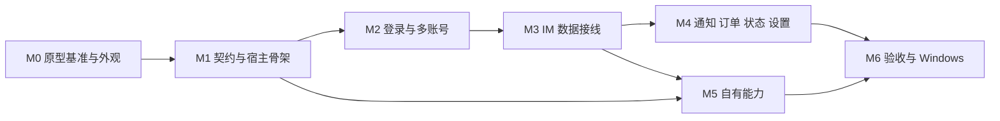

# 原型还原与端到端接线开发计划（macOS 先行）

2026-10-30。状态：计划，未开始实施。本文取代[总计划](00-master-development-plan.md) 第 2 节中“P0 网页接入原型”之后的执行顺序；范围、不变量和任务正文仍以总计划与 `docs/dev/` 为准。

## 1. 结论

当前 `vbk/` 能启动，但只是一个**未接线的本地界面外壳**。界面能画出来，数据、登录和大部分按钮背后没有宿主实现，所以看上去“功能没还原、接口没接上、登录登不上”。三件事的根因各不相同，必须按顺序修：

1. **外观**：主窗口同时开着 macOS 原生标题栏和自绘的 Windows 式标题栏，出现双标题栏，右侧最小化/最大化/关闭按钮调用的 `shell_window` 宿主没有实现。拖拽区写的是 Electron 的 `-webkit-app-region`，Tauri 不认。
2. **接口**：前端调用的 28 条命令（会话、消息、发送、通知、订单、设置、助手、窗口操作）只在 `ui/packages/ipc/src/client.ts` 里以“proposed, NOT frozen”的形式存在，宿主 `src-tauri/src/lib.rs` 只注册了另外 19 条。前端监听的 8 个事件宿主也一个都不发。已注册的账号命令参数和返回形状也与前端不一致。
3. **登录与数据**：`account_start_login` 只把官方登录页 URL 字符串返回给前端，宿主从未创建登录窗口或按账号隔离的 WebView，也从未调用 `publish_identity`，所以账号表永远为空。`web-adapter` 没有任何装配入口，没有加载官方页面的 WebView，`im_push_fact` 没有生产者，会话列表、消息、强提醒都拿不到数据。

截图里的状态栏“在线 · 回读 / 已连接”是前端初始默认值，不是宿主回读结果，属于误导性显示，也要一并修正。

原有测试（`cargo test` 297 项、Playwright 冒烟 211 项）全部跑在 mock IPC 上，只证明界面逻辑与核心算法，不能证明宿主接线。本计划的每个验收都必须在真实 `.app` 中执行。

## 2. 还原基准

用户指定的设计基准是 Claude Artifact 原型（Main / Alerts / Login 三块画板）：<https://claude.ai/artifact/DfzVFbQ8Fa4W6JG4GYKztm>。

本轮编写计划时**未能读取该原型**：文档工具返回无访问权限，仓库中也没有画板副本。以下信息来自仓库对原型的二手记录，需在 M0 第一步用原型本体核对：

| 来源 | 内容 |
| --- | --- |
| `vbk/ui/packages/ui-kit/src/tokens.css` | 从 `Main.dc.html` / `Alerts.dc.html` 提取的颜色、字号、圆角、阴影、布局尺寸（标题栏 40、导航 68、会话列表 280、侧栏 330、状态栏 26） |
| `vbk/ui/apps/main/styles.css` | 原型 `.win/.tb/.nav/.clist/.chat/.side/.ncat/.biz` 结构的移植 |
| [删减清单](2026-10-30-frontend-prototype-pruning.md) | 原型中要删的携程业务模块、必须保留的功能和检查表 |
| `vbk/ui/apps/REVIEW-2026-10-30.md` | 画板本身仍含被删模块，只作视觉参照 |

**平台规则**：原型是 Windows 视觉。macOS 版保留原型的配色、布局和组件，只改窗口外壳：红绿灯在左、去掉右侧三按钮、字体优先 PingFang SC、托盘语义换成菜单栏与 Dock。Windows 版保持原型原样。

## 3. 动手前必须定下的六个架构决定

这些决定决定了后面所有代码的形状，必须在 M1 开始前写成 `docs/decisions/` 下的记录。

| 编号 | 决定 | 推荐方案 | 需要实测确认 |
| --- | --- | --- | --- |
| D1 | macOS 窗口外壳 | `tauri.macos.conf.json` 为 main 设 `titleBarStyle: "Overlay"`、`hiddenTitle: true`、`trafficLightPosition` 对齐自绘标题栏中线；Windows 设 `decorations: false` 保留自绘三按钮 | 红绿灯坐标与 40px 标题栏对齐；全屏与分屏表现 |
| D2 | 每账号隔离的官方网页承载 | 每个账号一个隐藏的 `WebviewWindow`，`WebviewUrl::External` 加载官方 IM 页；macOS 用 wry 的 `data_store_identifier` 隔离，Windows 用 `data_directory` | WKWebsiteDataStore 标识在当前 macOS 与 wry 0.57 下可用；两个账号 Cookie 真正隔离 |
| D3 | 页内适配器回传通道 | `initialization_script` 注入 `web-adapter` 构建产物；用 Tauri 2 capability 的 `remote.urls` 只给官方域名开放 `adapter_*` 窄命令，不给通用 IPC | 远程 capability 在官方页面跳转、iframe、Service Worker 下的边界 |
| D4 | 展示数据通路 | 事实信封保持不含正文。另设 `DisplayCache`：适配器把会话标题、预览、消息正文推给宿主内存缓存，按 `AccountContext` 隔离，不落盘、不进日志，宿主再定向发给 main | 正文是否需要磁盘缓存；缓存容量上限 |
| D5 | 写操作路径 | 宿主到页面的请求通道：宿主 `emit_to(账号 WebView, "adapter://request", {req_id, op, args})`，适配器执行后用 `adapter_reply` 回传；发送沿用 `confirmed/rejected/unknown`，超时记 unknown 不重发 | 页面隐藏时 JS 定时器与 SDK 是否被 WebKit 节流 |
| D6 | 登录完成判定 | 账号 WebView 先显示官方登录页；导航离开登录路径后，在页内调用户信息接口取 `buid/uid/agent_id`，经 `adapter_identity` 交宿主 `publish_identity`，然后隐藏窗口并导航到 IM 页 | 短信、滑块等验证方式下的跳转路径；同身份重复登录的处理 |

## 4. 里程碑

每个里程碑结束时，必须在真实 `.app` 中完成验收步骤并留截图或录屏到 `docs/observations/`。mock 冒烟只作回归保护。

### M0 原型基准与 macOS 外观（约 2 天）

目标：真实 `.app` 打开后和原型一眼对上，并且不显示任何假状态。

| 任务 | 内容 | 主要文件 | 验收 |
| --- | --- | --- | --- |
| M0-1 原型落库 | 把原型三块画板导出为 HTML 与 PNG 存入 `docs/design/prototype/`，逐屏列出区域、尺寸与交互；删除被删模块后作为唯一视觉基准 | `docs/design/prototype/` | 文件入库；`tokens.css` 与原型逐项比对无偏差 |
| M0-2 窗口外壳 | 落实 D1；main 标题栏在 macOS 左侧留出红绿灯宽度，隐藏 `.wbtns`；Windows 保留三按钮；拖拽区改为 `data-tauri-drag-region`，并给 main 加 `core:window:allow-start-dragging` | `src-tauri/tauri.conf.json`、`tauri.macos.conf.json`、`ui/apps/main/main.ts`、`styles.css`、`capabilities/main.json` | macOS 截图只有一行标题栏，红绿灯在左可用，标题栏可拖动；Windows 截图三按钮在右 |
| M0-3 平台识别 | 宿主在页面加载前注入 `window.__VBK_PLATFORM__`，前端按 `macos/windows` 切换 class；字体栈 macOS 用 PingFang SC 优先 | `src-tauri/src/windows.rs`、`ui/packages/ui-kit/src/tokens.css`、`base.css` | 两个平台字体渲染截图与原型一致 |
| M0-4 去掉假状态 | `agent` 初始为“未知”，`net` 初始为“未连接”；无账号时主区显示原型的欢迎态与“添加账号”按钮，不显示空会话列表 | `ui/apps/main/main.ts`、`viewmodel.ts`、`i18n.ts` | 无账号启动截图：状态栏无“在线/已连接”，主区只有添加账号入口 |
| M0-5 其余窗口 | alarm、设置、登录外壳按原型调整；设置窗在 macOS 也走 Overlay 标题栏 | `ui/apps/{alarm,setting,login}/` | 三个窗口截图与原型对应画板比对 |
| M0-6 可调试构建 | 增加带 `devtools` feature 的本地构建脚本，便于在 `.app` 里看控制台 | `vbk/package.json`、`vbk/README.md` | 调试版可打开 Web Inspector |

### M1 IPC 契约统一与宿主骨架（约 3 天）

目标：前端每个按钮都有宿主命令可达，失败时给出真实原因而不是“命令不存在”。

| 任务 | 内容 | 主要文件 | 验收 |
| --- | --- | --- | --- |
| M1-1 契约定稿 | 把 `client.ts` 中 28 条 proposed 命令与 DTO 逐条审定，移入 `commands.ts` 与 `crates/contracts`；按 UI-REVIEW 的 C-01～C-05 修正；`account_*` 统一参数为 `{account}`、返回 `UiAccountSnapshot` | `ui/packages/ipc/src/{commands,contracts,client}.ts`、`crates/contracts/src/` | `tsc` 与 `cargo test` 通过；proposed 标注清零 |
| M1-2 一致性检查 | 新增测试：`commands.ts`、`src-tauri/commands.txt`、`generate_handler!`、`capabilities/*.json`、`views.rs` 五处命令清单必须一致 | `vbk/tests/`、`src-tauri/build.rs` | 故意删一处时测试失败 |
| M1-3 命令实现 | 宿主实现全部命令。依赖账号 WebView 的命令先返回结构化错误 `adapter.not_ready`；`shell_window`、`shell_open_window`、`shell_open_external`（只放行 HTTPS 官方域名）、`prefs_set`、`net_status` 直接做完 | `src-tauri/src/commands.rs`、新增 `src-tauri/src/{shell,prefs}.rs` | 真实 `.app` 中每个按钮点击后要么生效，要么提示“账号未连接”，无“命令不存在” |
| M1-4 事件投影 | 宿主在核心状态变化后定向发送 `account://changed`、`im://*`、`net://*`、`prefs://changed`、`account://agent-status`、`shell://toast`；main 接收 `notify://banner`、`play-sound`、`stop-sound`、`im://locate-conversation`、alarm 快照计数 | `src-tauri/src/{state,scheduler}.rs`、`ui/apps/main/main.ts` | 事件日志中每个事件都有发送方与接收方 |
| M1-5 偏好持久化 | `PrefsSnapshot` 在 `core-store` 中持久化，设置窗修改后重启仍保留 | `crates/core-store`、`src-tauri/src/prefs.rs` | 改 T1 与发送模式后重启读回一致 |

### M2 登录与多账号（约 4 天，关键路径）

目标：在 macOS 上用官方登录页登上真实账号，标题栏出现账号标签，重启后免登。对应 ACC-02、ACC-04、ACC-05、NET-02、MAC-01。

| 任务 | 内容 | 主要文件 | 验收 |
| --- | --- | --- | --- |
| M2-1 账号 WebView 工厂 | 落实 D2；`ProfileLease` 由 `core-account` 的 `profile_id` 驱动；登录尝试取消时销毁 WebView | 新增 `src-tauri/src/profiles.rs` | 两个账号各登录一次，Cookie 互不可见（用 Web Inspector 核对） |
| M2-2 登录窗口 | “添加账号”打开登录窗：本地 40px 头部（账号序号、取消）加官方登录页；不注入任何脚本到登录页、不读取密码 | `src-tauri/src/windows.rs`、`ui/apps/login/` | 能看到并操作官方登录页，含短信或滑块验证 |
| M2-3 登录完成与身份 | 落实 D6：监听导航，离开登录路径后注入只读身份脚本，调用户信息接口，`publish_identity` 后发 `account://changed` | `src-tauri/src/profiles.rs`、`ui/packages/web-adapter/src/identity.ts`（新增） | 标题栏出现真实昵称；同一账号再次登录不产生第二个标签 |
| M2-4 持久化与免登 | 账号索引写入 `core-store`；凭据交给 macOS Keychain 的 `SecretStore` 实现；启动先 Validating，校验通过才 ready | `crates/core-account`、新增 `src-tauri/src/keychain.rs` | 退出重开后账号直接在线；手动清 Cookie 后回到登录页 |
| M2-5 退出三模式 | 退出在线、退出登录、彻底移除分别处理 WebView、Cookie、Keychain 与本地记录 | `src-tauri/src/commands.rs` | 三种方式后的磁盘与 Keychain 状态符合 `docs/dev/02-account-login.md` |
| M2-6 失效处理 | 适配器报 `auth_invalid` 后标签显示“已失效”，点击重新打开登录窗，旧代次回调被拒 | `src-tauri/src/state.rs`、`ui/apps/main/main.ts` | 服务端踢下线后不显示旧数据 |

### M3 IM 数据接线（约 6 天，关键路径）

目标：会话列表、消息、发送、已读、置顶、颜色标记都来自真实网页，强提醒窗收到真实事实。对应 IM-02、IM-05、IM-06、IM-07、UIIM-01、UIIM-02。

| 任务 | 内容 | 主要文件 | 验收 |
| --- | --- | --- | --- |
| M3-1 适配器装配 | 新增页内入口：从页面取 `cid/sid/clientId/locale` 与官方 `IMClient`，构造真实 `AdapterDeps`，调用 `createAdapter().start()`；构建为单文件供 `initialization_script` 注入 | 新增 `ui/packages/web-adapter/src/boot.ts`、`ui/tools/bundle.mjs` | 账号 WebView 中控制台可见适配器启动与传输状态 |
| M3-2 回传通道 | 落实 D3；`adapter_push_fact`、`adapter_push_display`、`adapter_reply` 三条窄命令，宿主校验来源 WebView 与账号代次 | `src-tauri/capabilities/adapter.json`（新增）、`src-tauri/src/adapter.rs`（新增） | 伪造其他账号的推送被拒；main 窗无法调用这些命令 |
| M3-3 展示缓存 | 落实 D4；`im_conversations`、`im_messages` 读 `DisplayCache`；新消息发 `im://message-new` | `src-tauri/src/display.rs`（新增） | 会话列表与官方网页同屏对比一致 |
| M3-4 角色与未读 | 组合 `checkMemberStatus`、`getConversationInfoByGidList` 与 `history.ts`，填充角色表与未读数；解决 U02 新 epoch 首轮全量问题 | `ui/packages/web-adapter/src/index.ts` | 客户消息角色不再是 unknown；未读数与网页一致 |
| M3-5 写操作 | 落实 D5；发送文本、已读、置顶、颜色标记走宿主到页面的请求通道；补齐 `sessionId/worksheetId/partnerJid` 等载荷来源 | `src-tauri/src/adapter.rs`、`ui/packages/web-adapter/src/boot.ts` | 用测试会话完成发送并看到 confirmed；断网时显示 unknown 且不重发 |
| M3-6 强提醒联调 | 真实客户消息等待 30 秒后 alarm 弹出，回复后消失 | 无新文件 | 录屏：不抢焦点、点击定位正确会话 |
| M3-7 后台保活 | 主窗口隐藏、最小化、锁屏、睡眠后适配器仍工作或能补偿 | `src-tauri/src/profiles.rs` | 隐藏 30 分钟后消息与强提醒不缺失 |

### M4 通知、订单联系、客服状态与设置（约 4 天）

| 任务 | 内容 | 验收 |
| --- | --- | --- |
| M4-1 通知中心 | `notice_categories/list/mark_read` 接官方 IQ 接口；通知链接用 `shell_open_webview` 在当前账号 WebView 中打开 | 分类与未读数和网页一致；标读后网页读回 |
| M4-2 订单联系 | `order_search` 与 `order_create_im_chat` 走页内适配器；“网页高级操作”在账号 WebView 新窗口打开详情页；先解决 U01 `x-req-src` | 用测试订单完成“查询 → IM 联系 → 会话打开” |
| M4-3 客服工作状态 | 读回与切换在线/挂起/离开/下班，状态栏只显示读回值 | 切换后网页端同步显示 |
| M4-4 网页个人设置 | 个人资料、上班时间、快捷回复、自动答复、自动翻译走网页接口并读回 | 修改后刷新网页一致 |
| M4-5 截图对照 | 主窗口三个视图、账号菜单、退出对话框与原型逐屏对照 | 对照表全部通过或列出偏差理由 |

### M5 自有能力补齐（约 6 天，可与 M4 并行）

| 任务 | 内容 | 对应任务 | 验收 |
| --- | --- | --- | --- |
| M5-1 菜单栏与 Dock | 菜单栏图标与菜单、Dock 角标、Dock 弹跳、悬停未读预览 | SHL-06、NTF-04 | 未读 0/1/99/120 显示正确 |
| M5-2 声音与系统通知 | 接 `tauri-plugin-notification`，L2 横幅与 L3/L4 声音真正播放 | NTF-04、NTF-05 | 每轮最多一次超时音；L4 循环与封顶 |
| M5-3 快捷键与自启 | 初始化已声明但未启用的 global-shortcut 与 autostart 插件 | SHL-06 | 冲突快捷键不抢占；自启可关 |
| M5-4 商家助手 | 宿主实现 `core-assistant` 的 HTTP 执行；TSim 登录凭据进 Keychain；翻译栏与套餐速览接真实服务 | AST-02～06 | 外语会话中文输入 0.5 秒出译文；两种发送模式可用 |
| M5-5 截图、OCR、纠错 | macOS 屏幕录制权限、遮罩与标注、插入草稿 | MED-03、MED-04、MED-07、MAC-02 | 拒绝权限不崩溃；截图插入当前会话 |
| M5-6 更新与诊断 | 补 `ui/apps/update`，接 updater 插件与签名；诊断包脱敏导出 | REL-05～09 | 更新流程在测试源上跑通 |

### M6 验收与 Windows 对齐（约 4 天）

1. 按 `docs/dev/03-strong-alert.md` 第 7 节和总计划 QA-02～QA-05 在 macOS 跑完矩阵：隐藏、最小化、睡眠、断网、重启、登录失效、双账号。
2. 签名与公证（MAC-03），干净用户机安装。
3. 在 Windows 上重跑 M0～M4 的验收截图，确认右侧三按钮与 WebView2 Profile 路线。
4. 回写 `vbk/README.md` 与总计划第 5 节状态表，只把实测通过的项改为 `target_verified`。

## 5. 依赖顺序

M0 与 M1 可以部分并行：M0-1、M0-2 不依赖契约。M2 是整个计划的关键路径，D2 与 D6 的实测失败会阻塞后续全部数据接线，应最先做一个半天的可行性尖刺：一个隐藏 WebView 加载官方登录页、登录、读取身份。

## 6. 规则

- 不把 mock 冒烟或单元测试当作验收；每个里程碑的验收都在真实 `.app` 中完成。
- 不自建登录表单，不读取密码，不把 Cookie 复制进业务库或日志。
- 受控收发只用测试会话，不向真实客人发送试验消息。
- 被删的携程业务模块不恢复，原型中出现的也不还原，以[删减清单](2026-10-30-frontend-prototype-pruning.md)为准。
- 新增命令必须同时改五处清单，并由 M1-2 的一致性测试把关。

## 7. 需要用户提供或确认

1. **原型本体**：请把 Artifact 共享给本工具可读的账号，或把三块画板的 HTML 或截图放进 `docs/design/prototype/`。没有原型本体，M0 的逐屏对照无法执行。
2. **测试账号**：M2、M3 需要至少两个可登录的 VBooking 测试账号和一个可收发的测试会话。
3. **测试订单**：M4-2 需要一个可联系客人的测试订单号。
4. **TSim 测试账号**：M5-4 需要。
5. **macOS 签名身份**：M6 的签名与公证需要 Developer ID。

## 8. 2026-10-31 落盘状态

原型已解包落库到 `docs/design/prototype/`（三块画板源码与渲染图）。M0–M3 的代码已由 7 个并行 owner 落盘并通过集成检查；M4、M5 中的通知、订单、客服状态、商家助手、截图与偏好的宿主命令也已实现，但全部未用真实账号验证。

| 检查 | 结果 |
| --- | --- |
| `tsc -p tsconfig.json` | 无错误 |
| `node --test "ui/**/*.test.ts"`（含命令清单一致性测试） | 189 通过 |
| `cargo test --workspace`、`clippy -D warnings` | 通过，0 警告 |
| `src-tauri`：`cargo check / clippy / test` | 通过，57 项 |
| Playwright 冒烟（mock） | 275 通过 |
| 本机 debug 构建实机 | 主窗口单行标题栏、红绿灯在左、无账号欢迎态、状态栏不再显示假“在线/已连接”（[截图](../observations/2026-10-31-macos-main-welcome.png)）；“添加账号”打开登录窗，官方登录页在隔离 data store 中加载（[截图](../observations/2026-10-31-macos-login-window.png)） |

更正：2026-10-30 记录的“主窗口黑屏”是截图方式造成的假象。macOS 不绘制被其他窗口遮挡的 WKWebView，窗口置前后截图正常。

尚未实测：登录完成后身份上报与账号标签、会话与消息数据、发送三态、通知与订单、客服状态切换、TSim、截图权限、提示音、重启免登与三种退出、Windows 构建。官方页面 SDK 全局对象名、`sendMessageInSocket` 签名、IQ 通知接口 head 仍无证据，见各模块报告中的契约变更请求。
