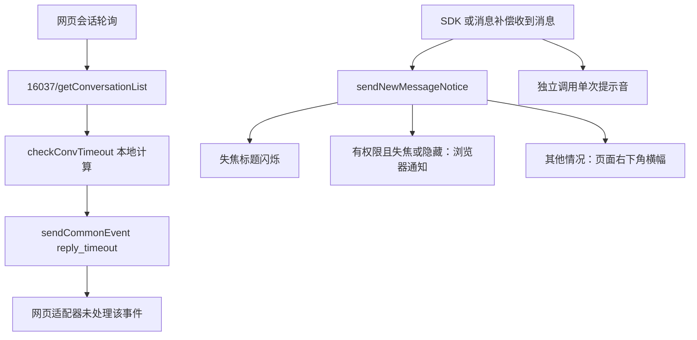

# 网页消息提醒与“强提醒”调查

2026-10-30，Asia/Singapore。解释网页实际提醒链路。当前范围以[范围决定](../decisions/2026-10-30-web-only-scope.md)为准：网页能力为基准，独立强提醒窗口为用户明确保留的唯一扩展。覆盖新版 `vbooking.ctrip.com/vbk/im/main`，并对照订单联系入口打开的旧版 `imvendor.ctrip.com/main`。

## 1. 结论

**没有发现独立的“强提醒业务接口”。当前网页可用的普通提醒来自收消息链路，再由浏览器本地实现横幅、标题闪烁、浏览器通知和声音。**

| 能力 | 当前证据 | 开发处理 |
| --- | --- | --- |
| 新消息/系统通知提醒 | 实际出现右下角“系统通知”；旧版标签实际出现“您有新消息”；代码有浏览器通知和单次声音 | 保留网页语义 |
| 回复超时强提醒 | 新版共享业务代码计算超时，但网页适配器没有承接 `reply_timeout`；未发现可用的对应独立弹窗入口或 API | 用户明确保留独立窗口作为本项目扩展，使用已有消息事实本地计算；不新增循环声音或分级升级 |
| 通知分类“特别关注” | 有 `optStatus=alert` 分支，但分类右键菜单在 `platform==web` 时 disabled，星标入口也排除 web | 不把共享代码中未启用的菜单做成网页能力 |

这不是对所有账号和网页版本的永久性结论；目标网页若以后出现真实入口，应先补证据调整范围。默认设置字段、枚举或未启用代码不能单独成为开发任务。

## 2. 用户切为在线后的观察

用户手动把客服状态改为“在线”后，两个网页均读到了在线状态，新版消息列表有新增会话和未读计数。本轮保持自然流量，没有发送测试消息、切换工作状态或修改提醒设置。

约 17:11:46–17:12:32 连续观察 45 秒，每 15 秒采样：

- 三次样本均没有回复超时、超时提醒或强提醒文案，也没有独立对话框。
- 页面可见且有焦点，浏览器通知权限为 `granted`。
- DOM 音频元素均 `loop=false`，采样时暂停。这里只证明配置，不声称通过听觉验收或每条提醒都播放成功。
- 网络持续有 `16037/getConversationList`、`11679/getRecentMessages` 等请求，未捕获独立强提醒端点。任务空间中新旧网页并存，网络队列含多页自然流量，不能用它断言某一页的精确轮询频率。

没有构造角色、未回复时间、接管状态均受控的客户消息，因此 **45 秒未弹窗不能单独证明没有强提醒**。下一节的网页调用链是主要证据。[在线采样](evidence/web-reminder-online-observation-20261030.json)、[网络契约摘要](evidence/message-notice-order-live-20261030.json)。

## 3. 超时分支为什么没有形成强提醒

当前新版入口脚本 `main-3007b16f6fe839b6.js` 只有 337 字节，实际业务位于 `296-1776b2655d6f3342.js`。不能继续沿用较早构建的单个大 main 文件证明当前实现。

精确调用链：

1. `startLoopConvList` 设置 5 秒 interval，依次 `getConversationList()`、`checkConvTimeout()`。这是代码调度配置，不保证后台标签实际每 5 秒执行。
2. `checkConvTimeout` 读取本地 `prefrences.replyTimeoutAlarm` 和 `replyTimeoutAlarmSecond`，后者默认 30 秒，逐会话调用压缩函数 `rF`。
3. `rF` 排除已结束、BOP、`inGroup!=1` 的会话；向前寻找有效成功消息，跳过机器人和携程客服。最新有效消息应来自客户，再寻找这一轮未被商家回复截断的客户消息。租车 `CAR_TIMEOUT` 另有分支。
4. 时间比较为 `Date.now() - createTime + (__server_client_timediff__ || 0)` 与阈值比较；没有调用平台 SLA、首响考核或后端倒计时接口。
5. 结果经 `nT.sendCommonEvent(en.replyTimeout, list, user)` 发出。但 `nT` 绑定到浏览器适配对象 `nx`，其 `sendCommonEvent` **只处理 `openExtraWindow` 并调用 `window.open`**，没有 `reply_timeout` 分支；`listenToCommonEvent` 也返回空解除函数。

所以默认值 `replyTimeoutAlarm=true`、枚举 `reply_timeout` 都不能证明网页会显示桌面强提醒窗。这里不是一个待补 URL 的后端接口，而是当前网页没有承接的展示分支。用户随后明确保留独立窗口，因此由本项目在网页事实之上新增本地实现，不能宣称为网页原有功能。

## 4. 普通提醒的数据与展示

### 数据来源

网页通过 Web IM SDK 接收消息，并以 HTTP 初始化、补偿和刷新；实时连接证据见[网页传输调查](2026-10-30-web-im-observation.md)。

| 接口（均 POST，路径相对 `/restapi/soa2`） | 本轮观察/用途 |
| --- | --- |
| `/11679/getRecentMessages` | 消息增量/补偿，不是专门的超时提醒接口 |
| `/16037/getConversationList` | 会话列表、工作状态和未读等事实，本地超时计算的输入 |
| `/11679/getIQConversations` | `head, lastMsgTime`；通知分类树、未读数与最后消息 |
| `/11679/getIQMessages` | `categoryId, categorySubId, lastMsgTime, pageSize` 加公共头；返回 `iqMessages` |
| `/11679/putAdviceofreadIQMessage` | `categoryId, categorySubId, msgId`；进入分类后网页自身会标读、更新未读展示 |

这些请求均捕获过；部分响应体因时机或子会话归属未读到，不能把所有 HTTP 200 视为业务验收通过。进入通知分类会触发标读，本次不称为无副作用抓包。

### 触发与呈现

新版 `updateNewMessageFromSDK` 分别处理系统已读等事件；普通非本人消息在不属于当前可见且有焦点的会话时调用 `showNewMessageNotify`，声音另调 `playMessageVoice`。通知中心从新通知进入展示，按分类 `optStatus` 过滤 ignore、按消息 ID 去重。

浏览器适配器 `sendNewMessageNotice`：

- 先调用标题闪烁，只在失焦时启动，原始标题与“您有新消息”每秒交替；计数大于 300 后停止，聚焦也清理。
- 支持 Notification、权限 `granted` 且失焦/隐藏时，创建浏览器通知。新版使用 `silent:true`，新通知会关闭上一个。系统勿扰、浏览器权限和后台限制仍适用。
- 否则调用 antd `notification.open`，位置 `bottomRight`；点击横幅通过内部导航定位会话/分类。浏览器系统通知另走聚焦或同源目标链接，不能承诺与横幅定位完全相同。
- 声音用页面 `<audio>`，`autoplay=true, loop=false`。普通消息受 `newMessageNotification`、`newMessageNotificationSound` 等开关影响；系统通知按分类、自带 `soundUrl` 或默认音色选音。未发现无限循环声音实现。

个人设置实际只有“个人资料、上班时间、快捷回复、自动答复、自动翻译”，没有超时强提醒设置页。共享适配器的 `userPrefrences` 是 localStorage 读写；字段存在不代表有网页入口或跨设备同步。

### 特别关注不是已开放的网页设置

分类组件 `p6` 的 Dropdown 设置 `disabled:"web"===platform`，星标控制要求 `platform!="web"`。不新增“设置特别关注”、取消特别关注、自定义分类提示音等菜单。

共享 `handleSetNotice` 仅更新本地分类存储和 UI，不能编造成远端“强提醒设置接口”。载荷已有 `optStatus` 仍按网页读取展示，不新增网页不存在的写入口。

## 5. 订单跳转的旧版网页

本轮 `imvendor.ctrip.com/main` 加载 appId `100017720`、构建 `1793085240908`；新版 appId 为 `100067816`。

旧版 `main-7928b3c422bccbc5.js`、`commons-16402123d854e2fd.js` 同样有失焦标题闪烁、浏览器 Notification、单次新会话/消息声音，音频明确 `loop=false`；本轮实际看到标题变为“您有新消息”。这两个资源未找到 `replyTimeout/checkConvTimeout/timeoutAlarm` 字符串，只是所读资源的检索结果，不扩大成对整个网站所有分支的不存在证明。

两个版本均未获得独立强提醒 API 或桌面式强窗的动态证据。接入沿用实际目标版本，不混合两版模板。

## 6. 开发处理与证据

原方案的 L0–L4 升级、循环声音、独立普通横幅/托盘预览窗口等要求取消。**单一独立 alarm 窗口按用户后续要求保留**，它是明确授权的本地扩展；采用置顶但不抢焦点显示，不反复抢置顶，设计见[03 强提醒](../dev/03-strong-alert.md)。

网页基准仍保留已确认的消息/通知计数、普通横幅、标题/浏览器通知与单次声音。新增独立窗口复用同一份消息/会话事实，由 Rust 维护等待轮次和期限；其他扩展不恢复。不将本地计时描述成平台考核。后台消息接入、恢复对账和窗口行为仍需实际原型验收。

当前源码 SHA、字符偏移和摘录见[网页静态证据](evidence/web-message-notice-static-20261030.json)，重点标签为 `timeout-scheduler`、`timeout-calculation`、`timeout-dispatch`、`web-adapter-common-event-no-timeout-handler`、`browser-notification-and-title`、`web-notice-category-controls-disabled`。
