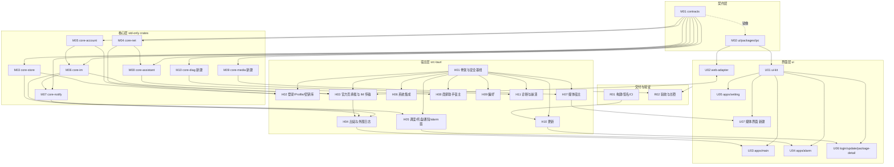

# 06 · 基于 Tauri 2 + Rust 的重构实施计划（模块级）

2026-11-02。输入是本目录的逆向与盘点报告：[01 前端](01-frontend.md)、[02 主进程](02-backend-main-process.md)、[03 缺陷](03-defects.md)、[04 目标与 vbk 差距](04-target-vs-vbk-gap.md)、[05 原生层与打包](05-native-packaging.md)。范围以 [网页版范围决定](../../decisions/2026-10-30-web-only-scope.md) 为准。本计划不替换 [总和开发计划](../../plan/00-master-development-plan.md) 的公共契约、不变量与任务编号，而是在其上做三件事：

1. 把官方客户端逆向得到的功能与缺陷，逐条落到 `vbk/` 的具体模块上；
2. 按「能替代日常客服」重新排迁移优先级；
3. 给每个模块写可度量、可复现的验收标准。

> 本计划是**计划**，不是验收结论。所有「当前状态」引用 04 报告在 2026-11-01 的盘点（A=有目标机读回 / B=代码落盘、离线测试过 / C=部分 / D=未开始），实施时以最新 PROGRESS 为准。

---

## 0. 决策摘要

| 项 | 决定 | 依据 |
| --- | --- | --- |
| 宿主 | Tauri 2（Windows WebView2 / macOS WKWebView），Rust 宿主 + std-only 核心 crate，保持现有 `vbk/` 结构 | 04 §2；官方 Electron 27.3.11 / Chromium 118 已停止维护（SEC-11） |
| IM 传输 | 维持范围决定：使用官方网页 Web IM SDK（隐藏的官方页 WebView 承载），**不排期** Node sidecar 或原生协议重写 | 范围决定 §当前决定；风险 R1 设置量化退出条件，触发时交用户决策 |
| 携程业务 | 只保留消息、通知、订单「详情 → IM 联系」；其余左侧业务模块删除 | 范围决定；01 报告页面清单 |
| 自有能力 | 多账号、托盘/任务栏、独立强提醒、商家助手、截图/OCR/纠错、更新、诊断全部保留 | 范围决定 §4 |
| 安全基线 | 03 报告「必须根除」10 条作为全局不变量 G-SEC-1~10，任何模块不得引入反例 | 03 §5 |
| 前端资源 | 只从应用包内加载，**禁止运行时替换本地前端**（对照官方 SUP-01 的 http 热更新） | 03 SUP-01 |
| 存储 | 第 1~2 波沿用 `core-store` 的 JSON 文档；第 3 波按 M03 的决策门评估是否引入单一 SQLite（rusqlite bundled），只允许一套引擎 | 04 §7「次要风险」；03 STA-07 |

## 1. 全局不变量（每个模块的验收都隐含这些检查）

来源：03 §5 必须根除清单，以及总和开发计划第 2 节的不变量。

| 编号 | 不变量 | 自动化检查 |
| --- | --- | --- |
| G-SEC-1 | 本地 UI 只从应用包加载，不存在下载后替换前端或迁移 SQL 的路径 | CI grep：`frontendDist` 之外不出现 `convertFileSrc`/`asset:` 指向 `app_data_dir` 的 HTML/JS；更新只走 H10 签名通道 |
| G-SEC-2 | 任何构建都不关闭 TLS 校验 | CI grep：`danger_accept_invalid_certs`、`ignore-certificate-errors`、`rejectUnauthorized` 零命中；reqwest 只用 rustls 默认根证书 |
| G-SEC-3 | 凭据只放系统密钥库（Keychain / 凭据管理器）；配置、日志、诊断包、提醒数据库里不出现密码、ticket、cookie | 单测 + 诊断包脱敏扫描（M10）；`prefs.json`/`*.json` 文档的 schema 不含凭据字段 |
| G-SEC-4 | 不关闭同源策略与站点隔离，严格 CSP，不剥离服务端安全头 | `tauri.conf.json` CSP 快照测试；不存在修改响应头的代码 |
| G-SEC-5 | 远程页面零 IPC 能力；唯一例外是 `capabilities/adapter.json` 的 7 个 adapter 命令，且宿主二次校验窗口 label、来源域与 `view_generation` | `ui/apps/_shared/contract-consistency.test.ts` 扩展为 capability ↔ `commands.txt` ↔ `views.rs` 三方一致 |
| G-SEC-6 | 发布包无 DevTools、无调试端口，不接受调试或 Node 类启动参数 | release 构建 feature 检查；启动参数白名单测试 |
| G-SEC-7 | 两平台全量签名（macOS Developer ID + 公证 + hardened runtime 无例外；Windows Authenticode），更新必须验签 | R01 CI 产物签名校验步骤 |
| G-STA-1 | 所有重连、重启、轮询都走单一状态机：指数退避 + 抖动 + 外部熔断计数（对照官方 STA-01/02） | 核心层属性测试：任意故障序列下重试间隔单调不减直到上限 |
| G-STA-2 | 主线程和 UI 线程不做同步 IO；持久化放专用线程；所有查询分页并设超时 | 代码审查清单 + `tokio::task::spawn_blocking` 规约 |
| G-ID-1 | `AccountContext={account_id,session_generation}` 与 `view_generation` 贯穿所有事件，旧代次回调一律拒绝 | `tests/scenarios/leakage.rs` 等场景测试 |
| G-IM-1 | 发送结果区分 `confirmed/rejected/unknown`；`unknown` 不自动重放 | `outbound_journal` 场景测试 |

## 2. 目标架构

### 2.1 官方客户端（逆向结果）与目标架构对照

| 关注点 | 官方 Electron 1.2.12/1.2.13（02/03/05 报告） | 目标 Tauri 架构 |
| --- | --- | --- |
| 运行时 | Electron 27.3.11 / Chromium 118；Mac 只有 x86_64 | 系统 WebView（WebView2 Evergreen / WKWebView），arm64 + x86_64 |
| 进程 | 主进程 + 14 个 BrowserWindow + 2 个 BrowserView + IM utilityProcess（`imsdk.js`，`@ctrip/s-node-imclient-core`）+ OCR/拼写 worker | 单 Rust 宿主进程 + 按窗口的 WebView；IM 由官方页 WebView 内的 Web SDK 承载；OCR/纠错在 Rust 侧线程池或按需子进程 |
| 本地页 | 25 个 Vite 多页面（React/antd），可经 ares 热更新下载 `dist.zip` 替换 | `ui/apps/*` 无依赖 TS，随包发布；只保留 IM、通知、登录、设置、alarm、截图、查看器、更新 |
| 桥接 | `appBridge` 暴露 `dbQuery`、`getAllLoginCookies`、`downloadFile` 等通用能力，远程页也注入；70 个 IPC 处理器中约 15 个读取 sender，明确据此拒绝调用的只有 3 个 | 69 条冻结命令（`src-tauri/commands.txt`），按窗口 capability 授权；远程页只开放 adapter 7 条 |
| 存储 | electron-store `config.json`（含明文密码/ticket）+ SQLite `vbk.db`（drizzle 迁移，SQL 也可被热更新替换） | 系统密钥库 + 按身份隔离的 JSON 文档（`core-store`）；评估后再决定是否引入单一 SQLite |
| 网络 | 关闭 HTTP/2、放开连接数限制、非 PROD 忽略证书 | reqwest + rustls 默认配置；端点白名单（`core-net::endpoint`） |
| 更新 | electron-updater（Windows 不验签）+ ares 热更新（http、不验签） | `tauri-plugin-updater`（minisign 签名）+ 平台代码签名；没有前端热更新 |

### 2.2 目标模块总览与依赖

依赖规则（沿用总和开发计划第 4 节的单写者规则）：

- 核心 crate 只依赖 `contracts` 与 `std`；新建的 `core-media`、`core-diag` 也一样。平台相关代码只放在 `src-tauri`。
- `contracts`（M01）与 `ui/packages/ipc`（M02）由集成负责人单写；任何模块需要新类型，先提交契约变更，再动实现。
- 宿主模块之间只通过 `state.rs` 暴露的服务接口互相调用，不直接拿其他模块的锁。
- UI 只通过 `ui/packages/ipc` 调用宿主；`web-adapter` 只通过 adapter 协议（`adapterProtocol.ts`）与 H03 通信。

### 2.3 关键路径

`M01/M02 冻结 → H01 安全基线 → H03 + U02 传输可靠性 → M06 计数/历史 → H05 + U04 强提醒实机 → R02 长稳 → R01 签名 → H10 更新 → 有限试用`

强提醒（H05/U04）只依赖 H03 产出的可靠事实，不需要等媒体、助手或更新完成；媒体（H07/U07）、助手（H08）、系统集成（H06）可以与关键路径并行。

---

## 3. 迁移优先级与分波

优先级口径（与 04 报告一致）：**P0** = 不解决就不能替代日常客服；**P1** = 有限试用必需；**P2** = 正式发布前必需；**P3** = 增强项。

| 波次 | 目标 | 包含模块（主要工作） | 退出条件 |
| --- | --- | --- | --- |
| **W0 安全与门禁**（P0） | 先把不变量做成 CI 门禁，修好平台相关测试 | H01（G-SEC 检查）、M04（TLS 断言）、M10（脱敏日志最小版）、R01（macOS `TMPDIR` 夹具修复，Win/Mac 双平台 CI） | 第 1 节全部自动化检查在两平台 CI 上通过；`src-tauri` 测试在 macOS 上 195/195 |
| **W1 能替代日常客服**（P0） | 消息不丢、计数一致、历史可翻、强提醒可用 | 先确认 R11（目标网页是否有反自动化检测）；H03 + U02（传输可靠性、后台节流对策、监督与补偿）、M06（计数口径、历史分页）、U03（会话列表/历史）、H05 + U04（强提醒实机）、R02（长稳测试平台） | R02 的 72 小时双账号长稳达标；强提醒 20/20 实机通过；计数与官方差异在已定口径内为 0 |
| **W2 有限试用**（P1） | 发送媒体、出站翻译、托盘任务栏、签名分发 | H04 + U03（图片/文件/视频发送）、H08（出站翻译、macOS 浏览器会话）、H05（Windows 任务栏数字、系统 Toast）、H07（Windows 截图）、H02（登录失效与风控路径）、R01（签名、公证、安装器）、H10（更新） | 签名安装包可在干净机器上安装、升级、卸载；媒体与翻译受控样本通过 |
| **W3 正式发布**（P2） | 系统集成、查看器、标注、诊断、通知中心、外围操作 | H06（快捷键、自启、深链）、U07 + H07（标注、图片/视频查看器）、H11（诊断包、崩溃恢复）、M03（schema 版本与迁移、SQLite 决策）、U03（通知中心、置顶/星标/转接/结束读回）、H09（偏好分区接线） | 发布候选检查清单全部通过 |
| **W4 增强**（P3） | OCR、纠错、服务端搜索、快捷回复、双架构 | M09 + H07（OCR、纠错）、U03（服务端会话搜索、快捷回复）、R01（universal 或 x86_64 构建） | 各功能受控样本通过，且不突破体积与内存预算 |

每一波内部的执行顺序见第 4 节各模块的「波次」字段。所有模块的完成都必须有**代码 + 目标机版本 + 受控样本 + 读回结果**，离线测试全绿只算 B。

---

## 4. 模块详述

字段说明：**路径**（代码位置；新建的模块标「新建」）、**职责**、**对标官方**（逆向得到的官方实现）、**根除问题**（03 报告编号，以及 04 报告的 D/V/E 编号）、**当前**（04 的盘点状态）、**依赖**、**波次/优先级**、**交付物**、**验收标准**、**模块风险**。

### 4.1 契约层

#### M01 contracts
- **路径**：`vbk/crates/contracts/src/{identity,im,events,error,json,...}.rs`
- **职责**：身份（`AccountContext`、`ConversationRef`）、事件信封（`stream/epoch/seq`）、错误码、IM 事实、alarm DTO、最小 JSON 编解码；整个工程的唯一真相来源。
- **对标官方**：官方没有类型化契约，IPC channel 是字符串，其中 36 处是动态 channel（02 报告）。
- **根除问题**：SEC-07（无 sender 校验的通用 IPC）在契约层的根源，即缺少类型化命令。
- **当前**：B，13 项测试；`HideAll` 缺账号字段、`unread_count` 是占位（总计划第 5 节审查遗留）。
- **依赖**：无。
- **波次/优先级**：W0 / P0。
- **交付物**：补齐审查遗留项；为契约加版本号 `CONTRACT_VERSION`，宿主与 UI 启动时比对。
- **验收标准**：①`cargo test -p contracts` 全过，每个公开类型都有 JSON 往返测试；②`contract-consistency.test.ts` 证明 Rust 类型与 `ui/packages/ipc/src/contracts.ts` 字段一一对应（字段名、可空性、枚举值）；③契约版本不一致时，宿主拒绝该窗口的全部命令并在诊断里记录。
- **模块风险**：契约频繁变动会让并行模块返工。对策：每波开始前冻结一次，波内只允许追加字段。

#### M02 ui/packages/ipc
- **路径**：`vbk/ui/packages/ipc/src/{commands,contracts,adapterProtocol,client,mock}.ts`
- **职责**：TS 侧的契约镜像、命令/事件名、`invoke/listen` 薄封装、Mock IPC。
- **对标官方**：`appBridge` 有 45 个暴露成员，含 `dbQuery`、`getAllLoginCookies`、`downloadFile` 等通用能力（02、03 报告）。
- **根除问题**：SEC-07、F-01、F-02；G-SEC-5。
- **当前**：B，11 项测试。
- **依赖**：M01。
- **波次/优先级**：W0 / P0。
- **交付物**：命令清单与 `src-tauri/commands.txt` 自动比对；禁止出现通用查询、通用网络、通用文件类命令（命令名黑名单测试）。
- **验收标准**：①`commands.ts` 与 `commands.txt`、`lib.rs generate_handler!`、`capabilities/*.json` 四方一致（CI 测试）；②黑名单（`query`、`sql`、`fetch`、`exec`、`cookies`、`readFile` 等词根）零命中；③Mock IPC 覆盖全部 69 条命令。
- **模块风险**：低。

### 4.2 核心层（std-only）

#### M03 core-store
- **路径**：`vbk/crates/core-store/src/`
- **职责**：按 `(environment, account_id)` 隔离的持久状态：草稿、置顶、提醒轮次、发送意图、同步水位；`tmp + rename` 原子提交；损坏文件隔离为 `*.corrupt-<ts>`。
- **对标官方**：`vbk.db`（drizzle，13 个迁移 SQL 放在 `dist/drizzle`，可被热更新替换）+ 30 日本地会话缓存；同步 SQLite 在主进程承担 IPC 查询（STA-04）；存在两套 SQLite 引擎（STA-07）。
- **根除问题**：SUP-01（迁移 SQL 可被替换）、STA-04、STA-07、PRI-02（本地库未加密）、F-14（无界缓存）、N-11（两套 SQLite 驱动）。官方的 13 个 drizzle 迁移 SQL 只作为表结构参考，不复用为运行时代码。
- **当前**：B（DAT-01/02）；DAT-03~05 为 D；没有 schema 版本迁移（04 §6.6）。
- **依赖**：M01。
- **波次/优先级**：W1 增加 schema 版本字段（P1）；W3 完成迁移框架与 SQLite 决策门（P2）。
- **交付物**：①每个文档带 `schema_version`，迁移函数编译进二进制；②写入全部走专用持久化线程；③**SQLite 决策门**：如果 W2 结束时本地消息缓存或搜索需求被确认，就引入 `rusqlite`（bundled，唯一引擎），迁移脚本用 `include_str!` 内嵌；否则继续用 JSON 文档。
- **验收标准**：①从 N-1 版本的数据目录升级，自动迁移成功，且回滚不丢数据（场景测试）；②断电模拟（写到一半杀进程）1000 次，0 次出现不可读文档，损坏文件被隔离且业务能继续；③双账号文档互不可见（`leakage.rs`）；④单次写延迟 p99 ≤ 20ms（SSD，1 万条草稿或水位记录）；⑤数据目录里没有凭据（G-SEC-3 扫描）。
- **模块风险**：JSON 文档在消息缓存场景下可能撑不住。对策：决策门提前到 W2 末，并有基准测试数据支撑。

#### M04 core-net
- **路径**：`vbk/crates/core-net/src/{endpoint,clock,...}.rs`
- **职责**：端点注册与来源精确校验、SOA 响应分类、服务端校时（ClockService）、网络状态信号；Cookie 镜像（NET-02）与代理/PAC（NET-03）。
- **对标官方**：`disable-http2`、对携程域 `ignore-connections-limit`（SEC-10）；非 PROD 忽略证书，且环境判定来自 asar 外的 JSON（SEC-06）；OCR/拼写模型下载 `rejectUnauthorized:false`（SUP-02）；包里硬编码 15 个测试域名（PRI-04）。
- **根除问题**：SEC-06、SEC-10、SUP-02、PRI-04、F-07（测试域名进生产包）、F-09（http 明文网关）、N-02；G-SEC-2。
- **当前**：B（NET-01/04）；NET-02/03 为 D。
- **依赖**：M01。
- **波次/优先级**：W0 TLS 断言（P0）；W2 Cookie 镜像与系统代理（P1）；W3 PAC（P2）。
- **交付物**：⓪把 02 报告发现的、`docs/api/inventory.json` 未收录的 32 个域名逐个判定（保留范围内的补进 inventory 并标证据，范围外的列为禁止）；①端点表按构建配置生成，**发布构建只含生产域名**；②TLS 配置在类型层面不可关闭（不暴露相关开关）；③系统代理读取（Windows WinINet、macOS SCDynamicStore）；④HTTP/2 与连接池保持默认。
- **验收标准**：①发布产物字符串扫描不含 `qa.nt.ctripcorp.com`、`fws`、`uat`、`fat` 类测试域名；②自签证书的本地 HTTPS 服务被拒绝（集成测试）；③在系统代理和 PAC 环境下登录与收发成功（W2/W3 实机）；④校时锚点失效时 UI 有明确提示，与 `clock_anchor` 的实机记录一致。
- **模块风险**：企业代理或 PAC 环境下 WebView 与 reqwest 的走法不一致（多栈一致性）。对策：R02 加入代理矩阵。

#### M05 core-account
- **路径**：`vbk/crates/core-account/src/`
- **职责**：身份 actor、登录 attempt、`(environment, buid) → AccountId` 稳定索引、`session_generation`、三种退出、凭据账本 Prepared → SecretStaged → IndexCommitted 及崩溃恢复。
- **对标官方**：按 `persist:<buid>` 分区的 BrowserView；账号密码和 bticket 明文写在 `config.json`（PRI-01）；每账号一套持久分区，没有上限或 LRU（STA-05）。
- **根除问题**：PRI-01、STA-05；G-ID-1、G-SEC-3。
- **当前**：B，账号恢复部分为 A。
- **依赖**：M01。
- **波次/优先级**：W1 / P0（迟到回调拒绝）；W2 / P1（失效与风控路径）。
- **交付物**：账号数上限与非活跃账号的 WebView 回收策略（与 H02 协同）；登录失效、验证码、风控三类状态进入状态机。
- **验收标准**：①场景测试：任意交错的登录、退出、失效、重启序列，旧代次事件 100% 被拒绝；②实机：两个账号同时在线 72 小时，0 次跨账号串扰（R02 校验每条消息的账号归属）；③登录失效后 60 秒内 UI 呈现「需要重新登录」，期间不产生提醒或发送。
- **模块风险**：风控、验证码样本难以获得（04 的 E 类阻塞）。对策：先保证状态可辨识，不追求自动处理。

#### M06 core-im
- **路径**：`vbk/crates/core-im/src/{im_core,rounds,...}.rs`
- **职责**：消息事实摄入、跨来源去重、outbox 与 `unknown` 核对、同步水位、等待轮次（rounds）、会话计数聚合。
- **对标官方**：IM utilityProcess 中的 `@ctrip/s-node-imclient-core`，多套重连机制叠加且没有指数退避（STA-02）；崩溃守护计数每次重建都清零，变成无限重启（STA-01）；本地 30 日会话缓存与服务端列表合并。
- **根除问题**：STA-01、STA-02（核心层的状态机部分）；04 的 D1（历史分页）、D2（计数差异）、D3（49 秒未到达）中属于核心逻辑的部分；G-IM-1、G-STA-1。
- **当前**：B，53 项测试。
- **依赖**：M01、M05。
- **波次/优先级**：W1 / P0。
- **交付物**：①**会话计数口径文档**（与官方后台 AX20/1959 的差异逐项解释，需用户确认口径），据此实现聚合；②历史分页游标与阅读位置保持的核心模型；③传输健康度信号（最后事件时间、补偿次数、跳号次数），供 H03 监督使用。
- **验收标准**：①属性测试：任意重复、乱序、迟到 ACK、跳号、旧代次序列下，消息不丢、不重、不串身份（沿用并扩展 `tests/scenarios`）；②计数：同一时刻对同一账号，vbk 与官方网页按已定口径的计数差为 0（R02 每小时采样，连续 24 小时）；③历史分页：上翻 20 页，阅读位置偏移 ≤ 1 条消息，30/30 次通过（目前只有 2 次样本）；④`unknown` 在重启后不重放，且 UI 呈现可人工核对的状态。
- **模块风险**：计数口径取决于官方未公开的规则。对策：口径必须由用户拍板，计划里列为外部决策点 X1。

#### M07 core-notify
- **路径**：`vbk/crates/core-notify/src/{engine,...}.rs`
- **职责**：L0–L4 升级、横幅、勿扰（1 小时 / 到明天）、「勿扰时仍提醒超时」、未读聚合、alarm 快照。
- **对标官方**：通知弹窗池、Alarm Dialog；网页版不处理 `reply_timeout`（范围决定 §强提醒结论）。
- **根除问题**：无对应缺陷；这是本项目扩展。
- **当前**：B，53 项测试；**零实机**（04 V4）。
- **依赖**：M06。
- **波次/优先级**：W1 / P0。
- **交付物**：假时钟测试覆盖睡眠、唤醒、系统时间跳变；稍后提醒与勿扰的交互矩阵。
- **验收标准**：①客户消息未回复满 30 秒（默认阈值），alarm 在 30±1 秒内可见；②连续客户消息不重置等待起点；③只有确认的商家回复或会话责任结束才清除，已读、打开会话、点发送都不清除；④系统睡眠 10 分钟后唤醒，5 秒内按真实时长重新计算并呈现；⑤以上在 Windows 和 macOS 上各 20/20 次实机通过（H05/U04 联合验收）。
- **模块风险**：低；主要风险在宿主窗口行为（H05）。

#### M08 core-assistant
- **路径**：`vbk/crates/core-assistant/src/{translate,...}.rs`
- **职责**：TSim 登录/刷新/登出的请求构造与解析、出站翻译六字段校验、语言识别、套餐/订单/摘要、浏览器会话导入的 wire 格式。
- **对标官方**：官方渲染层有 `buildTranslateRequest` / `parseTranslateResponse`（01 报告判定其归属）；Windows 上的商家助手原本由第三方插件通过 CDP 注入（PLG-01~03）。
- **根除问题**：PLG-01（调试端口注入）。本项目用原生模块替代注入，任何情况下都不开调试端口。
- **当前**：C，47 项测试；出站翻译真实调用 0 次（V5）；macOS 浏览器会话不可用（D7）。
- **依赖**：M01、M04。
- **波次/优先级**：W2 / P1。
- **交付物**：翻译请求超时与失败的分类；macOS 浏览器会话导入（Safari/Chrome 的 Cookie 读取需用户授权，或改为手动导入路径）。
- **验收标准**：①出站翻译：50 条受控样本，替换草稿与直接发送两种模式的结果都与 TSim 返回一致，失败时草稿不丢；②翻译请求 p95 ≤ 2 秒（以 TSim 实测基线为准）；③TSim 会话在 macOS 和 Windows 上都能导入并恢复。
- **模块风险**：TSim 是外部服务，接口变动不可控。对策：响应解析做严格校验，不认识的字段直接报错并进诊断。

#### M09 core-media（新建）
- **路径**：新建 `vbk/crates/core-media/`
- **职责**：与平台无关的媒体模型：截图选区与标注对象（矩形、箭头、文字、马赛克、撤销栈）、导出参数、附件限制（官方：图片 10 MiB、文件 30 MiB、视频 300 MiB）、OCR 引擎接口、中文纠错规则。
- **对标官方**：`node-screenshots` + `captureTool` 多屏遮罩、`SCREENSHOTS:*` IPC；OCR 用 paddleocr + onnxruntime-web 的 worker，模型从个人 GitHub 仓库下载且不校验（SUP-02）；拼写检查 worker。
- **根除问题**：SUP-02（模型来源与校验）、STA-10（模型占用 157 MB 常驻在 userData）、N-10（sharp 绑定缺失或版本不匹配导致 OCR 预处理可能失效）。
- **当前**：D。
- **依赖**：M01。
- **波次/优先级**：标注模型 W3 / P2；OCR 与纠错 W4 / P3。
- **交付物**：①标注模型与撤销栈；②**OCR 选型决策**：候选为系统 OCR（macOS Vision、Windows.Media.Ocr）或 ONNX Runtime + PP-OCR 模型。模型必须随包或从签名源下载，按 SHA-256 校验，默认关闭（REL-08）；③纠错规则引擎。
- **验收标准**：①标注模型单测覆盖全部工具与撤销/重做；②OCR：在 100 张客服场景截图样本上，中文字符准确率 ≥ 官方 paddleocr 在同一样本上的结果（先测官方基线）；③模型文件哈希不符时拒绝加载；④未开启 OCR 时安装包不含模型。
- **模块风险**：OCR 模型体积会抵消小包优势。对策：优先系统 OCR；ONNX 方案只作为可选下载。

#### M10 core-diag（新建）
- **路径**：新建 `vbk/crates/core-diag/`
- **职责**：结构化日志与统一脱敏（ticket、cookie、手机号、订单号掩码）、诊断包清单、崩溃标记、运行指标（传输健康度、内存、提醒延迟）。
- **对标官方**：启动时打印整份 config、拦截日志打印完整 URL（PRI-05）；崩溃报告自动上传，附带 hostname/buid/clientId，没有同意开关（PRI-03）；electron-log 把 preload 写进 userData 并注入所有 session（PRI-06）。
- **根除问题**：PRI-03、PRI-05、PRI-06；G-SEC-3。
- **当前**：D（REL-01/04/05）。
- **依赖**：M01。
- **波次/优先级**：W0 先做脱敏最小版（P0）；W3 完成诊断包与崩溃（P2）。
- **交付物**：日志宏统一走脱敏器；诊断包只在用户主动导出时生成，导出前展示内容清单。
- **验收标准**：①脱敏器对已知敏感模式的测试集 100% 掩码；②任意一份导出的诊断包经扫描，敏感模式零命中；③默认不做任何远程上传。
- **模块风险**：低。

### 4.3 宿主层（src-tauri）

#### H01 宿主骨架与安全基线
- **路径**：`vbk/src-tauri/src/{lib,main,views,commands,state,dto,events}.rs`、`tauri.conf.json`、`tauri.{macos,windows}.conf.json`、`capabilities/*.json`、`permissions/`、`commands.txt`
- **职责**：启动顺序、插件注册、视图注册表（哪个窗口 label 可以调用哪条命令）、`view_generation` 校验、全局状态聚合、CSP、capability。
- **对标官方**：7+1 处 `webSecurity:false`（SEC-01）、关闭站点隔离（SEC-02）、CSP 全通配并剥离服务端安全头（SEC-03）、fuses 未加固（SEC-04）、Mac 硬化运行时例外（SEC-05）、远程页注入 appBridge（SEC-07）、`openExternal` 不校验（SEC-08）、没有权限请求处理器（SEC-09）、生产环境可开 DevTools（SEC-12）、ATS 全放开（SEC-13）。
- **根除问题**：SEC-01~05、SEC-07~09、SEC-12、SEC-13；前端 F-01（通用 SQL 桥）、F-02（全账号 cookie 与 netFetch）、F-08（生产设置页调试工具）、F-12（`eval`/`new Function` 迫使 CSP 放开）；原生 N-04、N-08；G-SEC-4~6。
- **当前**：B；CSP 严格（`frame-src 'none'`），`adapter.json` 是唯一的 remote 能力（04 §2.2）。
- **依赖**：M01、M02。
- **波次/优先级**：W0 / P0。
- **交付物**：①第 1 节 G-SEC 检查全部做成 CI 测试；②WebView 权限请求（相机、麦克风、通知、地理位置）默认拒绝，只按窗口白名单放行；③外链只允许 https，打开前校验域名；④`state.rs` 单 mutex 拆成按服务的锁，避免提醒调度被 IM 写入阻塞；⑤macOS entitlements 最小化，不加 `disable-library-validation`、`allow-dyld-environment-variables`。
- **验收标准**：①CI：CSP 快照、capability 一致性、命令黑名单、entitlements 快照全部通过；②渗透用例：从远程官方页调用非 adapter 命令，100% 被拒绝并记录；③release 包中按 F12 或右键无法打开 DevTools；④锁拆分后，在 1000 条/分钟入站压力下，1 Hz 调度的抖动 p99 ≤ 50ms。
- **模块风险**：Tauri `unstable` 特性（多 WebView 窗口）在小版本间行为变化。对策：锁定 Tauri 版本，升级必须在 R02 上回归。

#### H02 登录、Profile 与密钥库
- **路径**：`vbk/src-tauri/src/{login,profiles,keychain}.rs`、`ui/apps/login/`
- **职责**：登录窗（本地头部 + 远程官方页）、每账号或每次登录尝试一个隔离 Web profile、身份发布、三种登出、凭据存取。
- **对标官方**：登录窗口（短信/密码/扫码/captcha，01 报告）、明文凭据（PRI-01）、Cookie 不加密（PRI-02、SEC-04 中的 CookieEncryption fuse）。
- **根除问题**：PRI-01、PRI-02（Cookie 部分）、STA-05；G-SEC-3。
- **当前**：B→A 部分（Windows/macOS 账号恢复已实机）。
- **依赖**：H01、M05、M03。
- **波次/优先级**：W1 / P0（恢复与隔离）；W2 / P1（失效、验证码、风控）。
- **交付物**：①非活跃账号的 WebView 回收（上限可配，默认 4 个活跃）；②macOS 钥匙串访问控制随签名身份稳定（依赖 R01 的 Developer ID，解决 adhoc 签名让授权随 cdhash 失效的问题）；③WKWebView 使用 `WKWebsiteDataStore(forIdentifier:)`（macOS 14+）做账号隔离，WebView2 使用独立 user data folder。
- **验收标准**：①双账号登录后重启应用，两个账号都免交互恢复，10/10 次；②正式签名包连续 5 次升级后，钥匙串不再弹授权；③在数据目录、日志、诊断包里扫描不到密码或 ticket；④登录失效、验证码、风控三类情况各有至少 1 个实机样本，且 UI 状态正确。
- **模块风险**：macOS 13 及以下没有 `WKWebsiteDataStore(forIdentifier:)`。对策：最低支持 macOS 14，或回退为每账号独立进程（需评估）。列为决策点 X2。

#### H03 官方页承载与 IM 传输（关键路径）
- **路径**：`vbk/src-tauri/src/{adapter,display,clock_anchor}.rs`、`ui/packages/web-adapter/`（U02）、`capabilities/adapter.json`
- **职责**：在每账号的隐藏官方页 WebView 中运行 Web IM SDK；通过 adapter 协议把有界事实事件送进 Rust；host → page RPC（发送、已读、置顶、星标、成员、通知、订单、上传）；传输监督。
- **对标官方**：IM utilityProcess 跑 `@ctrip/s-node-imclient-core`（XMPP/WSS），经 MessagePort（`get_im_channel_port`、`postImMessage`）与主进程通信；崩溃后无限重启（STA-01）；重连无退避（STA-02）。
- **根除问题**：STA-01、STA-02（宿主层监督部分）、F-06（5 秒增量会话轮询、3 秒共情话术轮询且不随可见性暂停：适配器**不得**在官方页节奏之外再加轮询）；04 的 D3（49 秒未到达）、V3、V9。
- **当前**：C；文本收发有实机样本，自然实时与媒体未通过。
- **依赖**：H01、M06、M04、U02。
- **波次/优先级**：W1 / **P0**（整个计划的第一风险点）。
- **交付物**：
  1. **后台节流对策**：WebView2 设置 `--disable-background-timer-throttling --disable-renderer-backgrounding --disable-backgrounding-occluded-windows`（只对官方页 WebView 的环境生效）；macOS 让官方页 WebView 挂在不可见但不 occluded 的窗口里，并评估 `NSProcessInfo.beginActivity(.userInitiated)` 防止 App Nap。
  2. **传输监督状态机**（实现 G-STA-1）：心跳超时 → 页面内补偿 → 重载官方页 → 重建 WebView，四级升级，每级指数退避，熔断后在 UI 显示「消息通道异常」，并保留手动重试。
  3. **补偿闭环**：每次唤醒、网络恢复、页面重建后，按 M06 的同步水位拉取会话与历史，补齐缺口。
  4. **官方页版本指纹**：记录官方页构建 hash 与 SDK 版本；适配器依赖的全局对象或方法缺失时，进入降级模式，不盲目调用。
- **验收标准**：①R02 长稳：双账号 72 小时，受控对端每 2 分钟发 1 条（共 ≥ 2000 条），**丢失 0 条**；端到端到达延迟 p95 ≤ 官方客户端同期 p95 + 1 秒，p99 ≤ 10 秒；②主窗最小化、被遮挡、隐藏到托盘三种状态下，各 1 小时内的延迟分布与前台无显著差异（p95 差 ≤ 1 秒）；③睡眠 10 分钟后唤醒，30 秒内补偿完成，期间的消息全部补齐；④断网 5 分钟后恢复，60 秒内补偿完成；⑤人为让官方页崩溃 20 次，监督状态机 20/20 恢复，重试间隔符合退避曲线，无重启风暴；⑥官方页版本变化时，指纹告警在 1 分钟内出现在诊断里。
- **模块风险**：见 R1、R2。若 ①~③ 在 W1 结束前达不到，触发决策点 X3（是否在范围外评估 sidecar），由用户决定，计划不自动切换路线。

#### H04 出站与外围日志
- **路径**：`vbk/src-tauri/src/{outbound_journal,peripheral_journal,media_outbound}.rs`
- **职责**：持久、无正文的出站 attempt 屏障（写前 fsync，重启不重放）；邀请、转接、结束的安全边界；附件不可变快照。
- **对标官方**：官方没有同等设计（04 §6.2）。
- **根除问题**：G-IM-1；04 的 V1（媒体发送 0 次）、V2（unknown 重启未验）、D6（大视频分片缺失）。
- **当前**：B / C（media_outbound）。
- **依赖**：M06、M03、H03。
- **波次/优先级**：文本 W1 / P0；媒体 W2 / P1；外围操作 W3 / P2。
- **交付物**：图片、文件、视频的上传 → 发送 → 读回链路；大视频分片上传；转接与结束的受控样本流程。
- **验收标准**：①文本：200 条受控发送，`confirmed` 的服务端 ID 与官方网页读回一致，200/200；②媒体：图片、文件、视频各 20 条（含 10 MiB、30 MiB、300 MiB 边界值），20/20 发送成功并在官方网页读回；超限文件在本地被拒，提示正确；③`unknown`：在发送中途杀进程 20 次，重启后 0 次自动重放，UI 都标记为待核对；④转接、结束、邀请各 ≥ 3 个受控样本读回正确（依赖 E3 多角色账号）。
- **模块风险**：服务端没有幂等保证（04 E2）。对策：严格执行「unknown 不重放」，并在 UI 提供人工核对入口。

#### H05 调度、托盘、通知与 alarm 窗
- **路径**：`vbk/src-tauri/src/{scheduler,tray,windows}.rs`、`ui/apps/alarm/`（U04）
- **职责**：1 Hz 调度执行 core-notify 的效果：alarm 显示与隐藏、声音、Dock 弹跳与角标、Windows 任务栏闪烁与数字、托盘菜单（显示、设置、勿扰、退出）、系统 Toast。
- **对标官方**：通知弹窗池、托盘与任务栏、Alarm Dialog；关窗即隐藏、进程常驻（STA-09）。
- **根除问题**：STA-09（改为可配置：关闭主窗时隐藏还是退出）；04 的 V4（强提醒零实机）、V6（托盘/Dock 零实机）、Windows 任务栏数字缺失。
- **当前**：B。
- **依赖**：H01、M07。
- **波次/优先级**：alarm W1 / **P0**；任务栏数字与 Toast W2 / P1。
- **交付物**：①alarm 窗置顶、不抢焦点（Windows `WS_EX_NOACTIVATE`；macOS `NSPanel` + `nonactivatingPanel`）、所有桌面空间可见、多显示器定位到主屏右下；②Windows 任务栏 overlay 数字（`ITaskbarList3::SetOverlayIcon`）；③系统 Toast（Windows AppUserModelID 注册；macOS `UNUserNotificationCenter`），点击后定位到会话；④声音在主窗隐藏时也能播放（Rust 侧播放，例如 `rodio`，不依赖主窗 WebView）。
- **验收标准**：①强提醒联合验收（同 M07）：Windows 与 macOS 各 20/20 次在 30±1 秒内可见，且前台应用在 alarm 出现前后不变（用前台窗口 API 自动断言）；②点击 alarm 后 1 秒内主窗打开对应账号的对应会话；③主窗隐藏时提示音 20/20 次可听见（录音或音频会话断言）；④Windows 任务栏数字与未读总数一致；⑤Toast 点击定位正确 10/10。
- **模块风险**：macOS 不抢焦点的置顶面板在全屏应用上的行为各版本不同。对策：在 macOS 14、15、26 上分别验证。

#### H06 系统集成
- **路径**：`vbk/src-tauri/src/lib.rs`（插件注册）、新建 `src-tauri/src/integration.rs`
- **职责**：单实例、深链、全局快捷键（截图、显示或隐藏主窗）、开机自启。
- **对标官方**：全局快捷键注册、开机自启、`vbookingChat://` 深链（参数不校验并写入持久配置，SEC-14）。
- **根除问题**：SEC-14；04 的 D9（快捷键与自启插件声明了但没注册）。
- **当前**：D（只有 single-instance 已注册）。
- **依赖**：H01、H09。
- **波次/优先级**：W3 / P2。
- **交付物**：注册 `tauri-plugin-global-shortcut`、`tauri-plugin-autostart`、`tauri-plugin-deep-link`；自有 URL scheme（**不抢占** `vbookingChat`），参数白名单解析，不写持久配置。
- **验收标准**：①快捷键冲突时提示并允许改键；②自启开关在两个平台上 5/5 次生效，关闭后也确实不再启动；③深链模糊测试 1 万个随机输入，0 次崩溃，0 次越权跳转；④第二个实例启动时把参数转交给第一个实例并聚焦主窗。
- **模块风险**：低。

#### H07 媒体宿主
- **路径**：`vbk/src-tauri/src/shell.rs` 中的截图部分迁出到新建 `src-tauri/src/media/{capture_win,capture_mac,viewer}.rs`
- **职责**：多屏截图采集、遮罩窗口、选区回传、图片与视频查看器窗口、OCR 与纠错的执行（调用 M09）。
- **对标官方**：`node-screenshots` + `captureTool` 多屏遮罩 overlay、图片查看器、视频播放器窗口、OCR worker、拼写 worker。
- **根除问题**：04 的 D6（Windows 截图 `HOST_UNSUPPORTED`）、D12（视频 Invalid）；SUP-05（不再带 DalDecrypt、7za 这类无用的可执行文件）。
- **当前**：C（macOS 调用系统 `screencapture -i`）。
- **依赖**：H01、M09。
- **波次/优先级**：Windows 截图 W2 / P1；遮罩、标注、查看器 W3 / P2；OCR W4 / P3。
- **交付物**：Windows 用 Windows.Graphics.Capture 或 DXGI；macOS 用 ScreenCaptureKit（需屏幕录制授权）；遮罩窗口每屏一个；查看器窗口支持缩放和另存为。
- **验收标准**：①在 2 台显示器、缩放分别为 100% 与 150% 的组合下，选区像素误差 ≤ 1px；②从按快捷键到遮罩出现 ≤ 300ms；③截图插入草稿后可发送（依赖 H04）；④macOS 未授权时有引导，授权后无需重启即可使用；⑤视频查看器能播放官方支持的格式（以 R02 收集的样本为准）。
- **模块风险**：macOS 屏幕录制授权与签名身份绑定，adhoc 签名下每次构建都要重新授权（依赖 R01）。

#### H08 商家助手宿主
- **路径**：`vbk/src-tauri/src/assistant.rs`、`src-tauri/src/assistant/*.rs`、`ui/apps/package-detail/`
- **职责**：TSim 服务的 HTTP 执行、会话生命周期、出站翻译、套餐速览、订单查询与详情窗口、浏览器会话导入、公开错误收敛。
- **对标官方**：Windows 上第三方插件通过 `--remote-debugging-port` 与 CDP 注入实现（PLG-01~04）。
- **根除问题**：PLG-01（不开调试端口）、PLG-02（不改写官方包）、PLG-03（伴随程序无签名）、N-06；F-11（反自动化输入检测，见风险 R11）。
- **当前**：C（Windows 上订单套餐与详情已实机读回）。
- **依赖**：H01、M08、M04。
- **波次/优先级**：W2 / P1。
- **交付物**：macOS 浏览器会话导入；1f01e84 的 CDR 卡片实机验证；`browser_storage` 测试改用不经过符号链接的临时目录（W0 已修夹具）。
- **验收标准**：同 M08；另外，①套餐速览在 Windows 和 macOS 上各 10 个订单样本读回的名称、供应商、APN 与 TSim 一致；②出站翻译的「替换草稿」只修改草稿，由客服本人确认并点击发送；不伪造输入事件、不规避官方的反自动化检测（R11），50 条样本 0 次被官方拦截提示。
- **模块风险**：浏览器 Cookie 存储格式随浏览器版本变化。对策：失败时引导用户手动导入。

#### H09 偏好
- **路径**：`vbk/src-tauri/src/prefs.rs`、`ui/apps/setting/`（U05）
- **职责**：PrefsSnapshot 持久化与各分区行为接线。
- **对标官方**：设置窗口的各设置项（01 报告）。
- **根除问题**：04 的「偏好分区只是持久化占位」，以及 `autostart` 默认 true 但没有接线。
- **当前**：C。
- **依赖**：H01、M03。
- **波次/优先级**：通知与助手分区 W1 / P0（已大部分完成）；其余分区 W3 / P2。
- **交付物**：每个偏好项都有对应行为与读回测试；默认值调整（`autostart` 默认 false，除非用户开启）。
- **验收标准**：①每个可见的偏好项都有「修改 → 生效 → 重启后保持」的自动化测试；②没有任何只存储、不生效的开关出现在 UI 上（不生效的项必须隐藏）。
- **模块风险**：低。

#### H10 更新（新建）
- **路径**：新建 `vbk/src-tauri/src/update.rs`、`ui/apps/update/`
- **职责**：检查、下载、验签、安装、重启；渠道（stable / beta）；回滚。
- **对标官方**：electron-updater（Windows 不验签，SUP-03）+ ares 热更新（http、无校验、解压后作为特权页面加载，SUP-01）；插件改写 asar 与官方更新冲突（PLG-02）。
- **根除问题**：SUP-01、SUP-03、PLG-02、N-01、N-02（更新源由远端动态下发：本项目更新端点编译进二进制，不接受远端改写）；G-SEC-1、G-SEC-7。
- **当前**：D（只有窗口壳）。
- **依赖**：H01、R01。
- **波次/优先级**：W2 / P1。
- **交付物**：`tauri-plugin-updater`，minisign 公钥编译进二进制；更新源只用 https；安装前校验平台代码签名；失败时保留旧版本可用。
- **验收标准**：①篡改更新包 1 个字节，100% 拒绝安装；②更新清单被替换为 http 地址时拒绝下载；③从 N-2、N-1 版本升级到 N，用户数据与登录态保留（与 M03 的迁移测试联动）；④断网或断电中断更新后，旧版本仍能启动。
- **模块风险**：签名密钥管理。对策：私钥只放 CI 机密，记录轮换流程。

#### H11 诊断与崩溃（新建）
- **路径**：新建 `vbk/src-tauri/src/diag.rs`
- **职责**：日志落盘与轮转、崩溃标记与下次启动时的恢复提示、诊断包导出（调用 M10）、运行指标面板。
- **对标官方**：electron-crashreport 自动上传（PRI-03）；DBManager 崩溃恢复；GPU 崩溃后永久禁用硬件加速（STA-06）。
- **根除问题**：PRI-03、PRI-05、PRI-06、STA-06。
- **当前**：C（只读诊断面板）/ D（导出与崩溃）。
- **依赖**：H01、M10。
- **波次/优先级**：W3 / P2（日志脱敏在 W0 随 M10 完成）。
- **交付物**：panic hook 写崩溃标记；WebView 进程崩溃（WebView2 `ProcessFailed`、WKWebView `webViewWebContentProcessDidTerminate`）只重建对应视图，不永久降级。
- **验收标准**：①人为让每类 WebView 崩溃 10 次，只有对应视图被重建，其他账号与窗口不受影响；②诊断包 100% 通过脱敏扫描；③日志总量上限可配（默认 200 MB）并自动轮转。
- **模块风险**：低。

### 4.4 界面层

#### U01 ui-kit
- **路径**：`vbk/ui/packages/ui-kit/src/`、`tokens.css`
- **职责**：无依赖的 `h()` 渲染、store、i18n、格式化、设计 token。
- **对标官方**：React + antd + redux，vendor chunk 合计约 3.2 MB（01 报告）。
- **根除问题**：F-04（小窗口预取全量 vendor）、F-05（2.78MB 单 chunk）、F-10（多套地图与 UI 库）、F-16（未压缩的提示音与表情）。
- **当前**：B。
- **依赖**：M02。
- **波次/优先级**：W1 / P0（虚拟列表能力）。
- **交付物**：通用虚拟列表（会话与消息共用，a34a007 已有视口渲染）、无障碍基础（焦点管理、键盘导航）。
- **验收标准**：①1 万条消息的会话，滚动帧时间 p95 ≤ 16ms；②全部 UI 包体积（gzip 前）≤ 1 MB，alarm 等小窗口首屏 JS ≤ 50 KB（官方约 3.3 MB）；③关键交互键盘可达。
- **模块风险**：自研渲染层的长期维护成本。对策：保持 API 小而稳定，不做通用框架。

#### U02 web-adapter
- **路径**：`vbk/ui/packages/web-adapter/src/`
- **职责**：注入官方页：SDK 胶水、事实与显示投影、历史/补偿/轮询、发送/已读/置顶/星标、成员/转接/结束、通知、订单、上传、校时、诊断。
- **对标官方**：官方 IM 页面的内部实现（imWindow chunk 2.7 MB）；网页版两入口约 5 秒一次的会话列表轮询。
- **根除问题**：04 的 D1~D4、U01–U10（适配器审查遗留）；F-06（不额外加轮询）；F-11（不规避反自动化检测，见 R11）。
- **当前**：C，393 项测试。
- **依赖**：M02、H03。
- **波次/优先级**：W1 / P0。
- **交付物**：适配器只读官方页暴露的稳定对象；每个依赖点都有存在性检查与降级；所有事件有上限（队列长度、单条大小）。
- **验收标准**：①在录制的官方页快照（至少 2 个官方构建版本）上回放，适配器测试全过；②依赖点缺失时，进入降级模式并上报指纹，不抛未捕获异常；③事件队列在 10 倍峰值压力下内存有界（≤ 50 MB）；④适配器发起的请求频率不超过官方页自身的节奏（R02 抓包对比，差异 ≤ 5%）；⑤代码中不存在伪造 `isTrusted`、隐藏 `navigator.webdriver` 或抹除 CDP 特征之类的规避逻辑（代码审查与 grep 门禁）。
- **模块风险**：见 R2。

#### U03 apps/main
- **路径**：`vbk/ui/apps/main/`
- **职责**：标题栏账号标签；左栏消息、通知、订单联系；会话列表；聊天区；composer（翻译栏、附件、截图）；右栏客户、订单、套餐卡片；诊断面板。
- **对标官方**：imWindow 的会话列表、消息类型、表情（yy-emoji、imyoyo）、提示音、快捷回复、搜索、转接；订单入口；通知（01 报告功能清单）。
- **根除问题**：04 的 D1（历史分页）、D2（计数）、D4（显示名 raw key）、D12（视频 Invalid）；F-03（25 处 `dangerouslySetInnerHTML`：本项目消息渲染只用结构化节点与 `textContent`）、F-14。
- **当前**：C，289 项测试。
- **依赖**：U01、M02、H03、H04。
- **波次/优先级**：会话、历史、文本 W1 / P0；媒体、翻译 W2 / P1；通知中心、外围操作 W3 / P2；服务端搜索、快捷回复 W4 / P3。
- **交付物**：按 01 报告的「保留」功能清单逐项实现，并在功能清单上标注实现状态。
- **验收标准**：①01 报告「保留」清单中的每个功能点（88 项中属于保留范围的部分），都有对应的 UI 测试与实机截图证据；消息、通知与 alarm 渲染路径对 `innerHTML`/`insertAdjacentHTML` 零使用（lint 门禁）；②冷启动到会话列表可交互 ≤ 3 秒（以 R02 测得的官方客户端基线为参照，目标是不劣于官方）；③双账号、各 500 个会话时，主窗内存（WebView 进程）≤ 官方同场景的 50%。
- **模块风险**：功能对等的口径。对策：以 01 报告的清单为准，由用户确认哪些不做。

#### U04 apps/alarm
- **路径**：`vbk/ui/apps/alarm/`
- **职责**：强提醒窗视图：轮次列表、等待时长、打开会话、稍后提醒、清除当前轮次。
- **对标官方**：Alarm Dialog。
- **根除问题**：04 V4。
- **当前**：B，8 项测试。
- **依赖**：U01、H05。
- **波次/优先级**：W1 / P0。
- **验收标准**：同 H05 ①②；另外，alarm 窗不提供发送客户消息或修改客服状态的入口（UI 测试断言）。
- **模块风险**：低。

#### U05 apps/setting
- **路径**：`vbk/ui/apps/setting/`
- **职责**：通知与提醒、商家助手、快捷键、网络、存储、隐私、更新等分区。
- **对标官方**：settingWindow。
- **当前**：C。
- **依赖**：U01、H09。
- **波次/优先级**：随 H09。
- **验收标准**：同 H09。

#### U06 apps/login、apps/update、apps/package-detail
- **路径**：`vbk/ui/apps/{login,update,package-detail}/`
- **职责**：登录窗本地头部、软件更新窗、TSim 套餐详情窗。
- **对标官方**：loginWindow、updateWindow；助手详情窗（插件）。
- **当前**：B / D（update）/ B。
- **依赖**：U01、H02、H10、H08。
- **波次/优先级**：login W1、update W2、package-detail W2。
- **验收标准**：update 窗显示的版本、渠道、进度、错误与 H10 状态一致；失败可重试。

#### U07 媒体界面（新建）
- **路径**：新建 `vbk/ui/apps/{capture-overlay,image-viewer,video-player}/`
- **职责**：截图遮罩与标注工具栏、图片查看器、视频播放器。
- **对标官方**：screenshots、screenshotsOverlay、image、video 四个页面（01 报告）。
- **当前**：D。
- **依赖**：U01、H07、M09。
- **波次/优先级**：W3 / P2。
- **验收标准**：标注全部工具可用、撤销重做正确；查看器支持缩放、旋转、另存为；见 H07。

### 4.5 交付与验证

#### R01 构建、签名与 CI
- **路径**：`.github/workflows/`、`vbk/src-tauri/tauri*.conf.json`、签名脚本
- **职责**：双平台构建；macOS Developer ID 签名、公证、hardened runtime；Windows Authenticode 与 NSIS；可追溯（commit 嵌入、`cargo auditable`）；SBOM。
- **对标官方**：Mac 有 Developer ID 签名并已公证，但带硬化运行时例外（SEC-05）；Windows 主程序、卸载程序、elevate.exe 都没签名（SUP-03、SUP-06）；两平台版本与签名策略不一致（MNT-03）。
- **根除问题**：SEC-05、SUP-03、SUP-06、MNT-03、STA-08、N-03、N-05（entitlements 放宽与 17 处可抢占的 rpath）、N-07、N-12、N-13（权限文案与无用的蓝牙权限声明）；G-SEC-7。
- **当前**：adhoc 签名、没有 build-id、NSIS 生成了但没执行过（04 §4、§6.6）。
- **依赖**：外部：签名证书（04 E7）。
- **波次/优先级**：CI 双平台 W0 / P0；签名、公证、安装器 W2 / P1；universal 构建 W4 / P3。
- **交付物**：两平台同一版本号同时发布；`cargo auditable build`；产物清单与 SHA-256；安装、升级、卸载脚本化测试。
- **验收标准**：①`codesign --verify --deep --strict` 与 `spctl -a -vv` 通过，entitlements 快照中没有例外项，`rea trace-dylib-resolution` 无可被抢占的加载路径，Info.plist 只声明实际用到的权限；②Windows 上 `signtool verify /pa` 对全部 exe/dll 通过；③`rea inspect-rust-binary` 能读出依赖清单；④在干净的虚拟机上完成安装、升级、卸载，并且卸载后不残留凭据（凭据清除需用户确认）；⑤安装包体积 macOS ≤ 30 MB、Windows ≤ 15 MB（不含可选 OCR 模型）。
- **模块风险**：证书获取周期不可控。对策：W0 就开始申请证书。

#### R02 验收与长稳平台
- **路径**：`vbk/tests/scenarios/`、新建 `vbk/tests/soak/`、`docs/research/` 下的实机记录
- **职责**：场景测试；长稳测试（双账号、受控对端自动发消息、到达延迟统计）；官方客户端基线测量（内存、冷启动、到达延迟）；实机证据归档。
- **对标官方**：无。
- **根除问题**：04 §7 风险 2「验收证据跟不上代码」。
- **当前**：C（QA-01 场景夹具）。
- **依赖**：受控测试账号与对端（04 E1、E3）。
- **波次/优先级**：W1 / P0。
- **交付物**：①受控对端机器人（用测试账号，按计划发送并记录发送时间）；②延迟与丢失统计报表；③每波结束时的实机证据包（版本、hash、样本、读回截图，已脱敏）；④官方基线报告（同一台机器、同一批账号）。
- **验收标准**：①报表能按账号、平台、窗口状态切分延迟分布；②每个模块验收里的数字都能从报表或证据包追溯；③PROGRESS 与 BLOCKED 与证据包同步更新（每波结束时检查）。
- **模块风险**：受控对端需要额外账号且不能打扰真实客户（04 E1 忙账号禁止出站）。对策：使用专门的测试账号，用户提供前此项阻塞。

---

## 5. 关键风险

| 编号 | 风险 | 概率/影响 | 触发信号 | 缓解措施 | 负责模块 |
| --- | --- | --- | --- | --- | --- |
| R1 | **IM 跑在隐藏 WebView 里的实时性**：后台节流、App Nap、睡眠唤醒导致延迟或丢失（已出现过 49 秒未到达） | 高/致命 | R02 中 p99 > 10 秒或出现丢失 | H03 的节流参数、监督状态机、补偿闭环；W1 末未达标则触发决策点 X3，由用户决定是否在范围外评估 sidecar | H03、U02、R02 |
| R2 | **官方网页改版**导致适配器失效（官方页是远程的，随时会变） | 高/高 | 指纹变化、依赖点缺失 | 版本指纹 + 降级模式 + 多版本快照回放测试；改版后 24 小时内出补丁的发布流程（依赖 H10） | U02、H03、H10 |
| R3 | **WebView2 与 WKWebView 行为差异**（存储隔离、Cookie、后台策略、媒体格式） | 中/高 | 同一功能双平台结果不一致 | 每个模块的验收都要求双平台分别通过，不继承另一平台的结论；macOS 14+ 的数据存储 API 列为决策点 X2 | H02、H03、H07 |
| R4 | **签名证书与钥匙串授权**：adhoc 签名让钥匙串授权、屏幕录制授权随每次构建失效 | 高/中 | 用户反复看到授权弹窗 | W0 就申请证书；W2 前所有对外分发都用正式签名 | R01、H02、H07 |
| R5 | **写操作难以验收**：服务端无幂等、忙账号禁止出站、多角色权限没有样本 | 高/中 | H04 的验收样本凑不齐 | 用户提供测试账号、多角色账号与沙箱；否则由用户明确缩小试用范围（列为外部依赖 X4） | H04、R02 |
| R6 | **平台不对称**：Windows 证据多，用户却在 macOS 上验收 | 中/中 | 某平台的验收记录明显少于另一平台 | R02 的报表按平台切分；每波的退出条件要求两个平台都达标 | R02 |
| R7 | **合规与账号风控**：自研客户端承载官方网页并调用其接口，可能触发风控或违反服务条款 | 中/高 | 账号被要求验证或被限制 | 只使用官方网页已有的能力与频率，不加大轮询；所有写操作走网页契约；上线前由用户确认合规边界 | 全局 |
| R8 | **存储层扩展性**：JSON 文档撑不住消息缓存与搜索 | 中/中 | 写延迟或启动时间随数据量线性上升 | M03 的决策门与基准测试 | M03 |
| R9 | **Tauri `unstable` 特性**（多 WebView 窗口）在升级时出现行为变化 | 中/中 | Tauri 升级后 R02 回归失败 | 锁定版本；升级单独开分支，在 R02 回归通过后合并 | H01 |
| R10 | **验收证据滞后于代码** | 高/中 | 实机记录明显落后于提交 | 每波退出条件包含证据包；PROGRESS/BLOCKED 由 R02 负责同步 | R02 |
| R11 | **官方反自动化输入检测**（01 报告 FE-29 / F-11）：官方 IM 发送前按评分拦截「异常自动化输入」，检测项包括 webdriver、CDP 特征、非可信事件比例、粘贴占比、鼠标轨迹。目标网页若有同类检测，适配器的程序化发送和出站翻译回填都可能被拦截或触发风控 | 中/高 | 发送时出现「系统检测到当前消息存在异常自动化输入风险」，或账号被要求验证 | W1 先确认目标网页版本是否包含同类检测；**不做任何规避**（不伪造事件、不隐藏自动化特征）；需要时出站翻译改为只回填草稿、由客服本人确认发送；若程序化发送本身被拦截，交用户决策（X7） | U02、H03、H08 |

外部决策点（需要用户拍板，计划不替用户决定）：

| 编号 | 决策 | 需要在何时决定 |
| --- | --- | --- |
| X1 | 会话计数的口径（与官方后台的差异如何对齐） | W1 开始前 |
| X2 | macOS 最低版本（是否要求 14+ 以使用 `WKWebsiteDataStore(forIdentifier:)`） | W1 开始前 |
| X3 | 若 H03 在 W1 末未达标，是否在范围外评估其他传输路线 | W1 结束时 |
| X4 | 测试账号、多角色账号、受控对端的提供方式 | W1 开始前 |
| X5 | OCR 方案（系统 OCR 还是 ONNX 模型） | W3 开始前 |
| X6 | 签名证书主体（个人或公司 Developer ID / Authenticode） | W0 |
| X8 | AI 会话总结窗口是否保留（属网页 IM 附属能力，按网页版是否提供来定） | W3 开始前 |
| X7 | 若目标网页的反自动化检测拦截了适配器发送，是否调整产品形态（例如所有发送都由客服在官方输入框中确认） | W1 中，R11 触发时 |

---

## 6. 官方功能 → 模块映射（迁移清单）

只列保留范围内的功能；删除的业务页（首页、工作台、事件、公告、商服、产品、数据、点评、完整订单管理、课程等）不迁移。功能点的细分以 [01 前端](01-frontend.md) 与 [02 主进程](02-backend-main-process.md) 的清单为准。

| 官方功能（逆向来源） | 目标模块 | 波次 | 当前 |
| --- | --- | --- | --- |
| 登录（短信、密码、扫码、captcha）与多账号分区 | H02、M05、U06 | W1/W2 | B→A 部分 |
| IM 实时收发、心跳、重连（imsdk utilityProcess） | H03、U02、M06 | W1 | C |
| 会话列表、未读、置顶、星标、历史分页 | M06、U03、U02 | W1/W3 | C |
| 文本、表情、引用、撤回 | U03、H04 | W1/W3 | B/C |
| 图片、文件、视频、语音的上传与显示（ws.uploadfile、voice、video 上传域） | H04、U03、H07、U07 | W2/W3 | C |
| 已读回执 | U02、M06 | W1 | B |
| 转接、邀请、结束、成员 | H04、U02、U03 | W3 | B |
| 快捷回复、服务端会话搜索 | U03、U02 | W4 | C |
| 入站翻译（平台） | U02 | W2 | B |
| 通知中心与通知弹窗 | U03、H05、M07 | W3 | C |
| 托盘、任务栏、Dock | H05 | W1/W2 | B |
| 新消息弹窗 notifier（右下/左下）、托盘悬浮未读详情 toolTip | H05、M07（作为 L2 横幅实现） | W2 | B/C |
| AI 会话总结（ai 窗口，SSE `streamSummary`） | 待定，见 X8 | — | D |
| 回复超时强提醒（本项目扩展） | M07、H05、U04 | W1 | B，零实机 |
| 订单「详情 → IM 联系」 | U02、U03 | W1 | B/A 部分 |
| 截图（多屏遮罩、标注）`SCREENSHOTS:*` | H07、M09、U07 | W2/W3 | C |
| OCR（paddleocr）与拼写检查 worker | M09、H07 | W4 | D |
| 全局快捷键、开机自启、深链 `vbookingChat://` | H06 | W3 | D |
| 自动更新（electron-updater）与热更新（ares） | H10、R01（热更新**不迁移**） | W2 | D |
| 崩溃上报、埋点 UBT、clientid | H11、M10（不做远程上报；埋点不迁移） | W3 | D |
| 本地数据库 `vbk.db` 与 `dbQuery` 桥 | M03（**不迁移通用查询桥**） | W1/W3 | B |
| 商家助手（Windows 插件：TSim、出站翻译、套餐速览、订单查询） | M08、H08 | W2 | C |

### 6.1 Rust/Tauri 依赖选型（新增依赖必须先过 M01/H01 评审）

| 用途 | 选型 | 所在模块 | 备注 |
| --- | --- | --- | --- |
| 多 WebView 窗口与账号隔离 | Tauri 2 `unstable` 多 webview；WebView2 独立 user data folder；WKWebView `data_store_identifier`（macOS 14+） | H02、H03 | 难点，见 R3、X2 |
| 托盘、菜单、Dock 角标 | Tauri `tray-icon`、`menu`、`set_badge_count` | H05 | 已在用 |
| Windows 任务栏数字 | `windows` crate `ITaskbarList3` | H05 | 新增 |
| 系统通知 | `tauri-plugin-notification`，或直接调用平台 API | H05 | 需要 AppUserModelID / 签名 |
| 提示音 | `rodio` | H05 | 不依赖主窗 WebView |
| HTTP | `reqwest`（rustls，默认配置） | M04 宿主侧、H08 | 已在用 |
| 凭据 | `keyring` + `security-framework` | H02 | 已在用 |
| 持久化 | 现有 `core-store`；若过 M03 决策门则用 `rusqlite`（bundled）+ 内嵌迁移 | M03 | 只允许一套引擎 |
| 截图 | Windows.Graphics.Capture / ScreenCaptureKit，或 `xcap` | H07 | 先比较多屏与 DPI 精度 |
| OCR | 系统 OCR（Vision / Windows.Media.Ocr）优先；备选 `ort` + PP-OCR | M09、H07 | X5 |
| 中文纠错 | 规则引擎（自研，进 M09） | M09 | 官方用 worker |
| 更新 | `tauri-plugin-updater`（minisign） | H10 | 不做前端热替换 |
| 快捷键、自启、深链、单实例 | `tauri-plugin-global-shortcut`、`-autostart`、`-deep-link`、`-single-instance` | H06 | 前两项已声明未注册 |
| 日志 | `log` + 自研脱敏输出（M10），或 `tauri-plugin-log` 加脱敏层 | M10、H11 | 不做远程上报 |
| 构建可追溯 | `cargo auditable` | R01 | 让 `rea inspect-rust-binary` 可读 |

**不迁移**：DalDecrypt、7za、ares 热更新、UBT 埋点、clientid 上报、SDUI 卡片与地图 SDK、请求拦截改写响应头（官方用来剥离 CSP，本项目不需要）。

## 7. 验收关口与本计划的对应

| 关口（总和开发计划） | 本计划中的覆盖 |
| --- | --- |
| G0 接口契约准入 | M01、M02 冻结；U02 每个依赖点都有证据 |
| G1 身份与登录 | M05、H02 的验收标准 |
| G2 业务页承载 | 只剩订单联系的最小入口（U02、U03） |
| G3 消息与业务写入 | M06、H03、H04、U03 的验收标准 + R02 长稳 |
| G4 宿主与系统集成 | H05、H06、H07、H10 |
| G5 存储、迁移与恢复 | M03、H10、H11 |
| MAC-01~03 | 每个模块验收都要求 macOS 单独通过；R01 的签名与公证 |

## 8. 计划维护

- 每波结束时更新本文件第 4 节各模块的「当前」字段，并附证据包链接。
- 新发现的缺陷进入 03 报告的编号体系，再挂到对应模块的「根除问题」字段。
- 本计划与 [总和开发计划](../../plan/00-master-development-plan.md) 冲突时，以总计划的公共契约与不变量为准，以本计划的优先级与验收标准为准；冲突本身需要在两份文档中同步修正。
